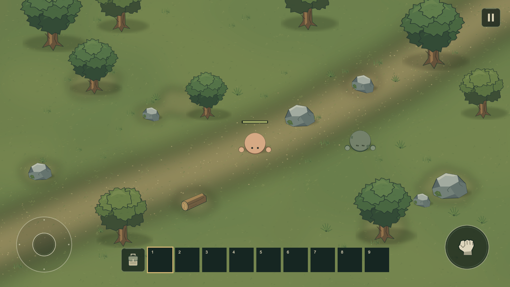

# Wildfolk

Unity **6000.3.19f1 LTS / Universal 2D**, 모바일 Landscape 탑다운 생존 게임의 극초반 플레이 버전이다. **맨손 채집 → 작업대 제작/설치 → 도구·검 제작 → Hotbar 장착/사용**을 제공한다. 최종 아트나 완성된 생존 게임은 아니다.

## 실행과 초반 진행

1. Unity Hub에서 `client/`를 Unity 6000.3.19f1 프로젝트로 열고 `Assets/Wildfolk/Scenes/Wildfolk.unity`에서 Play한다.
2. 빈 인벤토리/Hotbar와 맨손으로 시작한다. 좌하단 조이스틱으로 나무에 접근하고 우하단 공격 버튼을 누르거나 유지한다.
3. 나무 2개를 파괴하고 바닥 Wood를 주우면 6개다. Hotbar 왼쪽 가방을 열고 Hand crafting의 Workbench를 제작한다.
4. 제작된 Workbench 슬롯을 선택하고 가방을 닫는다. 플레이어 앞 Preview가 녹색이면 사용 버튼으로 설치한다. 적색이면 겹침/거리/필드 경계 조건을 해결한다.
5. 설치된 작업대의 2.6유닛 이내에서 그쪽을 바라보고 사용 버튼을 눌러 Workbench 제작 화면을 연다.
6. Wood 각 5개로 Wood Axe, Wood Pickaxe, Wood Sword를 제작한다. 필요하면 슬롯을 드래그해 Hotbar에 옮기고 선택한다.

도끼는 나무, 곡괭이는 돌, 검은 적에 효율적이다. 기존 Axe/Pickaxe 정의를 재사용한다. 빈 슬롯/재료는 맨손이다. 전체 36슬롯(위 Storage 27칸, 아래 Hotbar 9칸)을 공유하며 슬롯 이동/합치기/교환이 가능하다. 같은 아이템은 한도까지만 합치고 잔량을 원래 슬롯에 남긴다.

인벤토리를 열면 **플레이어 입력만 차단하고 월드는 계속 진행**한다. 적이 공격할 수 있다. 우상단 Pause는 별도 Continue 메뉴이며 현재 싱글플레이 정책에서 월드를 정지한다. 사망 후 Try again은 빈 상태의 새 필드다. WASD/Space는 에디터 보조 입력이고 숫자키 선택은 없다.

## 에디터 도구와 검증

`Wildfolk > View 1920x1080/2400x1080`은 이미 열린 Game View의 해상도만 바꾸며 창을 열거나 포커스를 주지 않는다. Game View 탭이 없다면 먼저 수동으로 연다. `Build Playable Scene`은 기본 씬/프리팹을 재생성하므로 수작업 배치를 보존할 때는 사용하지 않는다. 기존 데이터 에셋은 덮어쓰지 않고 자동 Game View 전환도 하지 않는다.

- Runtime: 입력/전투/인벤토리/제작/설치/세션을 책임별로 분리한다.
- Data: 실제 아이템 6종, Recipe 4종, None/Workbench 시설 요구와 수치의 단일 정본이다.
- Editor: 아트/데이터/프리팹/씬/UI 생성 도구다.
- Tests: EditMode 18개, PlayMode 14개 검증. 별도 복사본의 hidden headless Unity에서 실행했다.
- 문서: DESIGN_BIBLE, INVENTORY, CRAFTING, BALANCE, ARCHITECTURE, SURVIVAL_REVIEW.
- 이전 VISUAL_REVIEW/PLAY_REVIEW/HOTBAR_TOOLS_REVIEW는 당시 상태의 역사 기록이다.

아트 원본은 외부 게임 에셋을 사용하지 않는 `tools/generate_visual_assets.py`이며 Pillow 12.3.0이 필요하다. 소스 검사는 `python tests/validate_visual_project.py client`로 실행한다. Library/Temp/로그/로컬 검증 복사본은 정본에서 제외한다.

실제 모바일 사용감은 사용자가 테스트한다. 협동/저장/새 적/바이옴/절차 월드/고급 시설/생존 수치/회수·수리/계정·상점은 없다.
