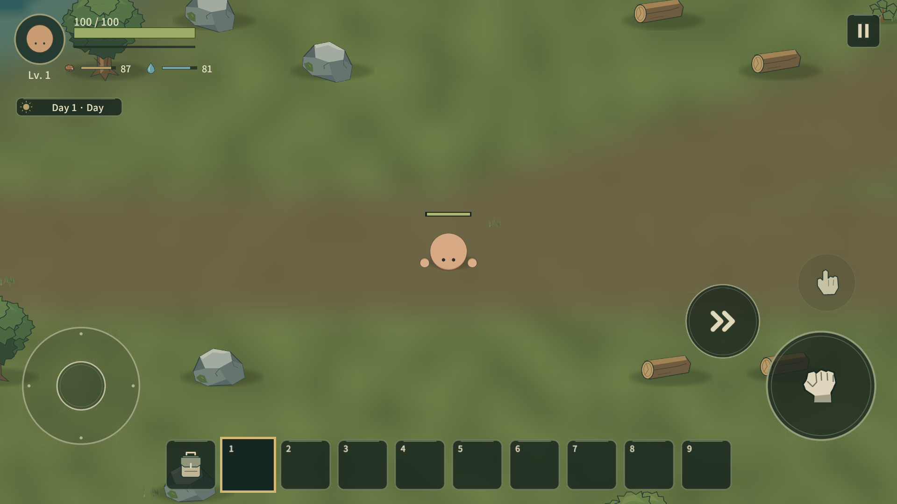

# Lowfire

표시 이름은 **Lowfire**다. 내부 Wildfolk namespace, projects/wildfolk 경로와 기존 저장/설정 식별자는 유지한다. 이번 변경은 전체 프로젝트 rename이 아니다.

Unity **6000.3.19f1 LTS / Universal 2D**, 모바일 Landscape(기준1920×1080) 탑다운 생존 게임의 초기 플레이 버전이다. 현재 Seed 월드, 낮 채집/시설/장비 업그레이드, Goblin 무리·작은 Camp,밤 Zombie/Skeleton, 물 용기와 생존, Save/Load v8(v1~v7 호환)을 제공한다. 최종 아트·월드 생성·출시 밸런스가 아니다.

## 실행과 기본 흐름

Unity Hub에서 client/를 열고 Assets/Wildfolk/Scenes/MainMenu.unity에서 Play한다. 빌드도 Home에서 시작한다. Continue는 검증된 기존 저장을 복원하고 Single Player는 무작위 Seed의 새 월드를 연다. Gameplay 씬만 직접 열면 기존 기본 Seed9472026을 사용한다. 신규 월드는13120×13120유닛의 큰 유한 대륙과64unit 청크를 사용한다. 구 저장은192×144 generation1을 유지한다. 같은 Seed는 지형·물·길·기본 자원을 재현한다. Try again은 기존처럼 무작위 새 월드를 시작한다. 사망 드랍/XP·Gold 패널티/Revive는 새로 결정하지 않았다.

큰 Primary는 공격·도구·설치·선택 소비품 사용·선택 Armor 장착, 작은 Interact는 선택 Armor 장착 또는 시설·상자·문·수원이다. 기본 공격은 Facing Sector의 유효 대상 하나만 타격하며 자신의 Team 시설을 공격하지 않는다. Joystick과 Hotbar9칸, 가방36칸(Hotbar9+Storage27)을 유지한다.

Fallen Log(HP50/Wood4) 또는 나무(HP150/Wood6)를 채집하고 Wood6으로 Workbench를 만든다. Wood Axe/Pickaxe/Sword는 각각Wood5. Stone 장비는 이전 Wood 장비+Stone, Iron은 이전 Stone 장비+Ingot을 사용한다. 내구도/자동 진화는 없다.

Hand crafting의 Wooden Cup은 Wood2다. 빈 컵이 있어야 수원에서 Raw Water Cup을 채운다. Campfire에서5초 끓이면 Clean Water Cup이 되며, 마시면 빈 컵이 돌아온다. Raw는 Thirst15와60초 불이익, Clean은38을 회복한다. 깊은 물은 막히고 여울은70% 이동속도로 건널 수 있다.

Campfire의 고기는1개/5초, Furnace는 Ore1개/2초→Ingot1개를 순차 처리한다. +1/대기 −1/Add all과 결과 Take를 제공한다. Chest는24칸이다. Stack을 길게 누르면 Item Actions→Split에서 수량을 고르고, Confirm 후 목적 슬롯 또는 Drop to ground를 고른다. 배치 전에는 원본 아이템이 유지되며 Cancel로 취소한다. 일반 드래그는 전체 수량이다.

가방/상자에서는 플레이어 입력만 막고 세계는 계속 진행한다. Pause/Settings는 Singleplayer를 정지한다. Pause에는 Save game과 Save & return home이 있고 플레이어용 Load game 버튼은 제거했다. 저장은 Seed+월드 Delta+플레이어/시설/상자/처리 상태를 기록한다. 기기 Pause/Background/Quit 자동 저장을 제공한다. Editor 저장은 프로젝트의 UserData, 빌드는 Application.persistentDataPath다. 기존 게임은 Home Continue로 이어한다. 실제 Load 함수와 Editor Developer Save/Load는 유지한다. Pause의 Save & return home은 저장 성공 후 Home으로 돌아온다.

새 월드 광물은 비재생이다. 식생만 게임 시간 뒤 새 위치/ID로 회복한다. 구 generation1은 이전 Population을 유지한다. 동물은 Chicken/Boar/Rabbit/Deer/Sheep의 종·지역·서식지 부족량을 새 Group/ID로 보충한다. 저장 중단 시간은 게임 시간에 더하지 않는다. 닭은 Raw1+Feather1, 멧돼지는 Raw2+Leather1을 드랍한다.

Zombie는 밤에 올라와 활동하고 새벽에는 보상 없이 잠복한다. Local Threat와 Global Cap18을 나누며 멀리 남은 비추적 적은 대기 후 Slot을 반환한다. 낮 Goblin은 영역/개인 공간 침범 또는 선공에 반응한다. XP/Gold는 별도 세션 지갑이며 Save/Load에 포함된다. Level/초기Skill은 제공하며 Shop/Meta Coin은 아직 없다.

## 정본과 검증

- 실제 Item50종, Recipe38종, Equipment Tier4종, Surface Biome4종이다.
- [기획](docs/DESIGN_BIBLE.md), [월드](docs/WORLD_GENERATION.md), [저장](docs/SAVE_PERSISTENCE.md), [전투/이동](docs/COMBAT_NAVIGATION.md), [수치](docs/BALANCE.md), [제작](docs/CRAFTING.md), [가방](docs/INVENTORY.md), [구조](docs/ARCHITECTURE.md).
- [Developer Tools](docs/DEVELOPER_TOOLS.md)는 Editor 전용이며 게임 HUD/Release에 노출되지 않는다.
- [Home/이번 검수](docs/HOME_FRONTEND.md). 이전 *_REVIEW는 당시 단계의 기록이다.
- 소스 검사: python tests/validate_visual_project.py client. Unity Tests는 Assets/Wildfolk/Tests의 EditMode/PlayMode다.
- 기본 캐릭터/환경과 이번 신규 생물·구조물은 tools/generate_visual_assets.py(Pillow) 원본이다. 기존 큐레이션 Armor/Dash/Font 출처는 docs/SOURCE_ART.md를 따른다. 외부 게임 에셋을 추출하지 않는다.

Wildfolk > View 메뉴는 기존 Game View의 해상도만 갱신하고 Play Unfocused를 적용한다. 자동 Focus/GetWindow 호출은 없다. Build Playable Scene은 씬/프리팹을 재생성한다. 수작업 씬 편집이 필요하면 먼저 보존한다.

실제 터치·손맛·장시간 생존·Android 성능은 사용자 검증 대상이다. 대형 POI 실내/무한 세계, 미검수 멀티 통합 플레이/Cloud Save, Animal Breeding, Boat, 추가 Armor Tier/Skill Tree 분기, 전문 제작대는 아직 없다. Settings Control Size80~140%와 음량 채널을 유지하며 현재 실제 BGM/SFX 콘텐츠는 비어 있다.

이번 캐릭터 패스는 Leather/Iron Head·Body Armor,Level/4종Skill,Profile→Character,Joystick Sprint/Stamina/오른쪽Dash,Workbench I→II 업그레이드,Reinforced Chest36/Stone Wall,제작Category/Filter/고정Sort/NEW를 제공한다. 자세한 정본은 docs/CHARACTER_PROGRESSION.md와 docs/SAVE_PERSISTENCE.md다. 기능 검증과 외형·이동·진행의 사용자 체감 검증을 구분한다.

품질 교정: Profile은 Character Information→독립4 Node Skill Tree, 장착/비교/해제는 Inventory Head/Body 슬롯으로 분리했다. Armor/손은 공통 Motion Root를 따르고 Stamina는 Player 주변 Arc다. 제작은 별도 두 열 Recipe/즉시 Category/All Section/재료별 수량·색상이다. English 기본과 한국어는 Settings의 Local Language로 전환한다. Resource는 Region Population/Soft Target/Harvest 제외로 다른 ID와 위치에서 회복한다. 조사·실제 검수·제약은 docs/UI_RESEARCH.md와 docs/QUALITY_REVIEW.md를 따른다. 이 단락은 직전 품질 교정 내용이다. 이번 생태 패스는 아래와 같다.

생태·품질 패스: 큰 Modal의 중심/계층·뒤 입력 차단,Armor Drag/빠른 Use,밀착 Collider Arc 완화,동물 Soft Separation/그룹 경보,Rabbit/Deer/Sheep,Goblin Warband·Ally Assist·새총·작은 Camp,Skeleton/녹슨 검 Variant와 유용한 Loot를 제공한다. Wood/Stone Wall과 경첩 Door0.32초를 교정했다. 신규 스프라이트는 기존 Python/Pillow 도형 제작 방식이다. 당시 실제 Armor4개/Inventory36/Hotbar9/Recipe25와 기존 시스템을 유지한다. 상세 정본은 [Creature/Loot](docs/CREATURES_AND_LOOT.md),[수치](docs/BALANCE.md),[검수](docs/ECOLOGY_REVIEW.md)에 있다.

개발 전 [AGENTS.md](AGENTS.md)를 먼저 읽는다. Home은 Penpot 세 시안 중 야전 수첩형을 선택해 Krita 로고/종이 패널을 적용했다. 기존 Sprite를 배치한 정적 야영 배경이며 World/AI/Population을 생성하지 않는다. Home Settings와 Pause Settings는 같은 UserPreferences/LocalSettings 및 화면 제작 코드를 공유한다. Multiplayer는 실제 Relay Room Code 또는 명시적인 Local Network Host/Join으로 협동 야영지에 입장한다. 현재 Player/Creature/전투와 Host 권위 채집·자원 복구·Ground Item·개인 Inventory·Loot/근처 파티 XP·Gold를 연결했다. 관련 자동검사 단계이며 실제2인 통합 QA는 미수행이다. 공유 Chest24/36·Hand Crafting·Workbench I→II·Furnace/Campfire를 Host 권위로 연결했다. 기존 제작/가방 UI를 공유하며 시작 지점 근처 초기 시설5개를 제공한다. 현재10종 Building 설치와 Wall/Door, Host 권위 v6 월드 저장·재Host·로컬 식별자별 Player 복원 기반을 연결했다. 실제2인 Relay/재Join 통합 검수는 다음 Multiplayer Integration QA에서 수행한다. 플레이어 철거 UX·계정·Cloud·Host Migration은 없다. [현재 범위와 검수](docs/MULTIPLAYER_FOUNDATION.md)를 따른다.

Home 수첩의 Single Player/Multiplayer/Settings는 기본 배경 박스를 없애고 종이 위 텍스트 메뉴로 표시한다. Continue의 Primary 박스와 기존 배경/타이틀은 유지한다.

현재 금속 진행은 Wood→Stone→Iron→Steel 장비와 Workbench I(Iron까지) / II(post-Iron 기술)다. Copper는 Iron Pickaxe, Coal은 Stone Pickaxe, 수변 Tin은 II에서 Copper로 만든 Prospecting Pan을 요구한다. Bronze 부품으로 별도 Blast Furnace를 제작해 Steel을 처리하며 기존 Furnace는 저단계 제련·Bronze를 담당한다. Reinforced Chest36과 가변 스크롤 UI, Save v6의 구 Chest/Steel cargo 이관을 제공한다. III~VI는 미구현이다. 지상4종/Caverns 기반은 WORLD_GENERATION 정본을 따른다. [진행과 이번 실제 MCP 검수](docs/METAL_PROGRESSION.md)를 따른다. 실제 연결된 Unity Game View에서 채집·제작·가공·장착·상자·SP Load·Local Host 재Host를 확인했으며 물리 기기/새 Protocol7 remote Relay 검수는 별도다.

직전 World Foundation v2: 신규 대륙/4 Surface Biome/수계/동굴 graph/청크 sleep state/광물 고갈/Save7·Protocol8. [정본](docs/WORLD_GENERATION.md)과 [이번 검수](docs/WORLD_FOUNDATION_REVIEW.md)를 따른다. 위 이전 패스 검수의 v6/Protocol7은 당시 기록이다.

현재 Exploration Foundation 1: 하나의 Torch로 손/설치 광원, 초반 Compass, 제작대 지정 Home/동굴 Exit 안내, 청크 경계4unit retention·비활성 지형 LRU24·2.5ms 목표 row sampler를 제공한다. Save8/Protocol9이며 generation2 지형과 legacy generation1을 유지한다. [탐험 정본](docs/EXPLORATION_FOUNDATION.md)과 [검수/성능 수치](docs/EXPLORATION_REVIEW.md)를 따른다. WB III/실제 hands-free Lantern/지도/출시 progression은 아직 없다.
