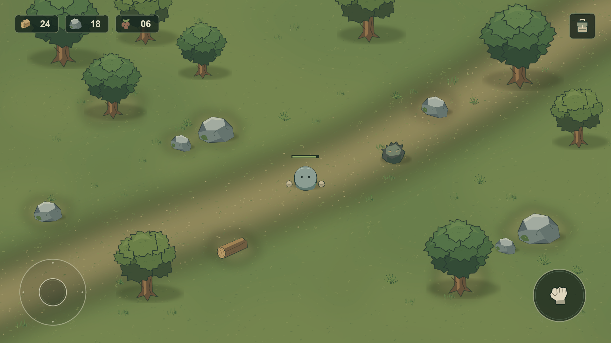

# Wildfolk

Unity **6000.3.19f1 LTS**, **Universal 2D** 기반의 모바일 가로형 탑다운 생존 게임 프로젝트다. 현재 단계는 실제 Game View에서 화면 방향을 판단하기 위한 **첫 비주얼 프로토타입**이다. 최종 아트 또는 게임 시스템 완성본이 아니다.



## 실행

1. Unity Hub에서 이 폴더의 `client/`를 Unity 프로젝트로 추가한다.
2. Unity 6000.3.19f1로 연다. `Packages/manifest.json`과 `packages-lock.json`에 기록된 패키지가 필요하다.
3. `Assets/Wildfolk/Scenes/WildfolkVisual.unity`를 연다.
4. 에디터 메뉴 `Wildfolk > View 1920x1080`을 선택하고 Play를 누른다.

기준 해상도는 1920×1080이다. `Wildfolk > View 2400x1080`으로 더 긴 화면비도 볼 수 있다. 이 메뉴는 에디터 보조 도구이며 게임 화면에 노출되지 않는다. 메뉴는 Unity 6000.3.19f1의 내부 Game View API를 사용하므로 다른 Unity 버전에서는 확인이 필요하다.

현재 화면은 정적 시안이다. 조이스틱·주먹·인벤토리 아이콘은 배치 확인용이며 입력, 이동, 공격, 인벤토리 동작을 제공하지 않는다. 자원 수와 HP는 고정 표시값이다.

## 구성

- `client/`: 실제 Unity 소스, 씬, 프리팹, 아트, 패키지와 프로젝트 설정.
- `docs/DESIGN_BIBLE.md`: 확정된 환경과 현재 방향.
- `docs/BENCHMARKS.md`: 참고 범위와 출처.
- `docs/VISUAL_REVIEW.md`: 실제 검수, 수정 내용과 남은 한계.
- `tools/generate_visual_assets.py`: 외부 게임 자산을 사용하지 않는 결정적 아트 생성 원본. Pillow 필요.
- `tests/validate_visual_project.py`: 소스 누락, 잘못된 씬 참조, 모바일 설정, 금지 UI 문구를 검사하는 소스 검증 도구.

사용하는 아트는 이번 시안을 위해 만든 PNG 스프라이트다. 몸통과 양손을 분리하고 장비·머리 장식용 빈 Transform을 둔 `PlayerVisual` 프리팹을 사용한다. 에디터 구성 코드는 아트 임포트, HUD, 씬, Game View 설정으로 분리했으며 실행 시 씬 전체를 다시 생성하지 않는다. 런타임 스크립트는 Safe Area 배치만 담당한다.

`Wildfolk > Build Visual Scene`은 저장된 씬을 재생성한다. 씬을 수작업으로 수정했다면 먼저 보존 여부를 판단해야 한다. 수정되지 않은 초기 배치를 재현할 때만 사용한다.

## 아트 재생성

```powershell
python tools/generate_visual_assets.py client/Assets/Wildfolk/Art
python tests/validate_visual_project.py client
```

아트 재생성 후 Unity에서 임포트를 마치고, 저장된 씬을 유지하거나 위 에디터 메뉴로 기본 배치를 재생성한다. 이 작업에서 실행한 Pillow 버전은 12.3.0이며 `tools/requirements.txt`에 기록했다.

`Library`, `Temp`, 로그, 개인 에디터 설정과 로컬 캡처는 정본에 포함하지 않는다. 서버·데이터 시스템은 아직 없으며 빈 폴더로 예고하지 않는다.
