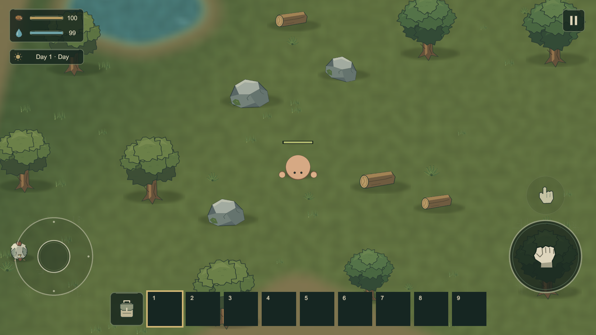

# Lowfire

표시 이름은 **Lowfire**다. 내부 Wildfolk namespace, projects/wildfolk 경로와 기존 저장/설정 식별자는 유지한다. 이번 변경은 전체 프로젝트 rename이 아니다.

Unity **6000.3.19f1 LTS / Universal 2D**, 모바일 Landscape(기준1920×1080) 탑다운 생존 게임의 초기 플레이 버전이다. 현재 Seed 월드, 낮 채집/시설/장비 업그레이드, Goblin 무리·작은 Camp,밤 Zombie/Skeleton, 물 용기와 생존, Save/Load v4(v1~v3 호환)을 제공한다. 최종 아트·월드 생성·출시 밸런스가 아니다.

## 실행과 기본 흐름

Unity Hub에서 client/를 열고 Assets/Wildfolk/Scenes/MainMenu.unity에서 Play한다. 빌드도 Home에서 시작한다. Continue는 검증된 기존 저장을 복원하고 Single Player는 무작위 Seed의 새 월드를 연다. Gameplay 씬만 직접 열면 기존 기본 Seed9472026을 사용한다. 월드192×144유닛이다. 같은 Seed는 지형·물·길·기본 자원을 재현한다. Try again은 기존처럼 무작위 새 월드를 시작한다. 사망 드랍/XP·Gold 패널티/Revive는 새로 결정하지 않았다.

큰 Primary는 공격·도구·설치·선택 소비품 사용·선택 Armor 장착, 작은 Interact는 선택 Armor 장착 또는 시설·상자·문·수원이다. 기본 공격은 Facing Sector의 유효 대상 하나만 타격하며 자신의 Team 시설을 공격하지 않는다. Joystick과 Hotbar9칸, 가방36칸(Hotbar9+Storage27)을 유지한다.

Fallen Log(HP50/Wood4) 또는 나무(HP150/Wood6)를 채집하고 Wood6으로 Workbench를 만든다. Wood Axe/Pickaxe/Sword는 각각Wood5. Stone 장비는 이전 Wood 장비+Stone, Iron은 이전 Stone 장비+Ingot을 사용한다. 내구도/자동 진화는 없다.

Hand crafting의 Wooden Cup은 Wood2다. 빈 컵이 있어야 수원에서 Raw Water Cup을 채운다. Campfire에서5초 끓이면 Clean Water Cup이 되며, 마시면 빈 컵이 돌아온다. Raw는 Thirst15와60초 불이익, Clean은38을 회복한다. 깊은 물은 막히고 여울은70% 이동속도로 건널 수 있다.

Campfire의 고기는1개/5초, Furnace는 Ore1개/2초→Ingot1개를 순차 처리한다. +1/대기 −1/Add all과 결과 Take를 제공한다. Chest는24칸이다. Stack을 길게 누르면 Item Actions→Split에서 수량을 고르고, Confirm 후 목적 슬롯 또는 Drop to ground를 고른다. 배치 전에는 원본 아이템이 유지되며 Cancel로 취소한다. 일반 드래그는 전체 수량이다.

가방/상자에서는 플레이어 입력만 막고 세계는 계속 진행한다. Pause/Settings는 Singleplayer를 정지한다. Pause에는 Save game과 Save & return home이 있고 플레이어용 Load game 버튼은 제거했다. 저장은 Seed+월드 Delta+플레이어/시설/상자/처리 상태를 기록한다. 기기 Pause/Background/Quit 자동 저장을 제공한다. Editor 저장은 프로젝트의 UserData, 빌드는 Application.persistentDataPath다. 기존 게임은 Home Continue로 이어한다. 실제 Load 함수와 Editor Developer Save/Load는 유지한다. Pause의 Save & return home은 저장 성공 후 Home으로 돌아온다.

자원은 지역 Population 기준으로 Plant90/Tree300/Log480/Stone600/Ore720초 뒤 새 후보를 검사한다. 동물은 Chicken/Boar/Rabbit/Deer/Sheep의 종·지역·서식지 부족량을 새 Group/ID로 보충한다. 저장 중단 시간은 게임 시간에 더하지 않는다. 닭은 Raw1+Feather1, 멧돼지는 Raw2+Leather1을 드랍한다.

Zombie는 밤에 올라와 활동하고 새벽에는 보상 없이 잠복한다. Local Threat와 Global Cap18을 나누며 멀리 남은 비추적 적은 대기 후 Slot을 반환한다. 낮 Goblin은 영역/개인 공간 침범 또는 선공에 반응한다. XP/Gold는 별도 세션 지갑이며 Save/Load에 포함된다. Level/초기Skill은 제공하며 Shop/Meta Coin은 아직 없다.

## 정본과 검증

- 실제 Item34종, Recipe25종, Equipment Tier3종, Biome1종이다.
- [기획](docs/DESIGN_BIBLE.md), [월드](docs/WORLD_GENERATION.md), [저장](docs/SAVE_PERSISTENCE.md), [전투/이동](docs/COMBAT_NAVIGATION.md), [수치](docs/BALANCE.md), [제작](docs/CRAFTING.md), [가방](docs/INVENTORY.md), [구조](docs/ARCHITECTURE.md).
- [Developer Tools](docs/DEVELOPER_TOOLS.md)는 Editor 전용이며 게임 HUD/Release에 노출되지 않는다.
- [Home/이번 검수](docs/HOME_FRONTEND.md). 이전 *_REVIEW는 당시 단계의 기록이다.
- 소스 검사: python tests/validate_visual_project.py client. Unity Tests는 Assets/Wildfolk/Tests의 EditMode/PlayMode다.
- 기본 캐릭터/환경과 이번 신규 생물·구조물은 tools/generate_visual_assets.py(Pillow) 원본이다. 기존 큐레이션 Armor/Dash/Font 출처는 docs/SOURCE_ART.md를 따른다. 외부 게임 에셋을 추출하지 않는다.

Wildfolk > View 메뉴는 기존 Game View의 해상도만 갱신하고 Play Unfocused를 적용한다. 자동 Focus/GetWindow 호출은 없다. Build Playable Scene은 씬/프리팹을 재생성한다. 수작업 씬 편집이 필요하면 먼저 보존한다.

실제 터치·손맛·장시간 생존·Android 성능은 사용자 검증 대상이다. 여러 Biome/대형 POI/Dungeon/무한 Chunk, 실제 Multiplayer/Cloud Save, Animal Breeding, Boat, 추가 Armor Tier/Skill Tree 분기, 전문 제작대는 아직 없다. Settings Control Size80~140%와 음량 채널을 유지하며 현재 실제 BGM/SFX 콘텐츠는 비어 있다.

이번 캐릭터 패스는 Leather/Iron Head·Body Armor,Level/4종Skill,Profile→Character,Joystick Sprint/Stamina/오른쪽Dash,Workbench I→II 업그레이드,Reinforced Chest32/Stone Wall,제작Category/Filter/고정Sort/NEW를 제공한다. 자세한 정본은 docs/CHARACTER_PROGRESSION.md와 docs/SAVE_PERSISTENCE.md다. 기능 검증과 외형·이동·진행의 사용자 체감 검증을 구분한다.

품질 교정: Profile은 Character Information→독립4 Node Skill Tree, 장착/비교/해제는 Inventory Head/Body 슬롯으로 분리했다. Armor/손은 공통 Motion Root를 따르고 Stamina는 Player 주변 Arc다. 제작은 별도 두 열 Recipe/즉시 Category/All Section/재료별 수량·색상이다. English 기본과 한국어는 Settings의 Local Language로 전환한다. Resource는 Region Population/Soft Target/Harvest 제외로 다른 ID와 위치에서 회복한다. 조사·실제 검수·제약은 docs/UI_RESEARCH.md와 docs/QUALITY_REVIEW.md를 따른다. 이 단락은 직전 품질 교정 내용이다. 이번 생태 패스는 아래와 같다.

생태·품질 패스: 큰 Modal의 중심/계층·뒤 입력 차단,Armor Drag/빠른 Use,밀착 Collider Arc 완화,동물 Soft Separation/그룹 경보,Rabbit/Deer/Sheep,Goblin Warband·Ally Assist·새총·작은 Camp,Skeleton/녹슨 검 Variant와 유용한 Loot를 제공한다. Wood/Stone Wall과 경첩 Door0.32초를 교정했다. 신규 스프라이트는 기존 Python/Pillow 도형 제작 방식이다. 실제 Armor4개/Inventory36/Hotbar9/Recipe25와 기존 시스템을 유지한다. 상세 정본은 [Creature/Loot](docs/CREATURES_AND_LOOT.md),[수치](docs/BALANCE.md),[검수](docs/ECOLOGY_REVIEW.md)에 있다.

개발 전 [AGENTS.md](AGENTS.md)를 먼저 읽는다. Home은 Penpot 세 시안 중 야전 수첩형을 선택해 Krita 로고/종이 패널을 적용했다. 기존 Sprite를 배치한 정적 야영 배경이며 World/AI/Population을 생성하지 않는다. Home Settings와 Pause Settings는 같은 UserPreferences/LocalSettings 및 화면 제작 코드를 공유한다. Multiplayer는 이용 불가 안내와 돌아가기/싱글 진입만 제공한다.
