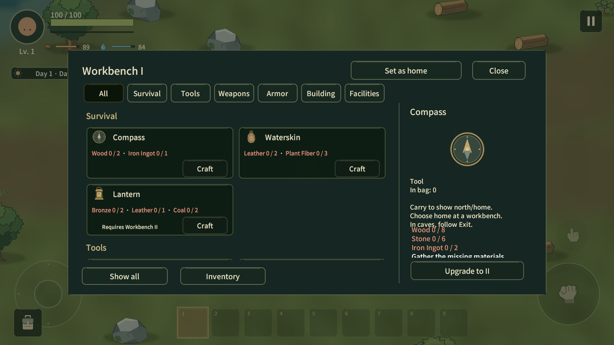
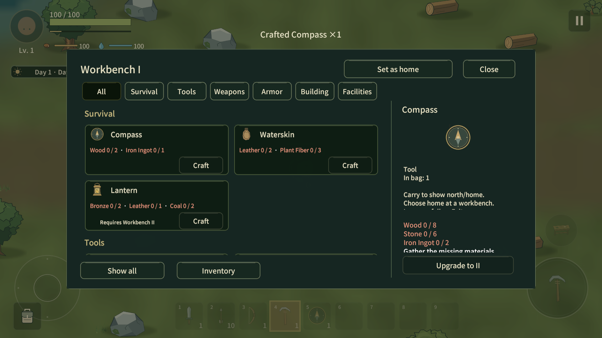
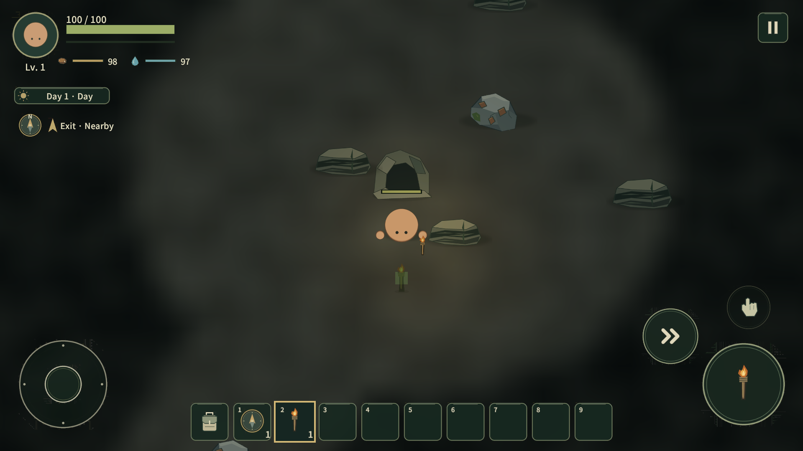

# Workbench III 전 통합 감사 · 2026-10-19

시작 remote main: `ab6a464bfd0965d3b1526142eb2b9567adc554d5`. Lowfire 표시명, Wildfolk 내부 식별자 유지. 신규 콘텐츠 패스가 아니다. 수치/미래 기획은 [BALANCE](BALANCE.md), [CONTENT_EXPANSION](CONTENT_EXPANSION.md), [RESOURCE_TEMPO](RESOURCE_TEMPO.md)에 맡긴다. 이번 문서만 감사표와 실행 근거를 모은다.

용어: **검사**는 compile/자동 검사/static validator, **테스트**는 연결된 Unity의 실제 Play/Game View 실행이다. MCP는 gameplay command, UI callback/drag handler를 호출했다. OS 마우스·키보드/Computer Use/창 Focus를 사용하지 않았다. 사람의 터치 조작·재미 검증으로 해석하지 않는다.

## 실제 조사 범위

`Runtime/Input`, `Player`, `Combat`, `Crafting`, `Items`, `UI`, `Presentation`, `Generation`, `World`, `Networking`, `Persistence`와 해당 Editor builder/scene/prefab/tests를 조사했다. 특히 PlayerCombat/Health/HitFeedback/LootOnDeath, PlayerFishing/NetworkActivities, PlayerCrafting/StationProcessing/ProcessingQueue, CraftingPanel/RecipeCardView, CameraFollow, NavigationBearing/CavernNetwork, WorldChunkRuntime/WorldTerrainRenderer/ResourceRegeneration, SaveGameRules/WorldSaveService/NetworkWorldPersistence를 읽었다.

Animator/Animation clip, particle/trail, hitstop/shake/zoom, Audio/Haptic을 실제 구성과 소스 검색으로 확인했다. 현재 핵심 애니메이션은 수동 pose/Lerp/SmoothDamp다. GameAudio의 채널·volume·PlaySfx hook은 있으나 제작된 BGM/SFX 콘텐츠는 없다. 진동, placeholder beep, 오디오 제작 파이프라인을 새로 추가하지 않았다.

## 화면 근거

## A. 핵심 사건 목록

품질은 첫 감사 기준이다. A=반복 일반 행동, B=상대적으로 중요한 행동. 현재 구현에 없는 클라이맥스는 만들지 않았다.

| 사건 | 중요도 | 발생 빈도 | 현재 체감 품질 | 분석 우선순위 |
|---|---|---|---|---|
| 이동/방향 | 핵심 | A/상시 | 충분함; 발/보행 애니메이션은 현재 원형 실루엣에 불필요 | 유지 |
| sprint/stamina/dash | 핵심 | A/높음 | 속도와 stamina 연동 존재 | 유지 |
| 근접 hit/miss | 핵심 | A/매우 높음 | 손/도구 pose, 중간 타점, 0.16초 반응 존재 | 유지 |
| ranged/impact | 핵심 | A/높음 | draw/release/projectile/ammo 감소 존재 | 유지 |
| 플레이어 피격 | 핵심 | A/상황별 | flash/squash와 HP 감소 존재 | 유지 |
| 적 사망 | 핵심 | A/반복 | SP 즉시 제거, Host 순간 축소로 서로 다름 | P1 |
| Wood/광물/Tin 채집 | 핵심 | A/매우 높음 | 재질별 반응/획득물 drop; Pan은 고유 행동 | 유지 |
| pickup | 핵심 | A/매우 높음 | 비행/바운스/+수량 합산 존재; modal에 가림 | P2 |
| 일반 crafting | 핵심 | A/높음 | 재료·결과 숫자만 변함 | P1 |
| Workbench upgrade | 핵심 | B/낮음 | 티어/NEW는 변하나 결과 acknowledgement 약함 | P1 |
| 시설 처리 | 핵심 | A/높음 | queue/current/progress/output 존재, 시작 확인 약함 | P2 |
| 설치 valid/invalid | 핵심 | A/보통 | 녹색/적색 preview와 아이템 차감 존재 | 유지 |
| chest/drag/drop | 핵심 | A/높음 | 두 inventory, 선택, ghost, 취소 존재 | 유지 |
| door/gate | 보통 | A/반복 | 0.32초 hinge easing, collider 전환 존재 | 유지 |
| fishing | 보통 | A/반복 | cast/wait/bite/caught; replica의 rod 판단/취소 결함 | P1 |
| cooking/food/water | 핵심 | A/반복 | 처리/수량/상태 변화와 충전 상태 존재 | 유지 |
| equipment/Utility | 핵심 | B/낮음 | 장착 슬롯과 캐릭터 외형, Lantern hands-free 존재 | 유지 |
| Torch/Lantern | 핵심 | A/탐험 | 손/설치/Utility 광원 연계 존재 | P2/불필요 setter |
| Compass/Home/Exit | 핵심 | A/탐험 | 북쪽·방향·거리·Exit 상태 구분 존재 | P2/경로 중복 계산 |
| cave enter/exit | 핵심 | B/낮음 | 이동은 되나 카메라가 지역 사이 빈 공간을 팬함 | P1 |
| day/night | 핵심 | 저빈도 연속 상태 | 시간/밝기·적 활동 연동 존재 | 유지 |
| save/load/rehost | 핵심 | 저빈도 | 상태 복원; schema/authority 경계 유지 필요 | P0 검사 대상 |

## B. 중요 사건 Experience Flow

### 공격/채집

| 단계 | 상태 | 현재 구현 | 실제 근거 | 문제 |
|---|---|---|---|---|
| 입력 | 충분함 | Primary와 facing-sector request | PlayerCombat.TryAttack / 실제 melee/채집 명령 | 없음 |
| Anticipation | 충분함 | 손/도구 pose 전반부 | PlayerCombat.Present, PlayerRanged | 현 스타일에 별도 긴 준비 동작 불필요 |
| 행동 | 충분함 | weapon별 duration/arc/range | ToolDefinition/AttackProfile | 통계와 실제 동작 보존 |
| 충돌/변화 | 충분함 | 중간 타점에서 authoritative damage/도구 자격 | ApplyHit/ResourceNode.Harvest | miss에도 성공 flash를 추가하지 않음 |
| 결과 | 존재하지만 약함 | flash/squash/shake, HP, loot | HitFeedback / combat-hit.png / gather-* | 소리 자산 없음; 과도한 숫자 효과는 제외 |
| Recovery | 충분함 | cooldown와 rest pose 복귀 | PlayerCombat.CancelAttack/HitFeedback | idle callback을 coroutine으로 변경 |

### 적 사망

| 단계 | 상태 | 현재 구현 | 실제 근거 | 문제 |
|---|---|---|---|---|
| 입력 | 해당 없음 | lethal attack에 종속 | Health.ApplyDamage | 별도 입력 없음 |
| Anticipation | 해당 없음 | 일반 공격 준비를 공유 | PlayerCombat | 새 클라이맥스 아님 |
| 행동 | 존재하지만 약함 | SP 즉시 release / Host 즉시 y25% | LootOnDeath.Drop / NetworkCreature.ResolveDeath | 양쪽 표현 불일치 |
| 충돌/변화 | 충분함 | lethal latch/authority/exact-once reward | Health/NetworkDeathResult.TryCommit | 판정·보상 시점 지연 금지 |
| 결과 | 존재하지만 약함 | loot는 즉시, 죽는 과정은 약함 | combat-death.png, 소스 | 0.22초 settle + 총0.35초 release로 통일 |
| Recovery | 충분함 | pooling/despawn, spawn reset | GamefeelPlayTests | AI/새벽 burrow와 death pose 경쟁도 중지 |

### 제작/업그레이드

| 단계 | 상태 | 현재 구현 | 실제 근거 | 문제 |
|---|---|---|---|---|
| 입력 | 충분함 | Button pressed tint/disabled | RecipeCardView / GameplayUiFactory.Button | 모바일 hover 추가 불필요 |
| Anticipation | 충분함 | have/need와 요구 tier 표시 | 02-before-crafting.png | 설명·업그레이드 재료 겹침 발견 |
| 행동 | 충분함 | 즉시 원자 교환 또는 upgrade | InventoryModel/PlayerCrafting | 긴 진행 animation 추가하지 않음 |
| 충돌/변화 | 충분함 | costs 소비/result 추가/NEW 변경 | crafting/upgrade MCP 로그 | 기존 경제 유지 |
| 결과 | 존재하지만 약함 | 수량/제목 변화뿐 | 첫 소스/07-craft-result.png/08-upgrade-result.png | modal 위 2.5초 한 줄 결과 보강 |
| Recovery | 충분함 | 닫기 없이 연속 제작 가능 | CraftingPanel | 알림이 입력을 가로채지 않음 |

### 시설 처리

| 단계 | 상태 | 현재 구현 | 실제 근거 | 문제 |
|---|---|---|---|---|
| 입력 | 충분함 | +1/−1/Add all/Take | CraftingPanel | 기존 위계 유지 |
| Anticipation | 충분함 | input/output, 초, 재료량 | station-furnace.png | 유지 |
| 행동 | 충분함 | queue reservation + timestamp | ProcessingQueue/StationProcessing | 시설별 idle Update 제거 |
| 충돌/변화 | 충분함 | queue/output 변경 때 Changed | NetworkFacility.Publish | 매 프레임 전체 상태 송신 금지 유지 |
| 결과 | 존재하지만 약함 | Output/Take 상태, 개시 ack 없음 | station-*.png | 시작/수령 결과 한 줄 보강; 완료는 existing output/Take 유지 |
| Recovery | 충분함 | output 수령 뒤 후속 작업 | scheduler 검사 | 0.1초 공용 tick, explicit Advance는 그대로 |

### 낚시

Caught 회수는 SP/replica 모두 같은 line/bobber 경로로 수면→플레이어를 따른다. 이전에는 SP의 bobber만 돌아오고 line 끝은 남았으며 replica는 다시 밖으로 펼쳐졌다. 기존0.5초 회수/0.6초 종료 시간과 보상 시점은 그대로다.

| 단계 | 상태 | 현재 구현 | 실제 근거 | 문제 |
|---|---|---|---|---|
| 입력 | 충분함 | rod Primary | PlayerFishing.Use | 어획 타이밍을 UI modal로 막지 않음 |
| Anticipation | 충분함 | cast 0.45초, line arc | fishing-cast.png | 유지 |
| 행동 | 충분함 | wait/bite 제한 시간 | PlayerFishing.Update | 유지 |
| 충돌/변화 | 충분함 | bite icon 확대/짧은 움직임/안내 | fishing-bite.png | 상태 구분 존재 |
| 결과 | 존재하지만 약함 | caught/인벤토리 Fish +1 | MCP 어획 로그 | 원격 owner-only inventory 참조를 equipment replica로 교체 |
| Recovery | 존재하지만 약함 | 로컬 Idle, remote timeout 의존 | Cancel/NetworkActivities | None 상태 즉시 publish; 재투척 bite 안내도 초기화 |

### 동굴 전환/안내

| 단계 | 상태 | 현재 구현 | 실제 근거 | 문제 |
|---|---|---|---|---|
| 입력 | 충분함 | 입구 range + interact | CavernPortal.Travel | fixture는 입구로 teleport 후 실제 Travel 호출 |
| Anticipation | 충분함 | 동굴 입구 실루엣 | CavernPortal Sprite | 과한 cutscene 불필요 |
| 행동 | 충분함 | 별도 지역으로 이동/청크 reconcile | actual cave enter/exit | 유지 |
| 충돌/변화 | 존재하지만 약함 | target는 이동, camera는 먼 좌표 사이 SmoothDamp | 09-cave-torch-navigation.png | 전환 직후 빈 바닥 프레임 |
| 결과 | 충분함 | Torch/Exit bearing/동굴 floor | 11-cave-camera-after.png | 지역 bounds 변경/화면 폭 초과 이동 시 snap |
| Recovery | 충분함 | 같은 지역의 일반 이동은 smooth | CameraFollow / camera 검사 | 지속 zoom/shake 없이 복귀 |

## C. 개선 후보와 처리

| 사건/시스템 | 현재 구현 | 실제 근거 | 문제 | 개선/처리 | 효과 | 난이도 | 중요도 | 빈도 | 우선순위 |
|---|---|---|---|---|---|---|---|---|---|
| save/authority | 있음 | SaveGameRules/SimulationAuthority/Network* | 손상·client simulation 여부 검사 | 경계 유지/회귀 검사 | 정합성 | 높음 | 핵심 | 항상 | P0 점검; 발견된 손상 없음 |
| WB 선택 설명 | 있음 | 02-before-crafting | upgrade costs와 겹침 | 작은 icon+독립 bounded scroll | 핵심 요구량 읽힘 | 낮음 | 높음 | 높음 | P1 수정 |
| cave camera | 있음 | 09-before/11-after | 지역 사이 빈 화면 | 불연속 이동만 snap | 진입 결과 즉시 보임 | 낮음 | 높음 | 낮음 | P1 수정 |
| SP/Host death | 서로 다름 | LootOnDeath/NetworkCreature | SP 즉시 제거, lifecycle 경쟁 | common settle, 즉시 보상/무충돌, AI 중단 | 사망 인과관계 | 중간 | 높음 | 높음 | P1 통합 |
| fishing replicas | 있음 | PresentReplica/Cancel | 비공개 bag 참조·취소 미전달 | held equipment/None 상태 | 협동 행동 명료성 | 낮음 | 높음 | 보통 | P1 수정 |
| reHost 시설 복원 | 있음 | 실제 재Host에서 queue2가 정지 | snapshot은 spawn 전 restore라 scheduler 등록 거절 | server OnNetworkSpawn에서 등록 | 복원 cargo 자동 진행 | 낮음 | 핵심 | 재Host | P1 수정 |
| 협동 modal 계층 | 있음 | 17-host-processing.png | world HP bar가 modal 위에 표시 | Canvas를 SP와 같은 screen overlay로 정렬 | 시설 정보 가림 방지 | 낮음 | 높음 | UI 열림 | P2 수정 |
| craft/upgrade result | 약함 | RecipeCardView/UpgradeFromUI | 숫자 변화뿐 | localized 한 줄 결과/ack 후 표시 | 행동 성공 확인 | 낮음 | 높음 | 높음/낮음 | P1 수정 |
| facility loop | 있음 | StationProcessing.Update | idle도 native callback | busy authority scheduler | idle callback 제거 | 중간 | 보통 | 매 프레임 | P2 통합 |
| queue costs/count | 있음 | ScaledCosts/CountWaiting | 중복 비용 변환·FindAll allocation | 공통 Costs/for-count | GC/유지보수 개선 | 낮음 | 보통 | UI 갱신 | P2 통합 |
| cave bearing | 있음 | NavigationBearing.CaveExit | 0.15초마다 Dijkstra 배열3개 | 생성 시 depth 계산과 next-route 공유 | 반복 할당 제거 | 낮음 | 보통 | 탐험 | P2 통합 |
| UI rebuild | 있음 | CraftingPanel.Refresh | 전부 off/on, ForceRebuild 반복 | visibility 실제 변화 때 rebuild | 불필요 layout 줄임 | 중간 | 보통 | 재료 변화 | P2 수정 |
| processing label | 있음 | ProcessingName | 0.2초마다 문자열 조합 | recipe/language cache | 반복 조합 제거 | 낮음 | 보통 | 5Hz | P2 수정 |
| idle hit feedback | 있음 | HitFeedback.Update | 모든 자원에 idle Update | 피격 중 coroutine만 실행 | idle callback 제거 | 낮음 | 보통 | 매 프레임 | P2 수정 |
| light setters | 있음 | LocalFirelight.LateUpdate | radius/color/angle 매 프레임 설정 | definition/floor dirty flag | 정적 renderer 변경 제거 | 낮음 | 보통 | 매 프레임 | P2 수정 |
| loot roll | 중복 | LootOnDeath/NetworkDeathResult | 확률/수량 코드 두 벌 | LootTable.Roll | SP/Host 확률 일관성 | 낮음 | 높음 | 사망 | P2 통합 |
| Audio/Haptic | 실제 콘텐츠 없음 | GameAudio/asset scan | 최종 타격/완료 소리 없음 | existing PlaySfx + PlayerFeedback.Presented cue hook/필요 목록 | 향후 자산 연결점 | 높음 | 보통 | 반복 | P3 보류 |
| scroll affordance | 부분적 | 06-after-workbench-I | 긴 설명의 추가 줄은 스크롤 필요 | 현 scrolling 유지; 표시 개선 후속 | 학습 용이 | 낮음 | 낮음 | 보통 | P3 보류 |
| camera shake/hitstop/VFX stack | 없음 | source/Play | 현재 정보 문제를 해결할 근거 없음 | 제외 | 반복 피로 방지 | 중간 | 낮음 | 높음 | 제외 |

전체 자동 검사에서 발견한 오래된 fixture도 교정했다. 새 수율6을 구 수율3과 비교하던 기대값, 도구별 cooldown을 무시하던 고정 대기, 첫 resource와 무관한 가까운 drop, 현재 식생 밀도/rarity와 맞지 않는 회복 fixture, 처리 cargo를 하나의 pickup으로 가정하던 검사를 현 정책에 맞췄다. Host spawn 대기는 빠른 headless frame 수 대신 짧은 realtime 대기를 사용한다. 그래픽 전용 검사는 Null Graphics에서 명시적으로 skipped이며 실제 MCP 캡처를 자동 검사라고 바꾸어 부르지 않는다. QA LocalSettings는 profile directory별 메모리 복사본을 사용해 씬 사이 언어/설정을 보존하고 실제 PlayerPrefs를 읽거나 쓰지 않는다.

## D. 유지/통합/삭제

| 대상 | 현재 상태 | 문제 | 제안 | 근거 |
|---|---|---|---|---|
| loot 확률/수량 계산 | SP/Host 별도 | 동일 정책 중복 | 통합 | LootTable.Roll, 전달·authority commit은 각 경계 유지 |
| 시설 runtime tick | 시설별 Update | idle native 호출 | 통합 | ProcessingScheduler; inactive logical timestamp는 기존 WorldChunk 경계 유지 |
| recipe cost scaling | 두 메서드 | 필드 누락 위험 | 통합 | ProcessingQueue.Costs가 Charges/Quality까지 공통 처리 |
| cave shortest path | depth/HUD 별도 | 같은 graph를 반복 계산 | 통합 | CavernNetwork 생성 시 next waypoint 보관 |
| HitFeedback.Update | idle 검사 반복 | 자원 수에 비례한 callback | 삭제 | 같은 반응을 event-start coroutine으로 대체 |
| StationProcessing.Update/ScaledCosts | 구 경로 | 대체 뒤 dead method | 삭제 | 공용 scheduler/costs로 대체 |
| CameraFollow.MotorWorld wrapper | pass-through | 무의미한 간접 호출 | 삭제 | cached world 직접 사용 |
| batch/순차 processing | 두 저장 형식 | 단순 유사성이 아님 | 유지 | 옛 cargo migration/현재 호환 경계 |
| FrozenLegacy generation1 | 구 월드 reader | 옛 가정이지만 지원 저장에 필요 | 유지 | old world silent regeneration 금지 |
| SP/Host delivery/authority | 별도 경계 | 합치면 client reward 위험 | 유지 | loot roll과 표현만 공유, exact-once commit 보존 |
| Home/Exit navigation | 현 target 둘 | 미래 target registry 없음 | 유지 | 현재 요구가 두 종류; III 기능 시 확장. 사전 framework는 불필요 |
| Utility light capability | EquippedLight data | 현재 Lantern 한 종 | 유지 | 문자열 Lantern 분기 없이 차기 Crystal Lantern에 같은 데이터 경계 가능 |
| Workbench tier/upgrade data | I–VI enum/UpgradeTo | 현 활성 I–II | 유지 | III가 최종이 아님. 미래 데이터는 이번에 추가하지 않음 |
| multiplayer starter facilities | 현 Host 새 월드 정책 | 생성 대상에 명시적인 기존 예외 존재 | 유지 | 경제/세션 시작 정책 변경 범위 아님. 이후 시작 정책 별도 결정 |
| WorldChunk/terrain/recovery | bounded scheduler/index/LRU | 전수 스캔으로 바꾸면 회귀 | 유지 | 0.25초 reconcile/1chunk·2.5ms 작업/지역 recovery budget 유지 |

## 외부 출시 게임 조사 → 적용 원칙

Lowfire에서 UI 겹침/제작 ack 부족/사망 전달 차이를 먼저 확인한 뒤 조사했다.

- [Core Keeper 공식 1.2.1.0/1.2.1.2 패치 노트](https://store.steampowered.com/news/posts/?appids=1621690&enddate=1779267737&feed=steam_community_announcements): 제작 tooltip의 실제 사용 가능 재료 수 표시, inventory animation 중복/누락으로 인한 반응성 문제 교정, 사망 animation 중 loot 누락 교정이 실제 출시 게임의 수정 항목이다. **관찰로부터 추출한 원칙**: 수량 근거를 읽을 수 있게 하고, 표현은 정확한 상태 변경을 따라가며, 보상 확정은 연출 완료에 의존시키지 않는다.
- [Valheim 공식 FAQ](https://www.valheimgame.com/faq/): 채집/도구/제작/건축을 생존 progression의 연결된 활동으로 설명한다. **적용한 해석**: 기존 have/need→craft→equipment/station 결과를 강화하고 새 콘텐츠로 흐름을 바꾸지 않는다.

외부 asset/code/layout을 복제하지 않았다. 창고 재료 자동 소비, 새 animation/audio 제작, 다른 게임의 VFX 세트는 가져오지 않았다. 공식 문서로 확인하지 못한 상세 frame timing을 외부 게임의 사실로 인용하지 않는다.

## 확장성 및 보존

WorkbenchProgression은 I–VI 검증/UpgradeTo chain, recipes는 RequiredWorkbenchTier, 저장과 network는 catalog 기반 ID/index를 사용한다. Steel을 최종 tier로 강제하는 runtime 분기는 발견하지 않았다. 자연 자원 존재는 unlock과 분리되어 있다. 새 광물/아이템/시설을 더할 때 정상적인 data/prefab/catalog 및 해당 기능의 신규 schema 설계는 필요하지만, 현재 I–II 코드를 복사한 우회 계층은 요구되지 않는다.

Crystal/Mechanical Part/Diamond/III/전문 제작대/Telescope/Signal Beacon/포탑·부품·자동장전/Deep III POI는 구현하지 않았다. 포탑의 탄약 저장·자동조준·Host 발사 정책은 차기 기능의 설계 대상이며, 이번에 빈 generic framework를 만들지 않았다.

Host-only AI/resources/facilities/building, owner request, 변화 중심 sync, sampled movement interpolation, chunk/far logical state, generation1/2, 지역 자원 회복, 수율/회복시간/I–II 경제, Furnace/Blast/Campfire/Cooking Pot 역할, Lantern/Compass/Home/Exit를 보존한다. Save9/Protocol11과 저장 필드 이름을 변경하지 않는다.

## 강도·반복 피로·오디오

고빈도 hit은 기존0.16초 재질별 반응을 유지한다. death는 총0.35초이며 조작을 멈추지 않는다. craft/processing/upgrade ack는 한 줄 2.5초, pickup은 기존1.5초 합산이다. 새 modal·screen shake·hitstop·zoom·damage number·particle 중첩을 넣지 않았다. 실제 과잉 연출로 확인해 제거한 효과는 없으며, 제거하지 않은 것을 제거했다고 보고하지 않는다.

필요한 실제 자산 목록: material별 타격/채집, enemy death, pickup, UI press, craft/processing output, upgrade. PlayerFeedback.Presented(Cue)와 기존 GameAudio.PlaySfx는 연결점일 뿐, 소리가 재생된다는 의미가 아니다. Haptic은 현재 없음/미구현 유지. 출시 모바일 기기에서 반복 피로와 음량을 평가한 기록은 없다.

## 실제 검수·한계

1920×1080 Unity MCP Play의 fixture/실행 기록과 대표 screenshot, 자동검사 요약은 `validation/gamefeel/`과 `docs/images/gamefeel/`을 따른다. 판단에 사용한 대표 캡처는 저장된 파일을 직접 열어 확인했다. `09-cave-torch-navigation`은 실패한 첫 visual 근거이고 `11-cave-camera-after`가 교정 후 근거다.

실제 이동 명령/공격/어획/시설 버튼/문/상자/drag handler/저장·복원 실행과 자연 전체 progression을 구분한다. 자원으로 순간이동, 도구·재료 지급, 이동 경로 clearing, stationary 전투 상대, 직접 player damage, 처리 시간 Advance를 사용했다. 터치 기기 입력·4인 원격/Relay·장시간 생존·광범위한 balance/재미는 미확인이다.

UI 설명과 upgrade requirements는 서로 겹치지 않는다. 긴 설명은 독립 scroll 안으로 제한한다. 1920×1080의 slot/icon/text/utility/processing 상태를 읽었지만 실제 작은 Android 해상도/노치별 device matrix를 검증한 것은 아니다.

## 결론

1. 즉시 효과가 큰 항목: crafting 설명 겹침, cave camera, 낚시 replica/취소, death 표현·simulation 경쟁을 수정했다.
2. 저비용 개선: 결과 ack, idle callback 제거, queue count/costs, route cache, dirty layout, light geometry setters를 정리했다.
3. 후속 polish: 실제 오디오 자산, 긴 설명의 scroll affordance, 물리 모바일 반복 체감, 원격 협동 시각 QA.

**Workbench III readiness: A.** 이번 감사에서 확인한 구조 blocker와 핵심 loop 전달 문제를 교정했다. 기존 tier/recipe/catalog 경계로 III 개발을 시작할 수 있다. 후속 오디오·실기기·원격 협동 검증은 남아 있으며, 미래 포탑/신규 시설의 세부 설계를 이미 완료했다는 뜻은 아니다.

## 자동 검사와 증거 해석

첫 전체 EditMode는133/133 통과했다. 첫 전체 PlayMode는130개 중105통과/25실패였고, 관련34개 재검사는31통과/3실패였다. 마지막 선별7개는6통과/0실패/그래픽 전용1제외다. 처음 실패한 항목의 최신 결과는 모두 통과 또는 위 명시적 제외로 해소됐다. `latest-play-cases.json`은 여러 실행의 각 case 최신 결과를 합친 목록이며, 최종 코드로 전체 PlayMode를 다시 한 번 실행한 결과가 아니다. 전체 전수 회귀 통과라고 해석하지 않는다. 최종 EditMode 수치/엔진 실행 시간은 `results.json`을 따른다.

새 회귀 검사는 scheduler의 idle/disabled/수집 후 재개, 사망 즉시 무충돌·단일 보상·pool reset, 실제 UI 경계와 modal, 카메라 전환, cave route, 재Host 처리 복원·낚시 취소 publish를 다룬다. stale fixture 교정은 현재 수율/데이터/cooldown과 UI 스크롤에 맞춘 것이며 검사 실패를 숨기기 위해 assertion을 제거하지 않았다.

원본 `world-v1.json`과 backup은 검사 전후 SHA256 및 파일 수정 시각이 동일하다. 격리 profile/world와 메모리 settings만 사용했다. 요약 증거는 `userdata-verification.json`, 실제 Play 명령 기록은 `mcp-play.tsv`와 `mcp-followup.json`에 있다.

성능 수치는 Editor/MCP가 포함된 단일 snapshot이다. 기존 crafting 화면83 batches/5SetPass/83draw, 교정 후 cave CPU4.7835ms/GPU1.18849ms, 다른 transition에서 GC862579bytes/frame을 관측했다. 장면/작업이 달라 전후 비교나 모바일 FPS 개선 근거로 쓰지 않는다. 실제 개선 근거는 idle callback/중복 경로 배열/비용·count 할당/layout 재구축/setter의 소스 경로 제거다. 최종 모바일 최적화 판정은 하지 않았다.

이전 중단 시 MainMenu/Play 종료/격리 profile 해제까지 확인했다. 재개 시 기존 batch cache를 재사용했고 새 clone/작업 branch/PR을 만들지 않았다. live Unity에는 byte가 다른 source만 동기화했으며 active scene 외부 교체나 창 Focus 호출은 하지 않았다.
