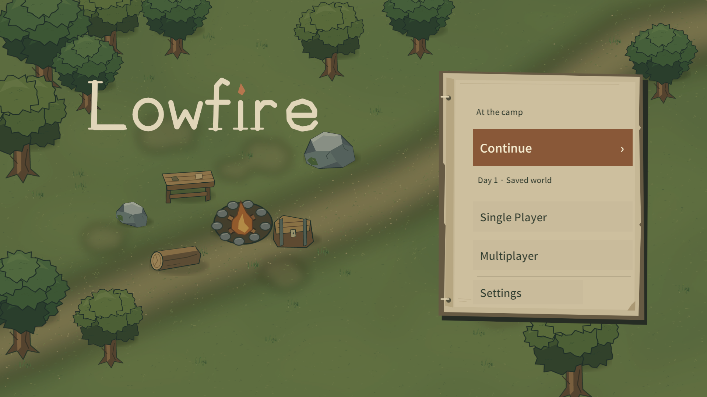

## 현재 UI 체크포인트 · 2026-10-31

유효 저장이 있으면 Continue가 우선이고, 없으면 Continue를 숨기고 새 세계 시작을 primary로 표시한다. Class·Profile·Achievements·Attendance는 독립 진입점이며 Store는 작은 Gem 진입점이다. Settings의 버튼/라벨 폭과 중앙 정렬을 함께 작성한다. 배경의 보급 상자는 불에서 더 떨어뜨렸다. Class는 개요→선택한 직업 트리, Multiplayer는 Create/Join과 대기실을 구분하며 MP Class bookmark는 제거했다.

SceneFlow는 실제 비동기 씬 전환에 임시 TransitionOverlay를 사용한다. 가짜 백분율 없이 단계/회전 표시를 쓰며 SP 초기 지형 준비 동안 기존 Pause/Resume으로 보호한다. Network overlay는 기존 상태/timeout/Leave를 따르고 취소 불가능한 씬 로드 중 취소를 숨긴다. 새 저장 서비스나 schema는 없다. 관련 자동검사는 통과했지만 전체 실제 화면·전환 체감·LAN 검수는 다음 작업이다. [상태/검증 한계](../validation/commercial-ui-mobile/REVIEW.md#checkpoint--user-requested-stop).

아래는 2026-10-15 최초 Home 제작 기록이다. 당시 여섯 진입점, 비활성 Continue, 빈 오디오와 동기 전환 설명은 현재 구현을 뜻하지 않는다.

# Lowfire Home / Frontend — 2026-10-15

기준 commit d53eb545c656cd58d31583a6bab6771df0aaf344. 이번 패스는 표시 브랜드와 Home UI 재설계이며 신규 게임 시스템/전체 프로젝트 rename이 아니다.

[한국어](images/lowfire-home-final-ko.png) / [저장 없음](images/lowfire-home-final-empty-en.png) / [설정](images/lowfire-settings-ko.png) / [새 세계 확인](images/lowfire-new-world-confirm.png) / [Pause](images/lowfire-pause-no-load.png)

## 브랜드와 시각 구조

플레이어 표시 이름은 Lowfire다. brand.name은 en/ko 공통으로 Lowfire를 제공하고, Home에는 Krita wordmark Sprite를 사용한다. 내부 namespace/Scene 명/프로젝트 폴더/projects/wildfolk/PlayerPrefs Prefix/world-v1.json/Application.persistentDataPath/PlayerSettings.productName은 유지했다. 저장·배포 식별자를 바꾸는 전면 rename은 수행하지 않았다.

기존 Quiet Woodland의 나무·돌·작업대·상자·불·통나무와 카메라 구성을 유지했다. 왼쪽 타이틀, 오른쪽 제본 종이 패널, 가장 큰 갈색 Continue, 짧은 저장 요약, 구분선 아래 Single Player/Multiplayer, 작은 하단 Settings로 구성한다. 저장 없음은 Continue 비활성/회색과 싱글 시작 안내로 구분한다. generic allcaps, eyebrow/tagline/CHOOSE YOUR PATH와 기존 짙은 네모 메뉴를 제거했다. 제품 화면에 Safe Area 보조선이나 개발 문구는 없다.

Penpot MCP로 실제 1920×1080 세 Board(A 표지판/B 야전 수첩/C 간결한 생존 메뉴)를 만들고 PNG export로 비교했다. B는 밝은 종이와 숲의 대비, 제본 재질, 버튼의 크기·여백 차이 때문에 선택했다. A는 기존 어두운 상자와 가까웠고 C의 가로 모드는 버튼 폭/앱 메뉴 인상이 남았다. [세 시안과 연구](UI_RESEARCH.md#lowfire-home-시각-재설계--2026-10-15), 휴대용 원본은 docs/design/lowfire-home-a.svg~c.svg다. Penpot의 배경 도형은 기존 야영지 자리표시이며 실제 배경은 Unity 기존 Sprite다.

Krita MCP의 native path/ellipse/line/polygon으로 글자 로고와 수첩 패널을 그렸다. art-source/LowfireWordmark.kra 및 LowfireFieldJournal.kra가 편집 원본이고, Art/lowfire_wordmark.png와 lowfire_journal.png가 실제 UI 자산이다. lettering의 i 점만 낮은 채도의 불씨색이다. 메뉴 글자는 이미지에 굽지 않고 기존 Text/LocalizedLabel을 사용한다. Imagegen/Blender/오디오 생성은 수행하지 않았다. [제작 출처](SOURCE_ART.md#2026-10-15-lowfire-home-ui)

## 기능과 구현 경계

앱 시작 MainMenu → Home Continue / Single Player / Multiplayer / Settings → Gameplay(Wildfolk)를 유지한다. Continue는 SaveRepository.Read와 SaveGameRules.Validate를 공유해 primary/backup/체크섬/내용을 확인하고 선택 시 다시 검사한다. Snapshot은 SceneFlow를 통해 한 번 전달한다. Single Player는 파일이 있으면 교체 확인을 받고 시작 시 파일을 삭제하지 않으며 다음 정상 저장이 기존 atomic/backup 규칙으로 교체한다.

Home/Pause Settings는 같은 SurvivalUiBuilder.Settings와 SettingsPanel/UserPreferences/LocalSettings를 사용한다. EN/KO, Control Size, Master/Music/SFX와 Flush 동선을 유지한다. 실제 BGM/SFX 콘텐츠는 기존처럼 비어 있다. Multiplayer는 후속 Foundation 1에서 실제 Host/Join과 별도 협동 야영지로 연결했다. 현재 구현은 [MULTIPLAYER_FOUNDATION](MULTIPLAYER_FOUNDATION.md)을 따른다. 이 문서의 아래 Lowfire 최초 Home 재디자인 검수/시간은 당시 기록이다.

Pause의 플레이어용 Load Game 오브젝트/콜백/문구 키를 제거했다. Continue/Save game/Settings/Save & return home 네 행동을 간격에 맞게 재배치하고 패널 높이를 줄였다. WorldSaveService.Load와 Editor Developer Save/Load는 보존했다. 사용되지 않는 LoadFromMenu wrapper만 정리했다. ConfigurePauseActions는 Editor authoring 단계에서 기존 씬과 재생성 경로를 함께 갱신한다. Runtime의 임시 숨김/우회 컴포넌트가 아니다.

FrontendSceneBuilder.JournalAction은 시각 표현과 기존 버튼 연결만 담당한다. HomeScreen에는 새 Update/polling/UI rebuild를 추가하지 않았다. HomeScreen.RefreshSave는 Home 복귀/Continue 때만 파일을 읽고 언어 이벤트는 표시만 갱신한다. MainMenu 뒤에는 WorldGenerator/Health/Creature/Pool이 없으며 새 DontDestroyOnLoad 서비스나 별도 저장 정본을 만들지 않았다.

## 이번 자동검사

| 검사 | 통과/전체 | Test Runner 실행 시간 |
|---|---:|---:|
| FrontendContractTests EditMode | 2/2 | 1.3965561초 |
| FrontendPlayTests PlayMode | 4/4 | 10.3285548초 |
| validate_visual_project.py | PASS | 소스/참조/표시 문구 검사 |

EditMode는 시작 씬/기존 Content 참조/양 언어/브랜드 키다. PlayMode는 저장 없음·손상·backup, 가상 Pointer의 실제 New/Save/Home/확인 취소/Continue 버튼, 공유 설정/언어/서비스 개수, 정적 Home의 네 사례다. Pause 버튼 4개 및 Load Game 부재도 확인한다. 전체 회귀가 아니다. 실행 XML/로그는 tests/artifacts/lowfire-edit.*, lowfire-play.*에 남으며 Git 제외다.

기존 tests/artifacts/unity 한 개를 재사용한 hidden batchmode/nographics 실행이다. 새 clone/대화형 테스트 Editor는 만들지 않았다. 테스트마다 임시 Repository와 기존 설정 복원 규칙을 사용한다. 아래 실제 Play 점검을 마치고 영어/원래 설정을 복원한 뒤 PlayMode 자동검사를 시작해 설정 변경이 겹치지 않게 했다. 자동검사는 관련 코드·씬의 최종본에서 각각 한 번 통과했다. 실제 UI 보정은 그 전에 수행했다.

## 기존 Unity Editor의 실제 Play 확인

1920×1080 Game View에서 Unity MCP로 버튼 이벤트를 실행하고 실제 캡처를 확인했다. OS 마우스/키보드는 사용하지 않았으며 창 Focus/Show 호출도 하지 않았다. 실제 터치/Windows 마우스 입력 검수와 구분한다. 자동 Pointer raycast 경로는 위 PlayMode 검사가 담당한다.

- MainMenu 시작, 새 Lowfire 로고/수첩 패널, 저장 없음 비활성·최종 회색 표시와 유효 저장의 활성 표시를 확인했다.
- Settings 열기/닫기와 EN→KO→EN, Home 행동 번역과 한국어 글리프, Multiplayer 안내/뒤로를 확인했다.
- Single Player → Pause Save & return home → 새 세계 확인/취소 → Continue를 실행했다. Seed1849906419와 iron_head/iron_body가 복원됐다.
- Pause의 Load Game이 없고 네 행동만 있는 실제 화면을 확인했다. Settings의 중복 Load 문구도 없다.
- Home에서 WorldGenerator0,Preferences1, 복원 뒤 Gameplay에서 Preferences1/Audio1/EventSystem1을 확인했다.
- 여러 Home 캡처 사이 유휴 상태에서 명백한 UI 점멸/증식을 보지 못했다. 전용 Profiler 측정/Zero GC/기기 성능 합격을 주장하지 않는다.

최초 검수에서 비활성 Continue가 짙은 갈색이라 활성과 구분이 약했다. Button의 normal/highlight/pressed/disabled 색을 정리해 최종본에서 회색 비활성 상태를 확인했다. Penpot export의 배경 경계도 Board 좌표에 맞춰 수정했다. UI 변경 직후 캡처가 이전 프레임을 담은 경우 Canvas 갱신/다음 Game View 렌더 뒤 다시 캡처했으며 빈 이전 프레임을 최종 증거로 사용하지 않았다.

검수 저장은 LIVE의 Captures/lowfire-review/world-v1.json으로 분리했다. 실제 UserData/world-v1.json의 전후 SHA256은 05FB151A4ADE490B65572F91635CA8FE22DAE085F4A598313650794EFFCA22D1로 동일했다. SceneFlow.Repository는 종료 전에 기본값으로 복원했다. 영어/Control1.20191717/Master1/Music0.65/SFX0.85를 유지하고 MainMenu 정지/dirty=false/is_focused=false 상태로 마쳤다.

## 대표 캐릭터 확인과 남은 한계

[맨손](images/lowfire-player-bare.png) / [Axe](images/lowfire-player-tool.png) / [Sword](images/lowfire-player-sword.png) / [월드 Armor](images/lowfire-player-world-armor.png) / [Inventory](images/lowfire-player-inventory-armor.png) / [Character](images/lowfire-player-character-armor.png)

대표 정지 상태에서 손 크기·좌우 간격, 오른손 도구/검 정렬, Iron Head/Body, 두 초상화의 손·장갑 표현을 비교했다. 이전 패스의 AlignHands 비율을 유지했고 이번 대표 상태에서 명백한 오류가 없어 캐릭터 아트/모션을 수정하지 않았다. 모든 회전/공격 자세나 Armor 조합을 검증한 것은 아니다. 로고의 자간·획 마감, 종이 질감과 나머지 Modal의 재질 통일은 후속 polish 대상이다.

전체 회귀/다중 해상도/Android 터치·성능/장시간 생존/실제 Multiplayer/모든 저장 상태/새 효과음·음악은 이번 범위에서 제외했다. 최종 출시 아트 선언이 아니다.

## 시간 기록(KST)

시각 경계는 도구의 실제 시각이며 생각/코드/도구 대기를 포함한 경과 시간이다. 도구 연결/사용자 연결 사이의 대기는 개별 순수 시간으로 분리 측정하지 않았다. 병행 실행은 중복 합산하지 않는다.

| 구간 | 시작 | 종료 | 경과 |
|---|---|---|---|
| 정본·자료·도구 확인, 연결 시도/중단/사용자 연결 포함 | 20:04:03 | 20:11:15 | 7분12초 |
| Penpot 세 시안·Krita 자산 | 20:11:15 | 20:16:07 | 4분52초 |
| Unity UI/브랜드/Load UI 구현·첫 컴파일 | 20:16:07 | 20:19:15 | 3분08초 |
| 실제 Play/대표 장비·색상 보정/최종 시각 확인 | 20:19:15 | 20:24:47 | 5분32초 |
| 최소 자동검사 결과·문서·최종 검토 | 20:24:47 | 20:29:03 | 4분16초 |

Git 마무리 시작은 20:29:03이며 그 전까지 총25분이다. EditMode는 20:24경 최종 시각 확인과 병행했고 PlayMode는 20:25:09에 시작해 문서 작업과 병행했다. Test Runner 내부 시간은 위 표와 같으며 기동/Import/종료 시간을 포함하지 않는다. commit/push/원격 확인 구간과 전체 경과는 완료 보고에 실제 종료 시각으로 추가한다.

## Home 소수정 / Multiplayer Foundation 1

Single Player/Multiplayer/Settings의 Image는 기본 tint를 투명하게 하고 hover/focus/press 때만 낮은 농도의 강조를 준다. raycast 영역과 버튼 callback은 유지하며 Continue의 박스와 야전 수첩/배경은 바꾸지 않았다. 기존 이용 불가 페이지는 동일 수첩 재질의 Host/Join, Internet/Local Network, 참가 입력, 실제 발급 코드, Enter/Back 화면으로 대체했다. 이전 home.multi_title/body 미사용 번역 키는 제거했다. 새 UI/검수는 MULTIPLAYER_FOUNDATION.md에 기록한다.
