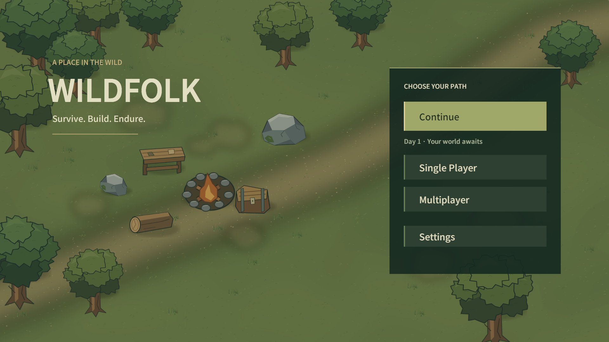

# Home / Frontend — 2026-10-15

기준 bbc60177f288194a5a52ef38e0d443f3e9d1921f. 이번 범위는 Home/Scene/Save/Settings 연결과 대표 Visual Consistency다. 전체 생태·제작 회귀 감사가 아니다. 영구 작업 규칙은 ../AGENTS.md에 고정했다.

## 실제 흐름

앱 시작(MainMenu) → Continue / Single Player / Multiplayer / Settings → Gameplay(Wildfolk). 기존 숲·돌·작업대·상자·불·통나무 Sprite만 사용한 정적 야영 배경, 왼쪽 타이틀과 오른쪽 주 행동군이다. Continue를 우선하되 유효한 저장이 없으면 비활성화하고 새 게임 안내를 표시한다. 새 그림/생물 AI/Population/Combat/WorldGenerator를 Home 뒤에 만들지 않는다.

Continue는 SaveRepository.Read와 SaveGameRules.Validate를 공유한다. 체크섬/내용/backup/기존 v1~v3 이관을 적용하고 선택 시 다시 검사한다. 유효한 Snapshot을 SceneFlow로 한 번 전달해 기존 WorldSaveService.Apply가 복원한다. UI의 저장 요약은 영구 저장 정본이 아니다. Single Player는 기존 무작위 새 월드 흐름을 사용하고 파일이 있으면 교체 확인을 받는다. 시작 순간 파일을 삭제하지 않으며 다음 저장이 기존 atomic/backup 규칙으로 교체한다. 단일 World만 지원한다.

Settings는 Home/Pause가 같은 SurvivalUiBuilder.Settings와 SettingsPanel/UserPreferences/LocalSettings를 공유한다. EN/KO·Control Size·Master/Music/SFX는 같은 키를 사용하며 씬 변경 전에 Flush한다. 음악/효과음 콘텐츠는 기존대로 비어 있다. Pause Save/Load를 유지했고 Save & return home은 저장 성공 후에만 복귀한다. 씬 전환은 SceneFlow 한 곳이 담당하며 새 DontDestroyOnLoad 서비스는 없다.

Multiplayer는 이용 불가 안내·뒤로·싱글 시작을 제공하는 FrontendPage다. 가짜 Host/Join/Room 입력이나 네트워크를 추가하지 않았다. 1~4인 Host/초기2인/Room Code/Friend·Invite/Login·Cloud 소유권은 향후 방향이다.

[한국어 Home](images/home-home-final-ko.png) / [저장 없음](images/home-home-final-empty-en.png) / [설정](images/home-settings-ko.png) / [새 세계 확인](images/home-new-world-confirm.png) / [Multiplayer 안내](images/home-multiplayer-en.png)

## 조사

Minecraft Bedrock UI팀/공식 Play 경로,505의 Terraria Mobile 모드/Host 안내와 Main Menu 저장 안내,Playdigious의 DST Mobile Host/Local Only 및 Klei Options를 비교했다. Continue 대 새 세계·모드 선택 후 세션·공유 설정/복귀 동선을 참고했다. 출처와 확인 한계는 UI_RESEARCH의 Home 절에 기록했다. 특정 게임의 Safe Area/엄지 좌표·최신 화면을 실측하거나 Asset/Code/Layout을 복제하지 않았다.

## 자동검사

| 실행 | 전체 | 통과 | 실패 | Test Runner 실행 시간 |
|---|---:|---:|---:|---:|
| home-related-edit.xml | 2 | 2 | 0 | 0.3908초 |
| home-related-play.xml | 6 | 5 | 1 | 22.741초 |
| home-settings-recheck.xml | 1 | 1 | 0 | 3.7729초 |

EditMode는 시작 씬/Gameplay 유지/기존 Content 참조/EN·KO 키2건이다. PlayMode는 Home 저장 없음·손상·backup, 실제 가상 Pointer 버튼으로 New/Save/Home/확인 취소/Continue, 공유 Settings·언어·서비스 개수, 정적 Home, 기존 Save v2/v3 이관의6건이다. 최초5/6 통과 후 실패한 언어1건만 재검사했다. 숨겨진 Home Label이 아니라 설정에서 돌아온 뒤 활성 Home의 번역을 확인하도록 테스트를 바로잡았다. 기존 LocalizedLabel은 OnEnable에서 갱신하므로 숨은 UI를 지속 갱신하지 않는다. 마지막 개별 결과 기준8개가 통과했으며 전체 회귀를 수행했다고 표현하지 않는다.

기존 tests/artifacts/unity 한 개를 재사용한 hidden BatchMode/Nographics 실행이다. 새 대화형 에디터를 계속 만들거나 OS 마우스/키보드를 사용하지 않았다. 테스트는 임시 Repository를 사용하고 기존 설정 키의 존재 여부/값을 종료 때 복원한다. XML/로그/검증 프로젝트는 Git 제외다.

## 실제 Unity Play Mode 직접 확인

자동 테스트와 별도로 기존 Unity Editor의 MCP에서 실제 Game View1920×1080을 확인했다. UI Button 이벤트로 저장 없음 비활성·Single 진입·Pause Save & Home·유효 Continue·교체 확인/취소·Settings EN↔KO·Multiplayer 안내를 실행했다. 새 세계 Seed33734771을 저장하고 Continue 후 같은 Seed로 복원되는 것을 확인했다. Home WorldGenerator0,Preferences1과 Gameplay 전환 뒤 Preferences1을 확인했다. 버튼의 좌표 hit/raycast 흐름은 위 자동 Pointer 테스트가 별도로 담당한다. Windows 입력/창 포커스 호출은 하지 않았다.

UserData/world-v1.json은 전후 SHA256 CA64BBEF05E379C68EFEB6EFEC14B90414DD832EDC8598A79F148CDC675E2F22로 동일했다. 검수는 Captures/home-review의 별도 저장으로 진행했다.

짧은 Home idle ProfilerRecorder 표본: UI Render/Canvas.BuildBatch 유효81개 표본의 호출 합0. GC Allocated In Frame은2개 표본에서9587 bytes였다. 전체 Editor/입력/렌더 할당이 포함되어 Home 코드의 할당량이나 기기 성능 수치로 해석하지 않는다. HomeScreen은 Update/파일 polling/매 프레임 Localization·UI 재생성이 없고, Scene 내 World/Health/Creature/Pool이 없는 상태를 확인했다. Zero GC/성능 최적화 완료를 주장하지 않는다.

## 대표 Visual Consistency

[7가지 Player 상태 모음](images/home-player-comparison.png) / [Inventory 원본](images/home-player-inventory.png) / [HP바 원본](images/home-creature-health-bars.png)

맨손·Axe·Sword·Head Armor·Body Armor·Inventory·Character를1920×1080에서 확인했다. 초상화의 손은 기존85px/-38px/36px로, 실제 월드의 몸통176px 대비 손 위치·크기와 달랐다. 실제 Sprite/Transform과 Facing 값에서 UI 비율을 계산해 약72.4px/-32.4px/44.7px로 맞췄다. 기본 손과 장갑이 같은 계산을 사용한다. 월드 손·무기·Armor 디자인/공격 모션은 재설계하지 않았다.

HP바는 Player와 Chicken/Boar/Rabbit/Deer/Sheep/Goblin/Slingshot Goblin/Zombie/Skeleton을 한 대표 화면에 배치해 약간의 피해로 표시했다. 높이·폭·테두리/색상 체계와 몸 겹침을 확인했으며 이 대표 상태에서 명백한 오류를 발견하지 않아 HP바 로직은 바꾸지 않았다. 모든 이동/회전/공격 자세를 검증한 것은 아니다. 작은 손 간격·무기 크기·Armor 스타일 등 취향성 조정은 이번 범위에서 확대하지 않았다.

Play 검수 종료 후 MainMenu 씬을 정지 상태로 남겼다. dirty=false,영어/기존 Control Size,1920×1080을 유지하고 Editor is_focused=false를 확인했다.

## 한계

전체 Creature/Recipe 회귀,장시간 생존,모든 Save 상태,3해상도 대규모 감사,Android 성능·터치 실측,실제 Multiplayer는 수행하지 않았다. 유효 legacy 저장의 복원과 backup은 최소 사례만 확인했다. Home 배경은 정적 첫 구성이고 최종 타이틀 아트/출시 품질 선언이 아니다.

## 작업 시간 기록(KST)

2026-10-15,도구의 실제 시각으로 구간 경계를 기록했다. 구간은 생각·코드·도구 대기를 포함한 경과 시간이며 순수 타이핑 시간은 아니다. 겹쳐 실행한 자동검사는 중복 합산하지 않는다.

| 구간 | 시작 | 종료 | 경과 |
|---|---|---|---|
| 요구사항·정본·레퍼런스 조사 | 14:12:07 | 14:16:38 | 4분31초 |
| Home·공유 저장/설정 구현 | 14:16:38 | 14:19:45 | 3분07초 |
| 첫 Play 흐름 점검·초상화 비율 보정 | 14:19:45 | 14:24:36 | 4분51초 |
| 최소 자동검사·대표 시각 점검 | 14:24:36 | 14:28:11 | 3분35초 |
| 관련 재검사·정본 문서·증거 정리 | 14:28:11 | 14:33:37 | 5분26초 |

Git 마무리 전까지21분30초다. 이후 최종 검토·commit·push 시간과 전체 시간은 완료 보고에 추가한다. Test Runner 내부 실행은 Edit0.391초/Play22.741초/관련 재검사3.773초이며, Unity 기동·Import·종료 대기는 이 실행 시간에 포함되지 않는다. 첫 두 기동~결과는 각 약46초,마지막 관련 재검사는 약31초였다. 이 백그라운드 실행은 위 시각 점검/문서 구간에 포함된다.
