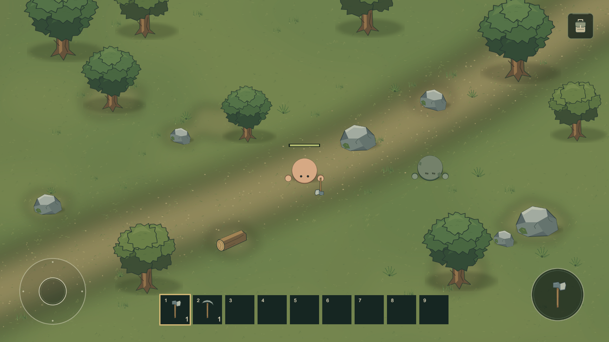
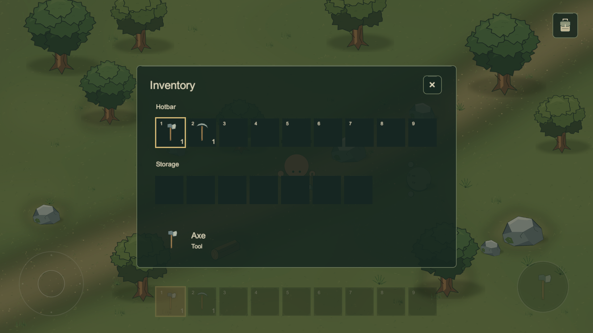
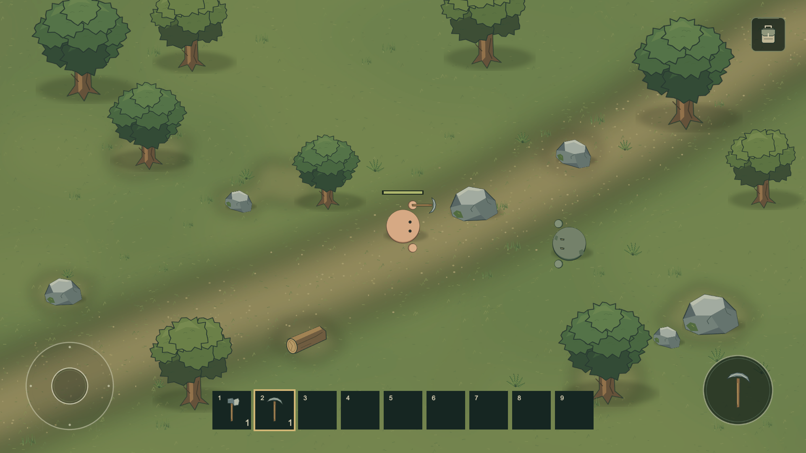
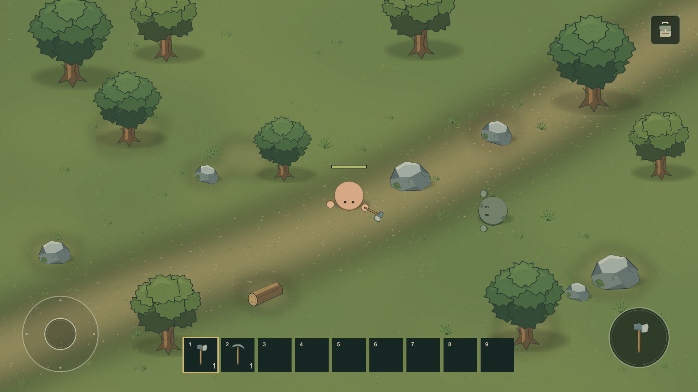
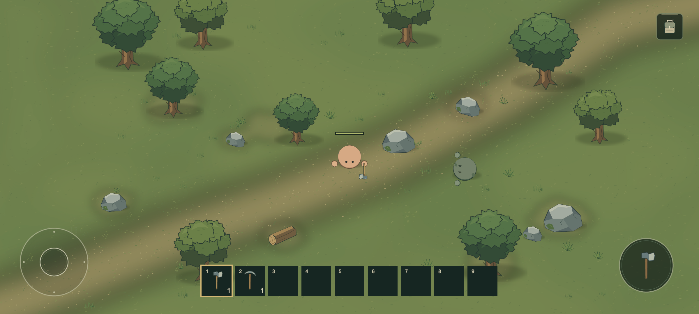
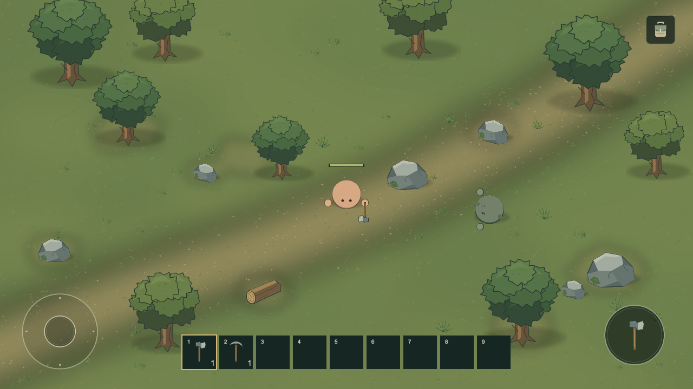

# 원형 캐릭터·Hotbar·도구 검수

> 이전 단계 기록: 기준 커밋 `28431687414534606582e0bc2f718fc851ce420a`의 16칸/시작 장비 버전이다. 현재 36칸/맨손 시작/제작/설치는 `SURVIVAL_REVIEW.md`를 따른다. 아래 시작 지급과 미구현 항목은 당시 상태다.

기준 커밋: 7d49fa19c2200d4cc138715995a81f2c361cd560. 검수일: 2026-10-13.
실제 Unity MCP Game View와 저장된 씬/프리팹/데이터를 확인했다. Windows 마우스·키보드 조작과 Android 실기 테스트는 수행하지 않았다. 사용자 실사용 검증과 자동 검증을 구분한다.

## 자동 검증

- 별도 Unity 프로젝트 복사본: EditMode 9/9, PlayMode 8/8 통과.
- EditMode: 저장된 참조/누락 스크립트/적 비물리 밀기 구조, 공통 Facing/장착/시작 장비/Hotbar 9개 연결, 수치 범위, 아이템 ID 중복/아이콘, 도구 프로필/효율 종류, Resource Kind, 기존 인벤토리 스택/한도/부분 수용 검증.
- PlayMode 회귀 6개: 실제 UI 장치 이벤트의 이동/조이스틱 복귀/카메라, 인벤토리/일시 정지/입력 차단, 맨손 교대 공격/자원 HP/드랍/획득/Stone 자동 스택, 적 피해/밀기 없음/사망, 보스 기반, 사망/재시작.
- 추가 2개: 여러 Facing 방향의 눈·손 배치/몸통 회전 없음/정지 방향 유지, Hotbar 실제 UI 선택/인벤토리 공유 선택/도구 장착/Arc/자원 효율/재료 및 빈 슬롯의 맨손 복귀.
- 자동 입력은 InputSystem MouseState를 EventSystem으로 전달한다. 사람이 직접 마우스나 모바일 화면을 조작한 결과가 아니다.
- 도끼 나무 1회 파괴, 도끼 돌 피해 5, 곡괭이 돌 피해 25, 곡괭이 나무 피해 5를 실제 공격 입력 경로에서 확인했다. 대상 반응과 기존 드랍/획득/스택 흐름을 유지한다. 공용 ParticleSystem 없음.
- UI 대비 수정과 불필요한 공격 취소 제거 후 최종 PlayMode 8개를 다시 통과했다.

## MCP 시각 검수

살구색 원형 몸체/원형 손/분리 눈, 회녹색 원형 Zombie를 직접 확인했다. 살구색과 회녹색을 구분하고 입/볼터치/코/옷/동물 요소를 넣지 않았다. 위/오른쪽/왼쪽 시선과 손 배치, 맨손 복귀, 손에 든 도끼/곡괭이, 짧은 Arc 휘두름을 확인했다. 방향/장착/애니메이션 캡처는 시각 fixture로 설정한 상태이며 사용자 조작 검증이라고 표현하지 않는다.

첫 선택 테두리는 대비가 약해 밝은 낮은 채도 황토색 테두리로 수정했다. 인벤토리는 Hotbar 9칸 한 행과 Storage 7칸을 구분한다. 같은 선택을 두 화면에서 표시한다. 하단 조작 사이 간격과 중앙 여백을 유지했다.

1920×1080, 2400×1080, 1280×720 Game View와 실제 Screen 크기를 확인했다. 검수한 화면에서 Joystick/Hotbar/Attack이 겹치거나 잘리지 않았다. Safe Area는 에디터 전체 화면이며 실제 노치 확인을 의미하지 않는다.

MCP 즉시 캡처 일부에서 Overlay UI가 빠지거나 PlayerLoop 재귀 오류가 발생했다. Editor.log 스택과 패키지 ScreenshotUtility.cs:197의 EditorApplication.Step 호출에서 발생함을 확인했다. Canvas 활성/크기/렌더 모드를 확인하고 MCP execute_code로 Unity ScreenCapture의 완성 프레임을 캡처해 UI를 포함한 Game View를 다시 검수했다. 게임 코드나 MCP 패키지에 우회 코드를 추가하지 않았다. 해당 도구 오류 기록을 확인한 뒤 Console을 정리하고 일반 Play Mode를 다시 시작해 최종 Console Error 0을 확인했다. 저장된 씬의 누락 스크립트 0, Hotbar 9칸과 Facing/장착 참조도 확인했다.

## 사용자 직접 테스트가 필요한 항목

실제 조이스틱과 공격/Hotbar 동시 터치, 슬롯 터치 크기, 손의 느낌, 빠른 방향 전환의 자연스러움, 도구 휘두름/거리/채집 속도의 체감, 좀비 식별과 재미는 사용자가 직접 테스트해야 한다. Android 실기/노치/발열/성능/백그라운드 복귀를 검증하지 않았다. 에디터 자동 테스트 성공을 실사용 완료로 보고하지 않는다.

캐릭터는 의도적으로 매우 단순하다. 사람 캐릭터로 읽히는 정도는 사용자 판단이 필요하다. 작은 좀비 눈과 가느다란 도구 자루는 작은 기기에서 추가 확인이 필요하다. 아트 변형과 지형이 적고 적 길찾기가 단순하다. 최종 아트 품질/상대 게임 우열은 판정하지 않는다.
