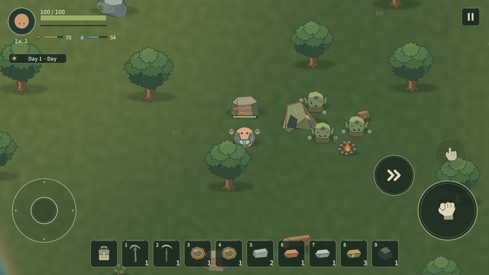
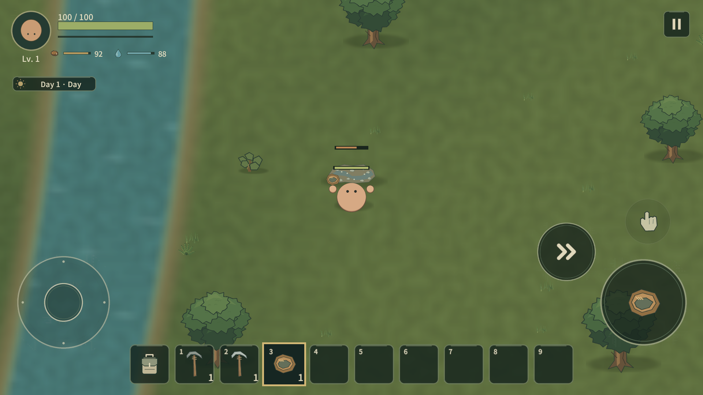
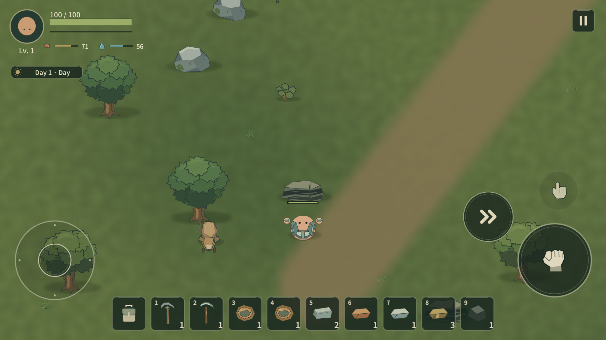
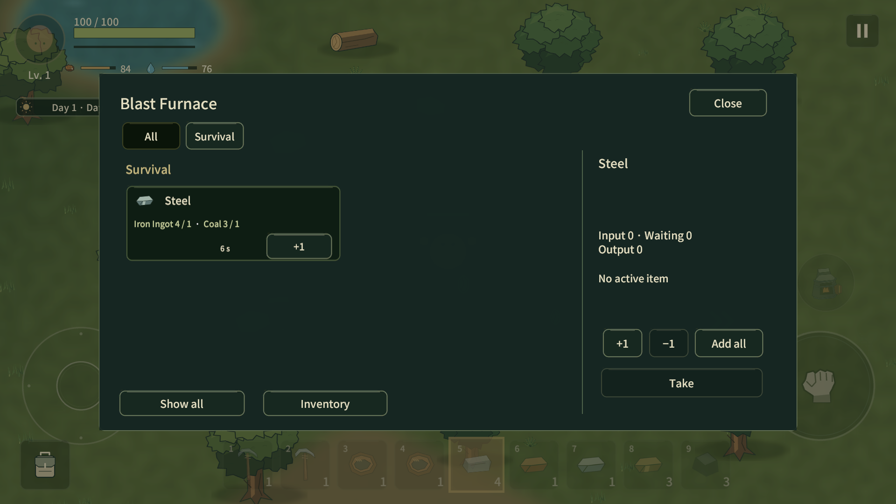
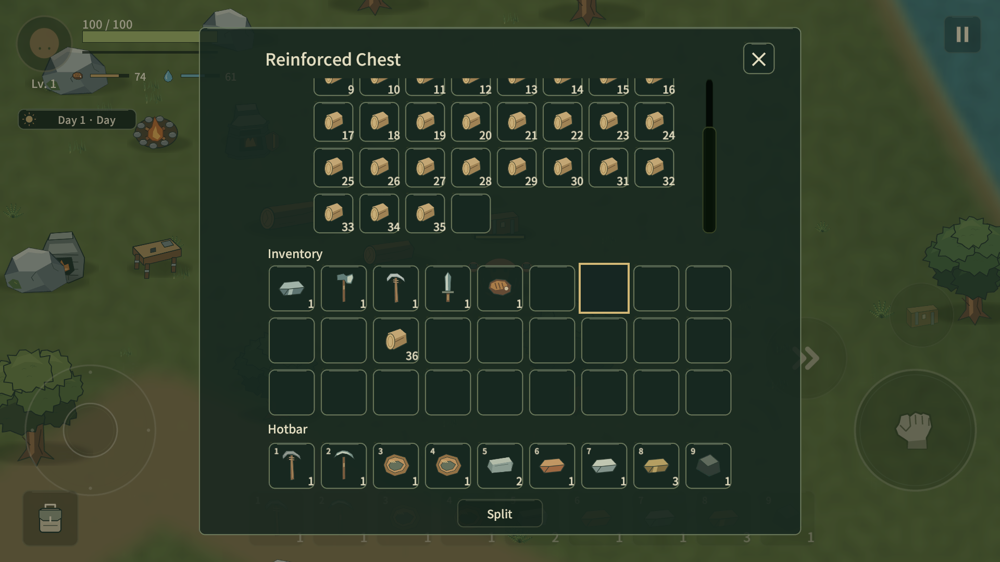

# 초기 금속 progression 교정

2026-10-19 현재 Item110 / Recipe91 / Equipment Tier5 / Surface Biome4 / Save10 / Protocol12. Workbench III가 활성화되었으며 현재 비용은 CONTENT_EXPANSION의 III 절을 따른다. 아래 이전 금속·I–II 패스 수치/검수는 당시 기록이다. 신규 자연 공급/지역 회복/4인 yield와 구 generation1/2 정책은 WORLD_GENERATION 정본을 따른다.

## 확정한 진행

장비는 **Wood → Stone → Iron → Steel**이다. Copper/Tin/Bronze는 풀 장비 Tier가 아니다. Workbench I은 Iron까지, II는 post-Iron 기술 발전을 담당한다. 구조적 Workbench 상한 VI와 실제 콘텐츠 I~II를 구분한다. III~VI 비용/Recipe는 없고 빈 Tier 업그레이드는 막는다. I→II는 Wood8+Stone6+Iron Ingot2이며 모든 비용을 원자 소비한다.

Iron → Workbench II → Copper → Prospecting Pan → Tin → Bronze → Blast Furnace → Steel → Steel 장비로 이어진다. 자연 자원 생성은 기술 진행과 독립이다. 새 게임의 자원은 제작대가 없는 상태에도 존재한다.

| 자원 | 채취 방식/최소 도구 | HP 또는 채취 진행 / 드랍 | 초기 수량 |
|---|---|---|---|
| Iron Ore | Strike / Stone Pickaxe Rank2 |75 /6|16, 기존 Rule2|
| Copper Ore | Strike / Iron Pickaxe Rank3 |90 /6|14, Rule5|
| Coal | Strike / Stone Pickaxe Rank2 |90 /10|12, Rule7|
| Tin Deposit | Panning / Prospecting Pan |50 /5|10, Rule6|

Copper는 노출된 암벽의 넓은 구리맥, Coal은 검은 층이 드러난 낮은 암층, Tin은 물가의 납작한 자갈·퇴적층으로 표현한다. Tin은 일반 Pickaxe로 채취할 수 없다. HarvestMethod(Strike/Panning/Interaction)와 ToolKind/최소 Rank를 함께 검사한다. 현재 실제 구현된 방식은 Strike/Panning이며 Interaction 전용 콘텐츠는 없다. Pan은 25 진행, 1.1초 모션/1.4초 간격이며 두 번에 Tin5을 얻는다. Pan으로 생물을 공격하지 않는다. 별도 UI 미니게임은 추가하지 않았다.

요구 도구 미달은 Health/진행/loot/성공 Damage 신호를 바꾸지 않는다. 성공 효과는 이 신호에 연결된다. 일반 헛동작은 가능하고 requirement 안내는 기존 2.5초 제한을 사용한다. Tin 퇴적층에서 획득한 재료의 화면 이름은 Tin Ore다.

## 제작과 가공

| 결과 | 비용 | 시설/시간 |
|---|---|---|
| Copper Ingot |Copper Ore1 + Coal1|Furnace, 3초|
| Tin Ingot |Tin Ore1 + Coal1|Furnace, 3초|
| Bronze3 |Copper Ingot2 + Tin Ingot1|Furnace, 5초|
| Prospecting Pan |Copper Ingot2 + Wood2|Workbench II|
| Blast Furnace |Bronze3 + Iron Ingot3 + Stone8 + Wood4|Workbench II|
| Steel |Iron Ingot1 + Coal1|Blast Furnace, 6초|
| Steel Axe/Pickaxe |이전 Iron 장비1 + Steel3 + Wood2|Workbench II|
| Steel Sword |Iron Sword1 + Steel4 + Leather1|Workbench II|
| Steel Head Armor |Iron Head Armor1 + Steel2 + Leather1|Workbench II|
| Steel Body Armor |Iron Body Armor1 + Steel3 + Leather1|Workbench II|
| Reinforced Chest |Wood8 + Iron Ingot2|Workbench II, 36칸|

기존 Iron 제련은 Ore1→Ingot1/2초로 유지한다. Furnace는 Iron/Copper/Tin/Bronze만, Blast Furnace는 현재 Steel만 처리한다. Campfire만 Raw Meat를 조리한다. Workbench II가 근처에 있는지 검사하던 반경 지원·registry 코드는 제거했다. II에서 상위 시설을 제작하는 기술 단계가 실제 진행을 결정한다. 초기 Local Host 시설5개에는 Blast Furnace가 포함되지 않는다.

Bronze는 Blast Furnace 부품, Reinforced Bow/Crossbow/Lantern/보강 건축·Trap/Brazier/Bronze Arrow에 쓰인다. Bronze Chest/Steel Wall 대체 Recipe는 제거했고 기존 Reinforced Chest/Stone Wall의 Iron·기초 재료 비용을 유지한다. 구 재료는 상위 제작에서도 프레임·손잡이·보강재로 계속 쓰인다. Steel 장비는 기존 Iron 수치를 읽고 정한 초기값이다. Axe/Pickaxe 기본 피해18(채집 효율 별도), Sword43, Head/Body Defense3/5다. 세부 효율·속도는 BALANCE를 따른다. 내구도/자동 진화/새 Copper·Bronze 풀 세트는 없다.

## 저장·권위·상자

Save v6은 v1~v5를 이관한다. 기존 32칸 Reinforced Chest는 기존 위치의 내용물을 보존해 36칸으로 확장한다. 사라진 두 대체 Recipe의 Seen ID만 제거한다. 구 일반 Furnace의 Steel 현재/대기분은 Iron Ingot+Coal을 시설 위치의 저장 Pickup으로 환급하고 완료 Steel은 완제품 Pickup으로 보존한다. 다른 예약·결과는 유지한다. v6부터 기본 Furnace의 잘못된 Steel cargo는 검증에서 거절한다. SP world-v1.json / Host multiplayer-world-v5.json 파일명은 기존 경로를 계속 사용한다. 사용자 저장을 이번 검수로 덮어쓰지 않았다.

Chest UI는 실제 capacity에 맞춰 슬롯을 생성/표시하며 ContentSizeFitter와 세로 ScrollRect를 사용한다. PC wheel/scrollbar, 모바일 빠른 세로 swipe를 지원한다. 채워진 슬롯의 PC drag 또는 터치 가로 drag/0.18초 이상 유지 후 drag는 아이템 이동이다. 0.45초 long press는 기존 Item Actions다. 스크롤 자체는 Inventory revision을 바꾸지 않고 성공한 기존 transfer만 변경한다. Host는 양쪽 revision·거리·열린 시설·생존·authority를 검사한다. Protocol7은 새 ToolKind/StationKind/등록 prefab 구성을 구 버전과 구분한다.

## 월드 경계

기존 Rule0~4/난수 소비/자원 r ID를 유지하고 추가 Rule5~7은 독립 stream으로 생성한다. Copper 암석밀도≥0.38, Coal≥0.48, Tin 수변1.4~12유닛 육지다. 기존 기반에서는 강뿐 아니라 호수 수변도 해당한다. 실제 퇴적 지형/절벽 지형 생성기는 아직 없다. 물가 자갈 그림과 노출 암층 Sprite는 초기 시안이다.

새 자원은 Mineral family/World scope/Target0.9/채집 제외18유닛·1200초/ClusterSpacing9, Copper·Coal600초/Tin720초 복구를 사용한다. Workbench upgrade event는 자원을 생성하지 않는다. 기존 저장을 로드하면 기존 구현처럼 Seed의 추가 공급층이 재구성되며, 이미 저장된 파괴 상태는 유지한다. 신규 biome/distribution/기존 기지 회피를 포함한 정식 기존 월드 도입 정책은 다음 패스다. 이번에 Biome 본체·Cave·POI 콘텐츠를 구현하지 않았다.

## 시설 이름 참고

[Core Keeper Fury Forge](https://corekeeper.atma.gg/en/Fury_Forge)의 상위 제작대에서 만드는 전문 고온 처리 역할과 [Grounded Hot and Hazy](https://www.obsidian.net/news/grounded/time-for-the-backyard-to-get-hotter-and-hazier)의 Oven 기술 가공 구분을 참고했다. 기존 Lowfire의 Workbench/Furnace/Campfire처럼 짧은 기능명으로 **Blast Furnace**를 선택했다. 비용·비율·그림·코드는 자체 결정이며 상용 게임의 실제 금속 공정을 재현하지 않는다.

## 이번 검증

[교정 증거](evidence/metal-correction.json)에 자동검사와 실제 MCP 조작을 분리해 기록한다. 기존 metal-progression.json은 교정 전 역사 자료다.

관련 EditMode22개, PlayMode16개는 최종 결과 통과했다. 최초 Play 검사에서 한 건은 새 네트워크 시설의 Spawn 전 열기를 시도한 fixture 문제였으며 FlushPending 후 해당 한 건만 재검사했다. 별도 전체 프로젝트 회귀를 반복하지 않았다.

실제 연결된 Unity 6000.3.19f1의 1920×1080 Game View를 MCP로 확인했다. Windows 입력/Computer Use/Focus/Show를 쓰지 않았다. Attack/제작 버튼/스크롤/슬롯 이벤트/기존 모델 API를 MCP로 직접 호출하고 프레임 진행 뒤 결과와 ScreenCapture를 확인했다. 재료 지급·순간 이동·일부 시설 배치와 시간 전진은 격리 검수 fixture다. 처음부터 전 재료를 걸어서 모은 자연 진행 테스트는 아니다. 자동 offscreen 렌더를 직접 검수로 세지 않았다.

새 월드 제작대0에서 Iron16/Copper14/Tin10/Coal12 존재, Stone→Iron/Coal 성공·Stone→Copper 거절·Iron→Copper 성공·Pickaxe→Tin 거절·Pan→Tin3 획득, I→II 비용 소비/III 차단, Furnace 저단계·Bronze/Steel 거절, II Pan/Blast Furnace 제작·실제 시설 설치·Steel 처리, Steel5종 제작/갑옷 장착, Campfire 고기와 양 Furnace 거절을 확인했다. 상자36칸/휠/스크롤바/모의 터치 swipe/맨 아래 슬롯 drag도 확인했다. 직접 화면에서 손잡이 길이가 비율보다 긴 문제를 발견해 수정했다.

SP 임시 파일 저장·Load와 Local Host 임시 파일 저장→Leave→재Host로 Tier·시설·Steel 예약·가방·상자·파괴 자원·문 상태를 확인했다. Host의 두 번째 서버 소유 fixture actor로 stale revision 상자 이동을 거절하는 것도 직접 확인했다. 실제 원격 기기 2인 검수로 해석하지 않는다. Door 열기/닫기·기존 Wall·자연 생물·가방 sanity를 확인했다.

실제 휴대폰 손가락 입력, 새 Protocol7의 remote Client 수신/Relay/4인, 장시간 밸런스·부족도·모바일 성능·다해상도는 직접 확인하지 않았다. 첫 MCP screenshot 도구는 Overlay UI를 제외해 Unity ScreenCapture로 다시 촬영했다. 씬 전환 중 Unity 내부 PlayerLoop 재진입 오류 한 건은 로그에 관찰됐으며 후속 플레이/재Host 결과와 분리 기록한다.

## 단계 시간 (KST)

정본 감사·조사: 17:20:18–17:23:33 / 3분15초

구현·에셋 제작: 17:23:33–17:37:29 / 13분56초

자동검사 첫 묶음·재호스트 재검사: 17:37:29–17:42:46 / 5분17초, 직접 검수와 일부 중첩

실제 MCP Play/Game View 검수: 17:39:26–17:52:05 / 12분39초

문서·씬 손잡이 반영·최종 검토: 17:52:05부터

위 구간은 검사/문서 병행이 있어 단순 합산하지 않는다. 관련 통합 검사는 한 묶음만 돌렸고 실패한 재호스트 한 건, 시각 수정 후 상자 한 건만 추가 확인했다. 숨김 Unity는 기존 캐시 프로젝트를 순차 재사용했으며 새 clone/새 visible Editor를 만들지 않았다. 최종 종료 시각은 evidence/metal-correction.json과 완료 보고에 기록한다.

최종 문서·씬·검토 종료: 17:57:29 KST. main commit/push/원격 SHA 확인은 이 시각부터 진행하며 실제 종료는 완료 보고에 기록한다.

## 탐험 장비 연결

이번 확장에서 Wood1+Coal1→Torch4(Hand), Wood2+Iron Ingot1→Compass1(WB I)을 추가했다. Coal의 기존 Stone Pickaxe gate와 WB I→II/금속 처리/Steel은 유지한다. WB III/Diamond 실제 진행은 이번에도 없다. [탐험 정본](EXPLORATION_FOUNDATION.md).

## Workbench I–II Content Expansion (2026-10-18)

Workbench I~II 콘텐츠 확장으로 Bronze9종 지속 사용처와 Feather 탄약 소비를 제공한다. Steel Bolt를 포함한 1인/4인 광물 필수·선택·안전 여유 표는 [CONTENT_EXPANSION](CONTENT_EXPANSION.md)이 현재 정본이다. III/Diamond 비용은 넣지 않았다.

## Workbench III 현재 상태 · 2026-10-19

현재 III는 활성 alpha 범위다. 위 I–II 시점의 III/Diamond 비활성 설명은 역사 기록이다. II→III는 재료만 요구하고 Diamond 장비는 Steel 장비를 소비한다. Bronze+Steel→Mechanical Part로 기존 광물을 사용하며 Ballista/Repeater는 Turret Workbench에서 제작한다. 현재 비용·수치·1/4인 예산은 CONTENT_EXPANSION의 III 절을 따른다.
