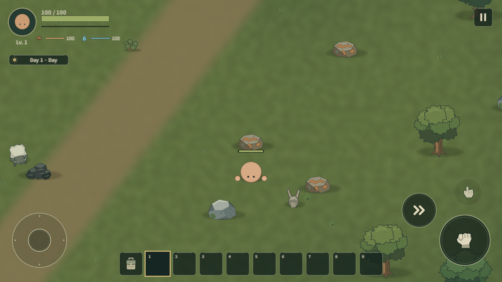
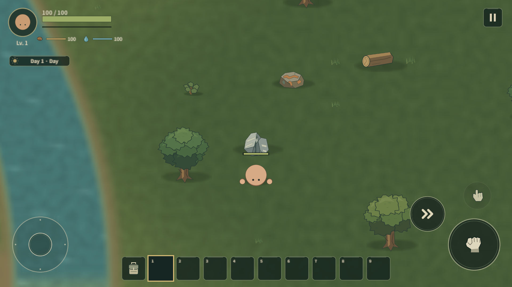
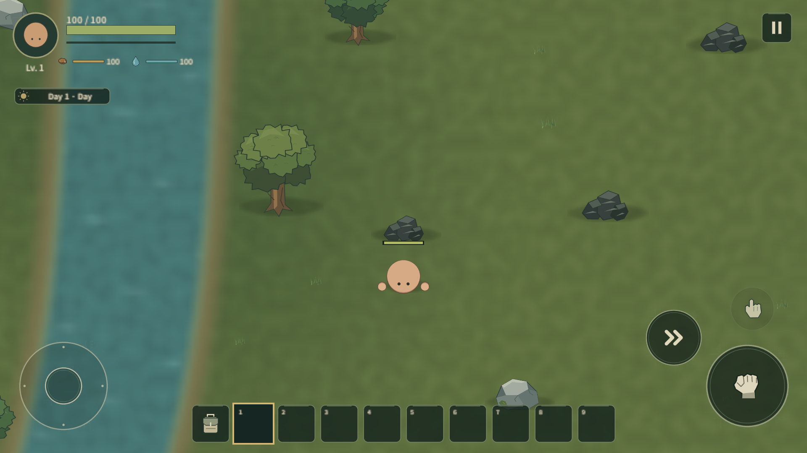
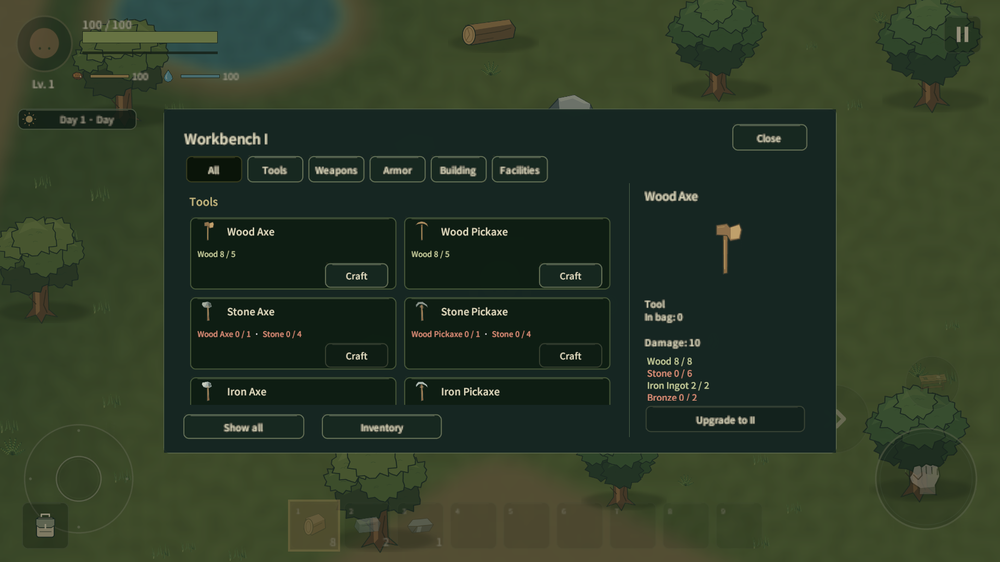
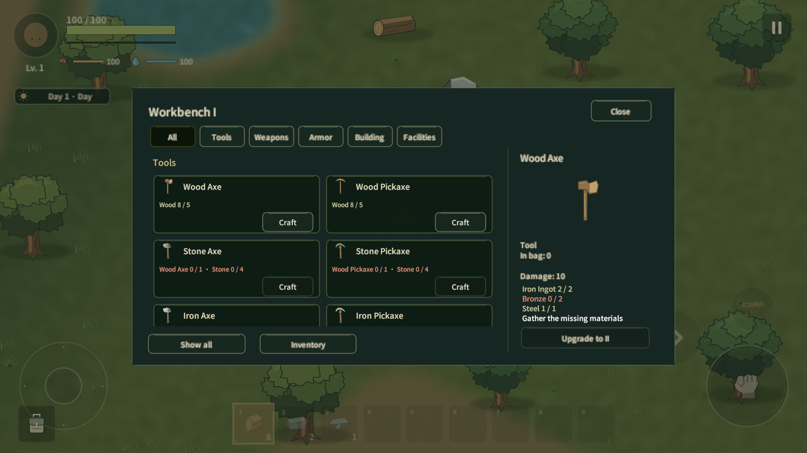

# Workbench progression / 초기 금속

2026-10-16. 기준 main ee51701a4b59662e219ac247901c1b2ac8a21ca2를 pull 후 작업했다. 표시명 Lowfire, 내부 Wildfolk 유지. 실제 Item41 / Recipe31 / Equipment Tier3 / Biome1 / Save v5 / Protocol6이다.

## 진행 범위

구조적 WorkbenchTier I~VI(1~6), 실제 구성·플레이는 I→II다. min/max/범위 외를 검증하며 다음 정의가 정확히 +1이고 Prefab/비용이 구성된 경우만 업그레이드한다. II의 UpgradeTo는 비어 있어 III 진입/가짜 탭/버튼은 없다. III~VI 실제 재료·Recipe·최종 밸런스는 미정이다. PlaceableDefinition의 임의 길이 UpgradeCosts, Recipe.RequiredWorkbenchTier, 시설 지원 반경, 선택 TierVisual/TierDisplayKey를 사용한다. 후반에는 서로 다른 재료 요구 종류 수를 늘릴 수 있다.

기존 I→II: Wood8 + Stone6 + Iron Ingot2. 기존 Iron Ore/iron_ingot/Stone→Iron 장비 경로는 유지한다. Hand는 초기 시설/컵, Workbench는 장비/건축/시설/진행, Furnace는 제련·합금, Campfire는 음식·물이다. 새 전문 시설이나 반복 장비 세트는 만들지 않았다.

## 실제 자원 / Recipe

| 자원 | 채굴 조건 | HP / drop | 최초 공급 |
|---|---|---|---|
| Iron Ore(기존) | Stone Pickaxe Rank2 이상 |75 /3|기존16 / Rule2 유지|
| Copper Ore |Wood Pickaxe Rank1 이상|90 /4|14 / Rule5 / 암석 밀도≥0.38|
| Tin Ore |Stone Pickaxe Rank2 이상|75 /3|10 / Rule6 / 수변1.4~12유닛 육지|
| Coal |Wood Pickaxe Rank1 이상|90 /4|12 / Rule7 / 암석 밀도≥0.48|

잘못된 도구 타입/낮은 Rank/맨손은0피해·0진행·0loot·0성공 hit event다. 일반 swing만 허용한다. 필요한 도구 이름을 영어/한국어로 짧게 안내하며 같은 안내는2.5초 동안 중복하지 않는다. 내구도는 기존처럼 없다.

| Furnace 작업 | 입력 → 출력 | 시간 | 선행 조건 |
|---|---|---:|---|
| Iron(기존) |Ore1 → Iron Ingot1|2초|기존 Furnace|
| Copper |Copper Ore1 + Coal1 → Copper Ingot1|3초|Furnace|
| Tin |Tin Ore1 + Coal1 → Tin Ingot1|3초|Furnace|
| Bronze |Copper Ingot2 + Tin Ingot1 → Bronze3|5초|Furnace|
| Steel |Iron Ingot1 + Coal1 → Steel1|6초|Furnace와 반경12 내 살아 있는 Workbench II 이상|

Bronze/Steel은 자연 광석이 아니다. Bronze3 출력은 초기 채집 부담을 낮춘 현재 게임값이며 실제 금속 질량/다른 게임의 수치를 복제하지 않는다. Coal은 위 제련/강철 Recipe의 함께 예약하는 입력이다. 별도 연료 슬롯/소모 타이머/새 Kiln은 없다. 기존 Iron Recipe의 연료 요구를 뒤늦게 추가하지 않았다.

II의 대체 Recipe: Wood6+Bronze2→Reinforced Chest1, Stone4+Steel1→Stone Wall2. 기존 Wood8+Iron Ingot2→Chest1과 Stone3+Wood1→Wall1도 남는다. 대체 방식은 카드에 Bronze fittings / Steel ties로 구분하고 기존 결과물/HP/저장·설치를 공유한다. 금속이 단순 보관만 되는 상태를 피하면서 새 장비 세트를 부풀리지 않은 초기 사용처다. 강철 전용 고급 도구/장비는 이번 범위가 아니다.

탐험→Wood Pickaxe로 Copper/Coal→Stone Pickaxe로 Tin/Iron→Furnace→기존 Iron Ingot으로 II 업그레이드→II의 합금 부속 Chest/강철 보강 Wall로 연결된다. Bronze는 기존 Iron 경로를 강제로 대체하지 않는 보조 선택지다. 장시간 진행·연료 scarcity·대체 Recipe 선호도는 사용자 밸런스 확인 대상이다.

## 존재 / 도구 / 가공의 분리

WorldMap/ResourceGenerationRule은 Workbench/Recipe를 조회하지 않는다. 새 광석은 첫 생성부터 존재한다. 기존 Rule0~4 난수 흐름이 끝난 뒤 Rule5~7을 독립 Seed+Salt로 추가하여 기존 r ID/좌표/scale을 유지한다. 업그레이드가 자원을 spawn하지 않는다. 기존 저장 로드에도 새 자연 공급층은 동일 Seed로 생긴다.

ResourceDefinition은 ToolKind/MinimumTier/안내용 Item 참조, ResourceNode.Harvest는 authority/생존/CanHarvest를 검사한다. Recipe/WorkbenchProgression/StationProcessing은 시설/지원 Tier를 별도 검사한다. UI는 실제 다음 업그레이드와 재료별 색·수량·부족 이유를 표시하고 긴 목록은 고정 창 안에서 스크롤한다. 검수용5종 비용은 일시 fixture이며 실제 비용/III~VI 데이터가 아니다.

## 미래 Biome 공급 데이터

AllowedBiomes / BiomeAffinity / Surface·Cave·PointOfInterest source context / Land·Shore / DepthRange / Forest·Rock density range / Water·Road distance range / Rarity / Count / ClusterSize·Radius / SpawnClearance·Spacing / Family / NaturalRecovery / Region·World scope / Target·Delay·Harvest exclusion·ClusterSpacing을 사용한다. Surface 초기 신규 생성과 복구는 ResourceSiteAllowed를 공유한다. Rule 이름별 Runtime 분기는 없다. 현재 실제 공간은 Temperate Surface뿐이며 Cave/POI/다중 Biome 생성은 구현하지 않았다.

새 광석은 Mineral family/World recovery scope/Target0.9/제외18유닛·1200초/ClusterSpacing9이며 Copper·Coal600초,Tin720초 지연이다. 회복 개체는 새 p ID다. 기존 영구 Tombstone/회복 Serial/후보 Cursor/Rule 인덱스는 공통 v5에 저장한다. 새 Rule 순서·Salt·기존 생성 알고리즘은 저장 호환 경계이므로 다음 패스에서 임의 재정렬하지 않는다.

## 권위 / persistence

Host가 도구·HP·타격·파괴·loot·pickup·Inventory·queue·Workbench·spawn/recovery·save를 판정한다. Client는 요청/표현만 한다. 실패 안내는 Host 결과에 따른 Owner RPC이고 성공 효과를 선확정하지 않는다. 새 자원별 Update/전수 매-frame 조회/full inventory·world 매-frame 전송을 추가하지 않았다.

NetworkFacility의 일회성 bool은 int Tier로 교체했다. 양쪽 revision/sequence/거리/열린 시설/생존을 검증하고 InventoryModel은 전체 비용 예약→시설 변경→commit, 실패/예외는 Inventory 복원이다. concurrent/stale 업그레이드의 두 번째 요청은 실패하고 비용을 추가 소비하지 않는다. SP 교체/MP 같은 객체 전환은 SaveId/Creator/HP 비율을 유지한다. Protocol6으로 이전 wire layout과 구분한다.

시설 tier는 실제 Item/Placement ID로 저장하므로 Save v5와 v1~v4 이관을 유지했다. 새 Item/Recipe/자원 Rule도 기존 ID 기반 codec을 공유한다. Steel은 예약 시 support bench를 검사하며 기존 예약 cargo는 support 소실 후에도 완료/회수/저장한다. NGO NetworkObjectId를 영구 ID로 쓰지 않는다.

## 상용 게임 조사와 적용 원칙

구현 전 Valheim/그라운디드/Core Keeper의 공식 설명·발표를 확인했다. 아래 커뮤니티 Wiki는 세부 규칙 보조 확인이다. 외형/Asset/Code/Layout은 복제하지 않았다.

- [Valheim 공식 FAQ](https://www.valheimgame.com/faq/): Biome 자원과 kiln/smelter/windmill 등 전문 처리 시설을 구분한다. [Bronze Wiki](https://valheim.fandom.com/wiki/Bronze)는 Copper2+Tin1의 Forge 합금임을 설명한다. Lowfire는 자원 존재와 가공 선행 조건을 분리하고 합금은 자연 광석으로 두지 않는다. 긴 운송/대량 소모나 boss gating을 이번에 복사하지 않는다.
- [Grounded 공식 Hot and Hazy](https://www.obsidian.net/news/grounded/time-for-the-backyard-to-get-hotter-and-hazier): Smithing Station과 Oven에서 만드는 upgrade globs·지역 탐험/해금 조건을 분리한다. [Pebblet Hammer Wiki](https://grounded.wiki.gg/wiki/Pebblet_Hammer)는 Tier1 tool을 명시한다. Lowfire는 tool type/rank와 station processing 조건을 분리하고 실패 시 필요한 도구를 알려준다. 특정 실패 애니메이션/문구를 원작과 같다고 주장하지 않는다.
- [Core Keeper 공식 Steam 발표 모음](https://store.steampowered.com/news/posts/?appids=1621690&enddate=1656592072&feed=steam_community_announcements): 새 탐험 지역의 ore와 Octarine Workbench/tools/crafting을 연결한다. [Crafting Wiki](https://corekeeper.atma.gg/en/Crafting)는 상위 bench가 하위 제작을 포함하는 구조를 설명한다. Lowfire는 상위 단계에서도 이전 Recipe를 유지하며 단일 Temperate 내부 분포를 다음 Biome 공급처로 확장한다. 무한 mining-damage 누적으로 모든 도구가 언젠가 광석을 깨는 방식을 쓰지 않는다.

검토 결과 Lowfire의 원칙: 자원은 세계에 선존재, 올바른 tool/rank를 통한 탐험 접근, 일반 bench는 진행 중심·전문 시설은 처리 담당, 예약된 연료/합금 입력의 안전한 보관, 초기 합금은 짧고 적은 요구량, 고갈은 밀도/복구와 탐험으로 조절한다. Bronze/Steel/Coal을 모든 비교 게임에 동일하게 존재하는 공통 규칙으로 간주하지 않는다. 이번 문서의 비율/시간/실패 UX는 Lowfire의 독자 결정이다.

## 검사 / 시각 확인 / 한계

증거: [metal-progression.json](evidence/metal-progression.json). 중복 제외 EditMode31 / PlayMode25, 각 검사의 최종 결과 모두 Passed다. 첫 Play22개 중1개는 복원 직후 자동 진행된 시간을 너무 엄격히 제한한 검사였다. 검사에서 복원 처리기를 즉시 정지하도록 고쳤다. 그 다음 씬의 Destroy 지연을 기다린 뒤 새 객체를 찾도록 fixture를 고쳤다. Host 재Host 검사는 새 Steel 예약을 넣은 만큼 기존 waiting 기대값을1→2로 고쳐 Iron/Steel 개별 예약도 확인했다. 실제 기능 결함과 검사 fixture 수정을 구분한다. 첫 캡처의 world sprite/UI 정렬은 offscreen 촬영 코드에서 overlay canvas 정렬을 보존하도록 고쳤으며 제품 UI의 sorting 변경이 아니다.

검사 범위: Tier 범위·미구성 차단·4종 원자 소비/예외 rollback, 기존I→II·동시/stale Host 요청, 새 광석 Seed/기존r ID/좌표/scale·수변/Spawn/Spacing, 채굴 거절 HP/hit/loot0·올바른 타격·마지막loot1회·비권위 거절·실제 신규 Tin recovery p ID, Bronze/Steel 모든 재료 예약·blocked output·queue snapshot, SP 새 금속·파괴/Tier/Steel cargo 복원, Host exit→재Host의 새 금속/광석 손상·파괴/Steel 예약·Tier/Chest/Door/Wall/생태 상태 보존. 기존 Iron 실제 공격/제련/장비 제작과 Door/Wall·Zombie 회귀도 포함한다. Source validator는655 unique GUID/Landscape/sprite/visible text PASS다. hidden cache Editor는 순차 재사용했으며 새 복제 프로젝트/추가 visible Editor를 만들지 않았다.

**실제 Unity MCP/Play/Game View 직접 조작 테스트는 수행하지 못했다.** 이번 세션에 Unity MCP 도구가 없고 설정 주소 localhost:8080은 연결을 거절했다. MCP 서버의 백그라운드 기동은 자동 승인 검토에서 `blocked by policy`로 거절되었다. Computer Use/Windows 입력/Focus/Show는 사용하지 않았다. 자동 렌더·자동 Play 검사를 직접 입력 테스트로 보고하지 않는다.

1920×1080 숨김 Unity의 offscreen render를 사람이 확인했다. 아래 자연 생성 자원은 위치를 조작하지 않았고 플레이어/카메라만 옮겼다. 다섯 재료 UI는 disposable fixture다. Copper의 넓은 산화맥/Tin의 세로 균열·밝은 층/Coal의 낮은 어두운 덩어리가 구분된다. 실제 터치·가공 전체 루프의 직접 조작·언어 전환 실기·2-process Relay·4인·remote Client 수신·다해상도·모바일60fps·장시간 scarcity/재미는 미검증이다. 초기 금속의 쓰임은 기존 건축물 대체 Recipe로 제한되어 있고 더 풍부한 중반 장비/시설 설계는 다음 콘텐츠 패스가 필요하다. UI 긴 비용의 스크롤 발견성/작은 화면 글자 품질도 실기 확인 대상이다.

## 다음 Biome 패스

Biome foundation + 첫 실제 biome/자원 공급 분포를 정의한다. 기존 Rule/ID/Seed 호환과 기존 저장·기지 위 신규 자원 배치 정책을 먼저 확정하고, 새 지역의 tool gate/희소도/밀도/cluster/recovery를 실플레이로 조정한다. Cave/POI는 실제 공급 문맥 생성기를 만들 때 연결한다. III~VI 비용/후반 ore/boss재료를 가짜로 선결정하지 않는다. 기존 건축물 대체 제작에 머문 합금 사용처를 이후 콘텐츠에 연결하되 새 전문 시설은 역할이 필요할 때 추가한다. 실제 Relay/device 통합 QA는 별도 release-stage 작업이다.

## 소요 시간 (KST, 겹침 없음)

Audit/Research: 16:31:24–16:37:33 /6분09초
Implementation: 16:37:33–16:48:48 /11분15초
Automated Checks: 16:48:48–16:58:24 /9분36초
Unity Direct Test 접근 제약·자동 렌더 검수: 16:58:24–16:59:01 /37초 (직접 입력 테스트0)
Docs/Cleanup: 16:59:01–17:05:58 /6분57초
Git 단계 전 합계: 34분34초. Git add/commit/push/원격·clean 확인은17:05:58부터 별도로 최종 응답에 기록한다.

열린 C:/UnityProjects/Wildfolk에는 변경 client 파일121개를 동기화했고 실제 내용 대조 차이0, 기존 사용자 SP save SHA256은 변경되지 않았다. 열린 Editor는 포커스를 가져오지 않았으며 live 재컴파일/직접 Play는 확인하지 못했다. 컴파일·검사는 재사용한 숨김 cache 프로젝트에서 확인한 결과다.
