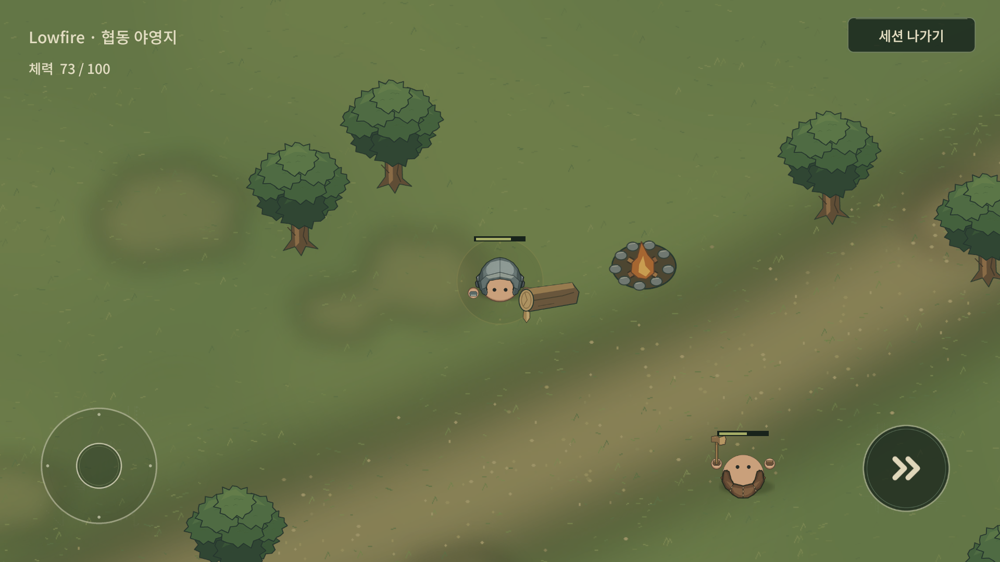

# Multiplayer Foundation — 탐험 기반 / Protocol9

2026-10-18 현재: generation2 지형 유지 / **Save8 / Protocol9**, Item50 / Recipe38. Torch·Compass·제작대 Home·동굴 Exit·제한 지형 cache/분할 생성을 제공한다. [탐험 정본](EXPLORATION_FOUNDATION.md)과 [실제 검수/성능](EXPLORATION_REVIEW.md)를 따른다. 아래 이전 날짜/Version 설명은 각 단계의 기록이다.

2026-10-17 현재: 신규 generation2/Save7/Protocol8. BaseGenerationVersion과 청크 logical state·시설 timestamp·동굴 state를 저장한다. v1~v6 저장은 generation1 지형/시설 위치를 유지한다. 아래 v5/v6/Protocol7 내용은 해당 단계의 구조/이관 기록이며 현재 월드 정책은 [WORLD_GENERATION](WORLD_GENERATION.md)을 따른다.
2026-10-16. 기준361fd7f735561fee9b77b8af331e66b25d428380. **Building / Wall / Door / Host World Persistence와 재입장 기반**을 추가했다. Player, Creature/Combat, Resource/Item/Inventory, Facility/Crafting에 이어 이번 기반 구현을 마쳤다. **다음 단계는 별도 Multiplayer Integration QA다. 이번에 실제 두 프로세스 Relay 검수는 하지 않았다.** 자동검사를 실제 원격 플레이 합격으로 해석하지 않는다.

## Building 권위와 transaction

Catalog에 실제 있는 Placeable9종(Wood/Stone Wall, Wood Door, Chest24/32, Workbench I/II, Furnace, Campfire)의 기존 Definition/Prefab을 그대로 사용한다. NetworkBuilding variants를 등록하며 시설6종에는 기존 NetworkFacility도 유지한다. Protocol5, Player 포함 명시 등록 prefab27개와 별도의 in-scene ecology NetworkObject를 사용한다.

선택 설치물은 기존 PlayerPlacement의 owner 전용 미리보기/footprint/회전과 Primary 입력을 사용한다. NetworkConstruction은 owner RPC/sender/sequence, 가방 revision/선택 slot/연결/생존/Running, 유한 좌표와 기존 최대 거리/지면·물/Bounds/충돌/구조물 overlap을 Host에서 검사한다. Rotation은 Host의 Facing과 기존0/90도 규칙으로 정한다. Client가 Building·수량을 선확정하지 않는다.

Physics transform을 동기화한 뒤 같은 메인 스레드에서 InventoryModel.TryDropSlot로1개 예약 감소→등록된 variant 생성·creator 지정→NGO Spawn 성공 확인→가방 commit을 수행한다. 실패/exception이면 원본 slot을 복원하고 대기 객체를 정리한다. 다음 요청은 방금 생성한 collider와 갱신 가방 revision을 보므로 같은 위치 설치 경쟁에서 두 번째 요청을 거절한다. 매 Frame Building 전체 상태를 전송하지 않는다.

현재 SP에는 플레이어 철거/회수 UX가 없으므로 이번에 새 removal/refund 명령을 만들지 않았다. 기존 피해로 파괴되는 WorldPlaceable은 공통 lifecycle을 통해 Host Despawn하고 기존 Chest/processing cargo를1회 방출한다. 플레이어 Friendly Fire 제한을 유지한다. 시작 근처 초기 시설5개는 새 세션에만 생성하며, 저장 월드를 열 때 다시 추가하지 않는다.

## Wall / Door / 공동 소유

Wall의 기존 위치·회전·sprite·collider를 사용한다. 인접 표현은 spawn/disable/despawn/복원 시 근처 Wall만 갱신하며 이전0.35초 polling을 제거했다. 전체 Wall network를 매 Frame 재계산하지 않는다.

Door 요청은 target object/revision/**원하는 open 상태**다. Host가 연결·생존·Running·거리·존재·revision과 기존 점유된 닫기 거절 규칙을 검사한다. 두 요청이 같은 revision으로 open을 요구해도 한 번만 바뀐다. target/from amount/server start time만 상태 변화 때 보내고 Client는 기존 hinge/easing/collider 경계로 표시한다. 매 Frame 문 transform RPC는 없다. 저장은 기존처럼 target open/closed를 보존하며 로드 때 해당 끝 상태로 복원한다. 원격 navigation/collider 수신 일치는 실제 통합 QA 대상이다.

현재 정상 참가자는 모든 구조물을 공동 설치/사용할 수 있다. 개인 토지·잠금·소유자만 사용 같은 제한은 없다. CreatorId는 기기 생성 식별자 metadata로 상태와 Save에 보존하며 권한·계정 entitlement로 사용하지 않는다.

## 같은 저장 truth와 v5

WorldSnapshotCodec/PlayerSnapshotCodec로 기존 WorldSaveService의 Capture/Apply를 추출해 SP와 Host가 같은 snapshot/복원 코드를 사용한다. SaveRepository의 checksum/temporary write+flush/재검증/atomic replace/정상 backup 정책을 재사용한다. 별도 멀티 전용 파일 포맷/복제한 World serializer를 만들지 않았다.

SavedGame v5는 명시적 IsMultiplayer와 Multiplayer metadata(WorldId/HostId/식별자별 PlayerSnapshot), optional creator를 추가한다. Unity JsonUtility가 null nested reference를 빈 객체로 읽어도 SP를 멀티로 오판하지 않는다. v1→v2→v3→v4 이관을 유지하고, 검증된 v4는 v5로 전진한다. SP는 기존 world-v1.json, Host는 같은 UserData/persistentDataPath의 multiplayer-world-v5.json을 사용한다. 사용자 SP 저장을 멀티로 덮어쓰거나 자동 변환하지 않는다. 로드만으로 기존 파일을 다시 쓰지 않는다.

Host snapshot은 Seed/Elapsed/자원 Delta·Recovery·후보 cursor·Harvest exclusion/동물 종·그룹·HP·anchor·보충 대기/Goblin Camp·주민·refill/Night 종·검 variant·HP/설치물 ID·type·position·rotation·HP·creator/Door target/Chest/Workbench II/Furnace 현재·예약 순서·완료 결과·남은 시간/Campfire Batch/Ground Item을 보존한다. Ground는 기존 SP와 같이 현재 Item/count/position을 지속 대상으로 삼고, spawn/드랍 trajectory나 과거 NetworkObject ID는 저장하지 않는다. Aggro/공격 순간 상태/투사체도 기존 정책대로 제외한다.

Capture와 Write는 Unity 메인 스레드에서 동기적으로 수행하며 pending NGO 초기화를 먼저 flush한다. 다른 gameplay 요청과 timer Update가 capture 중간에 실행되지 않는다. 가공 시간과 회복 timer는 저장된 게임 시간부터 계속하며 오프라인 시간을 더하지 않는다. 실제 저장 stall/기기 파일 시스템 성능은 측정하지 않았다.

## Host 종료 / 재Host / 실패

정상 Host Leave는 snapshot 검증·atomic 저장 성공→Closing→NGO Shutdown→Client 종료→Home 순서다. 저장 실패는 Console에 오류 종류를 기록하고 자연스러운 안내를 표시하며 세션을 유지한다. 종료 버튼을 다시 눌러 재시도할 수 있다. Application.wantsToQuit도 저장 실패 시 종료를 거절하고 background pause에는 Host가 저장한다. transport failure로 연결 유지가 불가능한 경로는 저장을 시도한 뒤 강제 정리한다. OS 강제 kill/crash/모바일 lifecycle의 저장 보장은 주장하지 않는다.

Home/Multiplayer의 Host 버튼은 기존 파일이 있으면 'Host saved world/저장한 월드 호스트'로 표시한다. 유효한 저장과 같은 로컬 Host 식별자를 확인한 후 새 Local/Relay session을 만든다. primary/backup 모두 불러올 수 없으면 로비에서 실패를 알리고 파일을 유지하며 새 월드를 대신 생성하지 않는다. 한 Host 월드 슬롯이며 별도 New World 삭제/선택 UX는 만들지 않았다. Relay allocation/Join Code는 Save에 넣지 않고 매 Host 시 새 connection을 만든다.

NetworkWorldState의 scene NetworkObject가 저장된 terrain seed를 전달한다. Host는 Ready 전 Player spawn을 기다리고, saved world는 terrain/base resource→delta→시설/cargo→ecology/ground를 한 번 복원한다. 공통 Release는 NGO Despawn 및 미완료 spawn 취소를 사용한다. loaded world에 기본 동물/Camp/초기 시설을 다시 중복 생성하지 않으며, 복원한 Night budget을 Start에서 초기화하지 않는다.

저장 불러오기 실패를 새 게임으로 대체하지 않는 원칙은 [Grounded 공식1.0 안내의 load failure 처리](https://grounded.obsidian.net/news/grounded/grounded-1-0-release)를 짧게 참고했다. Lowfire는 로컬 Host 저장이며 해당 게임의 Cloud Shared Worlds/호스트 이전 기능을 구현한 것이 아니다.

## Player state와 재입장 기반

기기에서 생성한 Guid를 별도 PlayerPrefs key에 보존하고 connection approval payload로 전달한다. 서버가 동일 식별자의 동시 연결과 room cap을 거절한다. 이 값은 **인증되지 않은 로컬 식별자**이며 다른 기기/재설치/초기화/위조에 대한 계정 소유권 보장이 아니다. Account/Login/영구 entitlement와 결합하지 않는다.

Host가 식별자별 Inventory/선택/Head·Body/HP/Survival snapshot/XP·Gold·Growth/Stamina/위치/서버가 아는 SeenRecipe 상태를 저장한다. 기본 PlayerSnapshot 검증을 재사용하고 metadata·중복 식별자·Host snapshot 일치를 검사한다. 최대256명의 기억된 식별자를 검증한다. 멀티의 HP0 snapshot은 그대로 Defeated로 복원하며 임의 revive/패널티를 추가하지 않는다. SP의 HP>0 저장 규칙은 유지한다. 기존 멀티의 미연결 소비/Skill 투자 등 다른 생존 행동 전체를 이 저장 패스에서 새로 구현한 것은 아니다.

서버 actor despawn/접속 종료에서 authoritative snapshot을 기억하고 연결 map/열린 context/PlayerObject를 정리한다. 같은 session에 정상 rejoin하면 동일 식별자의 snapshot을 새 actor spawn 전에 적용하며 기존 PlayerObject/대기 spawn을 검사해 중복 spawn을 막는다. Host 재생성 뒤에도 같은 파일의 참가자 상태를 연결한다. 실제 remote transport disconnect/rejoin은 아직 수행하지 않았다. 자동 retry/crash recovery/Host Migration은 없다.

## 검증과 남은 작업

[실행별 검사 증거](evidence/building-persistence-foundation.json). 기존 cached 프로젝트의 hidden batchmode Unity를 한 번에 하나만 사용했다. 새 clone/대화형 Editor/Computer Use/Focus/Show는 사용하지 않았다.

- EditMode 고유12개 최종 통과: v4→v5/모드·payload 보존, participant ID/중복/Host 일치/HP0 규칙,9종 source Definition와 등록/권위, 기존 atomic backup/손상·future version 거절 및 시설/입력 계약. 첫11/12에서 이전 시설 검사에 Wall을 포함한 filter를 고쳐 해당1개만 재실행했다.
- PlayMode 고유9개 최종 통과: 새5개와 기존 SP save/load/v1/v2/v3 이관4개. 설치 경쟁·stale·거리 거절·실패 rollback/9종 설치·owner 미리보기/아이콘/Primary 입력, Wall 연결/파괴1회, Door 경쟁/점유 닫기/hinge·collider, Host save/reHost, 같은 식별자 retire/rejoin, save 실패 유지/corrupt load 거절을 검사했다.
- World roundtrip은 resource 손상/파괴/회복 대기, Animal ID·Group, Camp/refill, Night variant, wall 회전/open Door, Chest, Workbench II, Furnace current/waiting/output, Campfire 진행, Ground 수량, Player 장비/가방/HP/생존/XP·Gold와 중복 Resource/Building ID와 중복 Player가 없음을 확인했다.
- 첫8개 묶음4/8 후 빈 nested metadata와 Door 끝값을 수정하고 관련6개를 검사했다. Night/타이머 보강 시400-frame 대기가 충분하지 않아 실제10초 deadline으로 바꾼 뒤 해당1개가 통과했다. 반복 실행은 고유 사례로 합산하지 않는다.
- Source/reference PASS:615 unique GUIDs/Landscape/참조/표시 문구. 실제 duration과 각 실행의 실패·재실행은 증거 JSON에 보존한다.

모두 단일 실제 Local Host와 같은 프로세스의 서버 fixture다. **실제 두 프로세스 Relay, 원격 owner UI/scene seed/delta/문 collider 수신, 실제 transport reconnect, latency/loss, 전체 gameplay loop,4인/mobile network·성능은 검사하지 않았다.** 별도 live Play/Game View 검수도 하지 않았다. 정상 실제 멀티 플레이 검증 완료라고 보고하지 않는다.

다음 단계는 **Multiplayer Integration QA**다. Foundation1~5의 Player→전투→채집→아이템/가방→제작/시설→건축/문→저장/재Host/실제 재Join을 두 프로세스 Relay에서 함께 검수한다. Account/Login/Friend/Invite/Cloud/영구 entitlement/Host Migration/Dedicated Server/자동 reconnect/4인·모바일 stress는 별도 범위다.

## 이번 시간 기록(KST)

정본·구조 확인:14:01:45→14:03:44,1분59초.

구현·첫 빌드·검사 작성:14:03:44→14:12:36,8분52초.

관련 자동검사·보완:14:12:36→14:20:55,8분19초.

최종 계약검사 대기·검토·문서:14:20:55→14:24:19,3분24초.

Git 마무리는14:24:19부터이며 실제 종료와 총 경과는 완료 보고에 기록한다. Unity 기동/Import/컴파일 대기를 포함하며 병행 시간을 중복 합산하지 않는다.

LIVE 변경87파일이 정본과 일치한다. MCP에서 최종 컴파일 완료/Console error0·warning0/Protocol5/ecology 등록26개·Building9개/scene WorldState와 SaveRules/v5/MainMenu/dirty=false/Play 중지/포커스 없음을 확인했다. 기존 사용자 SP world-v1.json SHA256은57d560f19e49507fbc7ac00b48e1dda5759732a181d1c0baa441ad4536da7970로 전후 동일하다.

---

## Foundation 4 기록 — 2026-10-16

2026-10-16. 기준 e4b6d1fb6a7f434b719fe39ddb8652994dc84e8f. 기존 Foundation 3 위에 **공유 Chest / Hand Crafting / Workbench I→II / Furnace / Campfire**를 Host 권위로 연결했다. 관련 컴파일·자동검사 단계이며 **실제 2인 Relay Play 통합 QA는 이번에도 수행하지 않았다**. Foundation 1의 실제 두 프로세스 Player 검수를 시설 검증으로 확대하지 않는다.

## 시설과 상호작용

기존 Storage Chest24/Reinforced Chest32/Workbench/Furnace/Campfire prefab의 NetworkFacility variant5개를 사용한다. 기존 고정 seed 필드의 시작 지점 근처에 Host가 시설별1개를 안전한 지면·비점유 후보에 생성한다. 후보가 없으면 해당 시설을 강제로 겹쳐 놓지 않는다. 이는 이번 시설 연결을 사용하는 세션의 초기 배치이며 Player Building placement/removal 기능이 아니다. 새로운 Recipe/Item/Facility 콘텐츠는 추가하지 않았다.

Player의 기존 PlayerInteraction/PlayerStorage/PlayerCrafting과 Interact 버튼을 연결했다. 멀티 Interact 후보는 NetworkFacility로 제한하므로 아직 네트워크화하지 않은 수원/문 경로를 실행하지 않는다. 기존 가방/상자/Category/Filter/고정 Sort/NEW/제작·큐 화면을 그대로 authoring하고 로컬 owner actor와 callback을 활성화 전에 다시 바인딩한다. Inventory36/Hotbar9를 유지한다. UI를 열어도 월드는 계속 진행하며 해당 Player 입력만 제한한다. NEW 확인 상태는 현재 Player의 세션 표시이며 이번에 계정·멀티 영구 저장을 추가하지 않았다.

ProtocolVersion4. Player 포함23 prefab을 시작 전 명시 등록한다. DefaultNetworkPrefabs는 Editor registry이고 Runtime의 NetworkSession 등록 목록이 정본이다. 동일 콘텐츠/Catalog 순서를 전제로 한다.

## Chest 동기화와 경쟁 요청

NetworkFacility의 Chest NetworkList는 Server write / Everyone read다. Host가 기존 InventoryModel을 유지하고 Changed 이벤트 때24/32칸을 비교해 달라진 슬롯만 dirty한다. 초기 snapshot 이후 Client는 읽기 전용 모델에 slot delta를 표시한다. 모든 현재 시설 observer에게 공유하며, 개별 열람자 구독/관심 영역 최적화는 추가하지 않았다. 전체 Chest를 매 Frame 전송하지 않는다.

NetworkFacilityInteractor는 owner permission RPC와 sender/sequence, 연결·생존, 플레이어 가방 revision, 시설 존재·거리·revision, 실제 열어둔 시설 context, 슬롯 범위·수량·Recipe/Station을 Host에서 검사한다. Client는 로컬 수량을 선확정하지 않는다. Host의 한 메인 스레드 처리에서 기존 InventoryModel.Transfer로 양쪽 슬롯을 먼저 commit하고 각각 변경 이벤트를 발행한다. 전체 교환/부분 Stack/merge 규칙은 싱글과 같다. full 슬롯에 부분 교환을 시도하면 원본을 유지한다.

두 Player가 같은 상자를 동시에 열 수 있다. A가 성공하면 시설 revision이 올라 B의 이전 revision 요청을 거절한다. B는 갱신 상태에서 다시 요청할 수 있다. 드래그/소분은 시작 시 가방·상자 revision을 보존하므로 들고 있는 중 내용이 바뀌면 오래된 요청을 새 revision으로 위장해 적용하지 않는다. 상자 내부 이동과 상자→바닥 Drop도 같은 경계를 사용한다. Drop은 기존 TryDropSlot 감소/생성 실패 rollback 및 NGO spawn 성공 확인을 재사용한다.

가방/시설 명령은 별도 작은 담당 컴포넌트로 나누되 같은 개인 가방 revision으로 충돌을 검출한다. 한 owner의 시설 요청은 ack와 해당 가방·시설 revision 수신까지 대기한다. Client의 UI 표시를 Host로 반영할 때, Host가 승인한 시설 열기 ack를 다시 close/open RPC로 반향시키지 않는다. 제작→가방/Hand 전환도 Host의 시설 context를 해제하며 이후 시설 mutation을 거절한다.

## Crafting과 Workbench

Hand와 Workbench는 같은 요청/검증 경계와 기존 PlayerCrafting.GetStatus/Craft를 사용한다. RecipeCatalog/RequiredStation/RequiredWorkbenchTier가 정본이다. 즉시 제작은 기존 InventoryModel.TryExchange가 복사한 다음 슬롯 배열에서 재료 소비+결과 공간을 함께 확인한 뒤 한 번 commit한다. 공간/재료/상태가 맞지 않으면 양쪽 모두 변경하지 않는다.

Workbench I→II는 Host가 기존 UpgradeCosts를 소비하고 동일 NetworkObject의 Definition/Visual/HP 비율을 II로 바꾼다. NetworkObject 교체로 두 Player의 열린 참조를 끊지 않는다. Upgraded state와 시설 revision, UpgradeTo가 없는 II 상태가 중복 업그레이드와 이중 비용을 거절한다. Client도 같은 Definition의 Tier와 Recipe 조건을 표시한다. 싱글의 기존 설치물 교체/Save ID 보존 업그레이드는 유지한다.

## Furnace와 Campfire

기존 StationProcessing/ProcessingQueue가 유일한 처리 로직이다. Furnace의 sequential current/waiting/output와 +1/대기 −1/Add all/Take는 Host가 검증·실행한다. 큐는 기존 예약 순서를 유지한 run과 결과 목록을 NetworkList delta로 전달한다. 현재 Recipe/Batch/완료 예정 server time/진행 여부는 상태 변경 때만 보낸다. timer 전체 RPC와 매 Frame 상태 전송은 없다.

Host만 Advance를 호출해 큐를 소비한다. completion/출력 포화 경계도 revision을 올려 완료 직전 요청을 거절한다. Output full이면 완료된 현재 단위를 보존하고, 결과 Take가 성공하면 재개한다. 결과와 대기 재료 반환은 기존 TryAddAmounts의 atomic 공간 검사를 사용하며 full bag이면 큐/결과를 유지한다. 실제 수치 Input50/Output100/2초는 기존 데이터를 유지한다.

Campfire는 기존 단일 Batch 예약, Meat cooking과 Raw Water Cup→Clean Water Cup5초, 명시적 Take를 유지한다. Furnace와 같은 NetworkFacility/요청 검증/진행 시각 경계를 사용하며 sequential queue로 억지로 바꾸지 않았다. Client는 Restore 경계로 Host snapshot을 표시하고 server time으로 Remaining을 계산할 뿐 큐/Batch를 독립 진행하지 않는다. 제작 화면은 상태 변화 때 목록을 갱신하며,0.2초의 진행 표시 갱신에서는 카드 진행률/남은 시간만 갱신한다.

## Disconnect와 저장 범위

시설 열기는 독점 lock/reservation을 만들지 않는다. 가공 투입 재료는 성공한 transaction에서 즉시 시설 cargo가 되므로 시작한 Player가 사라져도 Host queue는 계속 진행하고 다른 유효한 Player가 결과를 수령한다. NetworkDespawn은 actor의 열린 context/대기 요청/authority 참조/화면을 정리한다. 시설 cargo는 특정 Player의 UI나 생존에 묶이지 않는다. 연결 종료 Player의 가방 보존·재접속 복원·월드 저장은 이번에 결정/구현하지 않았다.

## 검증과 한계

[실행별 자동검사 증거](evidence/facility-network-foundation.json). 기존 cached Unity 프로젝트 하나에서 hidden batchmode 프로세스를 한 번에 하나만 실행했다. 새 clone/대화형 Editor/Computer Use/Focus/Show를 사용하지 않았다.

- EditMode16/16(0.5122075초): 등록/Protocol/시설 컴포넌트, craft atomicity, completion version/blocked cargo, 기존 InventoryOperations와 큐 순서/legacy restore/공간 보존.
- 고유 PlayMode8개 최종 통과. 첫 묶음3/8 후 새 검사5개가 fixture의 표시 이름/컵 Item ID 가정 때문에 본문 진입 전 실패했다. 데이터 참조/실제 ID로 고친 뒤 해당5개와 공통 Furnace1개6/6(12.4892733초) 통과했다. 이후 공통 Craft 경계/출력 포화·retired actor 보강3/3(6.6761345초), 시설 화면 전환 context 보강1/1(3.3313331초)을 수행했다. 반복 실행을 고유 사례로 합산하지 않는다.
- Chest: 두 actor의 같은 stack withdraw/같은 slot deposit/merge/split stale/full bag/거리 거절/24·32칸. 기존 UI로 부분 배치/변경 중 held 요청 거절/Close를 확인했다.
- Craft: 정확한 재료1회 소비/같은 revision 재요청 거절/공간 부족 원본 유지. Workbench 동시 upgrade1회/다른 Player 비용 보존/II Recipe와 잘못된 Station 거절.
- Furnace: 동시 add/remove stale/완료 직전·직후 Take/중복 Take/full bag/Output100 포화와 해제/시작 actor 제거 뒤 진행·다른 actor 수령.
- Campfire: 같은 Batch 시작·결과 Take 경쟁/시작 actor 제거/Meat와 Water의 실제 Recipe 상태 전이. 싱글은 기존 Furnace queue UI와 Campfire full bag/시설 파괴 cargo sanity2개를 수행했다. 기존 멀티 가방 UI/Armor/도구·자동 Pickup 검사1개도 통과했다.
- Source/reference PASS:602 unique asset GUIDs/Landscape/참조/제품 표시 문구.

두 actor는 단일 실제 Local Host 안의 서버 fixture다. **원격 Client의 owner 화면·공유 delta 수신/보간, 실제 transport disconnect, 두 프로세스 Relay, 양쪽 Game View, 터치·고지연/패킷 손실·4인·Android·bandwidth profiling은 검사하지 않았다.** retired actor의 NGO Despawn 검사와 실제 연결 단절 검수를 구분한다. 이번에는 별도 live Play 검수를 수행하지 않았다. 실제 통합 QA 완료/성능 합격을 주장하지 않는다.

## 다음 범위

Building placement/removal, Wall/Door/Building ownership, Multiplayer World persistence, Host save/reload, reconnect persistence/session recovery, Account/Login/Friend/Invite/Cloud Save/Host Migration/4인 stress와 실제2인 Relay 통합 QA는 남겨 둔다. 시설 초기 배치와 제작 결과 아이템을 얻는 기능을 Player 설치/건축 완료로 해석하지 않는다. 기존 기타 생존 행동/Skill 투자 전체가 네트워크화된 것도 아니다.

## 이번 시간 기록(KST)

정본 확인:13:39:04→13:42:01,2분57초.

구현 및 첫 빌드:13:42:01→13:46:10,4분9초.

관련 자동검사 및 보완:13:46:10→13:52:04,5분54초.

마무리 검토와 정본 정리:13:52:04→13:53:59,1분55초.

Git 마무리는13:53:59부터이며 실제 종료/전체 경과는 완료 보고에 기록한다. 단계에는 해당 Unity 기동/Import/컴파일 대기가 포함되며 병행한 시간을 중복 합산하지 않는다.

열린 LIVE에 최종 변경60파일이 정본과 일치함을 확인했다. MCP에서 최종 컴파일 완료/Console error0·warning0/MainMenu/dirty=false/Play 중지/포커스 없음/Protocol4/등록 ecology22개·시설5개와 close context 함수 반영을 확인했다. 기존 사용자 world-v1.json SHA256은57d560f19e49507fbc7ac00b48e1dda5759732a181d1c0baa441ad4536da7970로 전후 동일하다.

---

## Foundation 3 기록 — 2026-10-16

2026-10-16. 기준5eb5b989761aed7aad1c126e283db0d29831c3c9. 현재는 Player/Creature/Combat에 **Resource→Harvest→Ground Drop→Pickup→개인 Inventory 및 Creature Loot/XP·Gold**를 Host 권위로 연결한 단계다. 컴파일/관련 자동검사를 수행했으며 **이번에도 실제2인 Relay Play 통합 QA는 하지 않았다**. 이전 Foundation 1의 실제 Player 검수를 이번 Item/Resource 수신 검증으로 확대하지 않는다.

## Resource / Harvest / Recovery

기존 Tree/Fallen Log/Small Plant/Stone/Iron Ore의 Rule/ResourceDefinition과 도구·Tier 판정을 공유한다. WorldGenerator는 멀티에서 Host만 Resource를 만들고, Client는 정적 지형/물과 Host가 spawn한 자원 replica를 표시한다. 파괴한 나무가 Client의 로컬 월드 생성으로 다시 생기는 경로를 제거했다.

NetworkResource는 기존 프리팹의 variant다. Host가 초기 ResourceIdentity ID/Rule/HP/hit sequence를 전달하고 Health.Changed/Damaged 때만 상태를 갱신한다. 정적 자원에 매 Frame Transform/RPC를 보내지 않는다. 초기 위치/scale은 NGO spawn transform을 사용한다. Client는 Health.IsReplica로 독립 피해를 거절하며 hit/HP/collider/alternate sprite를 표시한다.

Primary의 기존 PlayerCombat을 재사용하며 멀티에서는 NetworkCreature 또는 NetworkResource만 선택한다. 도구 적합성/Required Tier/Range/Facing/Point-Blank/Single Target은 Host에서 판정한다. 같은 자원의 lethal hit는 기존 Health latch와 NetworkResource.Broken으로 한 번만 Drop/파괴한다. ResourceIdentity는 파괴를 기존 ResourceRegeneration/ResourcePopulation에 기록한 뒤 NGO Despawn한다.

기존 Region Soft Target/후보 Cursor/Harvest Exclusion/자연 회복 지연/Hard Limit/최대2개 Tick 보충을 Host에서만 실행한다. 복구는 원래 ID 부활이 아니라 p-serial의 새 위치/ID를 가진 NetworkResource spawn이다. Host의 기존 Capture/Recovery Snapshot 형식은 유지하지만, 이 패스에서 멀티 Save/재접속 복원을 연결하지 않았다. Client의 Tick/Record/Restore 진입도 권위 검사로 막는다.

## 공통 Ground Item과 Pickup

Resource Drop, Creature Loot, Player Drop은 모두 기존 WorldPickup의 NetworkGroundItem variant를 사용한다. 같은 NetworkSpawnFactory 등록 목록으로 생성하며 별도 로컬 Drop truth를 만들지 않는다. Ground 상태는 item ID/count/origin/destination/start/dropper metadata를 Host가 지정한다. Client는 공통 WorldPickup 표현 함수로 산란/부유만 수행한다. Client가 피해·획득·수량을 확정하지 않는다.

Ground trigger가 로컬 owner에게 가까운 후보를 등록한다. NetworkInventory는 가까운 후보만 확인하며, 같은 Item/Inventory revision에서 실패한 획득을 계속 RPC로 반복하지 않는다. 가방이 바뀌거나 범위를 나갔다 들어오거나 Item 상태가 달라지면 재시도할 수 있다. 전체 Ground Item 목록을 매 Frame 탐색/방송하지 않는다. 생성 후 기존 Pickup delay를 유지한다. Player Drop은 기존 안전한 근처 위치에 놓으므로 즉시 발밑으로 회수하지 않는다.

Owner Pickup 요청→Host의 연결/생존/존재/거리/지연/가방 수용 검사→claim latch→InventoryModel.TryAddAmounts→Count0/Despawn 순서다. **멀티는 한 Ground stack을 전량 넣을 수 있을 때만 획득한다.** 공간이 부족하면 부분 수량을 미리 더하지 않고 Ground를 그대로 둔다. 두 요청이 같은 프레임에 들어와도 첫 성공만 소비하며 이미 소비/제거된 개체는 다시 획득하지 못한다. 싱글의 기존 부분 자동 획득 방식은 유지한다. Ground 자체는 Host 소유 NetworkObject이고, 확정 후 아이템은 획득자의 세션 Inventory에 속한다.

## Inventory / 선택 / Armor / Player Drop

기존 PlayerInventory/InventoryModel36칸(Hotbar9+Storage27)과 Stack/Drag/Split/Item Actions/Drop UI를 재사용한다. InventoryUiBuilder는 시설 참조가 없는 모드도 지원하며 멀티에 Crafting/Chest 버튼·패널을 생성하지 않는다. 새 가방 디자인을 만들지 않았다. Bag/Hotbar/장비/선택 도구 아이콘/세션 Level·XP·Gold를 연결했다. Inventory가 열려도 월드는 계속 진행하고 해당 Player의 이동·공격만 막는다.

NetworkInventory의 NetworkList는 **Owner read / Server write**다. Model 변경 이벤트 때36칸을 비교해 달라진 index만 dirty한다. 선택 슬롯/Inventory revision/XP·Gold도 별도 owner-read 상태다. 초기 owner는 전체 snapshot을 받고 이후 슬롯 delta를 기존 읽기 전용 Model에 적용한다. 다른 Player의 전체 가방을 표시용으로 복제하지 않고 기존 public Armor/held 외형만 공유한다. 매 Frame Inventory 전체를 직렬화하지 않는다.

UI는 IInventoryAuthority를 통해 Select/Transfer/Drop/Equip/Unequip 요청을 보낸다. Client Model은 읽기 전용이며 로컬에서 먼저 수량을 확정하지 않는다. Host는 owner RPC/sender/연결·생존/slot/수량/Inventory 열림/expected revision을 검증한다. 오래된 revision은 거절한다. 요청 sequence는 replay를 거절하고, Client는 한 요청의 결과와 해당 snapshot revision 반영까지 다음 mutation을 대기한다. 부분 이동/합치기/전체 교환/Armor 교체·반환은 기존 모델/Equipment 코드로 수행한다.

Player Drop은 Host가 안전한 지형·장애물 없는 위치를 검사한 뒤 TryDropSlot에서 정확한 수량을 예약 감소→Ground 생성/초기화·NGO spawn 성공 확인→성공 알림을 처리한다. 생성이 false/exception이면 원래 slot을 복원하고 Changed를 발행하지 않는다. 실패 중 만들어진 대기 NetworkObject도 취소한다. PlayerItemDrop.BindWorld는 소유 여부와 무관하게 모든 멀티 actor에 월드/Pickup/설정을 연결하며 싱글 authoring도 같은 경계를 사용한다.

## Creature Loot와 XP / Gold 규칙

기존 LootTable/variant 선택과 Host-only roll은 유지한다. NetworkDeathResult의 payload는 한 번만 commit할 수 있고 NetworkCreature.DeathResolved와 함께 중복 Loot/보상을 차단한다. World가 commit한 결과를 공통 Ground Item으로 생성한다. 무한히 커지는 죽은 NetworkObject ID ledger를 추가하지 않았으므로 NGO ID 재사용과 충돌하지 않는다. 자연 잠복/단순 Despawn은 사망 보상을 만들지 않는다.

**멀티 XP/Gold는 처치 지점24유닛 안의 살아 있는 접속 Player에게 각자 LootTable의 전체 값을1회 지급한다.** 유효한 Player 공격자로 발생한 처치만 대상이다. 멀리 있거나 사망/연결 종료된 Player는 받지 않는다. 금액을 인원수로 나누지 않고 각 개인 세션 지갑에 지급하며 Ground Item의 획득자와는 독립이다. 뒤늦게 참가한 Player에게 과거 보상을 재지급하지 않는다. 싱글은 기존 마지막 직접 공격자 보상을 유지한다.

선택 이유: 기존 개인 PlayerProgression/Level/Gold 구조는 유지하면서 멀티 막타 경쟁을 줄이고 근처 지원 역할도 함께 성장하게 한다. 기여도/누적 피해/계정 entitlement를 계산하지 않는다.24는 이번 Lowfire의 초기 거리 규칙이며 실제 밸런스 합격 수치가 아니다. [Grounded 공식 설명](https://grounded.obsidian.net/news/grounded/time-for-the-backyard-to-get-hotter-and-hazier)의 party 공유 성장 자원 사례와 [Deep Rock Galactic 공식 업데이트](https://www.deeprockgalactic.com/updatesold)의 임무 완료 재화 보상 구조를 짧게 참고했다. 해당 게임의 XP/Gold 분배식을 Lowfire의 규칙으로 단정하거나 복사하지 않았다.

여기서 ownership은 Player의 현재 세션 Inventory/XP/Gold와 획득 확정이다. 영구 계정 소유권/온라인 entitlement/Cloud Save가 아니다. 접속 종료 Inventory 보존/재접속 복원/사망 아이템 드랍 규칙은 아직 제공하지 않는다.

## 검증과 한계

[실행별 자동검사 증거](evidence/item-network-foundation.json). 기존 캐시 검수 프로젝트에서 hidden batchmode 프로세스를 한 번에 하나만 실행했다. 새 clone/대화형 Editor/Computer Use/Focus/Show 조작은 하지 않았다.

- EditMode16/16(0.226255초): 관련 InventoryOperations/새 atomic drop·read-only/등록 Resource·Ground/기존 Creature 계약.
- 고유 PlayMode7개 최종 통과. 첫 묶음6/7 후 실패한 Drop 월드 바인딩 사례1개만 재실행해 통과했다. 이후 같은 UI 사례에 선택 도구 아이콘과 실제 trigger 자동 획득 검사를 추가해 통과했다. 중복 실행을 새 사례로 합산하지 않았다.
- 단일 실제 NGO Local Host에서 같은 자원 final hit2개→Drop/Despawn1회, 기존 Population 회복→새 ID/Network spawn, full Inventory 획득 거절, 두 actor의 같은 Ground 획득·제거 후 재요청 거절, quantity1 Drop/오래된 revision 재요청 거절, despawn한 actor의 요청 거절을 검사했다.
- Skeleton sword variant의 기존 table roll→Ground 수량 일치, 같은 death result 재commit 거절, 근처 Player2명 지급/먼 Player 제외/각 지갑 중복 없음, 기존 Creature lethal path를 검사했다.
- 기존36/9 가방 UI의 부분 Stack 배치/선택/Armor equip·unequip, 선택 도구 아이콘, trigger 기반 자동 획득을 검사했다. 싱글은 기존 Long Press Split과 pooled pickup 수량/보상 sanity2개만 수행했다.
- Source/reference PASS:592 unique asset GUIDs/Landscape/참조/제품 표시 문구.

두 actor는 같은 Host 안의 서버 fixture다. **실제 원격 Client의 owner UI/delta 수신, 실제 네트워크 pickup race/disconnect, Relay 두 프로세스, 양쪽 Game View, 모바일 터치·고지연/손실·4인·bandwidth profiling은 이번에 검사하지 않았다.** retired actor 검사와 실제 transport disconnect 검수를 구분한다. 재미/공유 거리24/whole-stack pickup의 체감은 사용자 및 이후 통합 QA 대상이다. 미측정 기기 성능 합격을 주장하지 않는다.

## 다음 범위

Chest sync, Crafting/Workbench/Furnace/Campfire processing, Building/Wall/Door, Multiplayer World/reconnect persistence, Account/Friend/Invite/Cloud Save/Host Migration/4인 stress와 실제2인 Relay 통합 QA는 미완료다. Consumable 사용/Skill 투자 등 다른 생존 행동을 이번 Item 전달 범위와 혼동하지 않는다.

ProtocolVersion은3이며 Player 포함18개 prefab을 시작 전에 명시 등록한다. 같은 콘텐츠/Catalog 순서와 현재 protocol을 전제로 한다. 최종 atomic Drop 강화 후 해당 Pickup/Drop/replay/retired actor 검사1개를 다시 실행해1/1(6.43812초)을 확인했다. Drop 성공 반환 직후 이미 NGO spawn이 완료됐는지도 검사했다. 열린 LIVE 프로젝트에 변경80파일을 동기화하고 MCP에서 컴파일 완료/Console error0·warning0/Play 중지/dirty=false/포커스 없음/Protocol3/등록 ecology prefab17개·Resource Rule5개를 확인했다. 사용자 world-v1.json SHA256은57d560f19e49507fbc7ac00b48e1dda5759732a181d1c0baa441ad4536da7970로 전후 동일하다.

## 이번 시간 기록(KST)

2026-10-16의 실제 wall clock이다. Unity 배치 기동/Import/컴파일 대기를 포함하며 병행한 문서 작업 시간을 중복 합산하지 않는다. 관련 실패/변경 사례만 재실행했다. 실제2인 Relay 대기는 없다.

정본 및 사례 확인:11:24:38→11:29:07,4분29초.

구현 및 첫 빌드:11:29:07→11:40:23,11분16초.

관련 자동검사:11:40:23→11:49:37,9분14초.

마무리 검토와 정본 정리:11:49:37→11:57:28,7분51초.

Git 마무리는11:57:28부터이며 실제 종료 시각/전체 경과는 완료 보고에 기록한다.

---

## Foundation 2 기록 — 2026-10-16

2026-10-16. 기준 bfc18d46a740b73fb898495ae84be2e86f365c9c. 현재 변경은 **Creature + Combat 네트워크 기반 구현**이다. 이번 패스는 컴파일과 최소 자동검사로 검증했으며 **실제 2인 Relay Play 통합 QA는 수행하지 않았다**. 아래 Foundation 1의 실제 두 프로세스 검수 기록은 이전 Player slice의 증거이며 이번 Creature 검증으로 확대 해석하지 않는다.

### 현재 완료한 구현

- Host만 Creature Spawn/Despawn, Animal Population, Night Spawn, Goblin Warband/Camp 보충, AI/그룹 반응/Soft Separation, 대상 선택과 피해·사망을 결정한다.
- Chicken/Boar/Rabbit/Deer/Sheep, Zombie/Goblin/Slingshot Goblin/Skeleton과 Rusted Sword Skeleton variant를 기존 프리팹의 네트워크 variant로 제공한다. 별도 종 이름별 네트워크 AI를 만들지 않았다.
- Client owner의 공격 요청에는 target ID·damage·hit 결과가 없다. owner permission RPC와 sender 검증 후 Host의 기존 PlayerCombat에서 생존·입력 상태·쿨다운·무기·Single Target/Facing Arc/Point-Blank/Range를 검사한다.
- Host의 기존 Creature Brain이 살아 있는 NetworkPlayer 중 가까운 대상을 선택한다. 근접 준비/타격 동안 대상을 고정하고 대상 사망 시 추적을 초기화해 다시 선택한다. 실제 타격과 새총 Projectile 충돌은 Host에서만 수행한다. Player HP/기존 Armor 방어는 공통 Health를 사용한다. Player 사망은 자신의 입력을 막으며 월드를 전역 정지하지 않는다. Revive/PvP/보상 소유권은 없다.
- Health는 lethal 판정을 이벤트 전 latch하고 HP를0까지 clamp한다. NetworkCreature.DeathResolved가 사망 결과를 한 번만 만들며, 짧은 눕힘 표현 뒤 Host Despawn한다. 자연 잠복/세션 종료는 Loot/Death를 만들지 않는다.

### 씬과 Spawn 경계

Multiplayer 씬은 기존 단색 야영지에서 **기존 WorldGenerationDefinition의 고정 default seed를 사용하는 필드**로 확장했다. 기존 서식지·Road·지역 Population을 공유하기 위한 지형이다. 각 peer는 동일 정본/seed의 정적 지면·물·자원 장애물을 생성한다. 이것은 Tree/Stone 파괴·재생이나 Resource/World Interaction 네트워크화가 아니다. 멀티의 Primary는 Creature만 타격하며 ResourceRegeneration은 비활성, Save/시설/Inventory UI는 생성하지 않는다. 기존 Singleplayer 씬과 사용자 저장을 멀티 세션에 사용하지 않는다.

NetworkEcologyBuilder는 기존 프리팹의 variant9개와 Pebble/Camp를 생성한다. NetworkSession.EcologyPrefab 참조 목록을 양쪽에서 StartHost/Client 전에 명시 등록한다. Player 포함12개다. NGO ProtocolVersion은2이며 같은 콘텐츠 버전을 전제로 한다. World 초기화가 NGO scene 완료 콜백보다 늦으면 Player spawn을 Map 준비까지 기다린다.

NetworkSpawnFactory는 기존 AnimalPopulation의 Instantiate와 Goblin/Night/Projectile의 PrefabPool 생성 경계를 연결한다. 기존 initializer가 Group/Home/Camp/Variant/Target을 지정한 뒤 같은 프레임 LateUpdate에서 Host가 NetworkObject.Spawn한다. 네트워크 개체는 기존 로컬 pool로 반환하지 않고 Host Despawn하며, 종료 시 아직 Spawn되지 않은 대기 개체도 정리한다. Singleplayer는 기존 Instantiate/pool 경로를 유지한다.

NetworkCreatureWorld는 Host에서만 기존 Population/Clock/Spawner를 활성화한다. Client는 같은 Brain/Lifecycle/Slingshot simulation을 비활성화하고 public 행동·경보·Population/Restore 진입도 권위 검사로 차단한다. Host의 기존 AnimalIdentity/GoblinIdentity와 Group ID/Anchor, Faction/Traits/Habitat 데이터가 정본이다. Client에는 NetworkObject ID와 species/group/camp/anchor/additional traits/variant를 읽기 상태로 전달한다. NetworkCamp는 Camp ID와 refill 예정 시각을 전달하되 Client가 보충하지 않는다.

동물의 가까운 동일 그룹 flee propagation/cohesion과 Goblin의 직접 이웃 assist/Warband3~5·새총0~2/leash/camp resident/refill을 공통 코드로 유지한다. Soft Separation은 Host의 모든 살아 있는 Player를 고려한다. 새 Group 전수 비교를 추가하지 않았고 기존 Group 순회 구조를 유지한다. Spawn의 Player 안전 거리는 모든 접속 Player 위치를 검사한다. Population/야간 spawn의 기준 anchor는 첫 생존 Player다. 여러 지역을 흩어져 탐험할 때의 population scaling/관심 영역 최적화는 이번에 완성하지 않았다.

### 표현과 트래픽

Root XY는 server-authoritative NGO NetworkTransform/NetworkRigidbody2D, 보간과0.04 threshold/unreliable delta를 사용한다.20Hz tick에서 quantized facing/pose/HP/hit sequence/target/brain/lifecycle frame을 비교하고 달라진 경우만 server-write NetworkVariable을 dirty한다. Species/Group/Camp/Variant 등 identity는 별도 상태로 분리했다. 매 렌더 Frame마다 모든 개체의 전체 RPC를 방송하지 않는다. HP와 pose가 함께 들어가는 frame의 변경 시 전체 구조가 직렬화되는 비용은 남아 있으며 실제 bandwidth/지연 profiling은 하지 않았다.

Client는 Brain 없이 root interpolation, 손/시선·Visual pose, HealthBar/hit/death를 표시한다. 새총은 Host network timestamp와 기존 DrawAmount/손/Band 함수를 이용해 Ready→Draw→Hold→Release→Band Snap→Recovery를 표시한다. 실제 돌은 Host가 한 개만 생성한다. NetworkProjectile은 origin/velocity/start를 spawn 상태로 전달하고 Client는 직선 visual만 진행한다. 충돌·Damage·최종 Despawn은 Host다. 고지연 발사 타이밍/보간 품질은 통합 QA에 남긴다.

Player는 기존 이동/상태 외에 server attack timestamp/sequence/hand/tool index로 같은 PlayerCombat.Present를 재사용한다. 오른쪽 Fist hold 버튼과 기존 Dash를 배치했다. 무기 획득/선택 Inventory 동기화는 아직 없으며 서버가 가진 무기 stats를 판정하는 구조까지만 제공한다.

### Death와 Loot의 정확한 범위

LootOnDeath는 멀티 개체에서 로컬 WorldPickup/XP/Gold 지급을 실행하지 않는다. Host가 현재 LootTable.Items/RareItems를 한 번 roll해 immutable NetworkDeathResult(개체/공격자 NetworkObject ID, Item/Count, XP/Gold)를 만들고 NetworkCreatureWorld.LootGenerated 이벤트/LastDeath로 노출한다. 이는 다음 패스 연결 경계이며 실제 아이템 획득/보상 소유권/대기 아이템 persistence가 아니다. LastDeath는 최신 결과 검사 용도이며 모든 사망의 영구 ledger가 아니다. Client는 Died authoritative event를 호출하거나 독립 roll하지 않는다. 싱글은 기존 공격자 보상·바닥 Drop을 유지한다.

### 미완료 범위

Ground pickup/drop, Inventory/Item ownership, Chest/Crafting/Furnace/Workbench, Resource harvesting·파괴/복구, Building/Door, Multiplayer persistence, reward ownership 세부 규칙, Friend/Account/Cloud Save/Host Migration/4인 stress와 **통합 실제 멀티 QA**는 미완료다. 이번 코드를 실제 두 Client 수신·화면 동기화·재접속/서비스/실기까지 검증한 것으로 표현하지 않는다.

### 이번 검증

[자동검사 결과와 실행별 증거](evidence/creature-network-foundation.json). 기존 tests/artifacts/unity를 재사용했고 새 clone이나 대화형 Editor를 만들지 않았다. 한 번에 한 hidden batchmode 검수 프로세스만 실행했다. Windows/Computer Use/Focus/Show 조작은 하지 않았다.

- EditMode NetworkCreatureContractTests + NetworkFoundationTests + EcologyModelTests:12/12,0.2602423초. 이후 새총 replica가 완료 시 Busy/Band를 해제하고 추가 발사하지 않는 표현 검사1/1(0.1235574초)을 추가해 고유13개 통과다.
- 고유 PlayMode9개 최종 통과(실패 관련 사례만 수정 후 선별 재실행). Network Creature4개, 기존 Network Foundation1개, Singleplayer sanity4개다. 서로 다른 실행의 중복 사례를 합산하지 않았다. 개별 XML/duration은 증거 JSON에 기록한다.
- 실제 NGO Local Host spawn/기존 이동·Dash/종료,5종 Animal/그룹 정보, 서버 공격 쿨다운/Single Target/밀착 판정, 동일 대상 두 서버 actor 공격의 단일 death/loot/despawn, 실제 Projectile 단일 생성/피해, Warband/assist, Skeleton variant/근접/죽은 target 재선택을 자동검사했다. 두 번째 actor는 같은 Host 안의 서버 fixture이며 원격 Client가 아니다.
- 별도 unspawned replica에서 Brain 비활성/피해·경보·분리·Population 생성/복원·Spawn 거절을 검사했다. 이것은 실제 연결된 Client 수신 검증을 대체하지 않는다.
- Singleplayer는 기존 모든 기본 무기의 Single Target, Range/Point-Blank, Warband/assist 수/지역 Animal 보충·저장 round-trip의4개 사례만 수행했다. 전체 회귀/모든 저장 migration은 아니다.
- source/reference validator PASS:578 unique asset GUIDs/Landscape/참조/표시 문구.

첫 자동 실행에서 static ecology anchor의 Rigidbody 가정과 scene 완료/World.Start 초기화 순서를 수정했다. 검수 fixture의 lazy Multiplayer 진입 누락과 leash 밖 assist 조건도 고쳤다. 통과한 전체 회귀를 매번 반복하지 않았다. 실제 두 프로세스 Relay/양쪽 Game View, 모바일 터치/디자인/재미·밸런스/고지연/4인·대규모 성능은 이번에 검사하지 않았다. 최종 대기 spawn 정리 이후 기존 Local Host 생성/이동/Dash/종료 자동검사1개를 다시 수행해1/1(6.0071142초)을 확인했다. 열린 LIVE Editor에도 변경81파일을 동기화했고 MCP에서 컴파일 완료/Console error0·warning0/MainMenu/Play 중지/dirty=false/포커스 없음, Protocol2/등록 ecology prefab11개를 확인했다. 사용자 world-v1.json SHA256은57d560f19e49507fbc7ac00b48e1dda5759732a181d1c0baa441ad4536da7970로 전후 동일하다.

### 이번 시간 기록(KST)

2026-10-16의 실제 wall clock이다. 배치 기동/컴파일·Import 대기를 포함하며 문서 작업과 겹친 대기 시간을 중복 합산하지 않는다. 실제2인 접속 대기는 없다. 같은 기존 검수 프로젝트를 재사용했고 실패한 관련 사례만 선별해 재실행했다.

정본 확인:08:55:18→08:57:09,1분51초.

구현 및 첫 컴파일:08:57:09→09:07:16,10분07초.

관련 자동검사와 수정:09:07:16→09:15:00,7분44초.

프로젝트 반영과 정본 정리:09:15:00→09:19:15,4분15초.

마지막 표현 교정:09:19:15→09:21:31,2분16초.

Git 마무리는09:21:31부터이며 실제 종료 시각과 전체 경과는 완료 보고에 기록한다.

---

## Foundation 1 기록 — 2026-10-15

기준 663c0cfb7e33bd9e50a50c4c675afe5a9e6577ee. 이번 범위는 Home 보조 메뉴 소수정과 실제 2인 Player 상태 slice다. 기존 생존 게임 전체를 멀티로 전환한 패스가 아니다.

[Home 텍스트 메뉴](images/network-home-text-menus.png) / [실제 Relay Host 메뉴](images/network-host-menu.png) / [두 프로세스 검수 데이터](evidence/network-foundation.json)

### 실제 제공 흐름

Home → Multiplayer → Internet(Room Code) 또는 Local Network → Host Game / Join → Host의 Enter Game → 협동 야영지(Multiplayer 씬)다. 기존 Single Player/Continue/Settings는 보존한다. 수첩 안 Single Player/Multiplayer/Settings는 기본 배경 박스를 제거하고 hover/focus/press 때만 약한 tint를 준다. Continue의 Primary 박스/배경/로고는 유지한다.

Internet Host는 공식 Relay allocation(Host 외 최대3명)을 만들고 GetJoinCodeAsync의 실제 결과만 표시한다. Join은 입력을 정리/형식 검사한 뒤 JoinAllocationAsync와 실제 Transport 접속을 수행한다. 가짜 코드나 IP를 Room Code로 표시하지 않는다. 대기·잘못된 코드·접속 실패·정원 초과·Host 종료는 en/ko 제품 문구로 표시하며 SDK 내부 메시지는 UI에 출력하지 않는다.

Local Network는 별도로 표시하며 IPv4[:port] 입력을 사용한다. 기본 포트7777, Host listen0.0.0.0, 같은 PC 검수 주소127.0.0.1이다. 로컬 주소는 인터넷 참가 코드가 아니다. 이번 실제 두 프로세스 검수는 로컬로 대체하지 않고 Relay/DTLS를 사용했다. 로컬 Host는 별도 자동 Play 검사에서 확인했다.

Host는 혼자 먼저 입장할 수 있고 접속 중인 Client/늦게 참가한 Client를 NGO SceneManager가 같은 씬으로 동기화한다. Host가 종료하면 Client도 연결을 정리하고 Home으로 돌아가 세션 종료 안내를 제공한다. Client만 나가면 해당 Player가 despawn되고 Host는 계속한다. Host migration, dedicated server, 자동 재접속은 없다.

### Networking stack와 외부 설정

- Netcode for GameObjects2.13.3
- Unity Transport2.7.4
- Multiplayer Services SDK2.4.0
- Authentication3.8.0/Core1.18.0은 패키지 의존성이다.

Unity 공식 Registry의 Unity6000.0 호환 버전을 확인하고 manifest/lock을 고정했다. [공식 Relay+NGO 가이드](https://docs.unity.com/en-us/mps-sdk/tutorials/relay-and-ngo)의 unified SDK/DTLS allocation·join 흐름을 사용했다. [NGO 문서](https://docs.unity3d.com/Packages/com.unity.netcode.gameobjects@2.13/manual/index.html)와 설치된 공식 package source에서 RPC invoke permission, scene events, prefab 등록, server NetworkTransform/NetworkRigidbody2D API를 확인했다.

기존 프로젝트가 Unity Cloud에 연결돼 있었고 실제 익명 인증/Relay 발급/참가가 성공했다. 현재 환경에서 추가 Dashboard/로그인 사용자 작업은 필요하지 않았다. 익명 인증은 Relay 접속을 위한 SDK bootstrap이며 제품의 Account/Login/Friend/Invite 기능을 구현한 것은 아니다. 다른 Unity Cloud 프로젝트로 옮길 때는 해당 프로젝트 연결/Authentication·Relay 서비스 설정이 필요하다. 서비스 사용 한도/다른 계정 환경/실제 모바일 기기는 이번 검증과 구분한다.

IRoomConnection이 RelayRoomConnection/LocalRoomConnection을 분리한다. 향후 Account/Friend/Invite/Room 경로를 바꾸더라도 Player 권위/이동 코드를 다시 구현하는 구조가 아니다.

### 권위와 동기화

NetworkSession root의 NetworkManager/UnityTransport 한 개만 씬을 넘는다. Home 진입마다 중복 생성하지 않는다. prefab은 양쪽 프로세스에서 StartHost/StartClient 전에 같은 PlayerPrefab 참조로 명시 등록한다. SDK가 자동 생성한 DefaultNetworkPrefabs.asset은 Editor authoring용 기본 목록이며 Runtime 등록의 정본은 NetworkSession.PlayerPrefab이다.

NetworkPlayer는 기존 Player prefab의 variant다. 실제 이동·Sprint·Dash·HP·장비 표현 코드를 복사하지 않는다. PlayerInputCommands의 IPlayerMovementAuthority 경계만 분리했고 싱글은 기존 직접 적용 경로를 사용한다. 입력 adapter는 owner에게만 활성화한다. replica에서는 Motor/Locomotion/Stats/Survival 시뮬레이션을 실행하지 않는다.

Host는 owner 입력 RPC만 수락하며 sender/ownership을 확인하고 유한한 방향 벡터만 크기1 이하로 정규화한다. Client는 위치·HP·Armor를 RPC로 지정하지 않는다. Host에서 기존 PlayerMotor/PlayerLocomotion/StaminaModel로 이동/스프린트/충돌 대시를 실행한다. 입력이 끊기면0.4초 뒤 정지한다. 같은 prefab/콘텐츠 버전의 실행을 전제로 하며 Catalog 순서/프로토콜 호환 변경 시 version 관리가 필요하다.

| 상태 | 실제 전달 방식 |
|---|---|
| spawn/despawn | Host의 NGO PlayerObject/ownership 및 접속 lifecycle |
| position/movement | server NetworkTransform + NetworkRigidbody2D, 위치 XY, 보간/threshold/unreliable delta |
| facing / moving / sprint / dash | server write Motion 상태, direction과 bit flags 변경 때만 dirty |
| HP / Maximum HP / Head / Body / held 외형 | Health/Equipment Changed 이벤트의 server write Status, Catalog 인덱스 |
| 보행 표현 | 공통 PlayerAvatar/CharacterFacing, replica는 읽은 이동 상태로 bob/방향 표현 |

네트워크 tick은20Hz다. 입력은 변경 또는0.15초 heartbeat만 전송하고 Dash는 행동 시 reliable owner RPC다. HP/Armor/held는 매 프레임 polling하거나 Inventory 배열을 보내지 않는다. Transform 외 모든 데이터를 매 프레임 전체 전송하지 않는다. 상태 replica는 표시용이며 별도 Inventory/Save 정본이 아니다. 고지연 예측/재조정/장거리 부하 최적화 완료를 주장하지 않는다.

### 야영지와 제외 범위

Multiplayer 씬은 기존 ground/tree/campfire/log Sprite와 유한한 경계, 카메라, joystick/dash/HP/Leave UI만 제공한다. WorldNavigation.StaticAreaSize를 통해 기존 이동·대시의 지형/충돌 경계를 재사용한다. WorldGenerator/WorldSaveService/AnimalPopulation/Creature AI/Resource/시설 작업은 생성하지 않는다. Creature 전투/플레이어 PvP/채집/파괴·복구/바닥 아이템/전체 Inventory/제작/Chest/가공/건축/Door/Loot/멀티 World persistence는 없다.

4명 admission을 수용하는 구조지만 실제 이번 검증은2명이다. 친구/초대/로그인/계정/Cloud Save/Host Migration/Dedicated Server/4인 부하 테스트는 미래 범위다. 살아 있는 전체 싱글 월드를 접속자마다 중복 실행하는 방식이 아니다.

### 실제 두 프로세스 Play 검수

기존 LIVE Unity Editor = Host A, 기존 tests/artifacts/unity를 재사용한 hidden batchmode 그래픽 Unity Editor = Client B로 실제 동시에 실행했다. 새 clone/대화형 Editor 창을 만들지 않았고 OS 입력/Unity Focus/Show 호출은 하지 않았다. 일반 NUnit 자동검사와 별도의 실제 NGO+Relay 접속이다. Editor 전용 NetworkReviewHarness가 기존 입력 source를 주입하고 양쪽의 실제 Player 상태를 읽었다.

실제 확인 결과:

- Relay 코드 발급/Client 참가/같은 씬, 서로 다른 owner Player2개 생성.
- A 이동을 B의 실제 actor에서, B 이동을 A의 actor에서 확인. 양쪽 방향 변화와 보행 상태 확인.
- A/B Sprint와 Dash flags 및 실제 위치 변화를 각각 확인.
- Host에서 A HP73/Iron Head·Body/Wood Sword, B HP58/Leather Head·Body/Axe를 적용하고 양쪽 HP/장비 데이터와 실제 SpriteRenderer를 확인.
- Host1920×1080 Game View에서 두 캐릭터·HP바·장비·joystick/dash/Leave UI를 확인. 대시 Sprite 참조와 Canvas 정렬을 수정해 나무가 UI를 덮지 않게 했다.
- Client 카메라의1920×1080 offscreen 렌더에서도 원격/로컬 Armor·held 표현을 보았다. 이 캡처는 batchmode viewport와 Canvas 비율이 달라 Client UI 레이아웃 합격 자료로 사용하지 않았다. 캡처 시 native ALLOC_TEMP 진단1건이 나와 해당 custom render capture 코드는 최종 Editor 도구에서 제거했다. 최종 제품의 기기 성능/메모리 합격을 주장하지 않는다.
- Client 종료 → Host player1개/세션 유지. 같은 실제 코드로 늦게 재참가 → 기존 Host HP/장비를 수신.
- Host의 실제 Leave 버튼 → 양쪽 Home/actor0/Idle, Client net.host_left 안내 상태.

초기 연결 검수 중 batchmode PlayerLoop 진행과 NetworkPrefab 등록 누락을 수정했다. Editor-only 검수 pump로 백그라운드 Play를 진행하고 runtime prefab 등록을 세션 시작 경로로 고쳤다. 수정된 Runtime으로 위 이동/상태/종료 검수를 수행했다. 큰 회귀 전체를 수정마다 반복한 것은 아니다.

싱글 sanity는 별도 검수 Repository에서 실제 New Game→이동→Inventory→Pause Save & return home을 확인했다. mode=Singleplayer, movement authority adapter=null, network Player0/Manager not listening, Preferences1이었다. Home Continue 가능 상태와 원래 KO/Control1.20191717/Master1/Music1/SFX1을 유지했다. 실제 UserData/world-v1.json 전후 SHA256은57D560F19E49507FBC7AC00B48E1DDA5759732A181D1C0BAA441AD4536DA7970로 동일했다. 이 파일의 이전 패스 해시와 다름은 이번 작업 시작 전 사용자 저장 상태이며 이번 검수로 덮지 않았다.

### 최소 자동검사

- EditMode NetworkFoundationTests + FrontendContractTests:5/5 통과,0.1539864초.
- PlayMode NetworkFoundationPlayTests + FrontendPlayTests:5/5 통과,10.5900562초.
- validate_visual_project.py: PASS,554 unique asset GUIDs/참조/표시 문구/기존 Landscape 구조.

EditMode는 비유한 입력·입력 크기 제한, 코드/IPv4 구분, server write/owner RPC permission, 기존 Home/저장 Content 참조/언어다. PlayMode는 로컬 Host의 등록/씬/authoritative spawn/이동·대시·정리와 기존 Home의 저장 상태/버튼/공유 설정/정적 Home의 최소 사례다. 전체 Creature/모든 Save/전체 프로젝트 회귀가 아니다. XML/로그는 tests/artifacts/network-edit.*, network-play.*로 Git 제외다.

NetworkReviewHarness는 Editor 폴더에만 있으며 제품 빌드에 포함하지 않는다. CLI Client(directory/real room code)와 Monitor(directory,role)를 제공한다. command JSON의 Sequence/X/Y/Dash/Leave/Quit와 명시적 Fixture가 있는 경우의 Host 전용 HP/장비만 처리한다. telemetry는 atomic replace로 쓴다. OS 키·마우스를 주입하거나 raw 네트워크 오류를 UI로 출력하는 도구가 아니다.

실제 Android/서로 다른 기기·회선/고지연/패킷 손실/장시간/4인 부하/서비스 한도/공격·전체 생존 동기화는 미검증이다. UI를 포함한 양쪽 모바일 실기 합격이나 완성된 멀티 생존 게임으로 표현하지 않는다.

### 시간 기록(KST)

실제 시각의 경과 시간이며 생각/코드/컴파일·기동 대기를 포함한다. 중복 실행 시간을 두 번 합산하지 않았다. 가장 긴 구간은 실제 두 프로세스의 초기 접속/프리팹 등록/백그라운드 Play 보정과 검수다. 최초 그래픽 Client는 새 networking 패키지 Import/컴파일·기동에 수 분이 걸렸고 같은 검수 프로젝트를 재사용했다. 종료 동선 및 수정 확인 때문에 Client 프로세스를 재시작했으며 새 clone을 만들지 않았다.

정본·공식 자료·패키지 확인:20:43:48→20:50:40,6분52초.

구현·첫 컴파일/연결 시도:20:50:40→21:03:21,12분41초.

실제 두 프로세스 검수·관련 수정:21:03:21→21:32:06,28분45초.

싱글 sanity:21:32:06→21:34:08,2분02초.

검수 도구 정리·최소 자동검사:21:34:08→21:39:24,5분16초(문서 작업 병행 포함).

문서 최종 검토:21:39:24→21:44:52,5분28초.

Git 마무리는21:44:52부터다. commit/push/원격 확인과 전체 경과는 완료 보고에 실제 종료 시각으로 추가한다. 각 소요 시간은 한 줄에 한 단계만 표기한다.

## 초기 금속 교정 / 현재 Protocol7

Player 포함 명시 prefab31개와 in-scene ecology NetworkObject를 사용한다. 기존 자원3 variant에 Blast Furnace variant를 추가했다. Host는 HarvestMethod/ToolKind/Rank를 함께 검증한다. Tin은 Pan만 허용한다. II에서 만드는 별도 Blast Furnace만 Steel을 처리하며 근처 Workbench 지원 gate는 없다. Reinforced Chest36과 가변 스크롤 UI는 기존 양쪽 revision transfer를 사용한다. Save v6으로 구 Steel cargo/Chest32를 이관한다. 실제 Local Host 직접 검사와 관련 자동검사는 METAL_PROGRESSION을 따른다. 새 Protocol의 실제 remote Client·Relay·4인 검수는 이번에 하지 않았다. 시작 시설5개에는 Blast Furnace가 없다.

## Exploration Foundation 1 / 현재 Protocol9

Torch도 기존 NetworkConstruction/NetworkBuilding transaction과 stable Save ID를 쓴다. Source31 variant+Player1, 명시 prefab32다. owner held input→기존 appearance replication→local light presentation이며 별도 매 frame light RPC는 없다. NetworkNavigation은 근처 Workbench 지정 RPC를 검증하고 owner-only Home ID/파생 좌표·유효 여부를 변경 시 전송한다. 세부는 [탐험 정본](EXPLORATION_FOUNDATION.md).

청크 합집합은 기존 살아 있는 NetworkPlayer들을 쓰고4unit 경계 retention을 추가한다. 멀리 떨어진 Local Host actor fixture와4 logical regions는 실제4 peer QA와 다르다. 이번 실제 검수 범위·숫자는 EXPLORATION_REVIEW를 따른다.

멀티 야외 조명 시간은 기존 NetworkWorldState의 Host 시간 sample(Elapsed/Server timestamp/Advancing)을0.5초마다 전달하고 Client가 server time으로 보간한다. 멈춘 Client WorldClock 때문에 밤에도 낮 광원으로 표시되던 경계를 연결했다. 별도 매 frame light/position RPC는 없으며 실제 remote Relay 화면 동기화는 미검수다.
