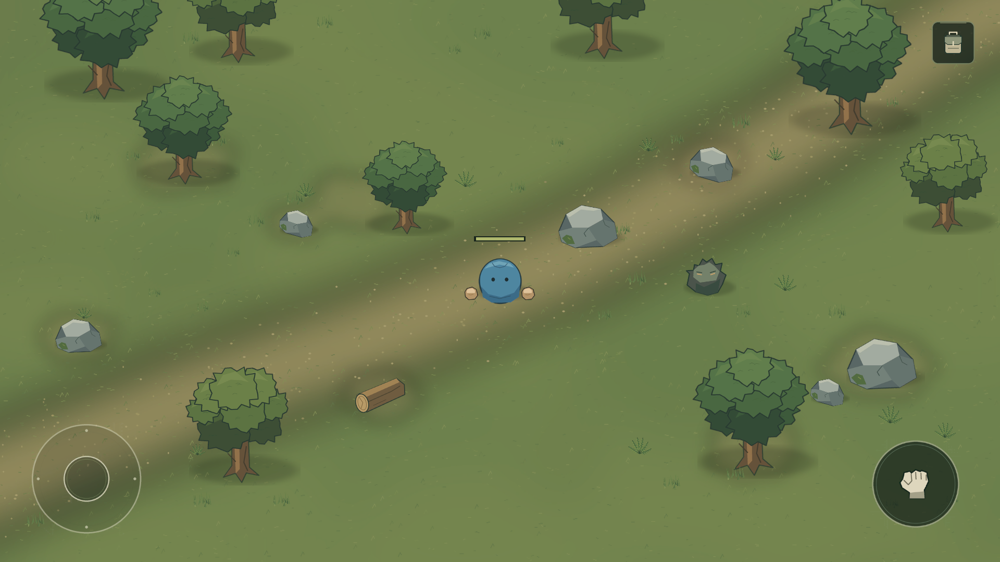
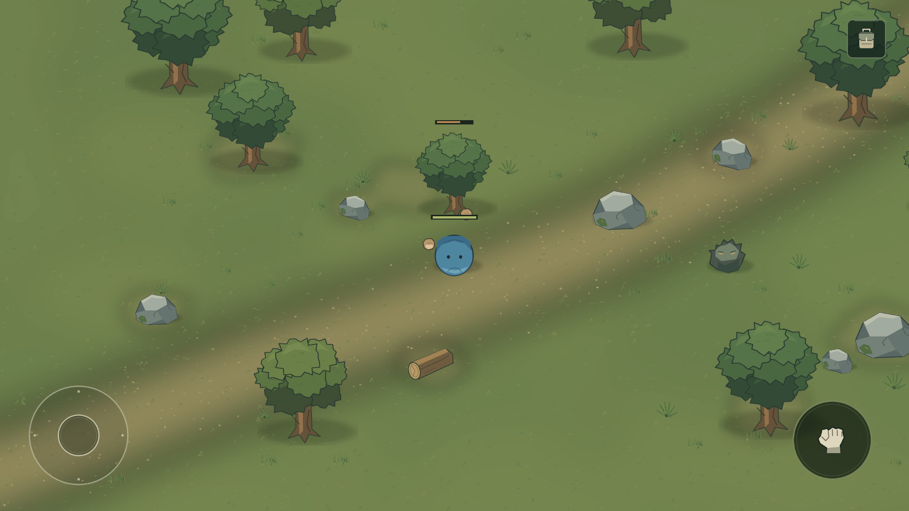
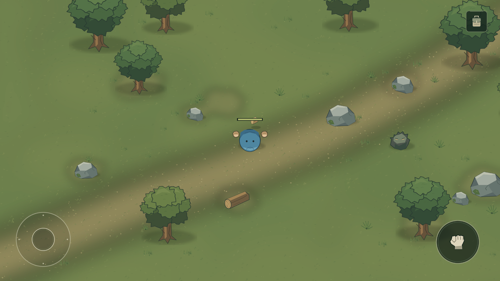
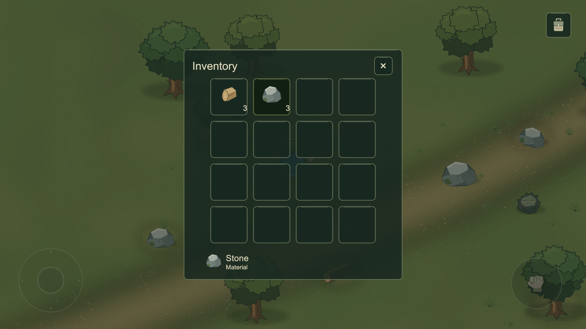
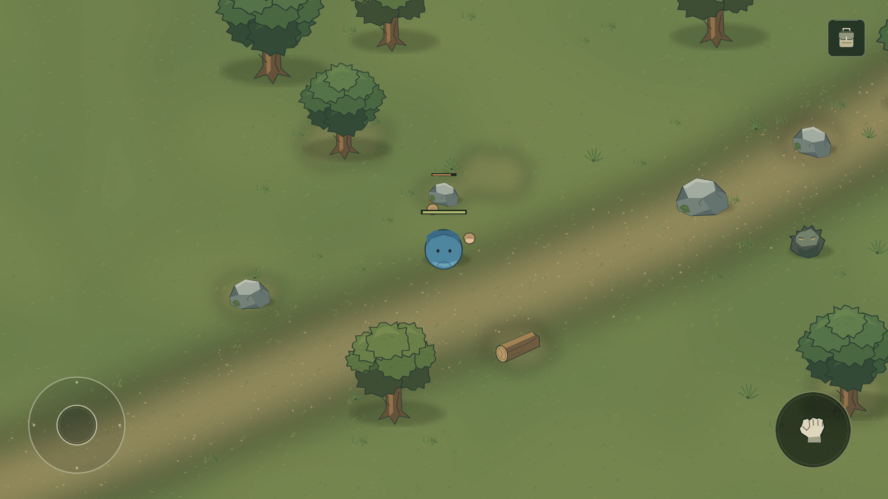
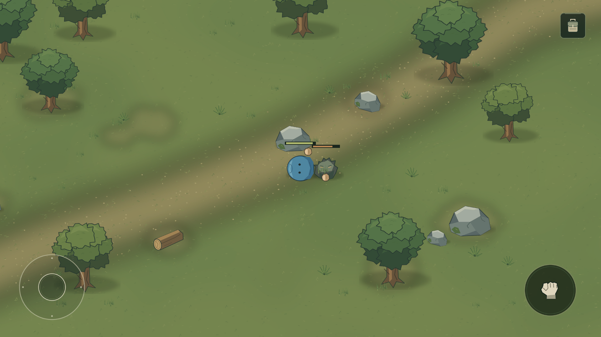

# 첫 플레이 버전 검수

검수일: 2026-10-13. 실제 Unity Play Mode Game View를 MCP로 캡처해 직접 확인했다. 사용자의 제한에 따라 Windows 마우스/키보드를 조작하지 않았다. 입력은 Unity Input System MouseState 장치 이벤트를 실제 UI 모듈로 전달했다. 이동/공격/UI 핸들러를 직접 호출한 것만으로 성공 판정하지 않았다.

## 결과와 검증 방법

- 별도 Unity 프로젝트 복사본의 headless 검증: EditMode **9/9 통과**, PlayMode **6/6 통과**.
- PlayMode: 대각선 조이스틱 Drag/해제/Thumb 복귀/카메라 추적, 인벤토리 실제 버튼/선택/입력 차단, 교대 공격/나무와 돌 HP/파괴/월드 드랍/근접 획득/Stone 6 자동 스택, 적 준비/명시적 피해/밀기 없음/피격 HP/사망, 보스 HUD 연결/해제, 실제 재시작 버튼을 검증했다.
- 주 에디터 MCP 관찰: 조이스틱 축 최대 (-0.71,0.71), 이동 (-1.66,+1.66), 해제 후 입력/Thumb/속도 0, 카메라 추적 확인.
- 나무 실제 공격: HP 30→20→10→0, 좌우 손 교대, 바닥 Wood 3 생성 당시 인벤토리 0, 접근 후 Wood 3, 슬롯 선택/열기/닫기 확인.
- 돌 실제 공격: HP 50→40→30→20→10→0, 바닥 Stone 3 생성 당시 Stone 인벤토리 0, 접근 후 Stone 3, 실제 슬롯 선택/표시 확인.
- 적 실제 관찰: 접근/준비, 첫 피해 플레이어 HP 100→92, 정지 플레이어 위치 변화 0, 적 HP 40→30→20→10→0, 제거 후 플레이어 HP 84. 파티클 0.
- 평상시 고정 Wood/Stone/Food HUD, 개발자 UI와 가짜 보스 없음.

MCP 내장 Test Runner의 초기 실행은 Play Mode 전환/도메인 재로드와 충돌해 실패했다. 주 에디터를 보존하는 별도 headless 실행으로 전환했다. 첫 headless 입력 검증은 에디터 비활성 포커스 때문에 실패했고 테스트 범위에서만 입력 포커스 설정을 변경/복원해 재검증했다. 채집 fixture 위치 설정 후 물리 프레임을 기다리도록 테스트를 수정했다. 런타임에 임시 우회 코드를 추가하지 않았다.

## 디자인 검수와 수정

회색 원반/석판 같은 몸통을 교체했다. 첫 구리색 반복 시안도 빵 같은 인상을 줄 여지가 있어 파란 천색으로 다시 수정했다. 피부색 양손을 확대/분리하고 작은 눈과 무광 명암을 유지했다. 실제 이동 회전, 좌우 공격과 나무/돌/적 피해 화면, 인벤토리의 실제 재료 슬롯을 직접 확인했다.

플레이어의 파란 천과 피부색 손이 회색 돌/초록 숲과 구분된다. 중앙 플레이 공간과 평상시 중앙 상단이 비어 있다. UI/아이콘/외곽선은 자연색과 무광 규칙으로 통일했다. 최종 아트 또는 상대 게임보다 우수하다고 판정하지 않는다.

## 요청된 Play Mode 항목

| 항목 | 수행한 확인 |
|---|---|
| 1~2 캐릭터 구조 | Game View 외형 직접 검수, 독립 몸통/손/눈 |
| 3~6 입력·이동·중앙 복귀·카메라 | 실제 UI 장치 이벤트 + 자동 테스트 + MCP 이동 관찰 |
| 7~14 공격·교대·나무·HP·드랍·획득·Wood | 실제 UI 이벤트 자동 테스트 + MCP 화면/수치 관찰 |
| 15~18 돌·HP·Stone 드랍/스택 | 자동 테스트(Stone 6) + MCP Stone 3 화면/수치 관찰 |
| 19 인벤토리 열기/닫기 | 실제 가방/X UI 이벤트 + MCP 슬롯 검수 |
| 20~25 적 접근·밀기 없음·공격·플레이어 HP·적 HP·사망 | 자동 테스트 + MCP 실제 적 관찰 |
| 26 파티클 없음 | PlayMode 오브젝트 검사 + MCP 0개 |
| 27~28 고정 재화/개발자 UI 없음 | 씬/코드/실제 화면 검수 |
| 29 게임 코드 Console Error 0 | 최종 실행 후 MCP Console 확인(초기 도구 검증 오류와 구분) |

## 미검증과 남은 한계

실제 Android/iOS 빌드·멀티터치 기기·노치·성능/발열·백그라운드 복귀는 검증하지 않았다. 새 버전의 2400×1080은 별도 검수하지 않았으며 이전 정적 시안 결과와 구분한다. 재미와 세부 밸런스는 사용자가 테스트한다.

아트 변형과 고유 지형이 적고 나무 수관이 반복적이다. 근접 공격 때 체력바가 손/주변 오브젝트와 가까워질 수 있다. 적 경로 찾기는 단순하다. 세계 저장·협동·제작·건축·장비·실제 보스·직업·로그인·상점은 구현하지 않았다.
