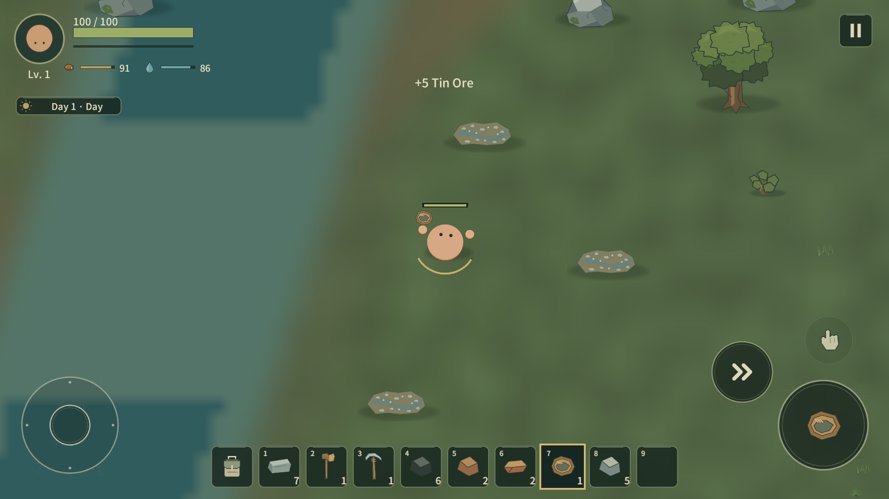
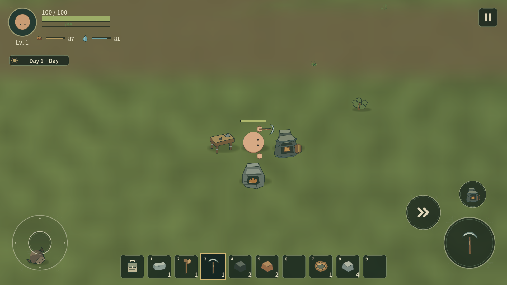
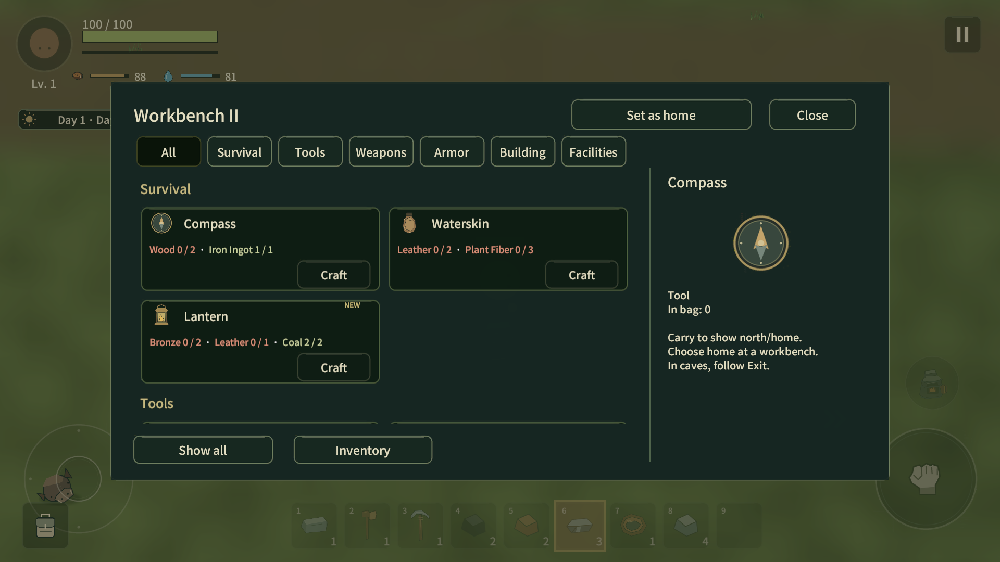
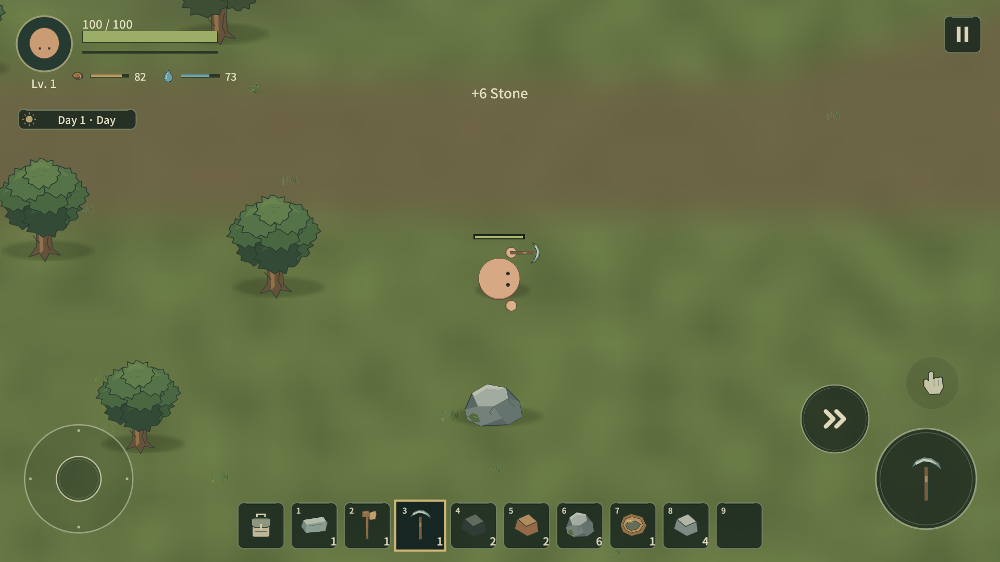

# Lowfire Resource Tempo / Workbench I–II Closure Report

2026-10-18. 기준 remote main `71f18ad601908670be9382b76567eeb980409ef0`. Main 직접 변경. 별도 clone/branch/PR/Computer Use 없음. 기존 테스트 cache를 사용했다.

## 1. 시작 상태

기존 완료 수율 Stone3/Iron3/Coal4/Copper4/Tin3. generation2 광물 비재생, legacy 회복 Stone600/Iron720/Coal600/Copper600/Tin720초. 대륙형 식생은 원래 source의(+3,+4) 복원 경로였다.4인 동일 비교 범위의 실제 요구량은 Iron135/Coal140/Copper44/Tin18이며 각각45/35/11/6 source를 캐야 했다.

## 2. 외부 게임 조사

[조사 원문과 링크](RESOURCE_TEMPO_RESEARCH.md). Core Keeper의 벽/대형 유한 boulder, Terraria의 vein/대체 crate, Valheim의 큰 매장량, DST의 장기 대체 돌 공급, Minecraft의 큰 vein/복수 철 공급을 비교했다. Lowfire에는 자유 굴착/큰 광상을 따라가는 구조가 없으므로 소형 source 수율과 지역 회복을 함께 조정했다. 타 게임의 자동화/merchant/시스템을 복제하지 않았다.

## 3. 기존 economy 분석

[원본 실제 asset/recipe 감사](validation/resource-tempo/audit-before.tsv), [전후 원재료 표](RESOURCE_TEMPO.md), [전체86 item Source/Sink](RESOURCE_ECONOMY_AUDIT.md). 기억이나 이전 보고서의 수치를 그대로 사용하지 않았다. 기존 validator는 기본 공유 시설/Compass/Cup을 빠뜨리고 Bronze 잔량을 재사용하지 않았으므로 같은 scope의 실제 비용을 다시 계산했다.

## 4. 실제 수정

|자원|완료 수율 전→후|회복 후|이유|
|---|---|---:|---|
|Stone|3→6|75초|초반/시설/건축 부담 완화|
|Iron|3→6|120초|개인 이전 장비와 Steel 이중 비용|
|Coal|4→10|105초|제련/Steel/조명의 누적 연료 부담|
|Copper|4→6|150초|전문 기술 재료 정체성 유지|
|Tin|3→5, HP75→50|165초|Pan 전용 유지,3타→2타로 반복 입력 완화|

recipe의 비용/출력 수량은 유지했다. 가공 batch 변경은 기존 저장의 이미 예약된 cargo를 재해석하므로 적용하지 않았다. 기존 자원 개수를3배 늘리는 변경도 없다.

## 5. 최종 resource recovery 구조

64unit 청크 population, 초기85% 목표(광물/Stone), 부족한rule/청크당 ticket1. 활성 청크만 indexed lookup,5초마다최대16ticket/2source/48후보다. 새로운 환경 후보에 p ID를 발급한다. 최근 채집/물/길/장애물/건물/플레이어 주변을 제외하며 막히면 대기한다. Host만 NGO spawn을 결정하고 SP도 같은 구현을 쓴다. 원본 tombstone은 유지하고 소진된 p는 제거한다. 세부 저장 의미는 [정본](RESOURCE_TEMPO.md).

## 6. 총 필요량

|범위|Wood|Stone|Iron Ore|Coal|Copper Ore|Tin Ore|
|---|---:|---:|---:|---:|---:|---:|
|공유1세트|32|25|5|3|2|1|
|개인 필수1명|25|13|30|17|2|0|
|4명 개인 필수 합|100|52|120|68|8|0|
|1P 필수+선택|98|76|39|50|20|9|
|4P 필수+선택|230|115|135|140|44|18|
|4P ×1.5 올림|345|173|203|210|66|27|

개인 필수: Steel 도구3/Armor2의 선행 chain, Pan/Compass/Cup. 공유: WB I→II/Campfire/Furnace/Blast Furnace/Chest. 선택: 기존 명시적 장비/탄약/작은 건축 reserve. Bronze 생산1P27/4P54, Steel17/68이다. 무한 건축이나 음식 전체 소비 예산은 아니다.4P source 수는 Iron45→23,Coal35→14,Copper11→8,Tin6→4. 전체 사람 플레이 시간이 같은 배수로 단축된다는 뜻은 아니다.

## 7. 대표 seed

|Seed|Iron/Coal/Copper/Tin 보장 yield|Rocky anchor 거리|수변 Tin anchor 거리|첫 Cave 입구 거리|판정|
|---|---|---:|---:|---:|---|
|9472026|396/550/108/55|650.1|635.7|647.6|통과|
|17491|396/550/108/55|650.2|431.2|647.4|통과|
|-81027|396/550/108/55|650.0|429.7|648.3|통과|
|193080127|396/550/108/55|650.7|556.0|650.0|통과|

새 validator의 초기 Wood/Stone 예산, source 환경/분산/지형 경로, 첫 Cave surface entrance와 cave graph를 검사했다. 기본 seed의 시작3×3청크 Wood1152/Stone618. 표의 거리는 직선 기하학 거리이며 사람이 걷는 시간은 아니다. 수변 anchor를 반드시 Wetlands biome이라고 부르지 않는다.4종 biome 존재 검사는 별도로 통과했다. 기존1154 generation entry의 ID/좌표 변경0. [seed JSON/TSV](validation/resource-tempo/).

## 8. 실제 Unity Play Mode 시간

Unity MCP로 live Editor의1920×1080 Game View를 확인했다. fresh QA seed9472026. 조작은 게임 PlayerInputCommands와 실제 motor/공격/제작/설치 API를 사용했다. 정확한 source를 선택하는 자동 경로라 blind human discovery 측정은 아니다. 시작 전 씬 준비 대기는 제외했다.

|측정|지급/teleport/가속 없는 입력 구간|이후 fixture 구간|
|---|---|---|
|Stone Pickaxe|35.723초|해당 없음|
|첫 Iron 가시 대상 선택|35.734초, 플레이어와26.22unit|해당 없음|
|Iron6 획득|46.634초|해당 없음|
|필요 Iron12 확보|62.843초, 두 source|해당 없음|
|첫 Coal|자연 탐색 시간 미측정|알려진 좌표 이동 후10개 확보; 시나리오65.889초|
|WB II|자연 완료 시간 미측정|시나리오63.213초; 원래 Iron12를 제련, 부족 Wood/Stone 지급|
|Tin5|자연 탐색 시간 미측정|알려진 수변 이동 후 Pan 실제 채집; 재개 기준74.966초|
|Blast Furnace|자연 완료 시간 미측정|75.286초; 부족 건축 재료 지급|
|첫 Steel3|자연 완료 시간 미측정|75.321초; StationProcessing.Advance로 가공 시간 전진|
|Steel Pickaxe|자연 완료 시간 미측정|생산한 Steel3+기존 Iron Pickaxe+부족 Wood2 지급 후 실제 Craft Ready|

fixture 재개 시 setup/import 대기는 제외하고68초부터 이어 기록했다.75초를 자연 Steel 완료 시간으로 해석하면 안 된다. [전체 실행 로그](validation/resource-tempo/play-steps.tsv).

## 9. 발견된 economy 문제

Iron의 전체 업그레이드 chain/Coal 누적 연료 비용에 비해 작은 노드 보상이 문제였다.4인 raw demand를 비교하면 수치로 드러난다. Bronze/Feather는 기존 사용처가 실제로 있어 새 시스템을 만들 이유가 없었다. Leather는 장비 제작 수요가 있지만 내구도 없이 무한 지속 소모되는 재료는 아니다.

## 10. 교정 / 유지

- 초기 Planner가 같은 Waterskin을 출력하는 정수 recipe까지 원재료 제작 경로로 보아 모호성을 감지했다. 충전 상태 변환을 제외하고 일반 물부대 제작을 사용하도록 수정했다.
- freeze generation stream과 g/e baseline을 분리해 수율 변경으로 구 save ID가 이동하는 문제를 방지했다. Diamond disabled/recovery false를 검증했다.
- 기존 generic density 테스트가 고정2개 고갈을 가정해 목표 비율 기반으로 교정했다. 타이머 JSON round-trip의 부동소수점 오차1e-14는1e-8 허용범위로 검사한다.
- 실제 QA runner는 chunk unload 뒤 station Component를 참조해 중단됐다. 저장 위치/재활성화 후 station을 다시 찾도록 교정했다. Steel recipe의 마지막 Wood2 부족은 실제 MissingMaterials로 확인한 뒤 지급을 기록하고 완성했다. gameplay 우회 코드를 추가하지 않았다.
- 최종 검토에서 inactive backlog를 순환하면 회복 지연이 길어질 수 있음을 찾아 active chunk ticket index로 수정했다.1,000 inactive ticket을 추가한 시험도 통과했다.
- 기존 제작 카드의 have/need 색상과 station gating을 유지한다. 작은 기존 feedback label에 실제 획득 수량만1.5초 표시한다. owner 전용 pickup RPC이며 HUD debug 버튼/로그는 추가하지 않았다.

## 11. 자동 검사

관련 EditMode67개 + PlayMode10개, 개별 최신 결과77/77 통과. 새 전체 project suite를 한 번에 재실행한 결과가 아니다. 통합 관련검사 뒤 실패/실제 변경 사례만 재검사했다. [실행 이력/개별 결과](validation/resource-tempo/tests.json).

최종 변경 영역: 모델41/41, recovery/Host3/3. Host test는4개 서로 다른 region 고갈, 회복, save/rehost, 동일ID 중복 materialization을 검사했다. SP test는 inactive 지역 spawn 금지,1,000 dormant backlog,시간/환경/고갈/회복/저장 복원을 검사했다. legacy 금속/시설/cargo/Generation1 저장 회귀도 관련 사례로 통과했다.

source validator: Landscape/참조/표시 금칙문구,991 unique GUID 통과. live Console error0. 사용자 save와 backup은 SHA256 및 수정시각 모두 작업 전후 동일. 격리 profile은 Play 전에 선택했고 마지막에 Play 중지 후 해제했다. 부팅 씬은 MainMenu로 복귀했다.

## 12. 직접 Unity 테스트

Wood/기초 도구/Stone Pickaxe/Iron 채집, 실제 WB I→II/Furnace/Pan/Copper/Tin/Bronze/Blast Furnace/Steel/Steel Pickaxe를 확인했다. 후반 fixture 구분은8번을 따른다. 실제 Game View에서 Tin +5/Stone +6, WB II have/need·부족 색상, 최종 장비/시설 표시를 눈으로 확인했다.

최종 MCP 추가 검수: 한 Iron 청크19source를 fixture로 고갈, Due282.6383으로 예약. clock을283.6383으로 전진하고 떨어진 위치에서 tick.1회 ticket/8후보로 다른 위치(-830.5427,-14.3883)의 p1 하나 생성. 저장·적용·반복 materialization 뒤 instance1,다음 Due403.6383(추가120초) 유지. 이 검수는 시간 전진/teleport fixture다. [직접 확인 값](validation/resource-tempo/mcp-recovery.json).

## 13. 하지 않은 테스트

Android/iOS 실기, real remote Relay, 실제4명 기기 동시 플레이,사람의 전체 무지식 탐험→Steel timing,장시간 고갈/기지 대형화/모바일 profiler는 하지 않았다. 기능·수율 개선을 재미/최종 밸런스/60fps 합격으로 바꾸어 보고하지 않는다.

## 14. 남은 위험 / 후속

회복은 유효 빈자리와 active region을 요구하므로 건축물로 막힌 청크나 좁은 수변은 timer가 지나도 지연될 수 있다. 보장량은 고정 baseline을 보존하므로1인에게 상당한 surplus가 남을 수 있다. 레시피 밖 무제한 건축/장기 음식·탄약 수요는 이 예산의 보장이 아니다. 실제 모바일 성능과 remote4인 interest/latency는 출시 전 별도 검증 대상이다. 이번 확인에서 WBIII 전 수정이 필요한 구조적 blocker는 발견하지 않았다.

## 15. 최종 판정

**B. 작은 correction1회가 더 필요하다.** 현재 수율/회복/공급 구조와 I–II 기능 연결은 교정했다. 다만 사람의 자연 Iron→Coal→Tin 동선과4인 분배 체감을 측정한 뒤 수율·회복 간격만 한 차례 조정하는 것을 권장한다. 자동 경로/fixture 결과만으로 I–II가 충분히 빠르고 완전히 닫혔다고 단정하지 않는다. III/Diamond는 구현하지 않았다.

## 주요 변경 파일

Runtime/Generation: ProgressionEconomy,ResourcePopulation,ResourceRegeneration,StreamedResourceState,WorldChunkRuntime,WorldProgressionSupply,ProgressionReachability,ContinentalWorldLayout. Data: Resource/WorldGeneration/NaturalSource/Recipe metadata. UI/Network: PlayerFeedback,WorldPickup,NetworkGroundItem,NetworkInventory,NetworkProtocol/NetworkSession prefab. SaveMigration은 indexed ticket 제거를 사용하며 schema9는 유지했다. Editor: ResourceTempoAudit/ResourceTempoQa/DeveloperHarness와 기존 authoring. Tests: ResourceTempo model/play/host 및 변경된 수치 기대값. 문서·실행 JSON/TSV·검수 PNG는 본 보고서의 링크를 따른다.

## 작업 시간 (KST)

조사·실제 데이터 감사: 21:18:07–21:22:53, 4분46초.

핵심 구현·테스트 준비: 21:22:53–21:32:31, 9분38초.

자동 검사·Unity MCP 검수: 21:32:31–21:48:49, 16분18초(기동/컴파일/도구 대기 포함).

문서·증거 정리: 21:45:11–21:51:02, 5분51초(QA와 겹침).

선택 검사 NUnit 실행 시간 합: 2분52.344초(기동/import/도구 대기 제외).

Git 전달 준비 시점: 21:51:31, 시작부터33분24초. 이후 최종 utility compile/commit/push 확인 시간은 완료 응답에 기록한다. phase는 겹치므로 합산하지 않는다. 시각은 도구 clock과 phase 파일 생성 시각을 기준으로 한다.
