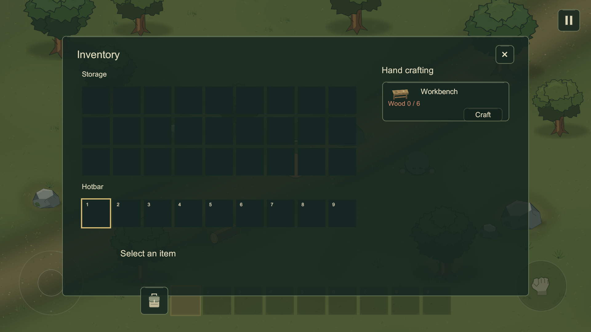
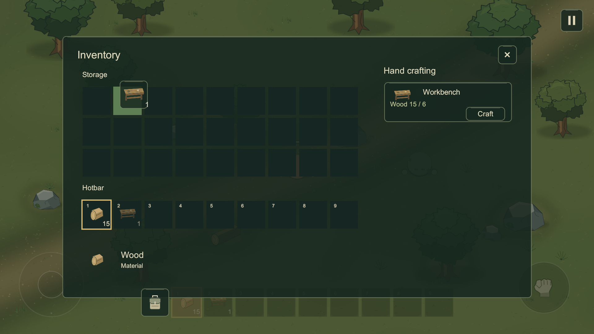
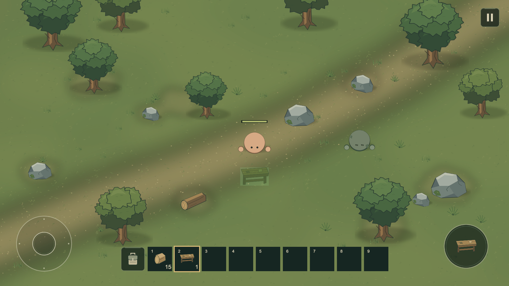
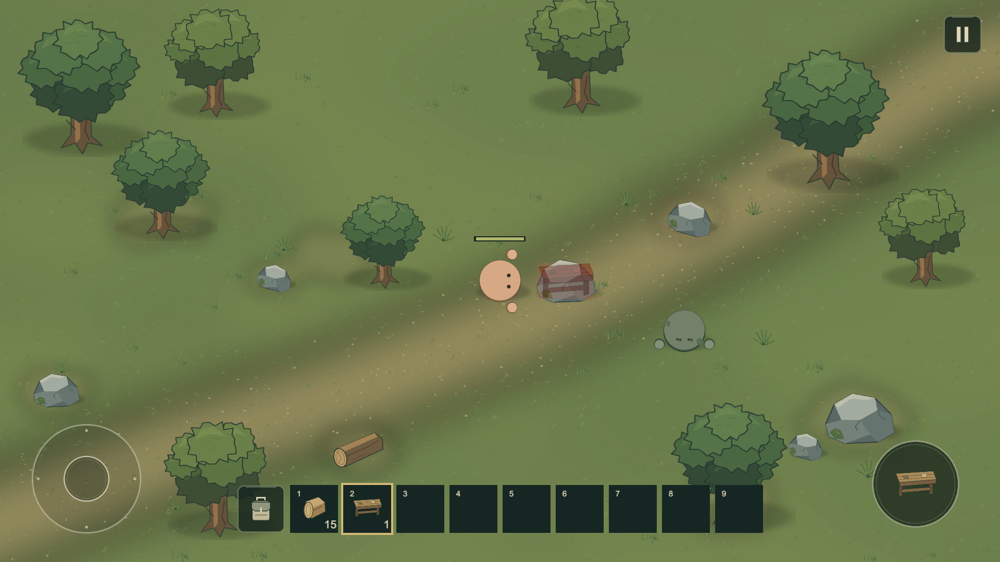
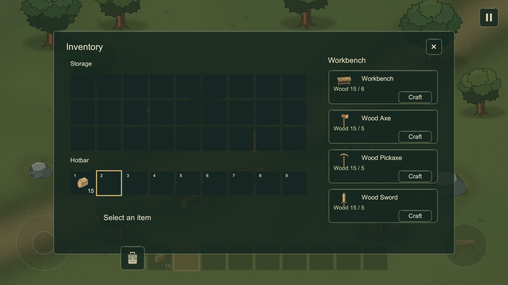
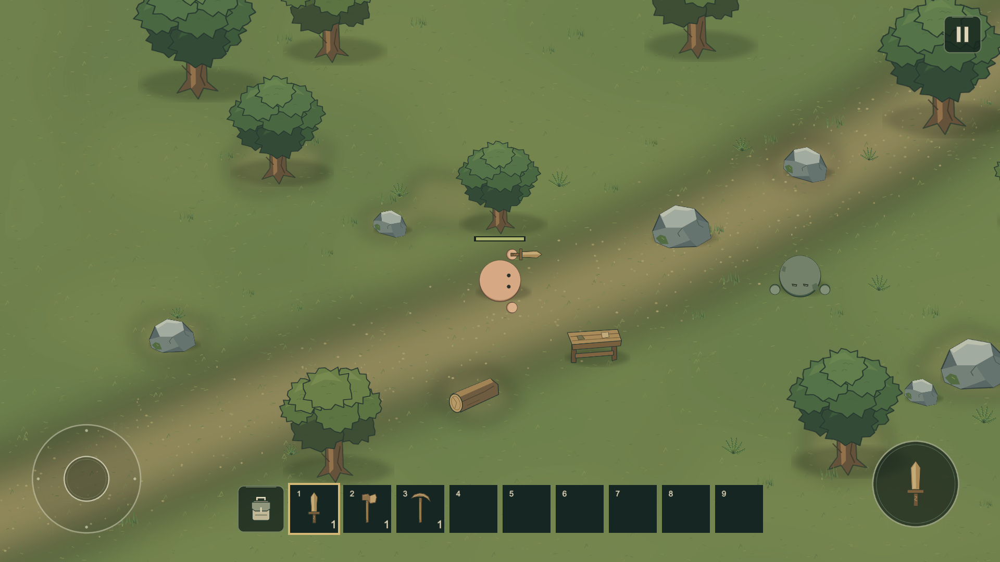
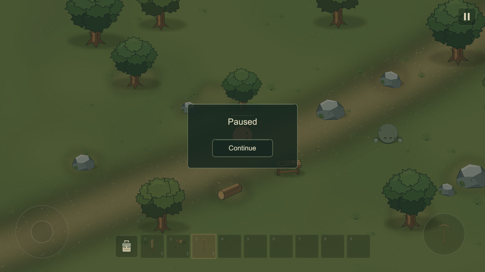

이 문서는 기준 커밋 f2cd92ea3fa111e9db5e05f46c233c57db4011e7까지의 이전 단계 기록이다. 현재 추가 기능 검증은 NEEDS_SETTINGS_REVIEW.md를 따른다.

# 인벤토리·제작·작업대 검수

기준: 28431687414534606582e0bc2f718fc851ce420a 이후 작업, 2026-10-13.
Unity MCP로 실제 Game View를 캡처하고 직접 검수했다. Windows 마우스/키보드, Computer Use, Android 실기를 조작하지 않았다. 기존 Game View만 해상도를 바꾸고 Focus/GetWindow 호출을 제거했으며 검수 중 에디터 상태는 비활성 포커스였다.

## 자동 검증

별도 복사본의 hidden headless Unity 실행:
- EditMode **18/18 통과**: 기존 스택/범위/참조/ID 검증, 전체 이동/부분 합치기/교환/거부, 공간·재료 부족의 제작 원자성, 소비 후 공간 활용, 다중 결과의 부분 소비 거부, 선택 슬롯 소비.
- PlayMode **14/14 통과**: 기존 회귀 8개와 새로운 초반 루프 6개.

새 PlayMode는 빈 36칸/Hand crafting, 인벤토리 상태의 적 공격과 플레이어 입력 차단, 별도 Pause/Continue/동결 정책, 실제 UI 드래그 이동·합치기·교환·바깥 취소·장착 갱신, Storage 제작 결과와 Hotbar 이동, 시설 거리/제거에 따른 권한 해제, 맨손 채집부터 작업대 설치·세 장비 제작·검으로 좀비 처치까지 확인했다.

초반 루프 자동 검증은 실제 공격/가방/Craft/사용/슬롯 UI에 Input System 장치 이벤트를 전달한다. 나무 7개에서 Wood 21개를 획득해 Workbench 6 + 장비 5×3을 소비했다. 플레이어 위치는 자동 테스트 준비용으로 설정했고 사람의 직접 조작 검증이라고 표현하지 않는다. 다른 회귀/드래그 검증에 필요한 아이템은 테스트 안에서만 준비한다.

첫 14개 실행 중 1개는 월드 지속 진행에서 생기는 작은 Rigidbody 위치 오차를 완전 일치로 비교해 실패했다. 입력 차단을 작은 거리 허용 오차와 속도로 확인하도록 테스트를 수정했다. 이후 시각 검수에서 시설 Collider 검색과 중심 거리 판정의 불일치를 발견해 표시/제작 권한을 공통 CanInteract로 수정하고 경계 검증을 보강했다. 최종 14개가 다시 모두 통과했다.

## Game View 검수

Storage 3×9 위/Hotbar 9 아래, 가방 위치, Pause, 결과/재료/Craft 표시를 확인했다. Craft 버튼의 카드 하단 여백을 조정했다. 드래그 원본 흐림/Ghost/Drop 색, 테이블 Sprite/그림자, 유효·무효 Preview와 세 장비 외형을 확인했다. 위 일부 이미지는 시각 확인용 재료/아이템/배치 상태이며 새 게임에는 남기지 않았다.

작업대 범위 밖 검을 선택했는데 사용 아이콘이 작업대로 남는 문제를 시각 검수에서 발견했다. 공유 중심 거리 판정으로 수정한 뒤 Attack 아이콘이 검과 일치함을 확인했다.

1920×1080을 우선 검수하고 1280×720/2400×1080의 실제 Screen 크기와 인벤토리 배치를 확인했다. 검수한 화면에서 잘린 슬롯/제작 버튼은 없었다. 실제 기기 노치/손가락 터치 크기 검증을 의미하지 않는다. 마지막 Play Mode에서 빈 36슬롯/Hotbar, 맨손, 설치물 0개, Time.timeScale 1, 1920×1080을 확인했다. Console Error 0, 저장된 씬의 누락 스크립트/스프라이트/머티리얼 각각 0을 확인했고 소스 검증은 151개 고유 GUID로 통과했다.

## 사용자가 직접 확인할 것

실제 멀티터치/드래그 감도, 슬롯과 Craft 버튼의 손가락 크기, 배치 위치의 체감, 시설 상호작용 방향, 전투/채집 속도·재미, 작은 화면의 목재 도구 구분은 실사용 미검증이다. Android/iOS 빌드·노치·발열·프레임 성능·백그라운드 복귀를 테스트하지 않았다.

아트 변형과 고유 지형이 적고 목재 도구는 비슷한 색이다. 배치는 포인터 자유 지정이 아닌 플레이어 Facing 앞 Preview다. 가방을 열면 적의 공격을 받으므로 실제 사용자가 위험/조작감을 판단해야 한다. 회수/수리/반 스택/저장/멀티플레이/새 적/생존 수치/고급 시설은 없다.
