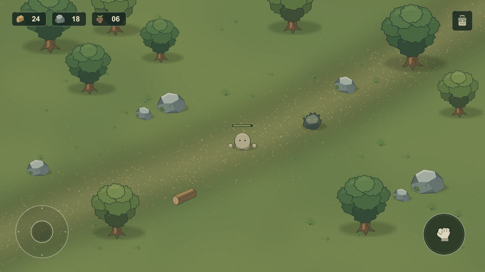
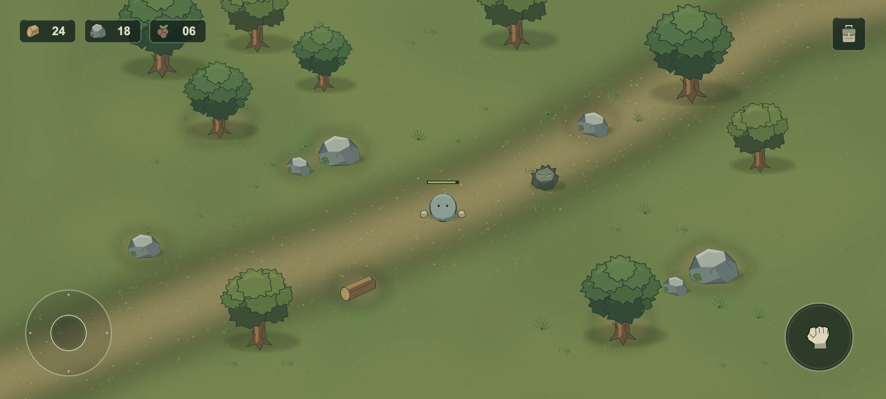

# 첫 비주얼 시안 검수

검수일: 2026-10-13. Unity 6000.3.19f1 / Universal 2D의 실제 Play Mode Game View를 Unity MCP로 캡처하고 직접 확인했다. 이미지 합성으로 만든 완성 화면을 게임 화면으로 보고하지 않았다.

## 1차 검수 — 1920×1080

확인한 문제:

- 베이지색 둥근 몸통은 빵 같은 인상을 줄 여지가 있었다.
- 나무 수관이 층층이 쌓인 형태로 반복됐다.
- 흙길의 점이 많고 바닥과의 색 차이가 약했다.
- 플레이어와 HP 표시가 조금 작았다.

수정:

- 몸통을 회청색/회녹색의 무광 명암으로 바꿨다. 볼터치·입·큰 눈·광택을 추가하지 않았다.
- 몸통과 손을 확대하고 HP 트랙의 높이와 폭을 조정했다.
- 수관의 외곽선을 불규칙하게 바꾸고 두 나무의 잎 덩어리 배치를 다르게 했다.
- 흙길을 더 연속적인 흙색으로 만들고 점의 밀도를 줄였다. 돌과 목재 주변에 불규칙한 흙색 변화를 더했다.
- 적의 입 선을 제거하고 눈 주변을 어둡게 해 마스코트 표정을 줄였다.

## 2차 검수 — 수정본 1920×1080

몸통의 빵 같은 색 인상이 줄었고 주변 잔디보다 플레이어가 읽힌다. 나무·돌·풀·적은 색과 외곽 형태로 구별된다. 자원 표시, 조이스틱, 공격, 인벤토리는 화면 모서리에 있고 중앙과 중앙 상단에는 UI가 없다. 초기 시안 수준의 단순함은 남아 있다.

## 추가 검수 — 2400×1080, 저장된 씬 재로드

2400×1080의 Play Mode에서 실제 `Screen.width/height`를 확인하고 캡처했다. HUD가 모서리에 유지되고 배경 끝이나 잘린 버튼이 보이지 않았다. 이 에디터 화면에서 Safe Area는 전체 화면이었다. 노치와 실제 기기 터치 검증을 수행했다는 의미는 아니다.

정리 후 저장된 씬을 MCP로 다시 로드하고 Play Mode로 진입했다. 기준 해상도 1920×1080으로 복원하고 최종 화면도 다시 캡처했다.

## 요청된 8가지 질문에 대한 판단

| 질문 | 현재 판단 |
|---|---|
| 어린이용 게임처럼 보이는가? | 베이지 몸통과 표정 요소를 줄였다. 자연색과 무광 명암을 사용한다. 단순한 눈 두 개는 남아 있어 장비 외형이 없는 현재의 인상은 추가 판단이 필요하다. |
| 모바일 초급 튜토리얼 프로젝트처럼 보이는가? | 기본 UI 문구와 테스트 버튼은 없다. 공터와 한 개의 더미라는 구성은 초기 시안 티가 난다. |
| Unity 기본 Primitive를 대충 배치한 느낌인가? | 기본 Primitive를 사용하지 않았다. 원본 PNG 스프라이트와 접촉 그림자로 구성했다. |
| Mine Survival보다 지나치게 싸 보이는가? | 상대 게임과 동일 조건의 품질 비교를 수행하지 않아 우열을 확정하지 않는다. 현재 선·명암·UI 색상은 통일했지만 고유한 아트 정체성과 변형 수는 부족하다. |
| 캐릭터가 병아리/동물/장난감처럼 보이는가? | 부리·귀·동물 특징·볼터치가 없다. 빵색 몸통을 회청색으로 수정했다. 둥근 실루엣 자체의 호감도는 사람의 판단이 필요하다. |
| UI가 플레이 화면을 과도하게 가리는가? | 검수한 두 화면비에서 중앙 플레이 영역과 중앙 상단은 비어 있다. 모서리 UI만 차지한다. |
| 나무/돌/플레이어/적이 즉시 구분되는가? | 수관, 각진 돌, 밝은 원형 몸통, 어둡고 뾰족한 적으로 구별된다. 움직임과 전투 중 가독성은 아직 검증하지 않았다. |
| 하나의 게임처럼 통일되어 보이는가? | 자연색, 어두운 외곽선, 무광 면과 같은 HUD 패널을 사용했다. 식생과 캐릭터의 개성은 더 보강할 여지가 있다. |

## 기술 확인 결과

- 컴파일/정리 후 MCP Console의 Error와 Warning 조회: 0건.
- 저장된 씬을 다시 읽은 후 SpriteRenderer 80개 확인.
- 누락된 MonoBehaviour 스크립트: 0개.
- 누락된 스프라이트: 0개.
- 누락된 스프라이트 머티리얼/셰이더: 0개.
- CanvasScaler 기준: 1920×1080.
- 표시 Text: 목재 24, 돌 18, 식량 06만 확인. 모두 고정 시안 수치다.
- 소스 검증 도구 통과: Unity 구조, Landscape 설정, 42개 고유 Asset GUID, .meta와 스프라이트 참조, 게임 UI의 금지 문구.
- 사용하지 않는 기본 SampleScene, 기본 2D 씬 템플릿, 템플릿 씬과 기본 Input Actions 및 연결 설정을 정리했다. URP 설정과 실제 참조되는 기본 Volume Profile은 유지했다.
- 새 Game View 보조 스크립트의 초기 임포트 순서로 발생한 컴파일 오류를 전체 Asset 임포트로 해소했다. 저장된 씬을 다시 강제 임포트하면서 발생한 외부 변경 재로드 확인창은 사용자가 Reload로 닫았고, 해당 강제 임포트 호출을 구성 코드에서 제거했다. 이후 MCP Play Mode 전환과 씬 재로드를 확인했다.

## 의도적인 한계

- 입력·이동·전투·인벤토리 등 실제 게임 로직과 애니메이션은 없다.
- 나무는 두 변형뿐이며 돌의 실루엣 차이도 제한적이다.
- 넓은 잔디 면과 부드러운 흙길은 다소 평평하다. 고유 지형과 아트 정체성을 아직 판단하기 어렵다.
- 캐릭터의 방향 표시, 직업과 장비 외형은 없다. 적은 시각적 더미다.
- 실제 Android/iOS 빌드, 기기 노치, 터치 크기와 촉감, 협동 플레이 가독성, 성능·발열을 검증하지 않았다.

이번 결과는 사람이 실제 화면의 분위기·배치·비율을 보고 방향을 결정할 수 있는 첫 시안이다. 최종 아트 품질에 합격했다는 판정은 하지 않는다.
