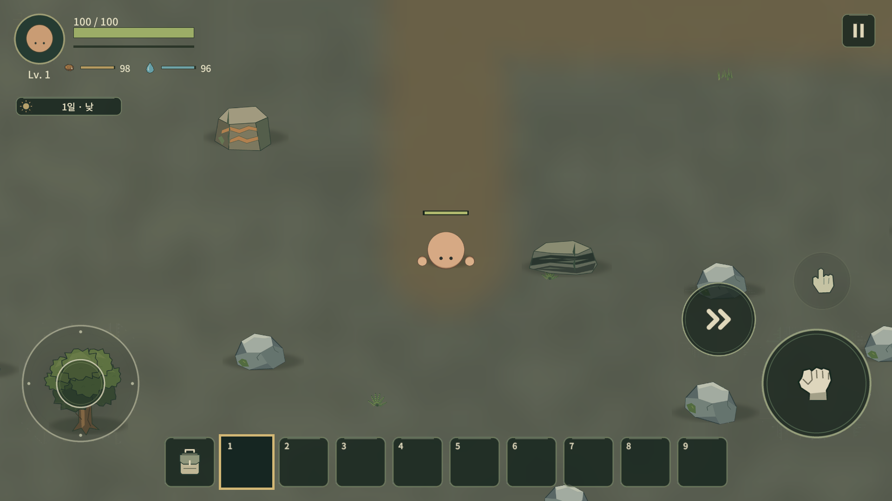
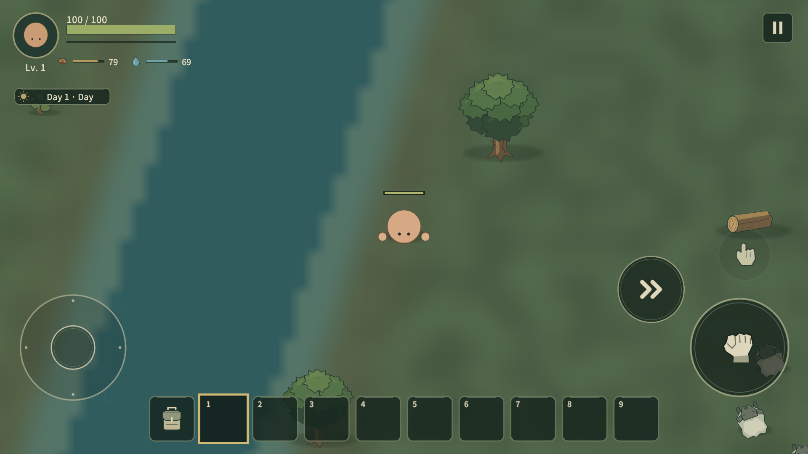
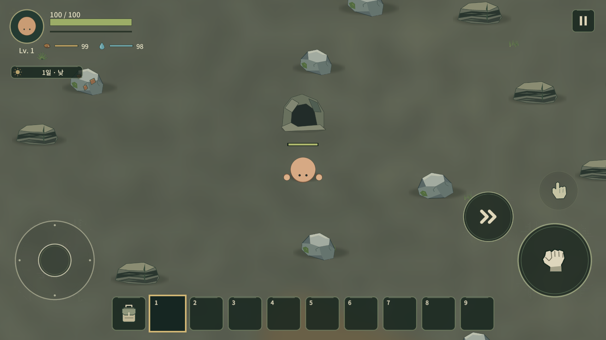
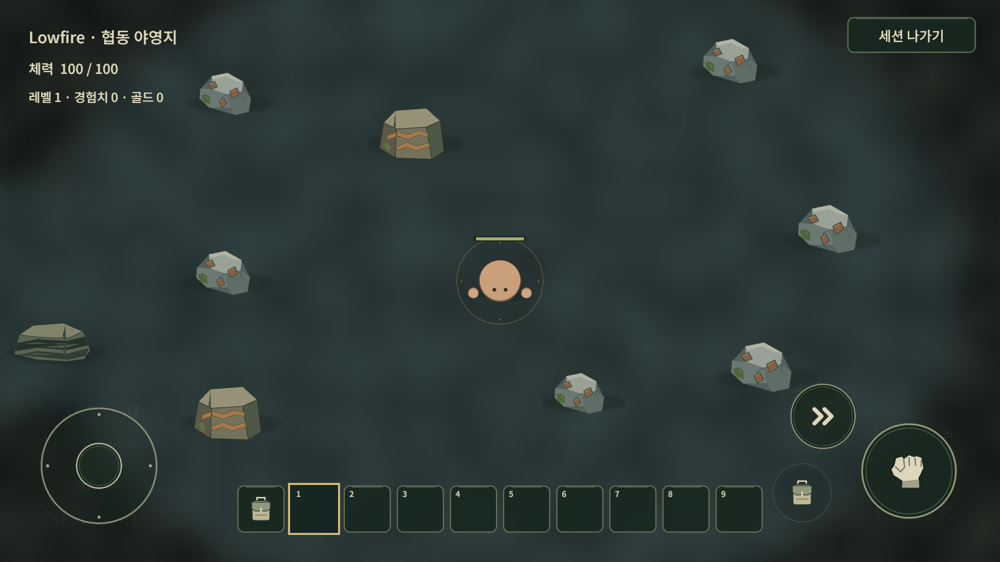
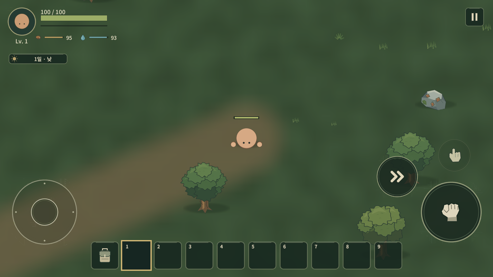
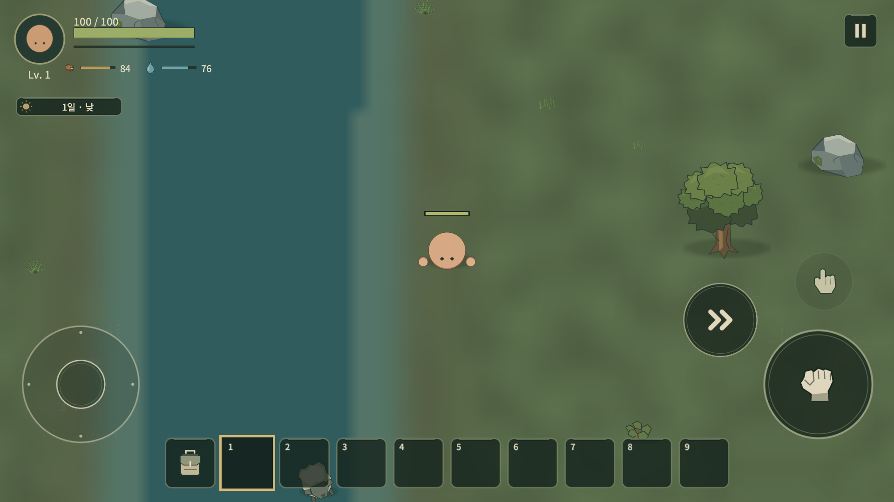
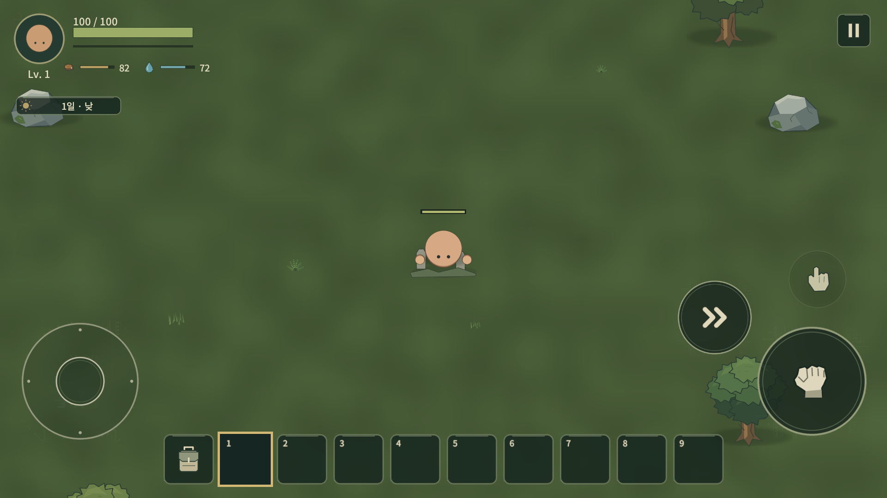
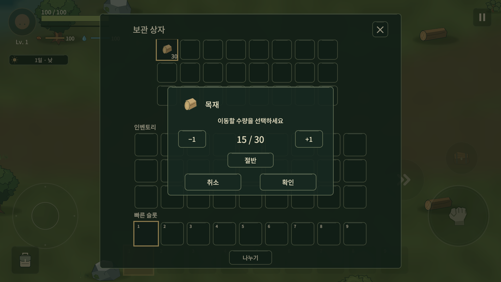

# World Foundation v2 검수

2026-10-17. 시작 main cf4ecd689623ea91b2d1815f010e66bcdd5cebe5. main 직접 수정, 기존 cached test project 재사용. clone/worktree/임시 branch/PR 없음. Unity 6000.3.19f1 LTS. 표시명 Lowfire/내부 Wildfolk 유지.

## 실제 Unity MCP

연결된 C:/UnityProjects/Wildfolk의 실제 Play/Game View1920×1080을 ScreenCapture로 확인했다. Windows 마우스·키보드/Computer Use/Focus/GetWindow/Show는 사용하지 않았다. Editor is_focused=false를 반복 확인했다. 숨김 자동검사 렌더를 MCP 직접 검수로 세지 않았다.

기본9472026과17491,-81027,193080127을 실제 생성했다. 기본 Forest anchor(200.63,62.04),17491(192.34,84.30),-81027(190.66,88.04),193080127(182.89,-103.21)이다. main river y100의 x는 각각 약621/412/411/540이며 POI anchor도 달랐다. 같은 Seed macro/source/anchor 재현은 별도 자동 검사다.4개 seed의4바이옴/진행 공급/지형 경로/동굴 연결도 자동 검사로 교차 확인했다.

지상4종,Forest road/전이,Rocky 광맥,River/Tin 퇴적지,Lake,coast/deep ocean,먼 Graveyard landmark를 화면으로 확인했다. 초기 청크2개만 표시된 첫 capture는 채워진9개 화면으로 교체했다. 모든 위치를 걸어서 탐사한 밀도 검수는 아니다.

동굴 입구 Interact 경로로 진입/귀환했다. chamber/corridor와 loop/dead-end graph를 확인하고 심부에는 fixture로 이동했다. DeepRuin Depth1.0,ambient .3,기존 Skeleton 계열 적3~4개,광물 pocket을 확인했다. 조작/API fixture와 통행 geometry 검사이며 실제 모바일 손가락 전투/자연 원정 플레이는 아니다.

SP는 격리된 Captures/world-v2/sp-review.json에 Save7/gen2/Seed193080127을 저장해 읽고 실제 Apply했다. Local Host는 별도 host-review.json에 저장/세션 종료/재Host 후 같은 WorldId,먼 상자1개와Wood7개,청크9개를 확인했다. 실제 v4 사용자 저장은 메모리에서만 v7/gen1로 검증했고192×144와 기존 Player position을 보존했다. v6 migration fixture는 별도 Play 검사다. 원본 UserData는 쓰지 않았고 SHA256을 대조했다.

## 검사 중 수정

- 별도 파일명과 일치하지 않던 SurfaceEnvironment SO를 분리해4종 profile이 실제 import되게 수정.
- 최초 표시 청크 채우기,halo sampling/연속 world좌표,카메라 기준 Y정렬로 먼 좌표에서 캐릭터가 지면 뒤에 가려지는 문제 수정.
- 화면이 비었던 Rocky의 돌/광맥 밀도를 환경 데이터 기반으로 증가.
- 시작 Iron3개 공급과4인 recipe yield/다중 cluster/시작점 통행 검사 추가.
- 재생 식물이 청크 경계를 넘었을 때 base source 유무와 무관하게 복원.
- 분산 플레이어 주변 동물 active quota와 미표시 logical actor HP 보존.
- NGO ground item의 비활성 view와 실제 spawn 생명주기 차이로 저장에서 빠지던 문제 수정.
- Cave pool이 graph 통로 중앙을 가로지르지 않도록 확보 폭 추가. 연결 구간 통행 검사 강화.
- pooling된 동굴 적의 죽음 callback 해제와 고블린 tick closure 제거.
- 구 콘텐츠 수의 검사값(34/25/3/17)을 실제48/36/4/30으로 갱신. RPC 검사도 입력 Owner/서버 알림 Server 권한을 구분.

자동 Play 통합 검사와 MCP Host를 동시에 열어7777 port 충돌을 일으킨 실행이 있다. 직접 Host 종료 후 해당 실패 항목만 순차 재실행했다. 실패 실행은 증거 JSON에 남기며 통과로 바꾸어 기록하지 않는다. Null graphics 장치에서는 자동 render 검사가 성립하지 않아 해당 render는 graphics 장치가 있는 숨김 batch로 구분한다.

## 코드 감사 / 한계

새 canonical path는 generation2이고 LegacyWorldLayout/구1024×768/고정 road/recovery는 generation1 저장에만 사용한다. WorldChunkRuntime은 하나의 scheduler와 responsibility별 partial 파일이며청크별 Update나 월드 전체 GO 상시 생성은 없다. runtime 새 공급처 판정은 ResourceRule→Source/environment 데이터로 이루어지며 자원 이름 switch가 없다. Disabled DiamondPocket은 요청된 미래 hook이고 실제 item/loot가 아니다. asset meta/GUID/씬 연결/금지 player text/공백 diff를 검사한다.

현재 POI는 주로 작은 landmark이고 동굴 벽·해안의 텍스처 가장자리는 아직 거칠다. 긴 거리 탐색에는 지도/Compass/Home Marker가 필요하다. 도로 전체의 A* 적합성,모든 seed의 기하학적 완전성,큰 저장의 serialization/GC/청크 activation spike,낮은 사양 모바일60fps는 보장하지 않는다. 네트워크 interest는 Host fixture까지만 확인했으며 실제 remote observer/Relay/late join/4인 분산 stress는 출시 전 QA에 남긴다.

Workbench III/Diamond 장비/새 생물/새 biome/Boat/지도/휴대광원 gameplay는 구현하지 않았다.

자동 검사 원본 요약과 실패 이력: [world-foundation-v2.json](validation/world-foundation-v2.json). 최종 결과와 단계별 시간은 아래에 기록한다.

## 화면

## 2026-10-18 재개 / 최종 결과

중단 지점에서 남은 소분 검사만 실행했다. `world-v2-resumed-split.xml`은1/1 PASS(실제 test runner3.875초, Unity startup/import/compile는 별도)다. Inventory/Chest 소분·버리기·다시 줍기·Chest→bag transfer까지 기존 Input System pointer fixture가 통과했다. 전체 검사는 반복하지 않았다.

최신 case 결과를 초기 integrated suite에 합치면 **EditMode110/110,PlayMode113/113**이다. 이는 한 번의 전체 통합 실행과 실패·변경 항목 focused 재검사의 합계다. 전체 suite 한 번이 전부 green이었다고 보고하지 않는다. 이전 실패 실행/메시지/각 case의 최종 근거 XML 파일명을 validation JSON에 함께 보존한다.

마지막 실제 문제는 재생성된 Chest Overlay가 Split Overlay보다 위에 놓여 확인 버튼을 막던 계층 순서였다. StackSplitPanel에서 소분/Item Actions를 열 때 앞에 놓고, InventoryDragController에서 Ghost/Drop Zone/Held Cancel도 사용 시 올리도록 정본을 수정했다. 임시 override component나 추가 polling은 없다. Door fixture는 load로 복원되는 자연자원을 다시 비워야 했고,Pan은 일반 Strike 무기 fixture에서 분리했다. 실제 점유된 문 닫기 거절/도구 역할을 약화하지 않았다.

실제 Unity1920×1080에서도 소분 창 sibling index11/상자10,EventSystem의 top pointer target이 확인 버튼인 것을 확인했다. Unity pointer-click→partial hold15→다른 상자 칸 배치 결과15/15,종료 후 dragging=false였다. 화면도 직접 확인했다. 재료 지급/상자 배치/API 호출은 격리 fixture이며 Windows 입력 테스트는 아니다. 사용자 원본 저장 SHA256은 처음과 동일하다.

동굴 pool 수정 후 실제 MCP에서8개 network의 모든 graph edge 표본을 다시 검사해 blocked0을 확인했다. 원래 WorldMap과 LegacyWorldLayout을 class/constructor 이름만 정규화해 비교한 결과도0줄 차이였다.

## 시간 기록

아래 첫 세션 구간은 병행된 작업 범위이며 합산하지 않는다. 휴지 기간은 작업 시간에 포함하지 않는다.

- Audit/Research:10월17일09:53~09:55,약2분+후속 짧은 공식 자료 조회.
- Architecture:09:55~09:57,약2분(단계 경계는 약값).
- Implementation:09:57~10:17,주 구현 약20분; 이후 검수 교정과 병행.
- Automated Checks:focused10:11부터 병행; integrated Edit9.357초,Play6분45.072초(포트 충돌 포함),실패 재검사2분26.236초. 추가 작은 focused 실행은 validation JSON의각 timestamp/duration 참조.
- Unity Direct Test:10:19~10:48 사이 병행. 재개 검수는10월18일09:23~09:25 사이이며4seed/Host 검수를 다시 반복하지 않았다.
- Cleanup/Docs:첫 세션10:32~10:54 병행,재개09:25부터 결과 정리.
- 첫 세션 총 경과:61분37초(09:53:05~10:54:42).
- 재개 시작:10월18일09:22:23. 마지막 NUnit case는09:23:22~09:23:26. Git 종료 시각은 완료 보고에 기록.
