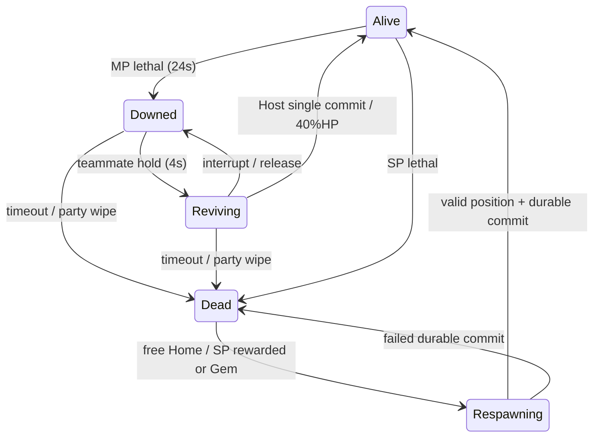

# Death / Revive / Respawn Foundation

## 착수 · 구현 전 감사 (2026-10-22)

remote fetch 후 local HEAD == origin/main == `e073c3401e99bca9e9441976a8cdac928418685a`, main clean. 이번 범위는 죽음/구조/복귀 기반이며 Class/Boss/상점/SDK/아이템 손실은 제외한다. Item134/Recipe111 유지.

### 기존 실제 call path

- `Health.ApplyDamage` → Current=0/lethal latch → Changed/Damaged → Died.
- `GameplaySession.OnEnable`의 Died 구독 → Defeat → SessionState.Defeated → GameplayHud.Refresh → DefeatPanel(Restart/NewGame). WorldPauseController는 SP를 timeScale0으로 동결.
- NetworkPlayer Host는 동일 Health/Session 사용. replica ApplyStatus는 HP0이면 ReplicateDefeat만 호출. Alive 복귀 API/Downed/timer/구조 transaction 없음.
- NetworkInventory.CanOperate는 server/connected/HP>0. Primary/Dash/시설/utility/낚시는 HP와 Session을 검사. PlayerMotor는 Session.IsRunning만 사용. 서버 Move는 scouting만 검사하므로 새 lifecycle gate가 필요.
- Health.IsAlive=false인 대상은 SimulationAuthority.Target, Enemy/Goblin/생물 공격의 선택·impact에서 제외. 새 몸통 HP를1로 유지하면 이 경계를 깨므로 Downed HP0을 유지한다.
- PlayerSurvival.Died 및 temporary tick은 Meal/Treatment를 제거. fishing/ranged/survey/telescope/placement는 세션 차단·명시 취소로 종료할 필요. 새 revive가 음식을 복제/재적용하지 않는다.
- WorldSaveService.Save는 HP0을 거절. SP SaveValidation도 HP>0만 수용. MP PlayerSnapshot은 HP0만 보존하고 Apply는 Defeated. NetworkWorldPersistence는 로컬 profile Guid별 capture/restore, Host 종료 시 저장/종료. 인증 계정이 아니며 GUID 위조/재설치는 해결 범위 아님.
- WorldGenerator.Generate는 WorldMap.Spawn으로 플레이어 배치. NetworkSession.SpawnParticipant는 그 지점+작은 참가자 offset. 기존 PlayerNavigation.HomeId는 **Workbench 방향 안내**로 변경 가능하므로 사망 복귀와 섞지 않는다.
- Runtime/Editor/docs 전체 premium/wallet/rewarded/advertisement/IAP/purchase/entitlement 검색: 실제 광고 SDK/유료 Gem 지갑 없음. Gold는 PlayerProgression의 월드 재화, Crystal은 제작 item. 둘 다 부활 결제로 사용하지 않는다.

## 구현 전 외부 비교

조회일 2026-10-22. 공식→커뮤니티 Wiki→스토어→보조자료 순으로 시도. Wiki.gg 일부 open403은 검색 색인에 실제 표시된 문단만 사용했고 확인 못한 기본 revive 초/HP는 추측하지 않았다. 모바일 공식 홈페이지/스토어에는 상세 부활 규칙이 없으므로 명시한 관찰 기사로 보완. 현재 모든 모드에 동일한 수치라고 일반화하지 않는다.

|게임|해당 시스템|실제 공개 사례|장점|Lowfire와 차이|적용|이유|
|---|---|---|---|---|---|---|
|Grounded|동료 구조 modifier|[Reliable Friend](https://grounded.wiki.gg/wiki/Mutations_%28Grounded%29)는 구조 경험으로 revive speed25/50/75%를 제공|기본 구조와 성장 modifier를 분리|현재 Lowfire에는 Class 없음; 기본 timer/HP는 이 자료로 확인 불가|modifier 경계만|class ID 분기 없이 hold/HP/duration 집계. 상대 수치 복사 안 함|
|Core Keeper|개인 respawn|[Bed](https://corekeeper.atma.gg/en/Bed): 잠깐 자면 개인 bed 지정, 한 bed 한 player, 파괴 시 Core 기본 위치|개인 위치와 world fallback 분리|현재 Workbench Home은 compass 안내; Bed gameplay 미구현|별도 persistent HomeAnchor+initial spawn fallback|Workbench를 임의 respawn station으로 만들지 않음|
|Core Keeper|death 위치/물품|[Tombstone](https://corekeeper.atma.gg/en/Gravestone)는 hotbar 이외 물품을 사망 위치에 보관. Bed 문서는 물/벽 stuck 복귀 사례도 구분|명확한 회수 목표/invalid 위치 처리|사용자 요구는 이번에 손실 없음/현장부활 가까운 보정만|위치 검증만|tombstone/원거리 현장 이동/새 inventory penalty 배제|
|Don't Starve Together|death/party wipe|[Multiplayer](https://dontstarve.wiki.gg/wiki/Multiplayer): ghost 후 여러 resurrection 경로, Endless portal 반복, Survival 전원 ghost120초 후 world reset|mode별 정책 명료|Lowfire는 world/캐릭터 영구 보존|모드별 policy 분리|world reset/영구사망/ghost sanity drain 배제|
|Don't Starve Together|동료/대가|[Telltale Heart](https://dontstarve.wiki.gg/wiki/Telltale_Heart): 살아 있는 동료가 사용, 제작자 HP비용, 부활자의 maxHP penalty|역할/소모품 확장 가능|현재 모든 class 기본 무료구조 요구|살아 있는 구조자 검증만|새 재료/영구 maxHP penalty 배제|
|Deep Rock Galactic|hold/중단/HP|[공식 Wiki Health](https://deeprockgalactic.wiki.gg/wiki/Health): 기본6초 hold, release/거리/구조자 incap 중단, partial HP는 Hazard별, 여러 구조자 속도 합산|위험 속 팀 행동과 명확한 진행|탑다운 모바일, Lowfire TTK/속도 다름|hold/부분HP/중단 채택|6초/다중 가속/mission fail은 복사하지 않음|
|Warframe|interaction/보호|[Death](https://wiki.warframe.com/w/Death): 가까이 hold action 우선, 기본5초, fullHP/shield와5초 invulnerability|구조 UX와 즉사 방지|Lowfire 공격 피해·템포 낮고 shield 없음|우선 상호작용/짧은 보호|full heal/5초 공격 무적 배제|
|Archero|선택형 광고/재화|[Udonis 실플레이 관찰](https://www.blog.udonis.co/mobile-marketing/mobile-games/archero-advertising): 초기 Gem 부활 후 level8에서 광고 선택도 등장|의도적 두 경로 선택|Lowfire는 open world expedition, 실제 광고 공급자 없음|분리된 availability/명시적 선택|기회 강제 소모/가짜 광고 성공 배제|
|Archero2|횟수/보스 비용|[Level Winner 2025-05-02](https://www.levelwinner.com/archero-2-beginners-guide/): level당 한 revive, gems 또는 ad. [PocketGamer](https://www.pocketgamer.com/archero-2/guide/)는 보스 첫 클리어·milestone의 Gem 선택을 설명|경로 이해와 자원 판단|사용자 확정은 **Gem 무제한**|선택 UI만|level/boss별 hardcap 도입 안 함|
|Survivor.io|현장복귀 HP/모드 차이|[플레이어 관찰 2023-05](https://www.reddit.com/r/Survivorio/comments/13680ls/): 광고50%/token·gem100%, chapter와 다른 모드 횟수 다르다는 보고|HP·횟수와 모드가 별개임을 보여줌|보조자료이며 공식 현행 수치 증명 아님|차이 비교만|100% HP/화면 청소/모드별 횟수/가격 증가 배제; 수치를 Lowfire 근거로 단독 사용 안 함|

### 각 결정: 외부 사례 → 현재 문제 → 원칙 → 배제 대안

1. Grounded modifier+DRG hold → 패배 화면뿐 → Alive/Downed/Reviving/Dead/Respawning을 공통 생명주기로 분리, SP는 Dead 직행 → Medic 전용/HP1 downed 배제(권위/target 경계 훼손).
2. DRG6초/Warframe5초 구조 → Lowfire 이동4.2, Zombie8피해/1.53초+Swing, Goblin6/1.75초+Swing → Downed24초, hold4초, radius2.6. 24초는 이론 최대100.8m지만 실제회피/접근+4초 hold 여유. Zombie13타≈18초 이상, Goblin17타≈28초 이상; hold4초 중2~3타도 치명적일 수 있음 → 3~5초 downed/60~120초 방치/6초 직접 복사 배제.
3. DRG release/거리/무력화+Warframe 입력 우선 → 모바일 작은 collider/시설 충돌 → 반경 기반 가장 가까운 Downed에 구조 우선, LOS 검사, hold 해제/이동입력/위치이탈/피격/공격요청/modal/target 변경/timeout/disconnect에서 진도 reset. lease0.5초로 끊긴 client hold 무한 진행 방지 → 다중 구조속도 합산 배제, 한 대상 한 구조자 lock+revision 단일commit.
4. DRG partial/Warframe full+보호 → 현재100HP·좀비8 → 현장/동료40%HP(40HP=일반좀비5타),2초 damage immunity, 공격시작 즉시 보호종료 → fullheal/긴 공격가능 무적/부활 AoE 청소 배제.
5. CoreKeeper bed fallback+DST Endless → 정상복귀 없음 → 무료 Home100%HP, Hunger/Thirst/Stamina는 현 상태 유지, 음식/치료는 기존 죽음 reset 유지. 별도 개인 HomeAnchor(default initial WorldMap.Spawn), 향후 유효지점 setter → inventory loss/성장 손실/Bed 제작/Workbench 자동연결 배제.
6. Archero ad+Gem/Archero2 cap/Survivor 모드 차이 → BM 없음 → 광고 **성공1회/expedition**, Gem 횟수제한0, Home이 새 expedition; Gem사용은 ad미소모. 비용 config기본0=disabled, QA만 임시값 → 외부cap/가격/증가가격 복사 배제.
7. 위 모바일 현장복귀+CoreKeeper invalid terrain → 죽음 자리 중요 → death position 보존, invalid시 반경3 이내 가장 가까운 walkable/solid-free 보정, 실패하면 Dead 유지/Home 선택 → 광고/Gem으로 Home 이동/적 제거 배제.
8. DST wipe와 DRG all-down → 무한대기 위험 → 전원 Downed/Dead시 Downed를 Dead로 확정, 각자 Home가능; 향후 PartyWiped 이벤트 → world reset/새 Boss encounter 구현 배제.
9. CoreKeeper 개인 respawn+DST 지속 penalty → HP만 저장/죽음 저장거절 → Save12 death record(Home/run id/사망sequence/adused/Dead), 구1~11 migration은 initialspawn. Downed/Reviving는 저장경계 Dead, protection/hold/actorID는 비영속. 죽음·부활·Home commit마다 저장 → reload 무료현장복귀/새 ad기회 배제. 인증없는 local file/GUID 위변조·수동 백업복원은 서버계정 없는 현재 구조로 보장 불가.
10. 모바일 광고 실패 관찰/Archero선택 → 실제SDK없음 → production unavailable, callback성공만 adcommit, stale callback/repeatedclick revision거절, 지갑은 transaction id+atomic commit contract; Development fixture는 명시 opt-in → 가짜 production 성공/Crystal/Gold 차감/상점·계정SDK 전면 구현 배제.

이 비교와 수치 결정은 코드 구현 전에 작성했다. 이후 검증/교정은 아래에 별도로 기록한다.

## 검증 / 구현 결과

### 최종 구현

- Item134/Recipe111/generation3 유지. 새로운 death penalty/장비·가방 손실/월드 삭제 없음.
- Downed24초, hold4초, radius2.6m, lease0.5초. 구조자는 이동 입력/실제0.2m 이탈/피격/공격 의도/거리·LOS/무력화/modal/대상 변경/timeout/disconnect에서 중단한다. 진도는 초기화되고 남은 Downed 시간은 계속 흐른다. 두 구조자는 가속하지 않으며 첫 lock+revision만 확정한다.
- 현장/동료40%HP,2초 damage immunity, 실제 공격 시작 즉시 종료. Home100%HP. 세 경로 모두 Stamina/Hunger/Thirst를 채우지 않는다. Meal/Treatment는 기존 죽음·Load 정책대로 제거하며 재지급하지 않는다.
- SP 광고는 성공한 부활1회/원정. no-fill/불가/실패/닫기(false callback)/중복/늦은 callback은 무부활. Gem 사용은 광고를 소모하지 않는다. Home만 새 원정이다.
- Gem **무제한**: counter는 거래 key용 사망 번호이며 가격/횟수 제한에 사용하지 않는다. 테스트에서 같은 원정6회 연속+광고 뒤 추가 Gem 성공. 보석 비용 config0은 제품 가격 미정·disabled, Editor에서 복제한 config7만 검증. Crystal3/Gold/가방을 보존했다.
- 지갑 계약: persistent Run+Death+kind key, 중복key/재진입 거절, world commit 실패 시 HP0/Dead/기존원정 복구와 debit0. 현재 제품 provider는 unavailable이고 실제 계정 지갑·광고 SDK·상점·IAP는 미구현이다. Editor 메모리 wallet 테스트를 실제 결제의 영속 보장으로 표현하지 않는다. 향후 원격 provider는 원자 영속 receipt/reconciliation을 구현해야 한다.
- 개인 HomeAnchor는 WorldMap.Spawn(현재 생성기의0,0)에서 시작한다. Workbench 방향 안내 HomeId는 보존·분리. authority AssignHome API의 유효 위치 변경/영속을 검증했으며 Bed/Home이동 gameplay는 추가하지 않았다.
- 현장 valid 위치는 그대로 복귀. solid/invalid 위치만3m 이내 local ring 보정, Home 막힘은8m 이내 보정. 검사 전에 목적지 주변 필요한 청크만 materialize하여 휴면 시설의 고체 충돌도 읽는다. 실패하면 Dead/Home 선택을 유지한다.
- MP Host가 lethal/timer/hold/HP/위치/보호/복귀를 결정하고 Client는 owner request+replica만 사용한다. 전원 down은 한 번 PartyWiped 이벤트와 Dead로 정리하고 각자 무료 Home을 제공한다. Boss encounter 구현은 없다.
- Save12: Home/Run/Death/Dead/AdUsed를 추가.1~11 reader/기존 migration을 유지하고11에서 새 record를 구성한다. 구 HP0 MP는 Dead, 구 SP 정상 생존은 Alive. death/commit/Home 시 저장, Downed/Reviving/pending은 저장 경계 Dead. hold/보호/actorID는 영속시키지 않는다. 동일 GUID 재접속/재Host/Load는 무료 현장부활을 주지 않는다.
- Protocol19: PlayerStatusState에 lifecycle/revision/helping/server deadlines와 owner life RPC가 추가되어18 peer와 혼용하지 않는다. prefab NetworkConfig도19다.
- 기존 Health.IsAlive=false 경계로 적이 Downed/Dead를 타깃에서 제외한다. Player network object/청크/낮은 몸체 자세/세계 구조 표식은 유지한다. 기존 navigation 화살표는 Downed 동료 안내를 우선한다.

### 실제 수행 결과와 증거

- 자동 결과는 `test-attempts.json`의 test별 마지막 결과로 집계한다. 최초 실패 XML도 보존했고 고쳐진 것만 좁게 재실행했다. 한 번에 전체 regression을 통과했다고 표현하지 않는다.
- EditMode: lifecycle serialization, Save11 migration, metadata/HP consistency, shared data, disabled production providers, duplicate/reentrant wallet/rollback, 기존 의약·음식·낚시·탐험·POI·inventory/health relation·atomic backup 회귀. 별도 full legacy v4/v11 SP/MP reader·dead-state 검증도 포함.
- PlayMode: 실제 EnemyController lethal, unavailable/success/failed/duplicate ad,6회 연속 Gem+잔액/Crystal 확인, callback cancellation, save failure rollback, Home UI, 새 SceneFlow Load, 자연 보호 만료, unsafe solid 위치 보정, Home setter 영속. 기존 공격·의약·inventory world policy·죽음 latch·pool reset·network targeting·동일 identity 복원 회귀.
- 실제 Unity MCP: `unity-mcp-live.tsv`,1920×1080 PNG14장. SP death3선택/disabled 안내, 실패 광고, 반복 Gem, 무료 Home, 실제 새 씬 Dead 복원. MP Downed banner/자세/표식, 작은 화면 위 banner, 구조 진행·Home·all-down·재Host를 검수했다. 기존 모바일 Interact의 top raycast와 PointerDown/hold/PointerUp 경로도 실제 Play에서 구조40HP를 확인했다.
- 실제 **2 process LAN**: visible Unity Host + 별도 hidden headless Unity Client. `lan-client-final.xml`과 양쪽 TSV에 Client→Host owner hold, Host→Client 구조, 피격 중단, timeout→Dead, 중복 Home 요청, 양쪽 all-down→Home, Downed disconnect, 같은 profile reconnect→Dead, Host 종료/재Host→Dead→Home을 기록했다. 조정용 임시 파일은 테스트 순서만 맞추며 게임 결과는 실제 RPC/NGO replica로 검증했다. Client는 headless이므로1920 화면 실사 검수는 visible Host 증거다.
- 4 actor 시뮬레이션은 한 Host 프로세스의4 server actor다. 실제4인 Relay/기기로 부르지 않는다. 두 구조자 lock/revision·lease 만료·timeout·party wipe를 확인했다.
- 사용자 실제 save2파일은 작업 전후 SHA256와mtime_ns가 동일하다. QA는 별도 Captures 경로와 identity를 사용했고 마지막 Unity는 MainMenu/Play중지/QA profile 해제 상태다.

### 실패에서 교정한 내용

1. 최초 새 script import/fixture API 이름, Editor assembly MonoBehaviour 부착 제한을 교정했다. 씬 Load가 검사 coroutine을 파괴하지 않도록 Editor에서만 컴파일되는 전용 host를 사용했다.
2. 매 저장 검증마다 같은 대륙을 여러 번 계산하면서 프레임이 길어졌다. 불변 validation layout만 seed/generation별 한 개 재사용하고 모든 mutable snapshot 검증은 유지했다. 최종 live warmed Gem commit은 로그상 약20~75ms 수준(개발 PC 관찰, Android 성능 보장 아님)으로 줄었다.
3. NGO despawn callback에서 파일 저장/flush하는 초기 구현을 제거하고 snapshot 기억+다음 프레임 disconnect save로 분리했다.
4. 구 test 기대값(11 version, 사망 시 inventory 비우기)을 현재12/보존 정책에 맞췄다. 기존 shared party reward 기대도 최신 source로 갱신했다. 구 고정좌표 생존 fixture는 generation1을 명시했다.
5. LAN 피격 fixture는2초 보호 중인 Host를 때리던 순서를 고쳤다. 보호 종료 후 실제 피해로 중단을 검증했다.
6. 네트워크 공격 회귀는 두 아군을0.1m 겹쳐 고체 LOS가 막히던 배치를1.2m 옆으로 옮겼다. production 전투/관통 정책은 변경하지 않았다. 한 재실행은 두 QA Host의7777 포트 경합으로 실패하여 Host를 종료하고 단독 재실행했다.

### 판정 / 한계

Foundation 기능 범위 **A**. 실제 광고 SDK/결제/계정 영속 지갑을 출시 검증했다고 주장하지 않는다. Android 실기·실제 터치/발열/긴 경제·4인 실제 기기/Relay·latency/loss·재미/손맛은 미검증이다. 로컬 파일/backup 수동 복원·GUID 위조·OS 강제 종료의 파일시스템 수준까지 막는 인증 서버/anti-tamper는 이번에 만들지 않았다.

다음은 Class/Class Point/Class Skill Tree 설계·구현이다. 향후 Medic은 공용 duration/speed/health modifier와 별도 healing item use 경계를 사용하며 이번에는 Class/Boss를 추가하지 않았다.

최종 집계: EditMode47/47, PlayMode/LAN13/13(중복 case는 마지막 결과, 실제 LAN1 포함), source validator1377 unique GUID PASS, data validator PASS. 전체60개 결과와 실행별 실패/재검사 이력은 test-attempts.json을 따른다.
