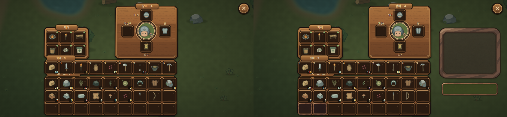
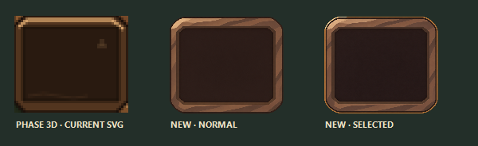
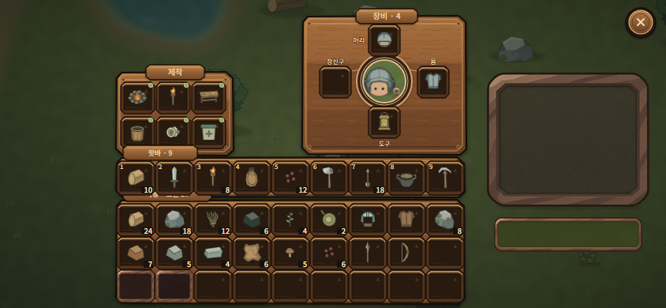

# Inventory Art Production Reset — Review

**Date:** 2026-11-07 UTC
**Status:** sample pack committed for review; production art gate **not passed**. Do not implement in Unity or expand to the full inventory before approval.

## Baseline and scope

- `mobile-game-builds` `main` before edits: `2e9fdfe2f0607fc9ee1c5b91142a617f12585573` (fetched and matched `origin/main`).
- `dev-playbook` `main`: `e022e9e4ff3947fcbd7f5b0237c5905d7c0409c7` (fetched and matched `origin/main`).
- The existing Phase 3D screens and SVG kit were inspected. They remain unchanged.
- Retained information structure: crafting group at left; equipment paper doll with the existing four equipment slots; nine-item hotbar above the 27-slot storage grid; contextual item detail/action only for existing selection/equipment states; existing drag, split/cancel, equip/unequip, and drop meanings. No pouch feature or new item/action was invented.
- Set aside for replacement: the repeated flat SVG wood lines and identical bevel treatment, small green-dot craft cue treatment, thin microcopy, 48×41 storage cells, the unused right-side space in the basic state, and the 5-pixel screen-edge clearance. This is a visual/layout reset; the associated state and existing action meanings stay intact.

## Commercial references inspected

| Game / screen | Observed surface and state treatment | Lowfire lesson | Not copied |
|---|---|---|---|
| [Core Keeper inventory](https://playcraft.space/gallery/core-keeper/inventory-crafting-pouches-hotbar/), frame from the official *Bags and Blasts* Steam trailer, catalogued with provenance by PlayCraft | The screenshot uses dark recessed wells, warm brown pixel-art frames, inner shadow and a narrow bevel to separate each slot. Equipment/category borders and the hotbar use localized colored indicators, so emphasis stays close to the relevant item. | Preserve the item-first dark well and clear inset edge. Keep Lowfire selection color separate from item rarity and do not let a permanent bright frame compete with icons. | No frame shape, pixel texture, palette mapping, icons, labels, pouch area, or screen layout was copied. Lowfire has no pouch feature. |
| [Necesse inventory screenshot](https://necessewiki.com/File:Inventory.png) and [inventory documentation](https://necessewiki.com/Inventory) | The screenshot shows high-density slots on a comparatively neutral grey surface, with dark separators and small edge depth; item silhouettes/counts carry most of the visual attention. The documented inventory uses a 4×10 storage grid plus a separate 10-slot hotbar. | Surface material can be restrained. Increase the visual weight of Lowfire item icons, quantities, and labels before adding decoration. | No screenshot pixels, icons, layout, text, or grid count were copied. |
| [Terraria Mobile controls documentation](https://terraria.wiki.gg/wiki/Game_controls) and [UI settings](https://terraria.wiki.gg/wiki/Settings) | The official wiki describes a distinct mobile inventory/control arrangement and movable touch controls. The current mobile screenshot host blocked direct image retrieval during this pass, so no material claim is made from that screenshot. | Keep touch affordances and action grouping visible at landscape size; verify actual target sizes after layout reflow. | No touch-control placement or images were copied. |

The Core Keeper gallery identifies the inventory frame as a still from the official Steam trailer and records the visible crafting, paper-doll, pouch, hotbar, and storage regions. Its screenshot was inspected directly from the linked image. The Necesse file screenshot was also inspected directly but used only for analysis; neither image is present in this repository.

## Art method comparison and decision

| Method | Strength for Lowfire | Cost / risk | License / source status | Decision |
|---|---|---|---|---|
| Krita, layered hand-painted raster | Direct control over outline weight, broad facets, warm/cool balance, shadow, and transparent edge pixels; the `.kra` master can be edited layer by layer and exported as PNG. Fits Lowfire's outlined 2D world better than physically rendered wood. | Requires human paint/cleanup and a per-component 9-slice review; the Krita MCP bridge was unavailable here, so no `.kra` master was created. | [Krita's official license](https://krita.org/en/about/license/) is GPL-3.0 for the program and explicitly permits commercial use of artwork made with Krita. | **Recommended production pipeline.** Build the final master in Krita, then export alpha PNG and record slice margins. |
| Blender material/render | Repeatable lights, bevels, ambient shadows, and controlled camera; useful for consistent material studies. | The first generator concept looked overly 3D and too heavily beveled for Lowfire. The Blender live bridge also did not answer, so no `.blend` was created. | The [Blender Manual](https://docs.blender.org/manual/en/4.0/getting_started/about/license.html) says the GPL applies to the application, not artwork created with it. | Good optional material blockout, not the final production source for this game's 2D UI. |
| Built-in ImageGen raster concept | Fast transparent raster samples; prompts prohibit external assets and preserve an inspectable generation record. | Non-deterministic, not layered/hand-editable, repeated facets can look generated, and ownership terms are not an exclusivity or non-infringement guarantee. | [OpenAI Terms of Use](https://openai.com/policies/row-terms-of-use/) assign user ownership of output between the parties to the extent allowed by law and say outputs may not be unique. Final commercial use still needs a legal/originality review. | Used only for these four review samples. **Not approved as shipping art.** |
| Repeated code-generated SVG primitives | Crisp scaling and easy layout edits. | The Phase 3D review already found that repeated flat bevels/lines did not reach the desired material quality; another SVG pass would repeat that limitation. | Project-authored source. | Preserve Phase 3D as history; do not extend it as the production art solution. |

## Four sample assets and visual gate

The native-size composite uses the unchanged 844×390 Phase 3D basic screenshot. It places the normal and selected slot samples in two empty storage cells, the 208×176 panel in unused background space, and the 188×44 blank button below it. The added panel/button are samples only, not new controls or a complete screen.

### Visual verdict: not ready to scale

- **Improved:** the painted surfaces have actual color planes, recessed centers, a top-left light direction, and contact shadow, giving more material depth than the original repeated SVG wood lines.
- **Style mismatch at 1×:** the samples read as warmer, rounder, and more volumetric than the existing Phase 3D slot and its Lowfire screen. Side by side, they look like a separate UI kit instead of a coherent upgrade; the equipment-panel bevel also dominates the simpler world background.
- **Still not at production standard:** all four surfaces share a generated, broad-facet look; the slot's 48×41 detail is borderline; and the button's edge/face proportions need a manual layered pass.
- **Selected state:** the final amber contour is visible in the zoomed comparison, but remains close to the normal state at 1×. It needs a more controlled 1–2 px authored indicator that is unmistakable without glow.
- **9-slice:** not passed. The bevel facets/shadow enter the corners and edges; the sample exports were resized to target aspect for screen review and are not evidence that arbitrary panel sizes will stretch cleanly.
- **Authenticity/editability:** no human-painted `.kra`, Blender `.blend`, Unity sprite import, font pass, or device screenshot exists. The previews are only a material-fit comparison. This fail/hold result is intentional; no full inventory production is started.

## 844×390 layout reflow proposal

The screen has 844×390 pixels. Phase 3D currently uses the crafting panel at `(147,91)` size `149×106`, equipment at `(383,20)` size `208×176`, hotbar panel at `(147,199)` size `442×51`, storage at `(147,253)` size `442×132`, and a selected/equipment detail card at `(596,101)` size `205×108`. Basic state leaves that right card absent. The storage grid is nine columns by three rows with `48×41` cells; the storage panel bottom is `y=385`, leaving five pixels to the screen edge. Current count/help text is roughly 7–9 px.

| Region | Proposed 844×390 placement / scale | Effect |
|---|---|---|
| Hotbar + storage | Keep nine columns and three rows. Use `54×42` visible cells with `54×44` non-overlapping hit rectangles and a 1 px horizontal gap; the grid width becomes `9×54 + 8×1 = 494 px`, from `x=148` to `x=642`. Keep the hotbar target row at `y=199..243`; storage target rows at `y=245..289`, `y=290..334`, and `y=335..379`. Keep the shared lower frame ending at `y=383`, leaving 7 px to the screen edge. Put section labels in the frame rail. | Keeps 9/27 capacity and cell ordering, makes the visible slot 12.5% wider and 1 px taller, and increases the touch rectangle from 48×41 to 54×44 without overlapping adjacent rows. It adds 2 px of bottom clearance over Phase 3D. |
| Right context column | `x=650..824` (`174 px` wide), `y=212..378`. Show selected item name, 11–12 px description/count, and the existing action(s). In the idle state, show short help for existing drag, long-press split, and equipment selection. | Uses the right-side gap without inventing pouches or new storage. Maintains world visibility above the lower UI. |
| Quantity / help text | Raise current roughly 9 px count to 12 px; raise 7–8 px helper text to 11–12 px. Allow a second line in the wider context column instead of truncating. | Improves first-glance reading while keeping copy as live Unity text. |

The 54×42 visible cell and 54×44 hit rectangle are layout targets, not final art dimensions. A 44 px target still falls short of a 48 px square target. Four 48 px rows plus a safe lower margin do not fit in the current vertical band without moving the existing equipment/crafting regions; if thumb testing requires 48 px, keep the 27-slot capacity but put the third storage row in a scrollable viewport. This proposal has not been implemented or device-tested.

## Verification and protected scope

- Re-ran `build_preview.ps1` and opened the native-size composite, side-by-side comparison, and 3× slot comparison.
- No automated game test, Unity EditMode/PlayMode, mobile touch, or live Unity render was run; none was needed for this art-only proof.
- No Unity source, scenes, prefabs, game data, Save/Profile/Protocol, runtime UI, or existing Phase 3D source/output was changed.
- No external reference screenshot or texture was copied into the repo.
- Initial `mobile-game-builds` and `dev-playbook` `main` both matched their fetched `origin/main` SHAs. Final Git SHA is recorded after push in the handoff.

## Approval needed before the next pass

1. Decide whether this muted hand-painted wood material direction is worth a manual Krita redraw, or whether Lowfire's UI should stay substantially flatter.
2. If proceeding, enable the Krita bridge so the next pass can produce a layered, human-cleaned `.kra`, a corner-safe 9-slice proof, and a second actual-size comparison. Do not use these generated exports in Unity without that review.
3. Approve the proposed 844×390 slot/context reflow only after the resized live-text layout is shown separately.

Until then, this work remains an art pipeline/material study. HUD, inventory-wide production, and Unity implementation remain out of scope.
