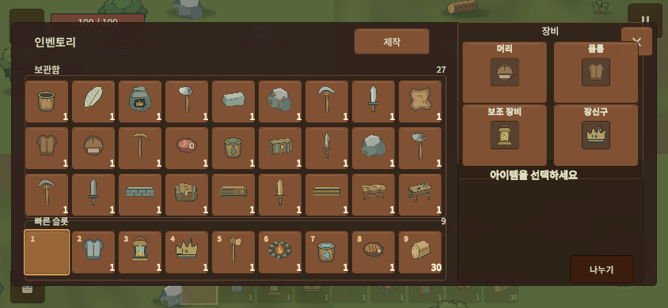
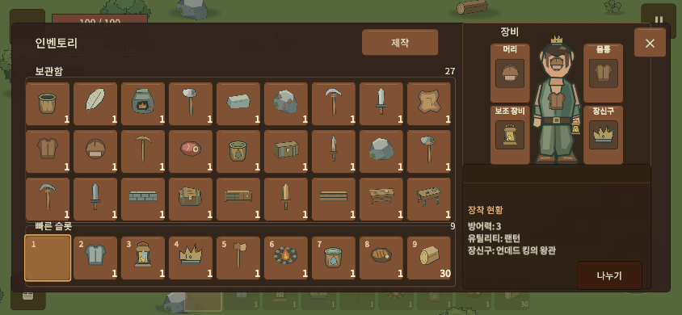
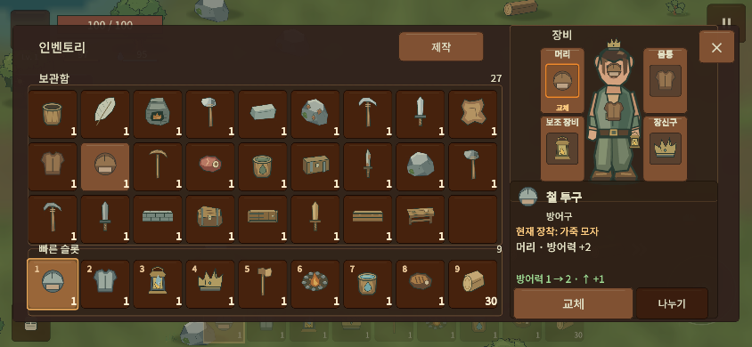
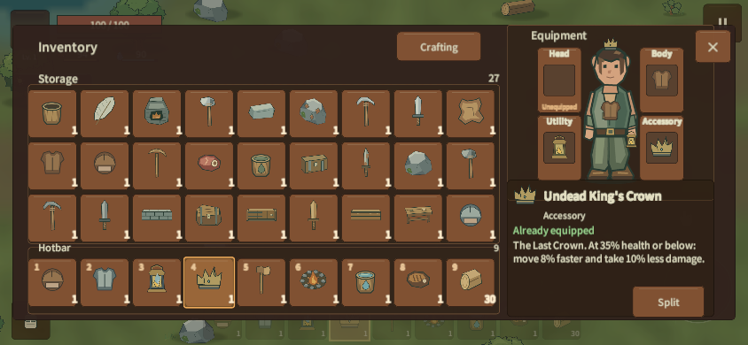
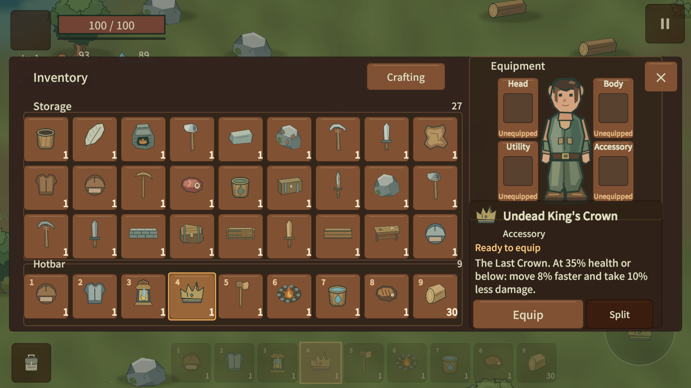

# Lowfire — 캐릭터 중심 인벤토리 최종 시각 검수

## 결과

승인된 디자인의 핵심인 정면 전신 프리뷰와 주변 2×2 장비 슬롯을 실제 Unity Game View에 적용했다. 전신 베이스는 인벤토리 전용 일러스트이며, 장비 레이어는 더미 데이터가 아니라 현재 플레이어의 `PlayerEquipment`에서 읽는다. Phase 4D 인벤토리의 저장·멀티플레이·드래그·분할·장비 동작은 기존 모델과 컨트롤러를 계속 사용한다. Phase 4E와 다른 UI 개발은 시작하지 않았다.

## 아트 및 렌더링 조사

- 기존 월드 플레이어는 탑뷰 `player_body.png` 및 얼굴·손 스프라이트와 `PlayerAvatar`의 `SpriteRenderer` 장착 외형을 사용한다. 이 리그를 정면으로 바꾸면 월드 캐릭터 외형과 이동 표현을 훼손하므로 수정하지 않았다.
- 기존 아트에는 승인 시안처럼 보이는 정면 전신 스프라이트가 없어 `projects/wildfolk/tools/generate_inventory_character_art.py`로 Lowfire 팔레트의 블록형 전신 일러스트를 만들었다. 원본 생성 도구의 공유 도형·색상 처리 방식을 사용했으며 다른 게임 아트는 복제하지 않았다.
- 새 에셋 `client/Assets/Wildfolk/Art/player_inventory_fullbody.png`는 115×287 PNG, SHA-256 `28CFF76E0B0F47D591E357D2727573511E298B3C52B64495ACF5895BBD4E90D2`, Unity Sprite GUID `36f4b7dcca9832c48838a28bbb34699c`이다.
- `PlayerPortrait`의 인벤토리 전용 경로는 현재 `HeadArmor`, `BodyArmor`, `Utility`, `Accessory` 참조로 보이는 레이어를 갱신한다. Utility는 캐릭터 옆, Accessory는 `AccessoryDefinition.Anchor`에 따라 표시한다. 왕관 Accessory의 `AboveHead` 외형은 머리 방어구 슬롯·방어력과 별개다. 기존 월드 렌더링 경로는 그대로 유지한다.

## 원인 및 수정

원본 픽셀 검토에서 자동 경계 검사로 잡히지 않은 시각 충돌 두 가지를 확인했다.

1. 아래 장비 행의 상태 글자와 선택 아이템 이름 줄이 844×390에서 붙고, 1920×1080에서 일부 겹쳤다. 두 장비 행 중심을 각각 y=212/20에서 y=262/70으로 올려 2×2 구조와 128×188 터치 셀을 유지하면서 상태 줄과 상세 정보 사이에 간격을 만들었다.
2. 장비 제목과 `AboveHead` 왕관이 가운데에서 만났다. 제목을 x=670에서 x=525로 옮겨 왕관 프리뷰와 분리했다. 오른쪽 Body 슬롯과 닫기 버튼 간의 기존 간격은 유지된다.

아이템을 선택하지 않았을 때 `InventoryPanel.RefreshSelection()`이 “아이템을 선택하세요” 문구를 다시 넣어 장착 요약을 덮던 경로도 수정했다. 이 상태에서는 장착 방어력·Utility·Accessory 요약을 보여 준다.

## Game View 증거

Unity 6000.3.19f1의 Play Mode Game View에서 `ScreenCapture.CaptureScreenshot`으로 최종 배치 캡처 90개를 생성했다. 15개 상태를 한국어·영어, 844×390·1280×720·1920×1080에서 각각 촬영했다. PNG 크기·파일 크기·SHA-256 전체 목록은 [최종 캡처 인덱스](captures/character-centered-review-20261115-final-v3/capture-index.csv), QA 진행·격리 기록은 [qa-live.tsv](captures/character-centered-review-20261115-final-v3/qa-live.tsv)와 [qa-result.txt](captures/character-centered-review-20261115-final-v3/qa-result.txt)에 있다. PNG 전체 용량은 31,688,797 bytes이다.

### 이전 Phase 4D

### 전신 프리뷰 기본 화면

### 장비 교체 후보

### 긴 영어 이름 및 빈 슬롯 상태

캡처 원본 픽셀로 844×390 한국어 기본·교체 후보·교체 완료·해제·나누기, 844×390 영어 기본·긴 이름, 1280×720 한국어 기본 및 영어 교체 후보, 1920×1080 한국어 기본과 영어 빈 장비 상세를 검토했다. 장비 슬롯 4종 단독 표시 및 교체·해제 상태 캡처도 최종 세트에 포함했다. 자동 텍스트 경계 QA는 0 findings였고, 시각 검토는 자동 결과와 별도로 수행했다.

## 회귀 검사

| 검사 | 실제 결과 |
|---|---:|
| `InventoryEquipmentLayoutTests.EquipmentTargetsAndLabelsFitSharedInventoryLayout` | EditMode PASS 2/2 — Wildfolk / Multiplayer |
| `CharacterPassPlayTests.InventoryCharacterPreviewTracksRealEquipmentWithoutChangingGameplayState` | PlayMode PASS |
| `EcologyPlayTests.ActualPointerArmorDragSwapUnequipAndUse` | PlayMode PASS |
| `EcologyPlayTests.InventoryReplacementLabelsShowCurrentGearDirectionAndResetSelection` | PlayMode PASS |
| `EcologyPlayTests.InventorySplitButtonInitializesWhenInventoryWasAlreadyOpen` | PlayMode PASS |
| 위 네 PlayMode 검사 합계 | PASS 4/4 |
| 최종 캡처 자동 텍스트 경계 검사 | PASS, 0 findings |
| Android 실기기 검증 | UNVERIFIED |

EditMode 레이아웃 검사는 중첩된 슬롯 자식 글자의 `RectTransform` 좌표를 부모까지 합산해 상세 이름과 상태 글자, 2×2 행 글자 및 제목의 경계를 검사한다. PlayMode 프리뷰 테스트는 실제 장비 데이터 변경과 기존 월드 플레이어 transform/facing 보존을 확인한다.

## 보호 파일 및 QA 영향

- 시작 시 저장한 보호 manifest 265개를 다시 대조했다. 해시 불일치 0건이며 보호 `.meta` 88개도 모두 동일하다. `DefaultNetworkPrefabs.asset`와 기존 미추적 자료도 manifest 값과 일치한다.
- `ProjectSettings/EditorSettings.asset`은 Unity 테스트 실행 중 `m_EnterPlayModeOptions`가 바뀐 것을 확인하고 시작 스냅샷으로 복구했다. 최종 SHA-256은 `0B5C614BA2B24AB6BD1853F450EF8CC44B84C2D084493F8B5BBA0C9F3213F680`이다.
- 테스트·QA 중 기존 `UserData/Economy/b44e85c108d399ac1ef5ea4528eee53b5ef0c390c69c87214a4d1609307609f2.json`에 QA 이벤트가 추가된 상태(B105…)를 발견했다. 이 실행 결과의 복사본을 `D:\Lowfire-CharacterInventory-protection-20261115-200632\qa-side-effects-after-tests\UserData\Economy\` 아래에 보존하고, 사용 전 기준 파일을 복구했다. 정본 저장 파일의 최종 SHA-256은 시작값 `C9D61E23BBBB90C1E8781B83E3D65BE38321BABEBA2C55B45D94D6A39EC9CD7A`와 같다. QA runner는 고유 임시 profile과 AutoSave 비활성 상태를 기록했고 세계 저장 쓰기는 없다고 보고했다.

## Unity 및 Git 상태

- 정본 Unity 프로젝트: `D:\Lowfire-Workspace\mobile-game-builds\projects\wildfolk\client`
- Unity Editor: `6000.3.19f1`; Unity MCP 인스턴스 `client@33b387e077436073`가 이 프로젝트 경로에 연결됐다.
- QA 종료 후 Play Mode를 끝내고 MainMenu 편집 상태로 복귀했다. Unity Focus/Show 호출은 하지 않았다.
- 변경 코드의 컴파일과 집중 테스트는 통과했다. Console에는 기존 `Google.IOSResolver.dll` 오류 1건이 남아 있다. `UnityEditor.iOS.Extensions.Xcode`가 설치된 Windows Editor에서 해석되지 않는 플러그인 참조다.
- 시작 기준 `main`과 GitHub `origin/main`은 `7aa8625afee42b47f1700696583f3ed0e8f2910e`로 일치했다. 최종 구현·문서·증거 변경은 이 `main` 작업 트리에 있으며 사용자 캡처 검수와 최종 디자인 승인은 별도로 대기한다.

## 작업 시간

- 시작 기준: 2026-11-15 20:06:37 KST — 보호 스냅샷 파일의 실제 생성 시각. 원래 요청 도착 시각은 별도 기록되지 않았다.
- 최종 시각 검증 완료: 2026-11-15 22:57:40 KST — 최종 90장 Game View QA 완료 로그.
- 보호 스냅샷부터 기능·시각 검증 완료까지: 2시간 51분 03초.
