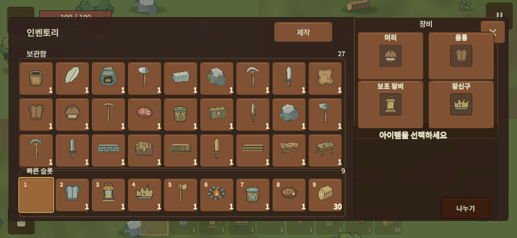
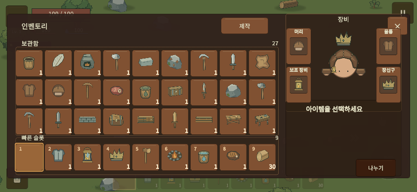

# Lowfire Phase 4D — 승인된 캐릭터 중심 인벤토리

작업 범위는 기존 Phase 4D 인벤토리 화면에 사용자가 승인한 캐릭터 중심 장비 구성을 적용하는 것이다. Phase 4E, 다른 화면, 게임플레이 기능은 시작하거나 변경하지 않았다.

## 결과

- 기존 shared Inventory UI를 확장해 2×2 Head / Body / Utility / Accessory 슬롯을 캐릭터 프리뷰 주위로 배치했다. Storage 27, Hotbar 9, 제작 진입, 선택 아이템 상세, 교체 비교, 장착·해제·나누기 버튼은 기존 구조를 유지한다.
- 캐릭터 프리뷰는 새 장비 시스템이나 임시 샘플 이미지가 아니다. 실제 `PlayerEquipment`와 런타임 SpriteRenderer를 읽어 Head/Body/양손 방어구, Utility, Accessory를 표시한다. Accessory 위치는 기존 `AccessoryVisual`과 공유하는 앵커 계산을 쓴다.
- Gameplay와 Multiplayer 씬은 같은 Builder로 다시 정렬했다. 인벤토리 모델, Storage/Hotbar 용량, 드래그·분할, 저장, 멀티플레이 권한 코드는 변경하지 않았다.
- 장비 셀의 상태 및 카테고리 텍스트는 128×188 터치 영역 안에 배치했다. 실제 렌더링 검수에서 프레임·아이콘·인접 슬롯·프리뷰·상세 정보·행동 버튼이 충돌하지 않았다.

제공된 참고 이미지에는 전신 인간형 캐릭터가 있지만 현재 Lowfire 아트에는 그런 스프라이트가 없다. 프로젝트의 기존 위에서 내려다보는 캐릭터 아트와 실제 장착 외형을 재사용했다. 캡처의 둥근 머리·손 중심 실루엣은 현재 게임 캐릭터 표현과 일치한다. 다른 게임의 아트나 생성한 캐릭터 에셋은 넣지 않았다.

## 전후 캡처

기존 Phase 4D 화면은 장비 2×2 카드가 차지하고 캐릭터 장착 외형을 중앙에서 볼 수 없었다. 새 화면은 기존 슬롯을 유지하면서 실제 장착 모습이 가운데에 보인다. 아래 두 이미지는 같은 844×390 Game View 크기 및 기본 인벤토리 상태의 픽셀 캡처다.

### 이전 Phase 4D · 한국어

### 캐릭터 중심 화면 · 한국어

### 전후 교체 상태

같은 844×390에서 한국어·영어 교체 후보 및 교체 완료 캡처는 [`before-phase4d`](captures/before-phase4d/)와 [`unity-final`](captures/unity-final/) 폴더에 있다. 긴 영문 설명, 빈 장비 슬롯, 나누기 모달과 모든 슬롯 단독 장착 외형도 포함한다.

## Unity 시각 QA

Unity Editor 6000.3.19f1의 실제 Game View에서 `ScreenCapture.CaptureScreenshot`으로 캡처했다. 15개 UI 상태를 한국어·영어 및 844×390, 1280×720, 1920×1080에서 각각 촬영해 총 90장을 만들었다. 실제 PNG IHDR 크기, 파일 바이트 수와 SHA-256은 [CAPTURE_INDEX.csv](CAPTURE_INDEX.csv)에 기록했다. 비교용 Phase 4D 이전 화면은 [BEFORE_CAPTURE_INDEX.csv](BEFORE_CAPTURE_INDEX.csv)에 별도 기록했다.

원본 크기로 시각 검토한 항목:

- 844×390: 15개 상태 전부, 한국어와 영어. Storage/Hotbar 격자와 선택 표시, 각 장비 단독 외형, 교체 후보·적용, 역방향 후보, 비호환 상태, 빈 슬롯·해제, 긴 영어 이름/설명, 나누기 모달을 확인했다.
- 1280×720 및 1920×1080: 기본 화면과 대표 상호작용 화면(장비 비교/교체, 긴 설명, 빈 장비, 분할)을 두 언어에서 검토했다. 전체 상태의 실제 캡처는 모두 보관했다.
- 자동 텍스트 preferred-height/패널 경계/상세 정보 대 장비 슬롯·버튼·캐릭터 프리뷰 검사: 0건 실패. 결과는 [`qa-result.txt`](captures/unity-final/qa-result.txt) 및 [`qa-live.tsv`](captures/unity-final/qa-live.tsv)에 있다.
- 캡처 중 AutoSave를 비활성화하고 고유한 임시 QA profile을 사용했다. QA는 저장 쓰기가 없다고 기록했다.

캡처는 최종 QA 실행기 보완 전에 완료했다. 보호 검사에서 QA 종료 순간 profile을 Play Mode 안에서 되돌려 씬의 `AchievementObserver`가 기본 경로로 텔레메트리 1건을 기록한 것을 발견했다. 기존 `UserData`는 작업 전 존재하지 않았고 기존 파일은 덮어쓰지 않았다. 이 QA로 생성된 `client/UserData/Economy/b44e85c108d399ac1ef5ea4528eee53b5ef0c390c69c87214a4d1609307609f2.json`은 `biomes: 1` 집계와 임의 guest scope를 담으며, SHA-256은 `C9D61E23BBBB90C1E8781B83E3D65BE38321BABEBA2C55B45D94D6A39EC9CD7A`다. 원본과 동일한 백업 사본을 보호 폴더의 `qa-side-effects/UserData/Economy/`에 보관했다. 정리 명령은 실행 정책에 의해 거부되어 파일을 삭제하지 않았으며, 현재 파일을 그대로 보존한다.

이후 실행기의 복구 처리를 `EnteredEditMode` 시점으로 이동하고 QA 편집 환경만 컴파일했다. 컴파일은 끝났고 새 컴파일 오류는 없었다. 변경 후 Game View 캡처나 Play Mode 테스트를 다시 실행하지 않았다. 따라서 위 90장과 8개 집중 검사는 변경 전 실제 구현을 검증하며, 종료 시점 보완 코드는 컴파일까지만 검증했다.

화면 픽셀의 시각 판정과 자동 경계 검사는 별도로 수행했다. 폰트 크기를 best-fit으로 줄이거나 텍스트를 숨겨 통과시키지 않았다.

## 변경 파일

- `client/Assets/Wildfolk/Editor/InventoryUiBuilder.cs` — 중앙 프리뷰와 2×2 장비 셀의 shared SP/MP 배치.
- `client/Assets/Wildfolk/Editor/QualityUiBuilder.cs` — 기존 플레이어 아트를 사용하는 인벤토리 프리뷰 생성 및 선택 외형 레이어.
- `client/Assets/Wildfolk/Runtime/UI/PlayerPortrait.cs` — 실제 방어구·Utility·Accessory 외형을 UI 이미지에 반영. 다른 화면은 optional Utility/Accessory 참조를 설정하지 않아 기존 구성을 유지한다.
- `client/Assets/Wildfolk/Runtime/Presentation/AccessoryVisual.cs` — 기존 월드 비주얼과 프리뷰가 같은 Accessory 앵커를 쓰도록 공용 계산.
- `client/Assets/Wildfolk/Runtime/UI/InventoryEquipment.cs` — 기존 장비 UI에 캐릭터 프리뷰 참조.
- `client/Assets/Wildfolk/Scenes/Wildfolk.unity`, `Multiplayer.unity` — 공용 인벤토리 레이아웃 저장.
- `client/Assets/Wildfolk/Editor/InventoryPhase4DVisualQa.cs` — 실제 캡처, 단독 장비 외형, 텍스트/시각 경계 검사.
- `client/Assets/Wildfolk/Tests/EditMode/InventoryEquipmentLayoutTests.cs` — SP/MP 셀·프리뷰·터치 영역의 구조 검사.
- `client/Assets/Wildfolk/Tests/PlayMode/CharacterPassPlayTests.cs` — 실제 Equipment 상태에 따른 프리뷰 갱신과 플레이어 transform/facing 불변 검사.
- `docs/INVENTORY.md` 및 이 검수 보고서.

## 검사 결과

| 검사 | 결과 |
|---|---:|
| Unity C# compile / domain reload | PASS, 변경 코드 컴파일 오류 없음 |
| `InventoryEquipmentLayoutTests.EquipmentTargetsAndLabelsFitSharedInventoryLayout` | PASS 2/2 (Gameplay, Multiplayer) |
| `CharacterPassPlayTests.InventoryCharacterPreviewTracksRealEquipmentWithoutChangingGameplayState` | PASS 1/1 |
| `EcologyPlayTests.ActualPointerArmorDragSwapUnequipAndUse` | PASS |
| `EcologyPlayTests.InventorySplitButtonInitializesWhenInventoryWasAlreadyOpen` | PASS |
| `EcologyPlayTests.InventoryReplacementLabelsShowCurrentGearDirectionAndResetSelection` | PASS |
| `StabilityPlayTests.LongPressSplitHoldsChosenAmountUntilExplicitPlacementOrCancel` | PASS |
| `WorldPassPlayTests.SplitHalfViaTouchButtonAndExplicitDropZonePreserveItems` | PASS |
| Phase 4D Game View automated text/overlap checks | PASS, 0 findings |
| Android 실기기 터치 검증 | UNVERIFIED |

Unity Console에는 이 작업 전부터 있던 `Google.IOSResolver.dll` 로드 오류가 1건 있다. 사유는 `UnityEditor.iOS.Extensions.Xcode` 참조를 현재 Editor에서 찾을 수 없다는 것이다. 변경한 인벤토리 코드의 컴파일/검사 오류는 아니며 iOS Resolver 설치는 이번 범위가 아니다.

## 기존 로컬 변경 보호

작업 전 변경 목록/해시를 `D:\Lowfire-CharacterInventory-protection-20261115-200632\protected-state.json`에 기록하고 원본들을 같은 보호 폴더에 복사했다. 작업 종료 직전 manifest의 265개 항목(기존 변경 264개와 clean `EditorSettings.asset` 1개)을 전수 대조했다. 기존 변경에는 `.meta` 88개, `DefaultNetworkPrefabs.asset` 변경, 기존 미추적 자료가 포함된다. 해시·길이·존재 여부 불일치 0건이며 `ProjectSettings/EditorSettings.asset` SHA-256도 시작값 `0b5c614ba2b24ab6bd1853f450ef8cc44b84c2d084493f8b5bba0c9f3213f680`과 일치한다. 생성된 QA 텔레메트리 파일은 이 원본 보호 manifest 밖에 새로 생긴 ignored 파일이며 기존 데이터는 없었다.

## Unity / MCP

- 프로젝트: `D:\Lowfire-Workspace\mobile-game-builds\projects\wildfolk\client`
- Editor: Unity 6000.3.19f1
- CoplayDev Unity MCP: 활성 인스턴스 `client@33b387e077436073`, 위 정본 경로 연결 확인
- 캡처와 테스트 후 Play Mode를 종료하고 MainMenu 씬으로 복귀했다. Unity Focus/Show 호출은 하지 않았다.

## Git 반영 및 시간

- 시작 기준 `main`과 `origin/main`: `43c37eac3cc31d95b79e03e939a856f65c73b41f`; 이 기준부터 Phase 4D 관련 변경만 허용 목록으로 staging/commit/push한다. commit ID와 최종 push 결과는 반영 후 여기에 기록한다.
- 작업 시작 기준: 2026-11-15 20:06:32 KST (보호 스냅샷이 생성된 첫 확인 시각; 요청 도착 시각은 별도 보존되지 않음).
- 작업 종료 및 총 경과: main push 후 기록한다.
