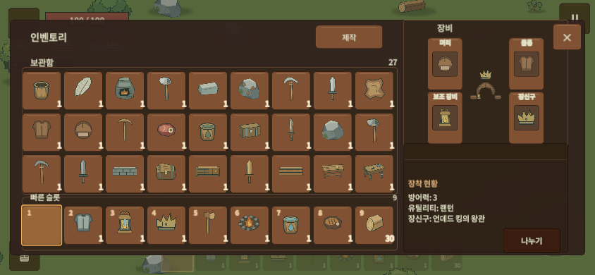
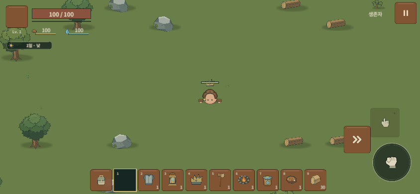

# Lowfire 인벤토리 월드 캐릭터 프리뷰 — 2026-11-16

## 결과 요약

기존 정면 캐릭터 대체 그림을 제거하고, 장비창 중앙 프리뷰를 실제 게임 월드의 2D 탑다운 PlayerAvatar 렌더러로 교체했다. 월드 캐릭터 오브젝트를 복제하거나 조작하지 않고 원본 SpriteRenderer의 현재 표현을 UI Image에 미러링한다. 새 캐릭터 아트는 만들지 않았다.

- 구현 및 원본 픽셀 시각 검수: PASS
- 관련 인벤토리 EditMode: 2/2 PASS
- 관련 인벤토리 PlayMode: 4/4 PASS
- 장비 저장 왕복 PlayMode: PASS
- Host 멀티플레이 인벤토리 PlayMode: UNVERIFIED — 테스트 준비 단계에서 HomeScreen 참조가 null이 되어 Host/아이템 검증에 도달하지 못했다.
- Unity MCP 세션: UNVERIFIED — 검수 시 활성 Unity MCP 인스턴스가 0개였다.
- 디자인 최종 승인: 사용자 검수 대기

전체 QA 결과는 PARTIAL이다. 기능·시각 검사는 통과했지만 Host 멀티플레이 통합 검사는 실행 결과를 얻지 못해 PASS로 표시하지 않는다.

## 원인 및 구현

Phase 4D의 이전 프리뷰는 별도로 생성한 정면 전신 PNG와 장비 표시용 아이콘을 사용했다. 그래서 실제 월드 캐릭터의 탑다운 외형, 방향별 손 배치 및 장착 표현과 달랐다. 이 작업에서는 해당 표현 경로를 없애고 실제 PlayerAvatar.Body 아래 SpriteRenderer와 장착 Accessory/Utility 렌더러를 읽도록 바꿨다.

PlayerPortrait의 미러링 경로는 실제 Sprite, enabled/active 상태, 색, flip, pivot, 상대 위치, 회전, 크기 및 SpriteRenderer sortingOrder를 UI Image에 반영한다. 장비가 바뀌면 다음 LateUpdate에 새 렌더러 상태가 표시된다. 미리보기 코드는 월드 플레이어의 Transform, Facing, 이동, 입력, PlayerEquipment 모델 또는 저장 데이터를 수정하지 않는다. Accessory는 자기 렌더러·앵커를 유지하고 Head Armor나 방어력으로 취급하지 않는다.

전용 정면 전신 PNG, 해당 .meta 및 생성기는 현재 씬/코드 참조가 없음을 확인한 뒤 제거했다. 월드 캐릭터와 공용 인벤토리 동작은 유지했다. Hotbar 9 + Storage 27, 장비 4종, 드래그·이동·분할·교체·해제·저장·멀티플레이 계약의 런타임 구현은 변경하지 않았다.

## 변경 파일

- Runtime: PlayerPortrait 미러링 동작
- Editor: QualityUiBuilder 및 InventoryUiBuilder의 인벤토리 프리뷰 배치/구성
- QA: 기존 Phase 4D 시각 QA에 실월드 외형 일치 검사와 월드 참조 캡처 추가
- Scenes: Wildfolk 및 Multiplayer 인벤토리 프리뷰 참조/크기 갱신
- Tests: 장비 외형·월드 상태 불변 검증, 두 씬의 36칸/장비 UI 구조 검증. 프리뷰 테스트는 Facing 방향 전환이 안정된 뒤 월드 상태를 비교한다.
- Removed: player_inventory_fullbody.png, player_inventory_fullbody.png.meta, generate_inventory_character_art.py
- Docs: docs/INVENTORY.md 갱신, 2026-11-15 검수 보고에 역사 문서 안내 추가
- Evidence: 이 디렉터리의 원본 Game View PNG, 캡처 인덱스 및 테스트 결과

저장/멀티플레이 런타임 코드와 프로토콜 소스는 변경하지 않았다.

## Unity Game View 증거

Unity 6000.3.19f1 Play Mode에서 ScreenCapture.CaptureScreenshot으로 원본 해상도 캡처 91개를 만들었다. 이 중 90개는 15개 상태 × 3개 해상도(844×390, 1280×720, 1920×1080) × 2개 언어(ko/en)이며, 나머지 1개는 장비를 착용한 월드 플레이어 참조 화면이다.

원본 픽셀 검수에는 844×390 한국어 기본·머리/몸통/보조/장신구 착용·빈 장비·교체 완료·해제·분할 상태, 844×390 영어 기본, 1280×720 한국어 기본, 1920×1080 영어 기본을 포함했다. 월드 참조와 같은 탑다운 렌더러 구성이 장비창 중앙에 표시되는지, 네 슬롯 및 상세 영역과 충돌하는지 직접 확인했다. 자동 텍스트 경계 결과는 0 findings였으며 자동 결과와 별도로 이미지를 검토했다.

캡처 크기는 29,663,757 bytes이며 인덱스에는 각 파일의 실제 크기, 해상도 및 SHA-256이 있다.

- [844×390 한국어 기본 인벤토리](captures/world-avatar-20261116-final/inventory-ko-844x390-base.png)
- [844×390 한국어 몸통 장비 외형](captures/world-avatar-20261116-final/inventory-ko-844x390-character-body-only.png)
- [844×390 한국어 장비 교체 완료](captures/world-avatar-20261116-final/inventory-ko-844x390-replacement-applied.png)
- [844×390 한국어 분할 모달](captures/world-avatar-20261116-final/inventory-ko-844x390-split-modal.png)
- [844×390 한국어 실제 월드 플레이어 참조](captures/world-avatar-20261116-final/world-avatar-ko-844x390-equipped.png)
- [91개 캡처 SHA-256 인덱스](captures/world-avatar-20261116-final/capture-index.csv)
- [시각 QA 요약](captures/world-avatar-20261116-final/qa-result.txt)

### 기본 인벤토리 — 한국어 844×390

### 실제 월드 캐릭터 참조 — 한국어 844×390

## 검사 결과

### 통과

- EditMode 2/2: Wildfolk.unity 및 Multiplayer.unity에서 Storage 27 + Hotbar 9, 4 장비 셀, 프리뷰 설정 및 레이아웃 바인딩 확인.
- PlayMode 4/4: 실제 장비 Sprite 미러링, 장착·교체·해제, 드래그, 분할 버튼 초기 비활성 상태, 교체 라벨·선택 초기화, 월드 캐릭터의 위치·몸통·손·방향 불변 확인.
- PlayMode 저장 1/1: GrowthSkillsEquipmentAndStaminaSurviveValidatedSaveRoundTrip 통과. QA 전용 임시 저장 경로를 사용했다.
- 여섯 테스트 통합 실행에서 위 저장 검사와 인벤토리 4개 PlayMode 검사는 통과했다.
- 원본 보호 스냅샷의 저장소 경로 632개를 최종 SHA-256 비교했으며 불일치 0개다. 그중 `.meta` 88개와 `DefaultNetworkPrefabs.asset`의 해시는 시작 시점과 일치한다. 사용자 미추적 파일은 변경·스테이징하지 않았다. 이 작업에서 제거한 이전 정면 프리뷰 PNG의 `.meta`는 보호된 88개와 별도 경로다.

결과 파일은 [EditMode](test-results/inventory-editmode.txt), [인벤토리 PlayMode](test-results/inventory-playmode.xml), [저장 및 Host 검사 실행 기록](test-results/inventory-save-network-test-run.xml)이다.

### 미검증 및 제한

NetworkItemPlayTests.ExistingInventoryUiSplitsMovesSelectsAndEquipsThroughHost는 Setup 중 HomeScreen이 null이 되어 실패했다. 비동기 MainMenu 전환이 준비되기 전 테스트가 두 프레임만 기다리는 지점에서 멈췄으므로 Host, 소유자 권한 및 인벤토리 조작 검증은 수행되지 않았다. 대기 보완을 시험한 후속 단독 실행은 새 TestResults.xml을 만들지 못했으며 PC 중단으로 결과를 확보하지 못했다. 검증되지 않은 테스트 픽스처 수정은 되돌렸고 제품의 네트워크 코드와 최종 테스트 소스는 시작 상태 그대로다. 따라서 멀티플레이 회귀 결과는 UNVERIFIED다.

Unity MCP가 실행 중인 Editor 인스턴스를 반환하지 않아 Console/MCP 연결 검사는 UNVERIFIED다. 실제 Game View 캡처와 PlayMode 검사는 Unity 6000.3.19f1의 격리 QA 프로젝트에서 수행했다. Android 실기기 터치 검증도 수행하지 않았다.

Unity Test Runner는 별도 NUnit TestResults.xml 아티팩트를 LocalLow에 기록했다. 이 폴더에는 게임 월드 저장이 없고, 실제 UserData 저장 2개 파일은 검사 전후 해시가 일치했다. 저장 회귀 검사는 QA 전용 임시 경로를 사용했다.

## 보호 및 Git 상태

작업 기준은 main HEAD 3794d785365a3d022455c6277ff1994ad9bfdf16이었다. 작업 시작 시 fetch한 origin/main과 일치했다. 작업 시작 보호 스냅샷의 632개 파일(변경된 추적 89개와 기존 미추적 경로 아래 543개 파일)을 모두 SHA-256 비교했다. 불일치 0개이며 .meta 88개와 DefaultNetworkPrefabs.asset도 원래 해시와 같다. UserData 2개 파일(총 2,062 bytes), 로컬 Codex 도구 설정 2개 파일도 불일치 0개다. EditorSettings.asset은 Git에서 처음부터 clean이었으며 수정하지 않았다.

- 최종 정본: D:\Lowfire-Workspace\mobile-game-builds
- Unity 프로젝트: D:\Lowfire-Workspace\mobile-game-builds\projects\wildfolk\client
- Unity: 6000.3.19f1
- 브랜치: main
- 소스·QA 증거 커밋: `7dda17f5d0b257c2dc014205cf1be903d4e4dd02`
- 최종 보고서 커밋: 별도 보고서 전용 커밋으로 반영
- SHA-256 최종 재감사: 보호 저장소 파일 632/632, `.meta` 88/88, UserData 2/2, 로컬 Codex 도구 파일 2/2 일치. 불일치 0개. `DefaultNetworkPrefabs.asset` 시작 해시 일치, `EditorSettings.asset` clean.

## 작업 시간

- 시작: 2026-11-16 00:03:43 KST (보호 스냅샷 시각)
- 종료: 2026-11-16 16:33:33 KST (최종 보고서 확정)
- 경과: 16시간 29분 50초. 중간 컴퓨터 중단/대기는 포함되며 실제 활성 작업 시간은 따로 계측하지 않았다.
