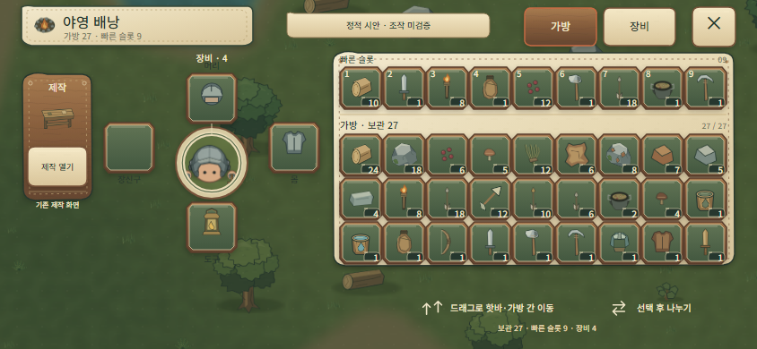
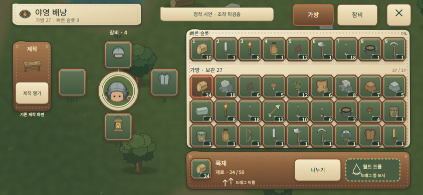
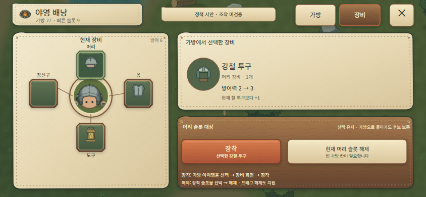
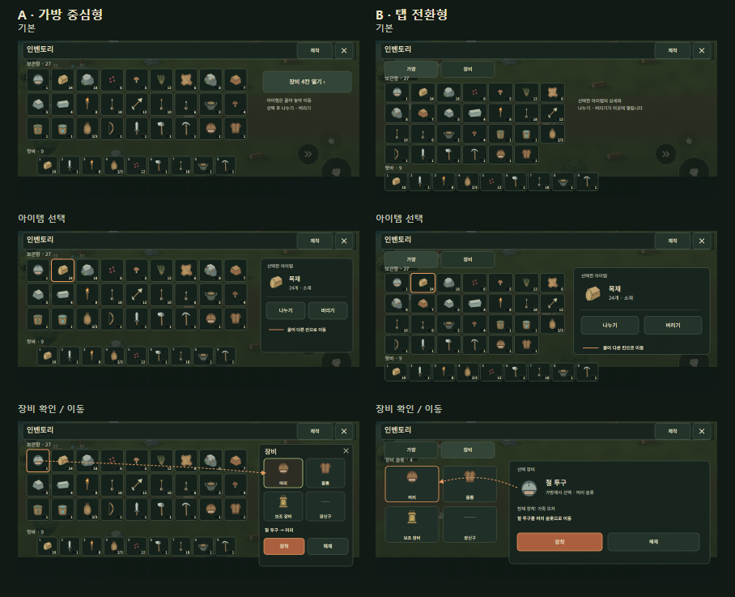

# Lowfire Inventory Redesign — Phase 3C

**Date:** 2026-11-06
**Status:** Static visual candidate; user approval required before any Unity work.
**Scope:** Three Korean landscape screens at 844×390, plus editable vector UI art.
**Design basis:** Core Keeper first, Terraria Mobile second, Necesse supplemental.

## Source baseline and scope

- `mobile-game-builds` `main` was fetched at the beginning and again before wrap-up: `cbed7212f7b73266fdf4c10b13c155479d906038`.
- `dev-playbook` `main` was fetched at the beginning and again before wrap-up: `e022e9e4ff3947fcbd7f5b0237c5905d7c0409c7`.
- The inventory contract was checked against current source: 27 Storage slots, 9 Hotbar slots, and 4 Equipment slots (Head, Body, Utility, Accessory). Existing item selection, inventory movement, drag and drop, stack splitting, equip, unequip, world drop, and entry to the existing crafting screen remain the boundary. No game behavior was changed.
- The screen backdrop and player portrait use the existing Lowfire Unity capture `projects/wildfolk/docs/images/lowfire-player-world-armor.png`. Item images, IDs, displayed quantities, localization, and armor values resolve from the current Lowfire project. The displayed inventory is an illustrative fixture, not a user save or loaded profile.
- New, editable UI shapes are in `art-source/inventory-ui-phase3c-2026-11-06/`; rendered study images are in this directory. No third-party screenshot or game asset was copied into the project.

## Direct screenshot comparison

The images below were opened and visually inspected, rather than inferred from store descriptions. The outside screenshots are linked from their source pages and are not included in Lowfire's assets.

| Actual reference screenshot | Lowfire screen built from the observed principle |
|---|---|
| **Core Keeper — primary structure.** PlayCraft's gallery identifies this as a frame near 12.5 seconds in the official Steam “Bags and Blasts” trailer. Image 1568×866; the exact build is not stated. The PC screenshot shows the crafting area at left, character and equipment in the middle, inventory and quick-access row at right, and the game world behind the UI. [Source and context](https://playcraft.space/gallery/core-keeper/inventory-crafting-pouches-hotbar/) · [Official Steam page](https://store.steampowered.com/app/1621690/Core_Keeper/).  | **Lowfire bag, basic state.** Preserves the reference's left-to-right craft / paper-doll equipment / hotbar-over-storage zones, with Lowfire art and items.  |
| **Terraria Mobile — touch interaction.** The archived mobile crafting screenshot is 1334×750 and its file page identifies version 1.4.0.5.1. The image is old relative to the current official mobile patch listing, which at review time lists 1.4.5.8 Hotfix Patch 5 (modified 3 Sep 2026); it is evidence of a mobile pattern, not a current feature specification. [Screenshot/version](https://terraria.wiki.gg/zh/wiki/File:New_Mobile_crafting_gui.png) · [505 Games current mobile support and patches](https://support.505games.com/support/solutions/folders/150000533777). | **Lowfire item selected.** Selection opens the details and action ribbon only when needed. Split and world-drop cues map to existing Lowfire paths; the drop target is explicitly shown only during a drag.  |
| **Necesse — supplemental grouping.** The archived inventory screenshot is 1080×307, uploaded 18 June 2022; the capture's build and platform are not identified. Necesse's official Steam page lists its release as 16 Oct 2025, so this older image is used only as a supplemental grouping example, not evidence of current retail behavior. [Screenshot metadata](https://necessewiki.com/File:Inventory.png) · [Official Steam page](https://store.steampowered.com/app/1169040/Necesse/). | **Lowfire equipment focus.** Four existing equipment sockets orbit the actual player image; a selected compatible item has explicit equip and unequip actions.  |

### What was carried over—and what was not

| Game | Observed structure or interaction | Lowfire application | Deliberately excluded |
|---|---|---|---|
| Core Keeper | Crafting, player equipment, inventory, and quick access use distinct neighboring zones; equipment is spatially related to the character; the hotbar sits above the backpack; repeated slots show item silhouettes and stack counts over the world. | This is the primary composition of the Bag view: existing Craft entry on the left, a paper doll with Head/Body/Utility/Accessory sockets in the middle, and Hotbar over a 9×3 Storage grid at right. | Core Keeper's pouch slots, icons, pixel art, and any commands not present in Lowfire. The PC screenshot was adapted for 844×390 touch use rather than copied or scaled as-is. |
| Terraria Mobile | Mobile-specific sectioning and context-dependent actions give item interaction dedicated touch space. The cited screenshot shows an older mobile UI; current control details could not be verified from the blocked `Game_controls` page during this pass. | Bag and Equipment are separate views. Item details and actions appear after selection instead of occupying a permanent pane. A split action and drag destination are shown only in relevant states. | Sort, favorite, quick-stack, research, filters, and other Terraria-specific features absent from Lowfire. No new Lowfire behavior is implied. |
| Necesse | A compact supplemental example of separating equipment and item collections. Its screenshot is old and unversioned. | Used only to cross-check the clarity of grouping; it did not determine Lowfire's panel geometry. | Necesse art, icons, and commands. Its 2022 capture is not treated as representative of the current retail interface. |

## Difference from Phase 3B

| Phase 3B | Phase 3C |
|---|---|
| **A** placed a large 9×3 Storage grid at left, Hotbar below it, and a gear opener in a right-side area. **B** used Bag/Gear tabs, a 7-column Storage field, and a persistent right detail area. | Reorients the Bag screen into three anchored zones: a narrow existing Craft entry at left, equipment sockets around the player image in the middle, and Hotbar above a 9×3 backpack at right. The selected-item information/action strip appears only at the bottom after selection. Equipment focus moves to a separate view with the four slots orbiting the player. |
| The 3B concepts used dark rectangular panels and showed some of the previous HUD through the background capture. | Uses a brighter field-canvas and carved-wood material system, cut-stone item wells with distinct material states, the current Lowfire world capture without the old HUD, and a selected-item strip in place of the always-present detail pane. |

| Previous candidate | New candidate |
|---|---|
|  |  |

This is a real structural shift, although the separate Bag and Equipment views retain the broad notion of switching between inventory functions already explored in 3B-B. The new composition is driven by the Core Keeper reference and makes the character/equipment relation central; it is not claimed to be an entirely new game interaction model.

## Answers to the required questions

### Core Keeper principles used

The three-area work flow, character-centered equipment sockets, Hotbar above Storage, visible item counts, and consistent repeated wells are directly recognizable from the inspected Core Keeper screen. Lowfire's current 27+9+4 model replaces Core Keeper's capacity and side systems. A character crop and Lowfire item sprites keep the screen grounded in this game.

### Terraria Mobile principles used

The inventory is composed for a landscape touch screen as separate operational zones rather than a desktop screen scaled down. The selected-item state allocates room to item information and actions only after selection. Splitting and dropping remain contextual actions. The old screenshot's exact control behavior is not asserted as current because the current controls article could not be opened during this review.

### Structural change from the previous Lowfire candidates

The Bag's main content moves from a left-first Storage grid with Hotbar below it (3B-A), or a 7-column grid beside a persistent detail pane (3B-B), to a reference-led craft / paper doll / quick-access-over-backpack arrangement. The Equipment state is a character-centered view rather than the 3B two-by-two gear tiles plus permanent detail column. Selection details no longer permanently occupy the right side of the Bag.

### Did slot size and readability actually improve?

**Slot size did not improve over Phase 3B-A.** This prototype uses 47×47 px wells so nine columns fit the narrow right zone. Phase 3B-A Storage wells were 56×55 px; Phase 3B-B Storage wells were 60×47 px. The Phase 3C wells are therefore narrower than both and have about 28% less surface area than 3B-A. Their height matches 3B-B, but the width is 13 px smaller. The benefit is a single nine-column grid with the Hotbar above it and simultaneous character/equipment context—not larger touch targets. Compared with the first 44×44 Phase 3C draft, this final draft raises bag and Hotbar wells to 47×47 px.

**Visual count contrast appears better, but readability is not proven on a device.** The new wells use a lighter canvas, larger item image proportion, and a distinct dark count badge; the selected item changes surface material as well as outline. At 844×390 the counts are visually separated from the item silhouette. Small explanatory text remains 8–10 px, and actual phone-scale legibility, touch accuracy, and safe-area fit have not been measured. No claim of touch-target certification is made.

### Why this is closer to a commercial UI—and remaining limits

The candidate uses a recognizable, reference-based information hierarchy; links equipment to the player visually; separates quick access from storage; reserves contextual actions for a selected item; uses real Lowfire imagery and data; and defines reusable normal/selected/target/pressed/disabled states in a coherent original UI kit. These choices are more specific and operational than the generic dark rectangles and permanent pane in 3B.

It is still a **static vector prototype**, not commercial-ready production UI. The surface language and slot states have not been exercised in Unity; there are no live scroll/drag transitions, press animation, focus/selection animation, sound/haptics, or Android safe-area test. The 47 px well width is a deliberate density compromise and needs device testing. The small instructional labels and close-packed one-pixel well gutters also need evaluation at real scale. The design is not approved by this report.

## Existing action paths shown

- **Select and inspect:** the wood stack is selected; its current item name, category, quantity, and max stack are displayed.
- **Move:** the existing drag path moves items between Hotbar and Storage. No new tap-to-move action is shown.
- **Split:** select the stack, open the existing item-action path, then choose **나누기** to reach the existing quantity selection. The basic-screen copy says “선택 후 나누기”; it does not suggest that a long press itself splits.
- **World drop:** the dashed destination appears only in the selected/drag illustration and is labeled “드래그 중 표시”. It is not a one-tap discard button.
- **Equip/unequip:** select a compatible bag item and switch to Equipment to equip it; select an equipped slot and use Unequip, which still requires an available Storage slot. The view uses the current Iron Head → Steel Head comparison (2→3 defense) from project data.
- **Craft:** the left action returns to the existing crafting screen. It does not add recipes or a new station.

All interaction cues are static drawings. None of these paths was activated or tested in Unity in this design-only pass.

## Output, provenance, and verification

- `previews/01-bag-basic.png` — Bag default state, 844×390.
- `previews/02-item-selected.png` — selected Wood stack and contextual actions, 844×390.
- `previews/03-equipment-focus.png` — equipment selection and equip/unequip, 844×390.
- `assets/lowfire-inventory-ui-kit.png` — reusable material/state sheet, 900×430.
- Editable SVG sources and the Python/PowerShell reproduction steps are under `../../art-source/inventory-ui-phase3c-2026-11-06/`.
- The three screens were rendered and visually inspected at 1:1. The generator verified 27 Storage, 9 Hotbar, 4 equipment slots, current localization/items, and the source armor values (current Head 2, candidate Head 3, equipped total 6). Render output reports exact screen dimensions of 844×390.
- External reference screenshots are remote links for analysis only. Existing Lowfire assets remain governed by their existing source/attribution records; this pass added no third-party art files.
- No Unity runtime/editor code, scene, prefab, game data, save/profile/protocol, actual UI, HUD, Main Menu, or Penpot content was changed. No user save was read or modified. Unity, Play Mode, and Android touch verification were not run.

**Decision requested:** review the three images and approve this visual direction or request a focused correction. Do not implement it in Unity before approval.
