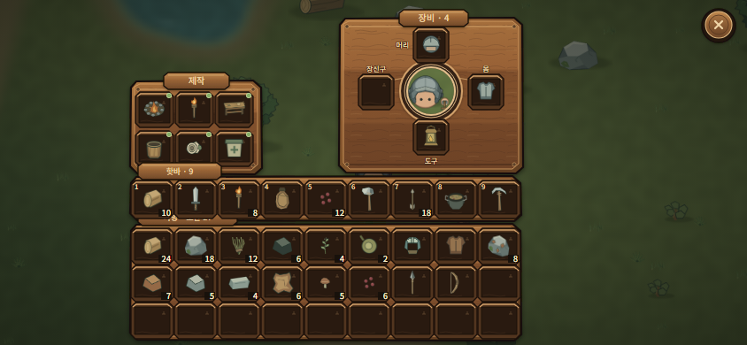
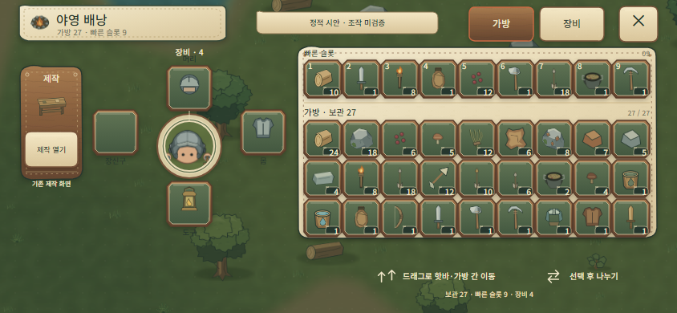

# Lowfire Inventory — Phase 3D Reference Reconstruction

**Date:** 2026-11-06
**Status:** Stage A visual candidate for review. It is **not approved for Unity** and is **not being represented as production-ready**.
**Scope:** Three Korean static screens at 844×390 and one editable SVG component sheet. No runtime implementation.

## Source baseline

- `mobile-game-builds` `main` fetched at start and rechecked during the pass: `854f8d8d50e4be93a128bf4402a12b7a9e87be2b`.
- `dev-playbook` `main` fetched and rechecked: `e022e9e4ff3947fcbd7f5b0237c5905d7c0409c7`.
- Current project sources under `client/Assets/Wildfolk/Runtime/UI`, `Runtime/Data`, `Resources/Localization.json`, `Data`, and existing `Art` were used for the interaction contract, IDs, icons, names, recipe requirements, and equipment values. The background/player imagery is the committed gameplay capture `docs/images/lowfire-player-world-armor.png`.
- The fixture is created in the render source. It does not read a player profile or save.
- No Unity runtime/editor code, scene, prefab, game data, save/profile/protocol, Penpot file, menu, or HUD was changed.

## A / B / C visual comparison

The Core Keeper screenshot was opened directly from the gallery and visually inspected. It is identified on the source page as a frame near 12.5 seconds in the official *Bags and Blasts* trailer. The served image measures **1560×878**; the exact game build/platform are not specified on that page. The image is linked remotely for analysis; it is not copied into Lowfire assets.

| A — Core Keeper primary reference | B — New Lowfire Phase 3D | C — Previous Lowfire Phase 3C |
|---|---|---|
| <a href="https://playcraft.space/gallery/core-keeper/inventory-crafting-pouches-hotbar/"></a><br>[Source page](https://playcraft.space/gallery/core-keeper/inventory-crafting-pouches-hotbar/) · [Official Steam page](https://store.steampowered.com/app/1621690/Core_Keeper/) |  |  |

### Core Keeper screen measurements

Boundaries are manual screenshot measurements, approximately ±5 px. Percentages are normalized to the actual 1560×878 image.

| Region | Approx. bounds in reference (x, y, w, h) | Normalized (x, y, w, h) | Observed role |
|---|---:|---:|---|
| Crafting | 272, 240, 275, 243 | 17.4%, 27.3%, 17.6%, 27.7% | Recipe outputs in a 3×2 field on the left |
| Character/equipment | 712, 73, 377, 412 | 45.6%, 8.3%, 24.2%, 46.9% | Paper doll is centered between four equipment groups |
| Pouches | 1092, 243, 337, 154 | 70.0%, 27.7%, 21.6%, 17.5% | Separate right-side item storage group |
| Hotbar | 272, 503, 817, 96 | 17.4%, 57.3%, 52.4%, 10.9% | Counted quick-access row above backpack |
| Backpack | 272, 605, 817, 260 | 17.4%, 68.9%, 52.4%, 29.6% | Wide, three-row, 10-column storage area |
| Utility rail | 172, 503, 100, 346 | 11.0%, 57.3%, 6.4%, 39.4% | Contextual utility actions next to the item grid |

The screen places the crafting group left of the character; the equipment slots visually point toward the character; the pouch region is right of the character; and the hotbar and backpack form a shared lower block. The UI panels are dark and nearly opaque over the world. Deep brown wells separate items from the timber frame; item silhouettes and stack numbers dominate each slot. Selection uses a brighter accent with a clear edge. Groups are separated by panel space and a visible change in surface depth, not by a single full-screen card.

## Lowfire reconstruction and measured differences

| Region | Phase 3D bounds in 844×390 | Normalized | Change required for Lowfire |
|---|---:|---:|---|
| Crafting | 147, 91, 149, 106 | 17.4%, 23.3%, 17.7%, 27.2% | Preserves the reference’s left position and width; moves upward to fit landscape height |
| Character/equipment | 383, 20, 208, 176 | 45.4%, 5.1%, 24.6%, 45.1% | Keeps the central paper-doll group and four sockets; uses Lowfire’s Head/Body/Utility/Accessory categories |
| Context detail | 596, 101, 205, 108 | 70.6%, 25.9%, 24.3%, 27.7% | Uses the reference’s right-side region only after item/equipment selection; larger than the pouch group for readable item data and a 44 px action |
| Hotbar | 147, 199, 442, 51 | 17.4%, 51.0%, 52.4%, 13.1% | Stays above the backpack; moves upward to retain all rows without shrinking slots to desktop-scaled size |
| Storage | 147, 253, 442, 132 | 17.4%, 64.9%, 52.4%, 33.8% | Uses the same 9-column/3-row Lowfire capacity and the reference’s lower block |

The lower block retains the reference’s 52.4% width. Lowfire has 9 Hotbar items and 27 Storage slots, so the cells are larger than a proportional scaling of the reference: Hotbar slots are **48×43 px**; Storage slots are **48×41 px**, with a 1 px horizontal gutter. The 3×2 craft results are 43×40 px. This is a 844×390 static layout measurement; it is not a device touch certification.

### Where Phase 3D differs from Phase 3C

Phase 3C put the 9-column Hotbar/Storage block on the right, placed a broad inventory/navigation header across the top, and used separate Bag/Equipment tabs. Phase 3D removes that header and those tab surfaces, moves the Hotbar/Storage block to the lower center-left in the same relationship as Core Keeper, and gives the left craft group and central paper-doll the reference’s prominence. It also replaces the pale field-canvas wells with dark recessed item wells in an original timber surface. The central character/equipment relationship remains because both the reference and Lowfire’s four-slot model call for it; this part is not claimed as a new idea.

Core Keeper’s right pouch group has no Lowfire equivalent. Phase 3D does not invent pouches, sorting, deposit, favorite/lock commands, or extra gear. The basic screen leaves that world area open; selected-item and equipment details occupy the same region contextually. The Core Keeper utility rail is not shown as a permanent command bar. Lowfire’s world-drop target is a held-item/drag state, separate from this selected-item action state.

## Data and existing interaction paths represented

- The screen contains 27 current Storage positions, 9 Hotbar positions, and exactly four Equipment sockets. The fixture uses current Lowfire item IDs and their existing PNG icons; empty positions remain empty.
- The 3×2 Craft area uses six current `RequiredStation: 0` recipes: `campfire`, `torch`, `workbench`, `empty_cup`, `field_dressing`, and `healing_salve`. The fixture contains enough current ingredients for each displayed recipe. Green dots indicate recipe availability in this fixture; no new recipe is proposed.
- The selected item is current Wood: 24 of its current 50-item stack limit. The card presents the existing Split/Cancel choices and indicates drag movement. The current interaction route remains selection/long-press → Split → quantity choice; the static card does not claim a new runtime tap route.
- The equipment state selects a current Steel Head item against the compatible Head socket. Source data resolves Iron Head defense 2 and Steel Head defense 3. Equipping remains the existing Equip action; the currently equipped item’s detail/action path remains the route to unequip.
- A circular close control preserves the existing inventory exit affordance. The image set does not depict every transient operation: the world-drop destination is absent because it appears only while a stack is held. No one-tap discard control is shown.

## Original graphics and provenance

The editable SVG generator and source screens are under `art-source/inventory-ui-phase3d-2026-11-06/`. The original component sheet is `graphics/lowfire-reference-wood-kit.svg`; its rendered review image is `assets/lowfire-reference-wood-kit.png`.

The component language uses clipped plank shoulders, a layered wood face with original grain strokes, dark inset wells, a small double bevel, item-count backing, amber selection, green compatible-slot feedback, and distinct raised/pressed/disabled action faces. The artwork is original vector work in this repository; it does not use Core Keeper textures, icons, labels, logo, or screenshot as an in-game asset. The background, portrait crop, Lowfire item icons, localization, font, and numeric values come from existing project files. No third-party asset/license record was added or changed.

## Visual/geometry audit at 1:1

The three generated PNGs were opened and inspected at their actual 844×390 dimensions after the final render. Their SVG bounds place every panel within the canvas. The right context card ends at x=801, leaving 43 px to the edge; the storage panel ends at y=385, leaving 5 px to the edge. The close control keeps a 13 px right margin. Craft and gear labels were repositioned so they do not touch their adjacent title or slot edges. The craft rows have 4 px vertical separation; the Storage heading ends before the first slot row; the selected/equipment detail text ends above its action surface. No text/slot overlap or screen-edge clipping is visible in the rendered screens.

| Check | Result | Limit |
|---|---|---|
| 844×390 export dimensions | Pass: all three PNG headers are 844×390 | Static Edge headless render only |
| 27/9/4 slots and current item IDs | Pass: generator checks source IDs, sprites, counts, and slot totals | Not loaded in Unity |
| Six craft cards | Pass: current recipe assets all resolve to hand crafting and fixture ingredients | Recipe buttons were not activated |
| Slot/text collision | No visible collision after manual 1:1 review; adjusted title spacing and Head label during refinement | No automated OCR/bounds detector was used |
| Canvas clipping | No visible clipping; screen margins are recorded above | Device safe area not measured |
| English language | Not evaluated; this pass is Korean-only as requested | No English preview was requested |
| Touch and drag accuracy | Not tested | Requires a real device and interaction build |
| Unity rendering / 9-slice | Not tested | Requires a later approved implementation pass |

## Stage A evaluation — not a production-ready pass

| Criterion | Assessment |
|---|---|
| Core Keeper information structure | Stronger match than Phase 3C: craft left, paper-doll equipment center, right-side contextual information, Hotbar over Storage in the lower block |
| Relative group positions | Craft/equipment/hotbar/storage retain their reference horizontal proportions; vertical positions are shifted upward to fit the 390 px canvas and larger cells |
| Item/slot hierarchy | Clearer separation than Phase 3C; item counts and selected/compatible states are legible at the supplied 1:1 PNG size |
| Reference material character | Partial: timber grain, recessed wells, beveled edges, and warm highlights are original vector art, but they remain smoother and less pixel-specific than the reference’s authored game UI |
| Right-side density | Partial: the basic screen is intentionally open because Lowfire has no pouch system; detail appears only in selected states |
| Commercial production quality | **Not met.** These images are a static vector reconstruction study. They have not been proven in Unity, on a phone, or through live transitions, touch feedback, safe-area layouts, or accessibility testing. |

This Phase 3D set is **not being marked complete or approved**. It is a better reference-led composition for review, but its surface art and small supporting text still read as a prototype in places. Improving those areas further belongs to Stage A reference-fidelity refinement. Do not start Stage B customization or Unity implementation until the user approves a direction.

## Rebuild and artifact list

Run from repository root:

```powershell
./projects/wildfolk/art-source/inventory-ui-phase3d-2026-11-06/render_previews.ps1
```

- `previews/01-bag-basic.png` — basic state.
- `previews/02-item-selected.png` — selected stack, split/cancel context.
- `previews/03-equipment-equip.png` — compatible Head slot and Equip action.
- `assets/lowfire-reference-wood-kit.png` — original component/state sheet.
- Editable SVGs and render source are in the matching `art-source` directory.

No Unity test, Play Mode run, mobile touch test, save edit, or Penpot change was made. No external-game screenshot was copied into Lowfire art or deployment assets.

## References

- Core Keeper gallery and screenshot provenance: [PlayCraft — Inventory, crafting, pouches, and hotbar](https://playcraft.space/gallery/core-keeper/inventory-crafting-pouches-hotbar/).
- Core Keeper official store listing: [Steam](https://store.steampowered.com/app/1621690/Core_Keeper/).
- Prior Lowfire candidate for comparison: `projects/wildfolk/validation/inventory-ui-phase3c-2026-11-06/previews/01-bag-basic.png`.
