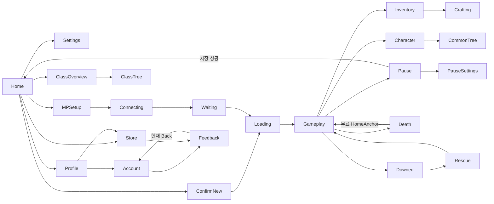

# Navigation / Back / state ownership

기준은 fetched main `48d6528758d18bf3df41ed02ad9aa0f268654a51`이다. 이 보고서는 게임 수정 승인이 아니다.

**CHECKPOINT / DRAFT — 사용자 요청으로 중단. 전수 감사 완료본이 아니다.** 자동 추출 목록과 수동 대조 초안이며, 잔여 surface/action 검수와 6개 보고서는 RESUME.md에 남겼다.

FACT는 현재 source/data 사실, CONFIRMED는 이번 Unity에서 관찰한 해당 화면·행동, SOURCE-INFERRED는 source로 확인했지만 그 상태를 실제 재현하지 않은 항목, HISTORICAL은 과거 캡처/검사, PROPOSAL은 제안, FUTURE GOAL은 사용자의 차기 목표, UNVERIFIED는 추가 증거가 필요한 항목이다. 시각적 평가 자체는 감사자의 판단이며 기능 검증과 구분한다.

의미 있는 조건별 route **103개**. 언어/해상도·슬롯별 전환은 중복 집계하지 않는다. slash는 조건부 목적지/표면군이며 버튼이 연결되는 모든 비용 transaction을 screen route로 세지는 않는다.

## 알려진 Help return 문제: 현재 결론

**CONFIRMED**: QA MainMenu에서 Store.Open → Store.Contact → Account.CloseHelp를 호출하고 각 실제 화면/active view를 캡처했다. Help Back은 Store가 아니라 Account다. `Store.Close`의 정상 Back은 `fromHome`을 기억한다. `Store.Contact`는 Store를 숨기고 `Meta.Profile.Open(); Meta.Profile.Help();`를 부르며 `CloseHelp`는 Account.View=true만 한다. 따라서 과거 “Store Back은 actual origin” 문장은 일반 Back에 한해 맞고 이 하위 경로까지 해결했다는 근거가 아니다. 이번에는 수정하지 않았다.

## 현재 Back 계약과 상태 수명

- HomeScreen은 Home/Settings/Multiplayer/Confirm 네 view만 관리한다. Economy/Class/Store/Account는 각자 flags를 관리하며 중앙 navigation stack이 없다. 유효한 Back 콜백으로 빠져나와야 한다.
- Achievement/Attendance는 `fromProfile`, Store는 `fromHome`; 일반 Back은 caller-sensitive다. Account.Back은 항상 Profile Hub, Help Back은 항상 Account. Class.Back은 Tree 여부에 따라 Overview 또는 Home.
- Pause.Settings Back은 Pause menu이며 Home.Settings Back과 다르다. Inventory/Crafting/Chest Close는 보통 Running으로 닫고 이전 subpanel로 돌아가는 stack이 아니다. Common Tree Back은 Character이다.
- Class.Open은 selected profile·node0·status를 다시 읽고 tree를 닫는다. Class card 변경은 node0. Economy category는 selection과 양쪽 scroll top을 리셋한다. Attendance tab은 재진입 때 남을 수 있고 Events 재탭은 다음 event를 고른다. Craft category/filter는 station kind가 바뀔 때 초기화; 가려진 selected recipe는 첫 visible 항목으로 fallback한다.
- HUD Gameplay CanvasGroup은 Running에서만 raycast/interactable. Split은 parent 위로 sibling을 올리고 ghost는 raycast off다. CampLoot/TierThree는 Session.Inventory를 사용하며 inventory view의 exclusion flags로 중복 표시를 막는다. Maintenance는 session event에서 즉시 숨기고 hold를 중단한다.
- source-level 차단 근거는 있지만 모든 rare modal 조합의 실제 pointer leak 부재를 이 감사에서 증명한 것은 아니다. Inventory/Character/Station의 세계 진행은 의도된 정책이며 “pause 실패”로 바꾸지 않는다.
- Transition.Load는 SP load 중 Cancel을 숨긴다. Network connect는 Cancel/Leave operation ticket을 무효화하며 뒤늦은 async 응답을 적용하지 않는다. world 준비45초/느림20초는 실패 안내 경계이지 실제 진행률이 아니다.
- Host Leave는 정상 save 실패시 머무른다. `MultiplayerMenu.Back()`은 Leave(false) 다음 Home.ShowHome를 호출하므로 Host save 실패/Closing 상태의 화면 일치 여부는 source 위험점이며 이번 live Host 실패를 재현하지 않았다.

## 감사 드라이버의 잘못된 경로와 배제

첫 캡처 반복에서 Attendance.Back 없이 Home.ShowHome를 직접 불러 기존 Attendance view가 남은 화면을 만들었다. 이는 일반 사용자 route 재현이 아니다. `live-frontend-attempt1.json`에 원인을 남겼고 `home-v2/settings-v2/...`는 실제 Back을 거친 다시 캡처한 증거다. 이 인위적 overlay를 제품 버그로 집계하지 않는다. 삭제 화면은 숨겨진 Delete callback을 호출한 QA preview이며 Linked gate를 통과한 계정 삭제 체험이 아니다.

## 전체 route ledger

| ID | From | event | To | 조건·상태 | source |
|---|---|---|---|---|---|
| NAV-001 | App | launch | H01 | MainMenu build index0 | [HomeScreen.OnEnable](../../client/Assets/Wildfolk/Runtime/UI/HomeScreen.cs#L19) |
| NAV-002 | H01 | Continue | T01 | 유효 검증 save | [HomeScreen.TryContinue](../../client/Assets/Wildfolk/Runtime/UI/HomeScreen.cs#L26) |
| NAV-003 | H01 | SinglePlayer | H02 | Repository.Exists | [HomeScreen.SinglePlayer](../../client/Assets/Wildfolk/Runtime/UI/HomeScreen.cs#L24) |
| NAV-004 | H01 | SinglePlayer | T01 | save없음 | [HomeScreen.SinglePlayer](../../client/Assets/Wildfolk/Runtime/UI/HomeScreen.cs#L24) |
| NAV-005 | H02 | Cancel | H01 | 새 세계 시작 안 함 | [HomeScreen.ShowHome](../../client/Assets/Wildfolk/Runtime/UI/HomeScreen.cs#L19) |
| NAV-006 | H02 | BeginNew | T01 | 새 seed; 다음 save가 slot교체 | [HomeScreen.BeginNew](../../client/Assets/Wildfolk/Runtime/UI/HomeScreen.cs#L24) |
| NAV-007 | H01 | Settings | H03 | local | [HomeScreen.OpenSettings](../../client/Assets/Wildfolk/Runtime/UI/HomeScreen.cs#L22) |
| NAV-008 | H03 | Back | H01 | 설정은 즉시 반영 | [HomeScreen.ShowHome](../../client/Assets/Wildfolk/Runtime/UI/HomeScreen.cs#L19) |
| NAV-009 | H01 | Multiplayer | M01 | session create/resume | [HomeScreen.OpenMultiplayer](../../client/Assets/Wildfolk/Runtime/UI/HomeScreen.cs#L23) |
| NAV-010 | M01 | Back | H01 | Leave(false) | [MultiplayerMenu.Back](../../client/Assets/Wildfolk/Runtime/Networking/MultiplayerMenu.cs#L30) |
| NAV-011 | M01 | Single | H02/T01 | SP saveexists에 따름 | [MultiplayerMenu.Single](../../client/Assets/Wildfolk/Runtime/Networking/MultiplayerMenu.cs#L31) |
| NAV-012 | M01 | Host/valid Join | T01 | Idle; valid destination | [MultiplayerMenu.Host](../../client/Assets/Wildfolk/Runtime/Networking/MultiplayerMenu.cs#L27) |
| NAV-013 | M01 | invalid Join | M01 | invalid code/address status | [MultiplayerMenu.Join](../../client/Assets/Wildfolk/Runtime/Networking/MultiplayerMenu.cs#L28) |
| NAV-014 | T01 | connection ready | M02 | Waiting | [TransitionOverlay.Watch](../../client/Assets/Wildfolk/Runtime/UI/TransitionOverlay.cs#L61) |
| NAV-015 | M02 | Back | H01 | Leave(false) shutdown | [MultiplayerMenu.Back](../../client/Assets/Wildfolk/Runtime/Networking/MultiplayerMenu.cs#L30) |
| NAV-016 | M02 | Enter | T01 | Host only | [MultiplayerMenu.Enter](../../client/Assets/Wildfolk/Runtime/Networking/MultiplayerMenu.cs#L29) |
| NAV-017 | M02 | Host enters | T01 | Client NGO Load event | [NetworkSession.PresentSceneTransition](../../client/Assets/Wildfolk/Runtime/Networking/NetworkSession.cs#L142) |
| NAV-018 | T01 | world ready | G01 | actor+terrain; safe session resume | [TransitionOverlay.Begin](../../client/Assets/Wildfolk/Runtime/UI/TransitionOverlay.cs#L10) |
| NAV-019 | T01 | Cancel | M01 | network connecting; operation++ | [TransitionOverlay.Cancel](../../client/Assets/Wildfolk/Runtime/UI/TransitionOverlay.cs#L77) |
| NAV-020 | T01 | failure/recovery | H01/M01 | scene/network path별 | [TransitionOverlay.Fail](../../client/Assets/Wildfolk/Runtime/UI/TransitionOverlay.cs#L60) |
| NAV-021 | H01 | Class | P01 | Lobby | [ClassLobbyScreen.Open](../../client/Assets/Wildfolk/Runtime/UI/ClassLobbyScreen.cs#L17) |
| NAV-022 | P01 | Back | H01 | overview | [ClassLobbyScreen.Back](../../client/Assets/Wildfolk/Runtime/UI/ClassLobbyScreen.cs#L22) |
| NAV-023 | P01 | OpenTree | P02 | 선택 class preview | [ClassLobbyScreen.OpenTree](../../client/Assets/Wildfolk/Runtime/UI/ClassLobbyScreen.cs#L23) |
| NAV-024 | P02 | Back | P01 | node 선택 유지; Open resets later | [ClassLobbyScreen.Back](../../client/Assets/Wildfolk/Runtime/UI/ClassLobbyScreen.cs#L22) |
| NAV-025 | P01 | AskPurchase | P03 | 구매 gate | [ClassLobbyScreen.AskPurchase](../../client/Assets/Wildfolk/Runtime/UI/ClassLobbyScreen.cs#L30) |
| NAV-026 | P03 | Cancel | P01 | 소비없음 | [ClassLobbyScreen.CancelPurchase](../../client/Assets/Wildfolk/Runtime/UI/ClassLobbyScreen.cs#L31) |
| NAV-027 | P03 | Confirm | P01 | success/failure status | [ClassLobbyScreen.ConfirmPurchase](../../client/Assets/Wildfolk/Runtime/UI/ClassLobbyScreen.cs#L32) |
| NAV-028 | H01 | Profile | A01 | OpenHub refresh | [EconomyScreen.OpenHub](../../client/Assets/Wildfolk/Runtime/UI/EconomyScreen.cs#L30) |
| NAV-029 | A01 | Back | H01 | CloseHub | [EconomyScreen.CloseHub](../../client/Assets/Wildfolk/Runtime/UI/EconomyScreen.cs#L31) |
| NAV-030 | A01 | Account | A02 | hub hidden | [EconomyScreen.OpenAccount](../../client/Assets/Wildfolk/Runtime/UI/EconomyScreen.cs#L32) |
| NAV-031 | A02 | Back | A01 | always hub fallback Home | [AccountProfileScreen.Back](../../client/Assets/Wildfolk/Runtime/UI/AccountProfileScreen.cs#L19) |
| NAV-032 | A02 | Help | A03 | no external submit | [AccountProfileScreen.Help](../../client/Assets/Wildfolk/Runtime/UI/AccountProfileScreen.cs#L29) |
| NAV-033 | A03 | Back | A02 | always Account; caller lost | [AccountProfileScreen.CloseHelp](../../client/Assets/Wildfolk/Runtime/UI/AccountProfileScreen.cs#L30) |
| NAV-034 | A03 | Category | A04 | UGUI template | [AccountProfileScreen.Refresh](../../client/Assets/Wildfolk/Runtime/UI/AccountProfileScreen.cs#L18) |
| NAV-035 | A04 | choose/dismiss | A03 | framework dropdown | [AccountUiBuilder.Help](../../client/Assets/Wildfolk/Editor/AccountUiBuilder.cs#L54) |
| NAV-036 | A02 | Delete | A05 | Linked normal entry | [AccountProfileScreen.Delete](../../client/Assets/Wildfolk/Runtime/UI/AccountProfileScreen.cs#L36) |
| NAV-037 | A05 | Cancel | A02 | counter reset next Open | [AccountProfileScreen.CancelDelete](../../client/Assets/Wildfolk/Runtime/UI/AccountProfileScreen.cs#L37) |
| NAV-038 | A05 | Confirm×1 | A05 | first extra warning only | [AccountProfileScreen.ConfirmDelete](../../client/Assets/Wildfolk/Runtime/UI/AccountProfileScreen.cs#L38) |
| NAV-039 | A05 | Confirm×2 | A05 | pending/failed text | [AccountProfileScreen.ConfirmDelete](../../client/Assets/Wildfolk/Runtime/UI/AccountProfileScreen.cs#L38) |
| NAV-040 | A02 | conflict | A06 | account/cloud conflict | [AccountProfileScreen.Refresh](../../client/Assets/Wildfolk/Runtime/UI/AccountProfileScreen.cs#L18) |
| NAV-041 | A06 | UseExisting/UseCloud/KeepLocal | A02/A06 | actual service response | [AccountProfileScreen.UseCloud](../../client/Assets/Wildfolk/Runtime/UI/AccountProfileScreen.cs#L24) |
| NAV-042 | H01 | Achievements | E01 | fromProfile=false | [EconomyScreen.OpenAchievements](../../client/Assets/Wildfolk/Runtime/UI/EconomyScreen.cs#L28) |
| NAV-043 | A01 | Achievements | E01 | fromProfile=true | [EconomyScreen.OpenAchievements](../../client/Assets/Wildfolk/Runtime/UI/EconomyScreen.cs#L28) |
| NAV-044 | E01 | Back | H01/A01 | cached origin | [EconomyScreen.Back](../../client/Assets/Wildfolk/Runtime/UI/EconomyScreen.cs#L36) |
| NAV-045 | H01 | Attendance | E02/E03/E04 | tab retains previous; no forced newcomer | [EconomyScreen.OpenAttendance](../../client/Assets/Wildfolk/Runtime/UI/EconomyScreen.cs#L29) |
| NAV-046 | A01 | Attendance | E02/E03/E04 | fromProfile=true | [EconomyScreen.OpenAttendance](../../client/Assets/Wildfolk/Runtime/UI/EconomyScreen.cs#L29) |
| NAV-047 | E02/E03/E04 | Board | E02/E03/E04 | event reselect cycles index | [EconomyScreen.Board](../../client/Assets/Wildfolk/Runtime/UI/EconomyScreen.cs#L39) |
| NAV-048 | E02/E03/E04 | Back | H01/A01 | cached origin | [EconomyScreen.Back](../../client/Assets/Wildfolk/Runtime/UI/EconomyScreen.cs#L36) |
| NAV-049 | H01 | Gem Store | E05 | fromHome=true | [StoreScreen.Open](../../client/Assets/Wildfolk/Runtime/UI/StoreScreen.cs#L16) |
| NAV-050 | A01 | Gem Store | E05 | fromHome=false | [StoreScreen.Open](../../client/Assets/Wildfolk/Runtime/UI/StoreScreen.cs#L16) |
| NAV-051 | E05/E06 | Back | H01/A01 | cached origin | [StoreScreen.Close](../../client/Assets/Wildfolk/Runtime/UI/StoreScreen.cs#L17) |
| NAV-052 | E05 | History | E06 | same Store view | [StoreScreen.ToggleHistory](../../client/Assets/Wildfolk/Runtime/UI/StoreScreen.cs#L21) |
| NAV-053 | E06 | History toggle | E05 | same origin | [StoreScreen.ToggleHistory](../../client/Assets/Wildfolk/Runtime/UI/StoreScreen.cs#L21) |
| NAV-054 | E05/E06 | Purchase help | A03 | Meta.Profile.Open→Help | [StoreScreen.Contact](../../client/Assets/Wildfolk/Runtime/UI/StoreScreen.cs#L22) |
| NAV-055 | A01 | Watch/Retry | E07 | inline status; native ad external | [EconomyScreen.WatchReward](../../client/Assets/Wildfolk/Runtime/UI/EconomyScreen.cs#L33) |
| NAV-056 | E07 | result | A01 | confirmed/pending/error inline | [EconomyScreen.Refresh](../../client/Assets/Wildfolk/Runtime/UI/EconomyScreen.cs#L16) |
| NAV-057 | G01 | Bag | I01 | Running; no context modal | [GameplaySession.ToggleInventory](../../client/Assets/Wildfolk/Runtime/Core/GameplaySession.cs#L21) |
| NAV-058 | I01 | Close | G01 | Session.CloseInventory | [GameplaySession.CloseInventory](../../client/Assets/Wildfolk/Runtime/Core/GameplaySession.cs#L27) |
| NAV-059 | G01 | Profile | P04 | Running | [GameplaySession.OpenCharacter](../../client/Assets/Wildfolk/Runtime/Core/GameplaySession.cs#L28) |
| NAV-060 | P04 | Close | G01 | local session | [CharacterScreen.Close](../../client/Assets/Wildfolk/Runtime/UI/CharacterScreen.cs#L13) |
| NAV-061 | P04 | Tree | P05 | Character state | [CharacterScreen.OpenTree](../../client/Assets/Wildfolk/Runtime/UI/CharacterScreen.cs#L14) |
| NAV-062 | P05 | Back | P04 | no authored direct Close | [SkillTreeScreen.Back](../../client/Assets/Wildfolk/Runtime/UI/SkillTreeScreen.cs#L20) |
| NAV-063 | G01 | Pause | S01 | SP; MP Leave is separate | [GameplaySession.OpenPause](../../client/Assets/Wildfolk/Runtime/Core/GameplaySession.cs#L33) |
| NAV-064 | S01 | Resume | G01 | SP unfreeze | [GameplaySession.Resume](../../client/Assets/Wildfolk/Runtime/Core/GameplaySession.cs#L37) |
| NAV-065 | S01 | Settings | S02 | Menu hidden | [PauseMenu.OpenSettings](../../client/Assets/Wildfolk/Runtime/UI/PauseMenu.cs#L9) |
| NAV-066 | S02 | Back | S01 | prefs Flush | [PauseMenu.Back](../../client/Assets/Wildfolk/Runtime/UI/PauseMenu.cs#L8) |
| NAV-067 | S01 | Save & Home | T01 | save success only | [WorldSaveService.SaveAndHome](../../client/Assets/Wildfolk/Runtime/Persistence/WorldSaveService.cs#L36) |
| NAV-068 | S01 | save failure | S01 | toast; no transition | [WorldSaveService.SaveAndHome](../../client/Assets/Wildfolk/Runtime/Persistence/WorldSaveService.cs#L36) |
| NAV-069 | I01 | Crafting | C01 | hand station | [PlayerCrafting.OpenHandCrafting](../../client/Assets/Wildfolk/Runtime/Crafting/PlayerCrafting.cs#L23) |
| NAV-070 | C01 | Bag | I01 | clears station context | [PlayerCrafting.OpenBag](../../client/Assets/Wildfolk/Runtime/Crafting/PlayerCrafting.cs#L25) |
| NAV-071 | C01 | Close | G01 | does not reopen bag | [PlayerCrafting.CloseCrafting](../../client/Assets/Wildfolk/Runtime/Crafting/PlayerCrafting.cs#L24) |
| NAV-072 | G01 | Station Interact | C01 | in range/LoS | [PlayerCrafting.OpenStation](../../client/Assets/Wildfolk/Runtime/Crafting/PlayerCrafting.cs#L59) |
| NAV-073 | C01 | sequential station | C02 | queue display variant | [CraftingPanel.Refresh](../../client/Assets/Wildfolk/Runtime/UI/CraftingPanel.cs#L16) |
| NAV-074 | C01 | Workbench I/II | C03 | upgrade/Home area visible | [CraftingPanel.Refresh](../../client/Assets/Wildfolk/Runtime/UI/CraftingPanel.cs#L16) |
| NAV-075 | G01 | Chest Interact | I06 | PlayerStorage context | [PlayerStorage.Open](../../client/Assets/Wildfolk/Runtime/Player/PlayerStorage.cs#L5) |
| NAV-076 | I06 | Close | G01 | storage clears; no return to bag | [GameplaySession.CloseInventory](../../client/Assets/Wildfolk/Runtime/Core/GameplaySession.cs#L27) |
| NAV-077 | I01/I06 | long press | I03 | count>1 | [InventorySlotDrag.Update](../../client/Assets/Wildfolk/Runtime/UI/InventorySlotDrag.cs#L17) |
| NAV-078 | I01/I06 | Split | I04 | selected count>1 | [InventoryDragController.OpenSplit](../../client/Assets/Wildfolk/Runtime/UI/InventoryDragController.cs#L104) |
| NAV-079 | I03 | Split | I04 | ChooseSplit | [StackSplitPanel.ChooseSplit](../../client/Assets/Wildfolk/Runtime/UI/StackSplitPanel.cs#L22) |
| NAV-080 | I03/I04 | Cancel | I01/I06 | parent remains; no consume | [StackSplitPanel.Cancel](../../client/Assets/Wildfolk/Runtime/UI/StackSplitPanel.cs#L28) |
| NAV-081 | I04 | Confirm | I05 | partial held; source unchanged | [StackSplitPanel.Confirm](../../client/Assets/Wildfolk/Runtime/UI/StackSplitPanel.cs#L27) |
| NAV-082 | I05 | place/cancel | I01/I06 | commit on valid target only | [InventoryDragController.PlaceHeld](../../client/Assets/Wildfolk/Runtime/UI/InventoryDragController.cs#L123) |
| NAV-083 | G01 | Supply Interact | I07 | camp/POI available | [CampLootPanel.Open](../../client/Assets/Wildfolk/Runtime/UI/CampLootPanel.cs#L18) |
| NAV-084 | I07 | Close/out of range | G01 | destroy transient panel | [CampLootPanel.CloseFocused](../../client/Assets/Wildfolk/Runtime/UI/CampLootPanel.cs#L38) |
| NAV-085 | G01 | Placeable selection | C04 | preview while running | [PlayerPlacement.LateUpdate](../../client/Assets/Wildfolk/Runtime/World/PlayerPlacement.cs#L21) |
| NAV-086 | G01 | Turret Interact | C05 | in range | [TierThreeHud.OpenTurret](../../client/Assets/Wildfolk/Runtime/UI/TierThreeHud.cs#L23) |
| NAV-087 | G01 | Beacon Interact | C06 | target exists | [TierThreeHud.OpenBeacon](../../client/Assets/Wildfolk/Runtime/UI/TierThreeHud.cs#L25) |
| NAV-088 | G01 | Compass Choose | C07 | HasCompass | [TierThreeHud.OpenNavigation](../../client/Assets/Wildfolk/Runtime/UI/TierThreeHud.cs#L65) |
| NAV-089 | C05/C06/C07 | Close/context invalid | G01 | CloseInventory | [TierThreeHud.Close](../../client/Assets/Wildfolk/Runtime/UI/TierThreeHud.cs#L62) |
| NAV-090 | I01/G01 | Telescope Use | C08 | selected telescope | [InventoryEquipment.Equip](../../client/Assets/Wildfolk/Runtime/UI/InventoryEquipment.cs#L29) |
| NAV-091 | C08 | Close/Pause | G01 | Telescope.Exit | [TierThreeHud.Build](../../client/Assets/Wildfolk/Runtime/UI/TierThreeHud.cs#L36) |
| NAV-092 | G01 | world context | G13 | tomb/door/water/cave etc | [PlayerInteraction.TryInteract](../../client/Assets/Wildfolk/Runtime/Player/PlayerInteraction.cs#L52) |
| NAV-093 | G01 | SP lethal | D01 | durable Dead; freeze | [PlayerDeath.Lethal](../../client/Assets/Wildfolk/Runtime/Player/PlayerDeath.cs#L54) |
| NAV-094 | G01 | MP lethal | D02 | not all-down; countdown | [PlayerDeath.Lethal](../../client/Assets/Wildfolk/Runtime/Player/PlayerDeath.cs#L54) |
| NAV-095 | G01 | hold teammate | D03 | near downed; Rescuing | [PlayerInputCommands.HoldInteract](../../client/Assets/Wildfolk/Runtime/Input/PlayerInputCommands.cs#L23) |
| NAV-096 | D03 | release/interruption | G01 | target still downed | [PlayerDeath.InterruptRescue](../../client/Assets/Wildfolk/Runtime/Player/PlayerDeath.cs#L49) |
| NAV-097 | D03/D02 | rescue success | G01 | HP/protection; world continues | [PlayerDeath.CommitTeammate](../../client/Assets/Wildfolk/Runtime/Player/PlayerDeath.cs#L146) |
| NAV-098 | D02 | timeout/all-down | D01 | Dead; MP only Home choice | [PlayerDeath.Lethal](../../client/Assets/Wildfolk/Runtime/Player/PlayerDeath.cs#L54) |
| NAV-099 | D01 | SP ad/Gem confirmed | G01 | same death revision; actual transaction | [PlayerDeath.GemRevive](../../client/Assets/Wildfolk/Runtime/Player/PlayerDeath.cs#L160) |
| NAV-100 | D01 | cancel/failure | D01 | retain death + free Home | [DeathHud.Refresh](../../client/Assets/Wildfolk/Runtime/UI/DeathHud.cs#L13) |
| NAV-101 | D01 | Free Home | G01 | same world HomeAnchor; not MainMenu | [DeathHud.Respawn](../../client/Assets/Wildfolk/Runtime/UI/DeathHud.cs#L18) |
| NAV-102 | G01 | MP Leave | T01 | Host save success; client shutdown | [MultiplayerArena.Leave](../../client/Assets/Wildfolk/Runtime/Networking/MultiplayerArena.cs#L28) |
| NAV-103 | G01/M02 | host disconnect | H01/M01 | session ends; no host migration | [NetworkSession.Disconnected](../../client/Assets/Wildfolk/Runtime/Networking/NetworkSession.cs#L130) |
