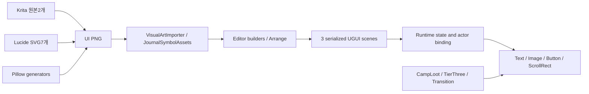

# UI 작성·원본 자산·Unity 통합 경계

감사 재개 시 fetch한 main: `82d19b64de0157d924a05f87ea8ee698f5d6db6b`. 제품 source/data는 이전 `48d6528`과 동일하다. game 변경·Penpot 제작 없이 조사했다.

FACT/CONFIRMED는 현재 source/이번 audit의 실제 화면, SOURCE-INFERRED는 source로 도출한 동작·위험, HISTORICAL은 과거 캡처, PROPOSAL은 제안, FUTURE GOAL은 사용자 차기 목표, UNVERIFIED는 검증 범위 밖이다. 디자인 심각도는 감사 우선순위이며 모든 항목을 출시 차단 코드 버그로 해석하지 않는다.

## 실제 pipeline

주요 제품 UI는 UGUI Canvas/CanvasScaler/GraphicRaycaster/RectTransform과 legacy Text다. UI Toolkit/UXML 기반 제품 UI로 재기술하지 않는다. Editor builder가 scene을 작성한 것이 “게임을 켤 때 모든 UI를 생성한다”는 뜻은 아니다. 런타임 생성은 아래 예외 경로다. 세 scene과671개 control의 상세는 source-manifest/scene-inventory/serialized-controls에 남겼다.

| presentation group | 작성 원본 | runtime truth / bind | 교체 경계 |
|---|---|---|---|
| Home·정적 야영 배경 | [FrontendSceneBuilder.Build](../../client/Assets/Wildfolk/Editor/FrontendSceneBuilder.cs#L19) | HomeScreen·SceneFlow | scene layout/배경 art; save 행동 유지 |
| 공용 sheet/book/action/node | [JournalUiBuilder.Sheet](../../client/Assets/Wildfolk/Editor/JournalUiBuilder.cs#L20); [JournalStyle.Action](../../client/Assets/Wildfolk/Runtime/UI/JournalSkillNode.cs#L21) | JournalSkillNode states | 재질/색/획선/spacing·type; gate/노드 수 유지 |
| Account/Profile/Store/기록 | [AccountUiBuilder.Build](../../client/Assets/Wildfolk/Editor/AccountUiBuilder.cs#L13); [EconomyUiBuilder.Build](../../client/Assets/Wildfolk/Editor/EconomyUiBuilder.cs#L13); [StoreUiBuilder.Build](../../client/Assets/Wildfolk/Editor/StoreUiBuilder.cs#L13) | Account/Economy/StoreService | view와 presenter 상태 유지; 서버 계약 변경 금지 |
| HUD/touch/slot | [GameplayHudBuilder.Build](../../client/Assets/Wildfolk/Editor/GameplayHudBuilder.cs#L13); [GameplayUiFactory.Button](../../client/Assets/Wildfolk/Editor/GameplayUiFactory.cs#L41) | Session·Joystick·HoldInput·ProfileHud | tap/hold/multitouch/cancel 의미 유지 |
| Inventory/Chest/Split | [InventoryUiBuilder.Arrange](../../client/Assets/Wildfolk/Editor/InventoryUiBuilder.cs#L79); [ChestUiBuilder.Arrange](../../client/Assets/Wildfolk/Editor/ChestUiBuilder.cs#L36); [StackSplitUiBuilder.Arrange](../../client/Assets/Wildfolk/Editor/StackSplitUiBuilder.cs#L31) | InventoryModel/Drag/Equipment/Host revisions | 36/9/24/36 및 destination 성공 전 원본 보존 |
| Craft/queue/upgrade | [CraftingUiBuilder.Arrange](../../client/Assets/Wildfolk/Editor/CraftingUiBuilder.cs#L56) | PlayerCrafting/StationProcessing | item/recipe/queue/tier gate를 source에서 바인딩 |
| Class/Common growth | [JournalContentAssets](../../client/Assets/Wildfolk/Editor/JournalContentAssets.cs#L9); [CharacterUiBuilder.BuildInformation](../../client/Assets/Wildfolk/Editor/CharacterUiBuilder.cs#L43) | ClassProfiles/PlayerProgression | world growth와 profile class를 별개로 유지 |
| 수리·해체 | [MaintenanceUiBuilder.Arrange](../../client/Assets/Wildfolk/Editor/MaintenanceUiBuilder.cs#L8) | ClassHud/PlayerBuildingService | 정확한 cost/refund/hold/release/context |
| Death/Downed | [DeathUiBuilder.Build](../../client/Assets/Wildfolk/Editor/DeathUiBuilder.cs#L8) | PlayerDeath/Wallet/NetworkPlayer | 무료 Home 및 reserve/commit/late callback 보존 |
| MP local UI | [NetworkInventoryUiBuilder](../../client/Assets/Wildfolk/Editor/NetworkInventoryUiBuilder.cs#L7); [MultiplayerUiBuilder.Build](../../client/Assets/Wildfolk/Editor/MultiplayerUiBuilder.cs#L10) | [NetworkInventoryUi.Bind](../../client/Assets/Wildfolk/Runtime/Networking/NetworkInventoryUi.cs#L13) | scene callback을 런타임 local actor에 교체함. 복사된 오래된 listener 사용 금지 |
| Runtime-only exceptions | [CampLootPanel.Build](../../client/Assets/Wildfolk/Runtime/UI/CampLootPanel.cs#L24); [TierThreeHud.Build](../../client/Assets/Wildfolk/Runtime/UI/TierThreeHud.cs#L36); [TransitionOverlay.Create](../../client/Assets/Wildfolk/Runtime/UI/TransitionOverlay.cs#L16) | supplies/turret/navigation/real scene·network phase | 새 디자인 통합 때 scene builder만 고쳐서는 반영 안 됨 |
| Feedback catch icon | [PlayerFeedback.Awake](../../client/Assets/Wildfolk/Runtime/UI/PlayerFeedback.cs#L17) | action event + 짧은 transient state | toast policy와 icon layout; reward truth 아님 |

## 원본·asset inventory

| 자산/원본 | 현재 사용/생성 | 재사용 판단·주의 |
|---|---|---|
| art-source/LowfireWordmark.kra | Art/lowfire_wordmark.png | 편집 원본·merged preview 확인. 브랜드 후보; 사용자 승인 없이 재제작 안 함 |
| art-source/LowfireFieldJournal.kra | Art/lowfire_journal.png | 큰 제본 bitmap. 모든 화면에 재사용할 필요 없음. 현재 9slice panel과 다름 |
| docs/design/lowfire-home-a.svg,b.svg,c.svg | 옛 Penpot Home3안의 portable SVG | 역사 concept; 전체 UI screen/component kit가 아님. 새 Penpot 연결/보드 없음 |
| art-source/navigation-symbols/*.svg + sources.json | Lucide7개→ui_play/users/settings/profile/award/calendar/next PNG | 실제 source commit/hash·ISC/Feather 고지 유지. UI tint 적용 |
| generate_journal_icons.py | node/focus/seal/lock/Gold/Gem 도형 | 자체 Pillow; Crystal과 PremiumGem 분리 |
| generate_journal_symbols.py + JournalSymbolAssets | 11×6 atlas,128cell66개(Class6/common6/classnodes54) | sprite names/IDs·slice metadata 유지. 기존 개별 world symbol과 다른 사용처 |
| generate_class_icons.py | class6 PNG | 자체 기하 원본, journal atlas와 목적 차이 명시 |
| generate_visual_assets.py | 기본 sprite·ground/panel/controls 등, ecology 확장 | 실행하면 다른 art까지 덮을 수 있음. 이번 실행 안 함 |
| generate_metal/world/exploration/content/tier_three/creature_loot/medicine/food/fishing/sidegrade/boss_art.py | 각 item/world/creature/POI/보스 art | 현재 alpha presentation; UI redesign을 이유로 재생성 금지 |
| NotoSansKR.ttf / NotoSansKR-OFL.txt | Resources font, legacy Text | 현재 EN/KO 실제 font; 게임 문자열을 PNG에 굽지 않음 |
| panel.png + .meta | 18px 사방 border, Image.Type.Sliced | 실제 일반 panel 9slice 대상. lowfire_journal도 자동 9slice라고 가정하면 안 됨 |
| Art/WorldSprite.mat | Universal Render Pipeline/2D/Sprite-Lit-Default | MCP 실제 shader 조회. world lighting 영향; UGUI default material과 구분 |
| UI material | 보통 m_Material=0 UGUI default | 새 shader/mask는 성능·색·Canvas batching 검증 필요 |
| WorldSpriteRenderer/URP lighting | 월드/아이템/portrait layers | GUI vector export로 actor pose/방향/장비 renderer가 자동 대체되지 않음 |
| AudioRuntime/AudioButton/Lowfire mixer | 기존 버튼 click/back·action cue | 새 view에서도 binding 유지; click음은 reward 성공 receipt가 아님 |

자산hash/KRA ZIP metadata는 source-art-index.json. 일반 Importer는 Sprite Single/PPU100(ground예외)/Bilinear/Clamp/no mipmap/CompressedHQ/4096 상한 경로를 갖는다. journal atlas는 Multiple/FullRect/Uncompressed/2048 상한/NPOT None인 별도 importer다. 현재 파일 meta가 builder의 모든 기본과 같다고 가정하지 않는다. import 코드는 이번에 실행하지 않았다.

## Penpot export ≠ 작동하는 Unity UI

| 항목 | 인계해야 할 값 | Unity에서 남는 작업 |
|---|---|---|
| SVG | 원본 viewBox/획선/실루엣/의미 ID/license | 프로젝트에 vector 렌더 지원이 있다고 가정 금지; 현재처럼 raster PNG 또는 별도 승인 dependency |
| PNG | scale·transparent padding·logical bounds·pivot | Sprite import/PPU/filter/압축/atlas·reference rebinding |
| Panels | 9slice border와 늘어나도 되는 중앙/보존 corner | Image.Type.Sliced·border metadata·text inset |
| Icons | role/name/selected/disabled/pressed tint | 상태 binding·hit rect·raycastTarget |
| Type | role/weight/lineheight/한영 길이 budget | live LocalizedLabel/L.Format; Glyph·TextGenerator·pixel snapping 검수 |
| Layout | anchor/constraints/min-size/insets/scroll content | RectTransform/Layouts/Mask/SafeArea 적용, 모든 content index 보존 |
| Motion | duration/easing/reduced-motion 대안/취소시 종료 | 기존 state lifetime과 input lock에 맞는 tween/animation; no fake loading |
| State | normal/pressed/disabled/busy/success/error | 실제 service/Host result가 상태를 바꿈; client optimistic grant 금지 |
| Performance | atlas 분할/texture budget/scrim alpha | overdraw·Canvas rebuild·GC·device GPU/font memory 측정 |

## 기존 구조를 유지하며 대체하기

PROPOSAL: 우선 presentation hierarchy, tokens, image/type/spacing을 교체하되 controller/service·SerializeField 참조·UnityEvent·pointer adapter를 재연결한다. generated scene만 손수 고치고 canonical builder를 그대로 두면 다음 authoring에서 덮어써진다. 후속 통합은 각 canonical builder/Arrange와 runtime-only helper를 함께 정리하는 명시 범위가 필요하다. 이번 audit에는 그 변경을 하지 않았다.

Item slot/보상 tile/button/tree node는 재사용 component 후보다. 다만 현재 의미가 다르다: 보상 tile은 비조작, slot은 pointer/drag/drop, primary는 press hold, confirmation은 transaction 시작 전 확인이다. 동일 사각형 prefab 하나로 강제로 통합하면 기능을 잃는다. 새 framework나 theme override layer를 누적하지 않는다.

월드 art replacement는 별도 승인·source ownership 패스다. 캐릭터/보스는 여러 SpriteRenderer와 pose/anchor/facing/hit/death/pooling을 공유하므로 새 art가 곧 animation 완성이라는 뜻이 아니다. 이전 facing correction은 유지하고 임의 REBUILD/rollback하지 않았다.

## Runtime/UI51개 ownership 대조

상위 표면에 포함한 adapter/helper도 누락하지 않았다. 실제 개별 source hash/method/binding은 source-manifest가 정본이다. Transition/Camp/TierThree는 runtime 생성 경로이며 scene-only 열거에 의존하지 않는다.

| source | 화면/계열 | 교체 경계 |
|---|---|---|
| [AccountProfileScreen](../../client/Assets/Wildfolk/Runtime/UI/AccountProfileScreen.cs#L6) | A02/A03/A04/A05/A06 | view/binding/helper 계약. controller/service 권위·input/locale 수명과 분리하여 외관 대체 |
| [AttackIconView](../../client/Assets/Wildfolk/Runtime/UI/AttackIconView.cs#L6) | G03 | view/binding/helper 계약. controller/service 권위·input/locale 수명과 분리하여 외관 대체 |
| [BossHud](../../client/Assets/Wildfolk/Runtime/UI/BossHud.cs#L6) | G09 | view/binding/helper 계약. controller/service 권위·input/locale 수명과 분리하여 외관 대체 |
| [CampLootPanel](../../client/Assets/Wildfolk/Runtime/UI/CampLootPanel.cs#L5) | I07 | view/binding/helper 계약. controller/service 권위·input/locale 수명과 분리하여 외관 대체 |
| [CharacterScreen](../../client/Assets/Wildfolk/Runtime/UI/CharacterScreen.cs#L5) | P04 | view/binding/helper 계약. controller/service 권위·input/locale 수명과 분리하여 외관 대체 |
| [ChestPanel](../../client/Assets/Wildfolk/Runtime/UI/ChestPanel.cs#L5) | I06 | view/binding/helper 계약. controller/service 권위·input/locale 수명과 분리하여 외관 대체 |
| [ClassHoldButton](../../client/Assets/Wildfolk/Runtime/UI/ClassHoldButton.cs#L7) | G05–G08 | view/binding/helper 계약. controller/service 권위·input/locale 수명과 분리하여 외관 대체 |
| [ClassHud](../../client/Assets/Wildfolk/Runtime/UI/ClassHud.cs#L6) | G05/G06/G07/G08 | view/binding/helper 계약. controller/service 권위·input/locale 수명과 분리하여 외관 대체 |
| [ClassLobbyScreen](../../client/Assets/Wildfolk/Runtime/UI/ClassLobbyScreen.cs#L6) | P01/P02/P03 | view/binding/helper 계약. controller/service 권위·input/locale 수명과 분리하여 외관 대체 |
| [ClassWorldFeedback](../../client/Assets/Wildfolk/Runtime/UI/ClassWorldFeedback.cs#L4) | G05/G11 | view/binding/helper 계약. controller/service 권위·input/locale 수명과 분리하여 외관 대체 |
| [ControlSizeLayout](../../client/Assets/Wildfolk/Runtime/UI/ControlSizeLayout.cs#L4) | G02–G08 | view/binding/helper 계약. controller/service 권위·input/locale 수명과 분리하여 외관 대체 |
| [CraftingPanel](../../client/Assets/Wildfolk/Runtime/UI/CraftingPanel.cs#L6) | C01/C02/C03 | view/binding/helper 계약. controller/service 권위·input/locale 수명과 분리하여 외관 대체 |
| [DeathHud](../../client/Assets/Wildfolk/Runtime/UI/DeathHud.cs#L5) | D01/D02/D03 | view/binding/helper 계약. controller/service 권위·input/locale 수명과 분리하여 외관 대체 |
| [DirectionDrag](../../client/Assets/Wildfolk/Runtime/UI/DirectionDrag.cs#L6) | G05/C08 | view/binding/helper 계약. controller/service 권위·input/locale 수명과 분리하여 외관 대체 |
| [EconomyScreen](../../client/Assets/Wildfolk/Runtime/UI/EconomyScreen.cs#L7) | A01/E01/E02/E03/E04/E07 | view/binding/helper 계약. controller/service 권위·input/locale 수명과 분리하여 외관 대체 |
| [EquipmentSlotDrag](../../client/Assets/Wildfolk/Runtime/UI/EquipmentSlotDrag.cs#L5) | I02/I05 | view/binding/helper 계약. controller/service 권위·input/locale 수명과 분리하여 외관 대체 |
| [GameplayHud](../../client/Assets/Wildfolk/Runtime/UI/GameplayHud.cs#L6) | G01 | view/binding/helper 계약. controller/service 권위·input/locale 수명과 분리하여 외관 대체 |
| [GameplayUiLayers](../../client/Assets/Wildfolk/Runtime/UI/GameplayUiLayers.cs#L4) | G01/all gameplay modals | view/binding/helper 계약. controller/service 권위·input/locale 수명과 분리하여 외관 대체 |
| [HomeScreen](../../client/Assets/Wildfolk/Runtime/UI/HomeScreen.cs#L8) | H01/H02 | view/binding/helper 계약. controller/service 권위·input/locale 수명과 분리하여 외관 대체 |
| [HotbarView](../../client/Assets/Wildfolk/Runtime/UI/HotbarView.cs#L5) | G01/I01 | view/binding/helper 계약. controller/service 권위·input/locale 수명과 분리하여 외관 대체 |
| [InteractButtonView](../../client/Assets/Wildfolk/Runtime/UI/InteractButtonView.cs#L6) | G04 | view/binding/helper 계약. controller/service 권위·input/locale 수명과 분리하여 외관 대체 |
| [InventoryDragController](../../client/Assets/Wildfolk/Runtime/UI/InventoryDragController.cs#L7) | I05 | view/binding/helper 계약. controller/service 권위·input/locale 수명과 분리하여 외관 대체 |
| [InventoryDropZone](../../client/Assets/Wildfolk/Runtime/UI/InventoryDropZone.cs#L5) | I05 | view/binding/helper 계약. controller/service 권위·input/locale 수명과 분리하여 외관 대체 |
| [InventoryEquipment](../../client/Assets/Wildfolk/Runtime/UI/InventoryEquipment.cs#L5) | I02 | view/binding/helper 계약. controller/service 권위·input/locale 수명과 분리하여 외관 대체 |
| [InventoryPanel](../../client/Assets/Wildfolk/Runtime/UI/InventoryPanel.cs#L6) | I01 | view/binding/helper 계약. controller/service 권위·input/locale 수명과 분리하여 외관 대체 |
| [InventorySlotDrag](../../client/Assets/Wildfolk/Runtime/UI/InventorySlotDrag.cs#L6) | I01/I06 | view/binding/helper 계약. controller/service 권위·input/locale 수명과 분리하여 외관 대체 |
| [InventorySlotView](../../client/Assets/Wildfolk/Runtime/UI/InventorySlotView.cs#L6) | I01/I06 | view/binding/helper 계약. controller/service 권위·input/locale 수명과 분리하여 외관 대체 |
| [ItemStats](../../client/Assets/Wildfolk/Runtime/UI/ItemStats.cs#L3) | I01/C01 | view/binding/helper 계약. controller/service 권위·input/locale 수명과 분리하여 외관 대체 |
| [JournalSkillNode](../../client/Assets/Wildfolk/Runtime/UI/JournalSkillNode.cs#L31) | P02/P05 | view/binding/helper 계약. controller/service 권위·input/locale 수명과 분리하여 외관 대체 |
| [Localization](../../client/Assets/Wildfolk/Runtime/UI/Localization.cs#L1) | all EN/KO | view/binding/helper 계약. controller/service 권위·input/locale 수명과 분리하여 외관 대체 |
| [LocalizedLabel](../../client/Assets/Wildfolk/Runtime/UI/LocalizedLabel.cs#L6) | all static labels | view/binding/helper 계약. controller/service 권위·input/locale 수명과 분리하여 외관 대체 |
| [MealHud](../../client/Assets/Wildfolk/Runtime/UI/MealHud.cs#L5) | G12 | view/binding/helper 계약. controller/service 권위·input/locale 수명과 분리하여 외관 대체 |
| [MedicineHud](../../client/Assets/Wildfolk/Runtime/UI/MedicineHud.cs#L5) | G07 | view/binding/helper 계약. controller/service 권위·input/locale 수명과 분리하여 외관 대체 |
| [ModalLayout](../../client/Assets/Wildfolk/Runtime/UI/ModalLayout.cs#L4) | all fixed panels | view/binding/helper 계약. controller/service 권위·input/locale 수명과 분리하여 외관 대체 |
| [NavigationHud](../../client/Assets/Wildfolk/Runtime/UI/NavigationHud.cs#L5) | G10 | view/binding/helper 계약. controller/service 권위·input/locale 수명과 분리하여 외관 대체 |
| [PauseMenu](../../client/Assets/Wildfolk/Runtime/UI/PauseMenu.cs#L4) | S01 | view/binding/helper 계약. controller/service 권위·input/locale 수명과 분리하여 외관 대체 |
| [PlayerFeedback](../../client/Assets/Wildfolk/Runtime/UI/PlayerFeedback.cs#L5) | G11 | view/binding/helper 계약. controller/service 권위·input/locale 수명과 분리하여 외관 대체 |
| [PlayerPortrait](../../client/Assets/Wildfolk/Runtime/UI/PlayerPortrait.cs#L5) | I01/P04 | view/binding/helper 계약. controller/service 권위·input/locale 수명과 분리하여 외관 대체 |
| [PlayerRescueMarker](../../client/Assets/Wildfolk/Runtime/UI/PlayerRescueMarker.cs#L5) | D02/D03 | view/binding/helper 계약. controller/service 권위·input/locale 수명과 분리하여 외관 대체 |
| [PlayerStaminaHud](../../client/Assets/Wildfolk/Runtime/UI/PlayerStaminaHud.cs#L4) | G01 | view/binding/helper 계약. controller/service 권위·input/locale 수명과 분리하여 외관 대체 |
| [ProfileHud](../../client/Assets/Wildfolk/Runtime/UI/ProfileHud.cs#L5) | G01/MP wallet | view/binding/helper 계약. controller/service 권위·input/locale 수명과 분리하여 외관 대체 |
| [RecipeCardView](../../client/Assets/Wildfolk/Runtime/UI/RecipeCardView.cs#L6) | C01 | view/binding/helper 계약. controller/service 권위·input/locale 수명과 분리하여 외관 대체 |
| [SettingsPanel](../../client/Assets/Wildfolk/Runtime/UI/SettingsPanel.cs#L5) | H03/S02 | view/binding/helper 계약. controller/service 권위·input/locale 수명과 분리하여 외관 대체 |
| [SkillTreeScreen](../../client/Assets/Wildfolk/Runtime/UI/SkillTreeScreen.cs#L5) | P05 | view/binding/helper 계약. controller/service 권위·input/locale 수명과 분리하여 외관 대체 |
| [StackSplitPanel](../../client/Assets/Wildfolk/Runtime/UI/StackSplitPanel.cs#L5) | I03/I04 | view/binding/helper 계약. controller/service 권위·input/locale 수명과 분리하여 외관 대체 |
| [StaminaArc](../../client/Assets/Wildfolk/Runtime/UI/StaminaArc.cs#L6) | G01/G03 | view/binding/helper 계약. controller/service 권위·input/locale 수명과 분리하여 외관 대체 |
| [StoreScreen](../../client/Assets/Wildfolk/Runtime/UI/StoreScreen.cs#L7) | E05/E06 | view/binding/helper 계약. controller/service 권위·input/locale 수명과 분리하여 외관 대체 |
| [SurvivalHud](../../client/Assets/Wildfolk/Runtime/UI/SurvivalHud.cs#L5) | G01 | view/binding/helper 계약. controller/service 권위·input/locale 수명과 분리하여 외관 대체 |
| [TierThreeHud](../../client/Assets/Wildfolk/Runtime/UI/TierThreeHud.cs#L7) | C05/C06/C07/C08 | view/binding/helper 계약. controller/service 권위·input/locale 수명과 분리하여 외관 대체 |
| [TimeHud](../../client/Assets/Wildfolk/Runtime/UI/TimeHud.cs#L5) | G01 | view/binding/helper 계약. controller/service 권위·input/locale 수명과 분리하여 외관 대체 |
| [TransitionOverlay](../../client/Assets/Wildfolk/Runtime/UI/TransitionOverlay.cs#L10) | T01 | view/binding/helper 계약. controller/service 권위·input/locale 수명과 분리하여 외관 대체 |
