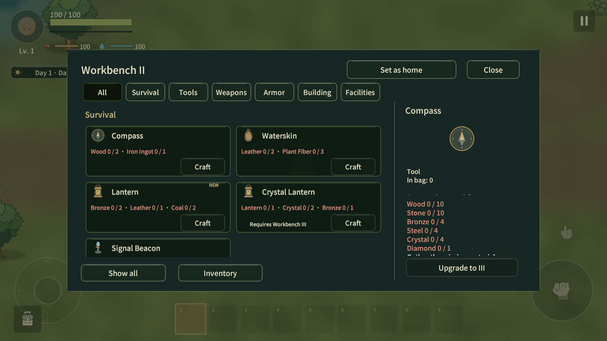
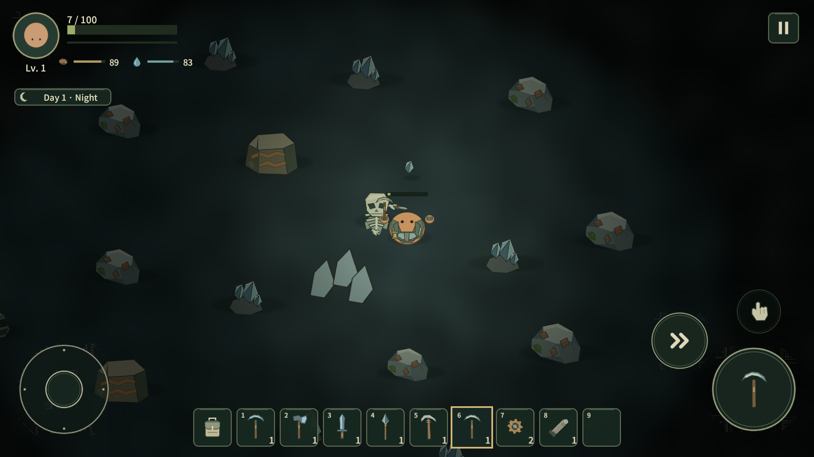
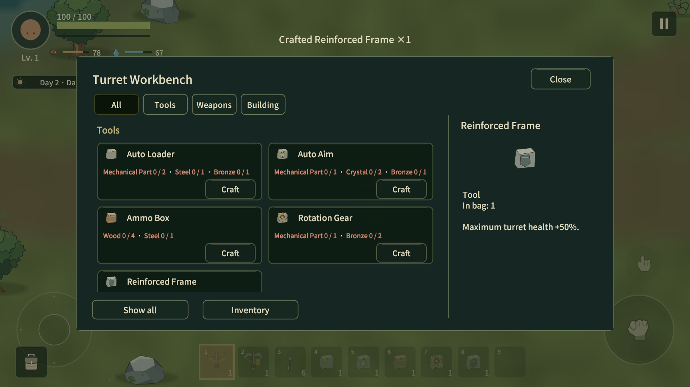
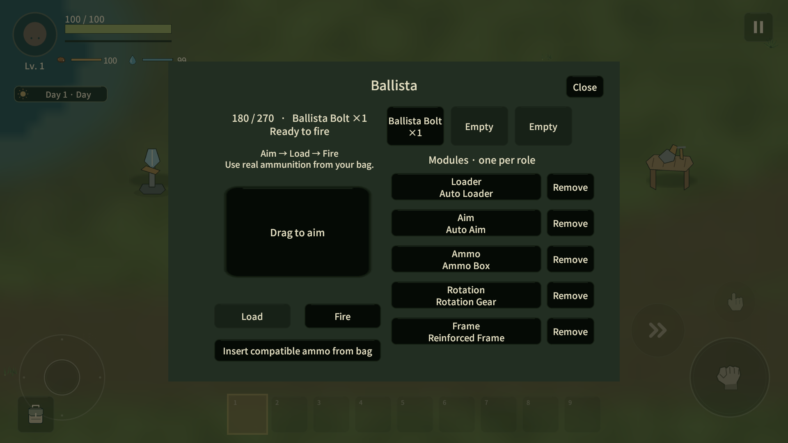
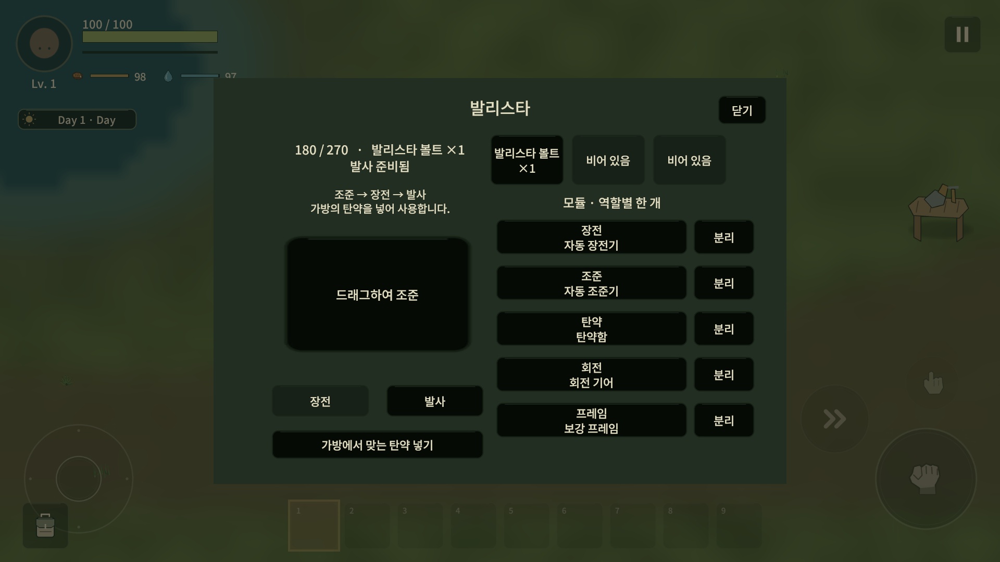
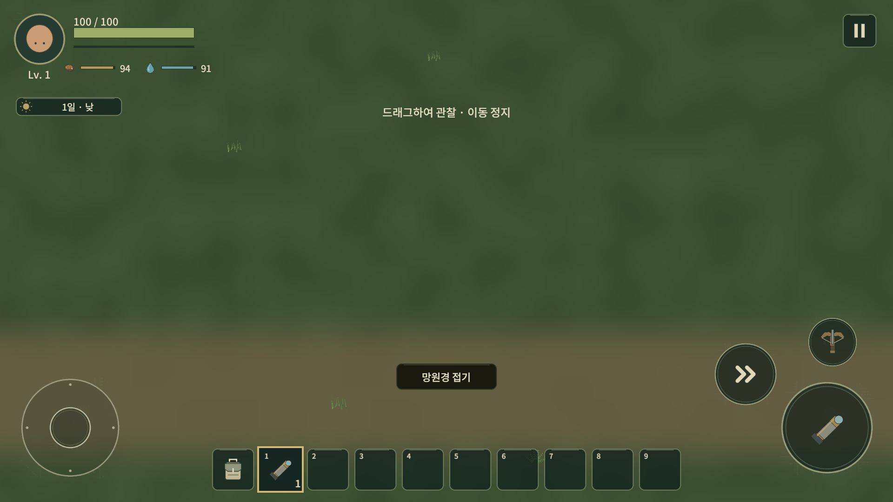
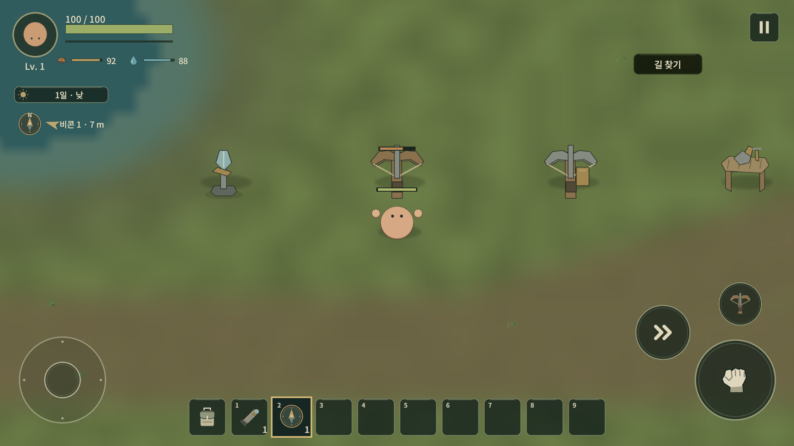

# Workbench III 검수 · 2026-10-19

판정 **A — Workbench III alpha 구조 범위 구현 완료**. 다음 Defense Objective 또는 통합 QA로 진행할 수 있다. 실제 기기 성능·4인 Relay·장시간 경제·재미 합격을 뜻하지 않는다. 시작 main `821e493d637e2f25ba94ab843cc9737539cb9ee5`; commit/push/최종 원격 일치는 완료 보고에서 확인한다.

## 검사: 자동·정적

`automated-results.json`은 실제 XML의 실행 시각/케이스 이름/결과를 보존한다. 최초 전체 EditMode142건은130통과/12실패, 선택 PlayMode19건은9통과/10실패였다. 구 tier/count 기대, 새 resource kind, Unity inline JSON의 null→빈 객체 복원, fixture의 열린 제작창 재진입, Host 시작 대기와 UDP 포트 충돌을 교정하고 실패/연관 케이스만 재실행했다.

최종 관련 Edit20/20, 추가 재개 Edit12/12, 최종 관련 Play6/8 후 남은2건+신규2건 재개 Play4/4 통과. 재개 Edit 실행17.083초, Play98.173초이며 Editor 초기화/종료를 포함한 프로세스 시간68.27/137.59초와 구분한다. 마지막 투사체 경계 수정 후 관련 Play4/4도 통과했다(검사20.892초/프로세스74.50초). 전체 실행 기록의 서로 다른 케이스171개에서 마지막 관측 실패0개다. **현재 전체 Play suite를 한 번에 통과했다는 뜻이 아니다.**

재개 Play에는 실제 보석 재생/활성 청크 불변, 마지막 장전 탄약 회수 시 Ready 해제, III 업그레이드의 제작창 바인딩, Host 저장/재Host의 탄약·모듈·HP·비콘·개인 Navigation 보존이 포함된다. 재개 Edit는 seed9472026/42/1/20261019에서 구 source ID/위치 보존과 새 deep 공급 검증을 포함한다.

최종 코드 검토에서 포탑 투사체 경계가 NetworkCreatureWorld에만 묶인 것을 발견해, 발사 시 포탑의 실제 WorldGenerator를 캐시하도록 수정했다. 싱글과 Host 모두 비활성 simulation chunk에서 반환한다. 새 회귀 검사는 실제 발사된 탄을 비활성 좌표로 옮겨 다음 Update에서 반환됨을 확인하며 기존 수동 hit/자동 LOS·탄약/휴면 검사도 함께 통과했다. 매 frame 월드 검색은 추가하지 않았다.

ProjectDataValidator 오류0, 컴파일 오류0, Python 정적 검사 통과: Landscape/소스 구조/1143 unique asset GUID/스프라이트 참조/금지 화면 문구. 사용자 실제 world/backup의 SHA256과 nanosecond mtime은 전후 동일하며 `user-save-protection.json`을 따른다.

## 테스트: 실제 Unity MCP Play / 1920×1080

모든 Play는 격리 QA profile/save/world다. Windows 조작/창 포커스 호출은 없었다. 아래는 Editor의 실제 런타임 command 및 UI callback 결과다.

- III: 부족 재료 거절,6종 have/need 비용, 업그레이드 버튼, 신설 제작 카드. 개인 Diamond6종과 technology 제작 callback, Steel 재료 소모, Part2 출력, Diamond armor/Crystal Lantern 장착과 검 동시 사용.
- 별도 최종 격리 Play에서 Diamond Sword 실제 공격52피해(표적1000→948), Diamond Pickaxe로 Crystal77피해(130→53)를 확인했다. 표적/광물 위치는 fixture지만 실제 PlayerCombat 공격 경로다.
- Crystal/Diamond: 원래 생성된 지하 source로 teleport, Iron Pickaxe 거절, Steel 공격 명령 채굴, 수율6/3. 지역 고갈·시간 가속·플레이어 후퇴 fixture 후 새 ID/좌표 회복. Diamond 원래 `(26266.88,-94.26)`과 다른 `(26240.82,-75.63)`의 `p1` 확인.
- 보석 회복 수정: 기존 clear radius5에서 유효 환경 후보1409개 중 실제 spawn0개였다. 새 보석만 radius2로 줄여 회복을 확인했다. 기존 광물/초기 source spacing/회복 주기·목표·채집자리 제외 규칙은 유지한다.
- 산업 보상: Abandoned Workshop `deep:0:2`에 teleport 후 청크가 생성한 실제 산업 chest의 Part1/CrossbowBolt6/BallistaBolt2 확인. 일반 chest나 자연 바닥 공급을 추가하지 않았다.
- Telescope: use 진입, 방향 입력·실제 drag handler, move/dash/interact 제한, damage 종료, 접기 버튼, 원거리 지형 표시, simulation wanted 불변, 표시 전용2개와 종료3초 후0개 확인. 원거리 AI/자원 생성은 호출하지 않는다. 표시 전용 풍경에는 지형·소수 풀·정적 POI만 있어 일반 플레이보다 성기다.
- Beacon: 기본 추적 off, 단일 대상 선택/방향/거리,20개 설치 상태의 단일 HUD, Off 숨김, UI 회수의 item 반환/registry 제거. SP 저장/로드와 Host 재접속의 팀 비콘/개인 선택 보존.
- 설치: 최종 SP에서 기존 PlayerPlacement.TryPlace 경로로 Beacon/Ballista/Repeater/TurretWorkbench 각각 성공·item1소모, 즉시 재시도 거절. 기존 collision/거리 검증 사용.
- Turret Workbench: 실제 station 열기, 두 포탑·전용탄·다섯 모듈 제작 callback.
- Ballista: 실제 탄약 삽입/장전/조준/발사, duplicate cooldown 거절, 실제 projectile hit1000→938. 다섯 module,3slots,maxHP270. 자동17발과 유한 탄약 소모.
- Repeater: Crossbow Bolt 호환, LOS 벽에서 사격0, 벽 제거 후3발/대상1000→952, 아군1000 유지, 빈 탄약 사격 중단. 다른 Ballista가 섞였던 초기 fixture는 비활성화한 뒤 분리 검수했다.
- Chunk sleep: 탄약9개로 멀리 이동,100게임초 동안 dormant cargo9 유지, 복귀 후 모듈·탄약 복원. 오프라인 전투를 진행하지 않는다.
- Host 실제 save/rehost: ammo27, HP163/max270,5모듈, 비콘, 선택 Navigation/ID 일치 확인. 단일 로컬 Host이며 원격 클라이언트 검수를 대신하지 않는다.
- UI: 한국어/영어 모듈 이름 두 줄, 닫기, 불투명 modal, 빈 ammo와 Ready 상태 확인. 최초 카드 누락/6개 비용 잘림/모달 초기화 예외/가방 겹침/닫기 번역키/모듈 두 번째 줄 잘림을 교정했다.

`play.tsv`는 초기에 중단한 guided coroutine 원본이다. 그 로그의 fixture 실패를 삭제하거나 전체 성공으로 바꾸지 않았다. 후속 수동 MCP 결과와 자동 검사로 보완했으며 위 항목을 최종 관측으로 사용한다.

## Natural / fixture / 미검수

일반 채집/제작/공격/UI 코드를 실행했지만 teleport, 재료 지급, 직접 설치 fixture, 표적 Health1000, 게임 시간 가속을 사용했다. 자연 진행으로 III에 도달한 시간은 측정하지 않았다. 최초 source/산업 chest는 실제 seed 월드 생성 결과다. 원격4인/Relay/재Join, 모바일 터치/60fps, 장시간 전투·발사 비용·희소성·재미는 미검수다. Ballista 관통/추가 적/IV–VI/Defense Objective는 구현하지 않았다.

기존 generation1/2에 새 geology/POI를 소급 생성하지 않는다. 기존 월드를 파괴하지 않는 대신 자연 III 탐험은 새 generation3 월드가 필요하다. 현재 무료 영구 조명의 경제와 자동 포탑 장기 유지비는 이후 사용자 밸런스 검수 대상이다.

## 성능 경계

공용 .05초 scheduler/한 tick최대16포탑, 근처 collider64/LOS32, server heading최대10Hz, 표시 전용 root최대9/terrain LRU24/row sampler2.5ms 목표를 사용한다. root 생성/지형 텍스처 upload와 다수 포탑의 물리 검색 비용은 실제 기기에서 측정해야 한다. 첫 접근성 validator가 넓은 surface flood를 반복하던 경로를 줄였으며, 별도 Editor 환경의 생성25.726초와 실제 Host3.658초 관측은 동일 조건 벤치마크가 아니다.

## 화면 증거

