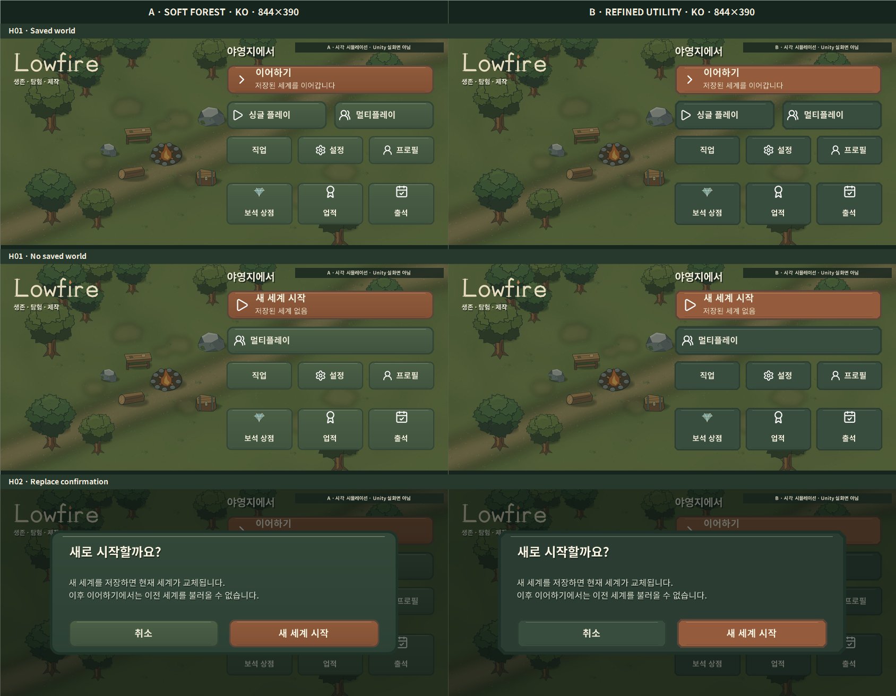
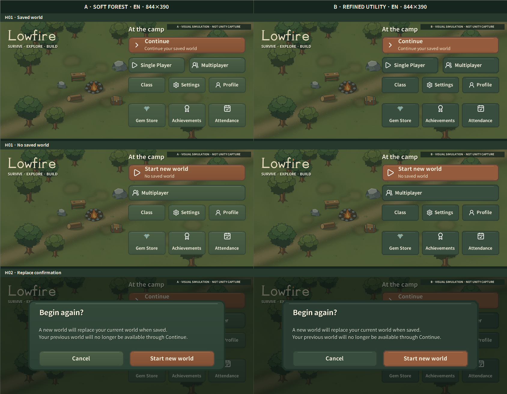
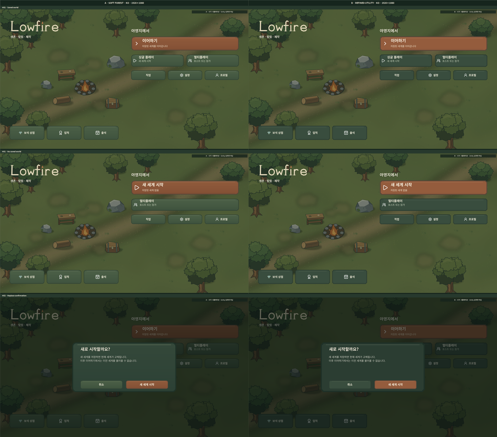

# Phase 2A.2 Visual Review

## Pair review

Each side-by-side sheet uses the same reconstructed Lowfire world background, content, state, and viewport. In each row A is left and B is right. The screens are labeled simulations, not Unity captures.

### Mobile landscape — 844×390

### Desktop reference — 1920×1080

See [1280×720 Korean](previews/comparisons/ab-ko-1280x720.png) and [1280×720 English](previews/comparisons/ab-en-1280x720.png), plus all comparison sheets in [SCREEN_INDEX.md](SCREEN_INDEX.md).

## Direction A — Soft Forest

**Strengths:** rounded silhouettes and a low-key warm highlight sit more naturally beside the existing rounded tree canopies, campfire, and handwritten Lowfire wordmark. The thinner edge and restrained gradient reduce the heavy “outlined card” look. The muted sage body groups the main and secondary actions without relying on ornate trim.

**Weaknesses:** on the darkest parts of the reconstructed background, the low-contrast surface edge can recede. It depends on the subtle highlight and spacing to separate adjacent buttons. It feels calm and cohesive, but still reads as a clean vector UI study rather than hand-painted world art.

## Direction B — Refined Utility

**Strengths:** the shallow chamfers, flat faces, and consistent inset rules give each control a crisp boundary. Selected, pressed, and disabled states remain easy to distinguish at small size. It is the more visibly structured option.

**Weaknesses:** its repeated clipped corners and stronger outline retain more of the geometric weight that caused the original world/UI mismatch. Against the softer background, it reads slightly more like a generic utility HUD. This is clearer, but less integrated.

## Screen and state checks

- **844×390:** both directions keep all required routes on-screen, with separate button rectangles and no collision. Korean and English H02 warning copy remains inside the frame; Cancel is a quiet secondary action and “Start new world” is the emphasized primary action. The small secondary text is legible in the 1:1 PNG, but should be checked at actual handset viewing distance and Android scaling.
- **1280×720:** the hierarchy has room to breathe and long English labels fit. The composition retains open world area and keeps the logo separate from the action group.
- **1920×1080:** large controls and sparse world framing make the scene easy to read. It has generous empty space by design; this does not demonstrate a live gameplay background at this aspect ratio.
- **H01 saved/no-save:** Continue is shown only in the saved state. The no-save primary becomes “Start new world”; Multiplayer remains available. This follows the current `HomeScreen` save-state rule.
- **H02:** warning explains that saving a new world replaces the current one and the former world will not remain available through Continue. Cancel is secondary; the destructive action is primary. H02 is a visual simulation, not a tested save flow.
- **KO/EN:** all required main actions are present in both locales and fit the three target sizes. The primary labels and confirmation text preserve the meanings in `Localization.json`; short helper lines are explanatory preview copy. Those helper lines are not new gameplay features.
- **Surface state study:** the comparison shows primary/secondary defaults, selected, pressed, and disabled variants. The disabled treatment is distinct, not hidden. [Open the A/B state sheet](previews/comparisons/ab-button-states.png).

## Recommendation

For the stated objective—bringing UI closer to the existing forest art—I recommend **A — Soft Forest as the next candidate**, while retaining B as a useful legibility/structure reference. A’s soft corners and lighter edge address the art mismatch more directly. This recommendation is not a final approval: the reconstructed sprite background is not Unity color output, and neither direction has been integrated or tested on Android.

## Remaining visual risk

The game’s current sprite set has strong dark outlines, but it does not include painted menu-specific material. The authored surfaces are deliberately simple vector pieces. They improve shape and weight consistency but do not yet achieve a fully hand-illustrated, bespoke production-art finish. The composition preview also cannot establish how overlays behave with a live animated scene, safe areas, system bars, dynamic scaling, or localized font fallback.

## Unity handoff boundary

After the user selects a direction, import only the chosen surfaces, preserve live localized Text and real navigation callbacks, configure candidate 9-slice borders from `art-source/ui-redesign/main-menu-phase2a2-world-harmony-2026-11-05/surface-manifest.json`, and test in the real `MainMenu` scene at the three target aspect ratios. Do not replace the current menu until a Unity build is visually reviewed. This pass makes no Unity changes.
