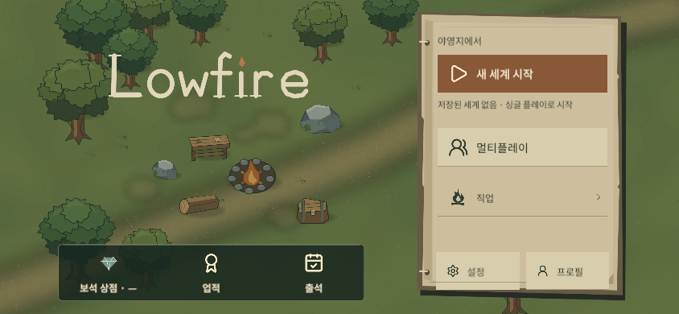

# Actual Unity Capture and World-Art Reconstruction

## Direct Unity evidence

The preserved source captures are from the existing UI audit at `projects/wildfolk/validation/penpot-ui-ux-audit-2026-11-04/evidence/live/`. They show the then-current `MainMenu` scene in Unity Game View, Korean locale, with no saved world. They were visually opened and the source index marks them as accepted live menu evidence.

| Capture | Viewport | Captured (UTC) | SHA-256 |
| --- | ---: | --- | --- |
| [home-v2-ko-1920.png](../penpot-ui-ux-audit-2026-11-04/evidence/live/home-v2-ko-1920.png) | 1920×1080 | 2026-11-04 01:44:44.4506764Z | `b097fa104558e81de6daf18d35fb942aa8328c594bcf3dcff7ebcfe69d4de98c` |
| [home-v2-ko-1280.png](../penpot-ui-ux-audit-2026-11-04/evidence/live/home-v2-ko-1280.png) | 1280×720 | 2026-11-04 01:45:25.2077293Z | `fdd5563673d29d8130032449327448836b53e31f1331284c705ee431dc892e7e` |
| [home-v2-ko-844.png](../penpot-ui-ux-audit-2026-11-04/evidence/live/home-v2-ko-844.png) | 844×390 | 2026-11-04 01:46:05.5535966Z | `e4e1e6b172a94a87f93b55215ffda071ebb3c2cb5d028bc21c53cb5fde9db8d2` |

The actual capture shows the old journal-style panel and logo over the world. It verifies the live composition and the old UI, but it is not a capture of either new direction. The current main-menu builder and `HomeScreen` source hashes still match the recorded latest-main source hashes (see `source-manifest.json`). No Unity editor window was focused or changed for this design study.

## New preview background

The A/B screens use a separate reconstruction, not a crop or retouched copy of the Unity screenshot. The compositor reads the canonical game sprites listed in `source-manifest.json` and reproduces the positions, scales, and ground framing currently declared by `FrontendSceneBuilder.Background()` and its sprite helper. The Phase 2A and 2A.1 generated forest-concept background is not an input.

Because the previews use Windows `System.Drawing`, their lighting, antialiasing, sprite filtering, and color management can differ from the Unity renderer. They are therefore labeled in-image as visual simulations, and should be judged as art-direction candidates rather than pixel-matched Unity output. H01 saved-world and H02 confirmation layouts are reconstructed design states; they were not captured from a live save or click flow.
