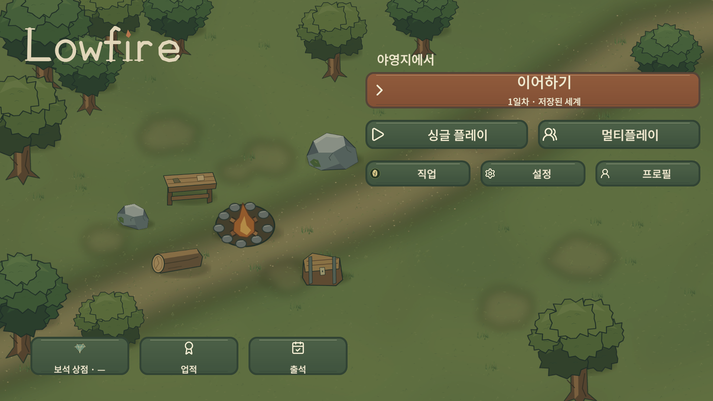
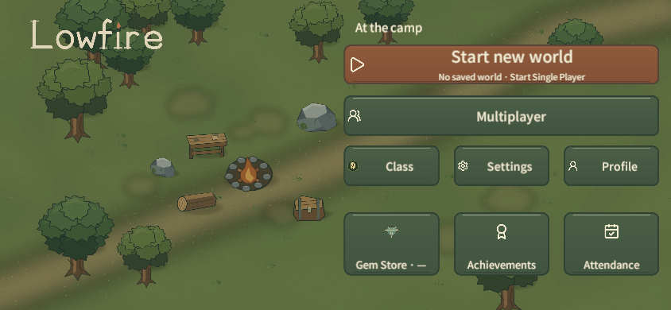
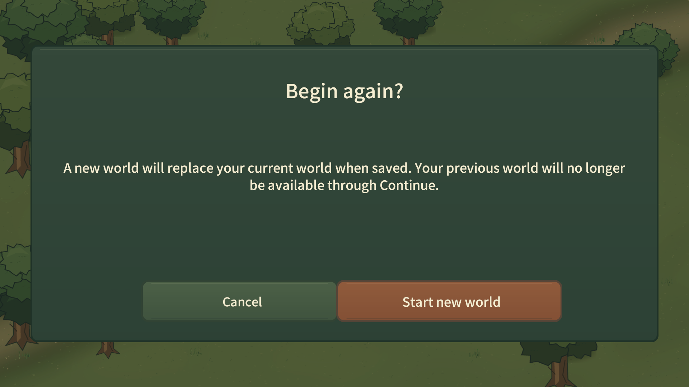

# Lowfire Phase 2B — Main Menu Unity Pilot

Date: 2026-11-06
Unity: 6000.3.19f1 LTS / Universal 2D
Scope: H01 Main Menu and H02 new-world replacement confirmation only

## Source baseline

Before editing, fetched both repositories' `main` branches. The game repo was clean at `b5d20d394470ce7b73e26cf15ebfe0e9c67d6bd8` (`origin/main` matched); `q93503128-a11y/dev-playbook` was at `e022e9e4ff3947fcbd7f5b0237c5905d7c0409c7` (`origin/main` matched). The Phase 1 handoff, 2A/2A.1/2A.2 reviews, and current Home/art source documentation were reviewed before implementation. The approved candidate is A — Soft Forest; its final visual approval remains with the user.

## Implementation

- `FrontendSceneBuilder` now applies the candidate art to the canonical MainMenu scene and exposes an update-in-place authoring command. Fresh scene builds import the same canonical PNG assets.
- `HomeScreen` applies sprite-swap primary/secondary/selected/pressed/disabled states and lays out actions for wide and compact landscape viewports. Text remains live Unity `Text`/`LocalizedLabel` and uses the existing KO/EN localization keys.
- Existing Unity world/camp background, Lowfire wordmark, button GameObjects, navigation callbacks, save rules, and H02 confirmation flow remain. No generated forest mockup replaced the scene background.
- Existing account, class, store, and economy route authoring reapplies the menu presentation after adding its controls. It does not change destination behavior.
- Eight approved A-direction PNG surfaces are copied to `client/Assets/Wildfolk/Art`; Unity `.meta` files preserve the verified import settings and scene GUID references. Original editable SVGs and source manifest remain in `art-source`.
- No Save/Profile/Protocol/Economy/Network/content/balance/runtime gameplay data was changed. HUD and Inventory were not started.

## Actual Unity Game View review

Unity MCP captured the live Game View, not a reconstructed preview. The Unity Editor remained `is_focused=false` during the operations. No Windows mouse/keyboard input and no Editor Window Focus/Show call was used. Each state was checked at 844×390, 1280×720, and 1920×1080 in Korean and English. The PNGs are listed in [SCREEN_INDEX.md](SCREEN_INDEX.md).

H01 no-save changes the primary label to Start new world while retaining Multiplayer and the remaining routes. H01 saved shows Continue, then Single Player and Multiplayer side by side. Class/Settings/Profile and the separate Gem Store/Achievements/Attendance group remain independently visible. The actual camp sprite composition stays visible behind the controls.

H02 shows the replacement warning and separate Cancel/Start new world actions over the existing world background. Long English warning copy wraps within the frame at all three sizes. The compact 844×390 layout keeps both actions on screen.

The 844×390 Unity render shows distinct action surfaces and separated hit rectangles. The smallest confirmation message and the 44px-high H02 buttons still need validation on actual Android hardware at device density and viewing distance.

## Save and interaction safety

The only save used was the isolated QA file `C:\UnityProjects\Wildfolk\Captures\phase2b-main-menu\world-v1.json`. A real Single Player flow created the QA world; Save14/version14 was read through the existing validation rules. H02 was opened with this save present. Invoking Cancel returned to Home; the same QA save remained present and readable as version14. The destructive Start new world callback was not invoked, so this check did not overwrite the QA file. The user's actual save path was never used.

Existing routes and persistent callbacks were retained by the scene builder. Automated PlayMode regression exercised Settings/back navigation, audio bindings, Multiplayer Join cancellation, and transition cleanup. This is not a physical touchscreen test and does not claim that pointer/touch accuracy has passed on an Android device.

## Verification

| Check | Result |
|---|---|
| Unity script compilation after implementation | Passed; no compile errors reported |
| Unity Console error/warning read | 0 entries |
| EditMode `FrontendContractTests.AppStartsAtHomeAndGameplayRemainsEnabled` | Passed |
| EditMode `FrontendContractTests.SaveRulesReferenceGameplayContentAndHomeKeysHaveBothLanguages` | Passed |
| PlayMode `FrontendPlayTests` menu regression (save/cancel/continue, settings, class/profile/meta destinations, idle Home) | 5/5 passed |
| PlayMode `AudioPlayTests.ActualHomeNavigationAndTransitionCancelKeepTheirAudio` | Passed |
| H01 states × locale × viewport Game View captures | 12/12 files, dimensions checked |
| H02 confirmation × locale × viewport Game View captures | 6/6 files, dimensions checked |
| QA save after H02 Cancel | Version14 readable; unchanged by confirmation check |
| Android physical touch, cutout/safe-area, device density | Not tested |
| Full test suite, full player build, Android build | Not run |

One initial EditMode test request was rejected because Unity was still in Play Mode; after programmatically exiting Play Mode without focusing the window, the two EditMode tests passed. The five targeted frontend PlayMode tests and the audio/navigation PlayMode test passed (6/6). The test runner reported `editor_is_focused=false` and zero focus nudges.

## Visual limitations and user review

The button state art is consistent and sliced in Unity, but it remains a clean vector surface study rather than hand-painted world art; Stage 2A.2 documented this limitation and it is not hidden here. H01 uses the existing stylized game camp scene, and the new surfaces fit its muted forest palette. The H02 warning text is readable in 1:1 Game View images, though phone-specific scaling is unverified. Android safe-area, edge-to-edge/system bars, contrast measurements, input on touch hardware, and localization font fallback require a later device review.

This implements the selected visual candidate, not its final visual approval. The user should evaluate the Unity PNGs before any HUD/Inventory redesign or additional UI migration begins.

## Time and usage record

Times below cover only the measured finalization segment after the clock checkpoint; earlier implementation work occurred before that checkpoint and is not included in this interval.

| Work segment | Start (UTC) | End (UTC) | Elapsed |
|---|---|---|---|
| Final QA capture, interaction/test verification, documentation and pre-commit review | 2026-11-06 01:59:23 | 2026-11-06 02:20:42 | 21m 19s |

The tool surface does not expose reliable per-task model-token or billing usage, so no usage quantity is inferred. Unity Test Runner's own durations were EditMode 3.31s, Frontend PlayMode 66.10s, and Audio PlayMode 2.29s (test-run durations, excluding editor start/stop overhead).
